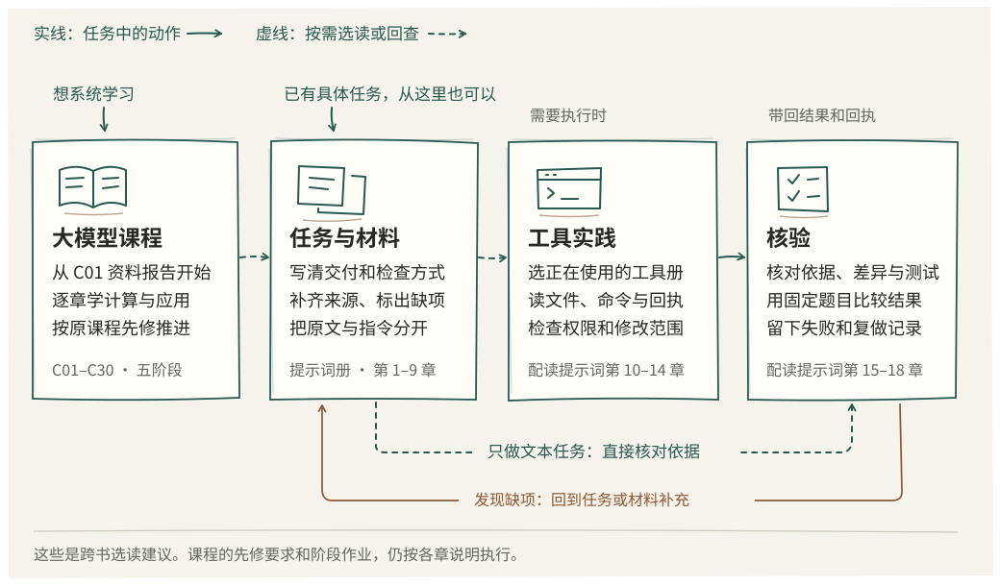

# 大模型与智能体工程

这个仓库收录大模型课程、提示词方法册和八本 Agent 读物。想系统理解模型并编写应用，可以沿课程学习；手头已有任务或工具问题，可以直接查相应分册。各册共用阅读入口和构建命令，保留自己的版本、材料与验证记录。

[打开系列书架](index.html) · [选择阅读路线](docs/reading-routes.md) · [整合记录](docs/integration/README.md) · [来源与许可](LICENSES.md)

提示词册当前源码为 0.1.2，新增三张适合窄屏阅读的手绘图，并修正书中材料链接，详见[本轮阅读修订](docs/integration/prompt-0.1.2.md)。下面的下载记录对应前次 0.1.1 交付。

[PR #1](https://github.com/zhuguang-ZFG/ai-engineering-series/pull/1) 已合并，合并提交 `f09bca1` 的 [main 检查](https://github.com/zhuguang-ZFG/ai-engineering-series/actions/runs/42882355610)通过。[完整构建](https://github.com/zhuguang-ZFG/ai-engineering-series/actions/runs/42880178268)的五个任务全部通过，可直接下载[提示词 0.1.1 阅读包](https://github.com/zhuguang-ZFG/ai-engineering-series/actions/runs/42880178268/artifacts/13794072343)或[大模型课程阅读包](https://github.com/zhuguang-ZFG/ai-engineering-series/actions/runs/42880178268/artifacts/13793988383)，解压后打开包内 `index.html`。阅读包包含 HTML、PDF、EPUB；提示词包还含独立练习 ZIP。验证范围和报告见[发布记录](docs/integration/release-20261111.md)。



| 内容 | 从这里开始 | 范围 |
| --- | --- | --- |
| 大模型：从入门到精通 | [C01 先做一份资料报告](model-course/book/llm/lessons/c01.md) · [课程说明](model-course/README.md) | 五阶段三十章，模型原理、应用、评测、训练与交付；课程版本 1.1.2，技术试读版 |
| 提示词工程：从提问到 Agent 协作 | [第 1 章](agent-books/prompt/ch01.md) · [全册目录](agent-books/prompt/README.md) | 十八章与附录，练习任务约定、材料组织、工具回执和配对比较；版本 0.1.2，技术试读版 |
| Agent 实战与机制 | [御舆](agent-books/README.md) · [各册产品表](agent-books/yuyu-book/PRODUCTS.md) | 御舆、Omp、Pi、OpenCode、DeepSeek Harness、Hermes、Codex CLI、Kimi Code，按所用工具选读 |
| 编程项目补充 | [Vibe Coding 原稿](model-course/book/book.md) | 保留原课程的编程实践与来源说明 |

系列目前以中文为主。《御舆》的中文和英文版本均保留，其他册的语言范围以各自说明为准。知识卡和试读页也可直接打开：[中文知识卡](agent-books/docs/knowledge-cards.html)、[英文知识卡](agent-books/docs/knowledge-cards.en.html)、[中文样章](agent-books/docs/sample-chapter.html)、[英文样章](agent-books/docs/sample-chapter.en.html)。

在仓库根目录运行：

```bash
python series.py list
python series.py check --project all --structure-only
python series.py check --project all
python series.py build --product prompt --lang zh --pdf --epub
python series.py build --product llm --lang zh --pdf --epub
python series.py collect
```

`list` 列出可构建的分册。`--structure-only` 核对整合结构；完整检查会调用两侧原有检查。命令使用已经安装的 Python 和 npm，依赖按两侧的锁文件分别安装，步骤见 [Agent 书籍](agent-books/README.md)与[大模型课程](model-course/README.md)。课程命令还需在 `PATH` 中找到 `python`。PDF 导出另需本机 Chromium 或 Chrome、中文字体；模型推理、训练与 OCR 的环境按具体章节准备。

源文件分别位于 `agent-books/` 和 `model-course/`。根 `index.html` 提供随仓文件的入口，在干净克隆中也可打开。两侧构建器继续管理原有输出，`collect` 将可用阅读成品汇集到根 `dist/agent-books/` 和 `dist/model-course/`，生成完整离线书架 `dist/index.html`，文件摘要写入 `dist/manifest.json`。课程导出器同时生成正文与答案册的 PDF、EPUB；给 `llm` 指定 `--pdf` 或 `--epub` 任意一个参数都会生成两种格式。直接阅读 Markdown 无须先构建；阅读已有 PDF、EPUB 也无须安装制作工具。

各册的成功与失败记录都予以保留。提示词册已验证离线程序，在线模型 A/B、跨模型迁移和独立读者试读仍待完成；大模型课程已有真实推理、训练和 OCR 记录，模型质量、独立交付与教学验收仍有缺项。详见[提示词验证记录](agent-books/prompt/VERIFY.md)和[课程实际进度](model-course/specs/STATUS.md)。整合检查只覆盖所运行的项目，原项目的历史 CI 不能代替新仓的远端验证。
