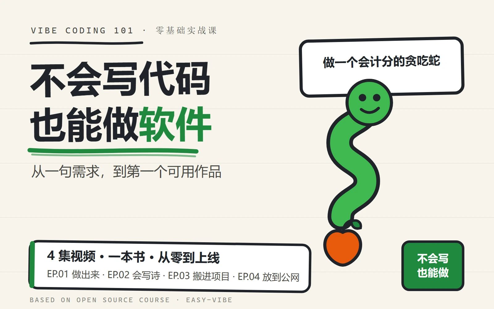

# Vibe Coding 101

> 不会写代码，也能从一句需求出发，做出第一个可用作品。

大模型手绘课：双击项目根目录的 [开始阅读.html](开始阅读.html)。书籍在 [deliverables](deliverables/) 文件夹：[PDF](deliverables/llm-explained-handdraw.pdf) · [EPUB](deliverables/llm-explained-handdraw.epub)。



本仓库汇集一套面向零基础学习者的 Vibe Coding 课程交付物：完整中文书籍、横版课程视频、竖版短视频，以及可继续编辑的 HyperFrames 源码。

大模型原理与应用十二课已开放：[打开手绘学习页](exports/llm/index.html)，从文字、注意力和训练，走到检索、工具与能回查证据的资料助手。可以下载 [PDF](deliverables/llm-explained-handdraw.pdf) 和 [EPUB](deliverables/llm-explained-handdraw.epub)，包含四十八张手绘图、纸上实验与自测答案。本地实验无需账号或 API；实际模型练习采用 DeepSeek V4.1 Flash 和 Kimi K3，附官方资料与复做方法。真实初学者试读仍待完成。完整范围见 [课程改造规格与实施计划](specs/llm-learning-redesign/SPEC.md)。

新版网页提供课内目录、三档字号、本机续读和手绘放大；手机打开即可接着读。PDF 目录有实际页码，EPUB 可以直接跳进小节。

## 内容

| 内容 | 文件 |
| --- | --- |
| 大模型原理与应用 · 十二课试读 | [`exports/llm/index.html`](exports/llm/index.html) |
| 手绘课程 PDF · A5 排版 | [`llm-explained-handdraw.pdf`](deliverables/llm-explained-handdraw.pdf) |
| 手绘课程 EPUB · 可调字号 | [`llm-explained-handdraw.epub`](deliverables/llm-explained-handdraw.epub) |
| 换材料练习 · A4 留白作答 | [六道练习 PDF](deliverables/llm-reading-tasks.pdf) · [网页题目](exports/llm/check-understanding.html) |
| 陪读核对与空白记录 | [参考与记录 PDF](deliverables/llm-reading-guide.pdf) · [空白 JSON 模板](exports/llm/review-record.json) |
| 原理纠错与进阶回查 | [完整原理回查](exports/llm/principles-reference.html) · [缓存、专家与计算成本](exports/llm/advanced.html) |
| 手绘讲义与复习图卡 | [讲义](exports/llm/deck.html) · [图卡](exports/llm/cards.html) |
| 原理与应用专题 · 静音逐步图解 | [生成原理](deliverables/llm-principles.mp4) · [证据与工具](deliverables/llm-applications.mp4) |
| 完整书籍 | [`book/book.md`](book/book.md) |
| 横版成片（宣传片） | [`deliverables/vibe-coding-101-landscape.mp4`](deliverables/vibe-coding-101-landscape.mp4) |
| 竖版成片（宣传片） | [`deliverables/vibe-coding-101-vertical.mp4`](deliverables/vibe-coding-101-vertical.mp4) |
| EP.02 成片（1080p） | [`deliverables/ep02-landscape.mp4`](deliverables/ep02-landscape.mp4) |
| EP.03 成片（1080p） | [`deliverables/ep03-landscape.mp4`](deliverables/ep03-landscape.mp4) |
| EP.04 成片（1080p） | [`deliverables/ep04-landscape.mp4`](deliverables/ep04-landscape.mp4) |
| EP.02–04 封面 | `deliverables/ep02-cover.webp`、`ep03-cover.webp`、`ep04-cover.webp` |
| 横版源码 | [`videos/landscape/`](videos/landscape/) |
| 竖版源码 | [`videos/vertical/`](videos/vertical/) |
| EP.02 源码 | [`videos/ep02/`](videos/ep02/) |
| EP.03 源码 | [`videos/ep03/`](videos/ep03/) |
| EP.04 源码 | [`videos/ep04/`](videos/ep04/) |
| 手绘风改造方案（封面 + 书籍图解提示词） | [`design/handdraw/`](design/handdraw/) |

系列正片按集数分目录（`videos/ep02`–`ep04`），宣传片沿用 `videos/landscape`、`videos/vertical`；各集 1080p 成片与 16:9 封面在 `deliverables/` 同名对应。

EP.04《把这条蛇，放到公网上》讲的是打包、托管、真机验收与回滚；源码目录结构与其他成片一致，改完可用 `npm run render:4k` 重出 4K 母版。

## 图片与大文件

书籍插图已全部镜像到 `book/assets/images/`（949 个文件，约 196 MB，Git LFS 存储），书本可离线阅读，不再依赖上游仓库的图片链接。克隆后如需在本地查看插图，执行：

```bash
git lfs install
git lfs pull
```

不拉取 LFS 对象时图片显示为指针文件，文字阅读与 `npm test` 校验不受影响。指向其他章节文档的链接仍指向 [easy-vibe](https://github.com/datawhalechina/easy-vibe) 上游仓库。

## 本地检查

需要 Node.js 22+、Python 3.13 与 FFmpeg。首次安装锁定依赖：

```bash
npm ci
python -m pip install -r scripts/llm/requirements-books.txt
```

运行完整检查：

```bash
npm test
```

`npm run check:accessibility:llm` 在本机 Chrome 中逐页核对可访问性树和键盘操作，检查跳到正文、训练暂停、蒸馏滑块、工具错误与证据回查的焦点。CI 使用 Playwright Chromium 运行同一检查。语义与键盘检查的范围不等同于屏幕阅读器听感或真实读者测试，逐项验收证据见 [ACCEPTANCE.md](specs/llm-learning-redesign/ACCEPTANCE.md)。

`npm run check:reading:llm` 检查字号、续读、课内导航、大图操作和窄屏布局；包括离线、存储拒绝和禁脚本情况下的阅读。

修改课程内容后运行 `npm run build:llm` 重新生成网页。`npm test` 同时检查本地实验、真实编码快照、网页是否与源文件一致，以及原有书籍和视频交付物。

修改课文或图解后，运行 `npm run export:books:llm` 重建 PDF 与 EPUB。导出依赖本机 Chrome 和 `scripts/llm/requirements-books.txt` 中的 Python 包；电子书本身不依赖这些工具。`npm run check:books:llm` 核对源文件指纹、成品哈希、PDF 中文章节/页边界/书签及 EPUB 目录/资源/内部链接，防止教材变了、电子书却未更新。纸上实验与网页静态读法来自同一来源；电子书不会执行交互按钮。

`media-status.json` 绑定四支本轮成片的源码指纹与文件 SHA-256。修改视频源码后，重新检查、渲染并核对实际抽帧，再运行 `node scripts/llm/media-manifest.mjs --update`；校验会拒绝源码或成片与审查记录不一致的版本。

检查会验证书籍封面、标题、Markdown 围栏、视频源码结构，以及 MP4 的编码、分辨率、帧率、音轨和时长。

如需编辑视频，在对应目录运行：

```bash
cd videos/landscape   # 或 videos/vertical、videos/ep02–ep04
npm run dev
npm run check
```

`videos/ep04` 的渲染脚本：`npm run render` 出默认分辨率预览，`npm run render:4k` 出 4K 母版，`npm run deliver -- renders/<母版>.mp4` 压出 1080p 交付版。

## 来源说明

书籍内容整理自开源项目 [datawhalechina/easy-vibe](https://github.com/datawhalechina/easy-vibe)。图片使用上游仓库的公开资源链接；课程封面、视频编排和本仓库的交付结构为本项目制作。

> 上游仓库当前未提供可由 GitHub API 识别的许可证文件。转载或再分发前，请自行确认原始内容授权范围。

应用回查：[提示词工程](exports/llm/prompt-reference.html) · [RAG 架构](exports/llm/rag-reference.html) · [提示、检索与核验精选](exports/llm/applications-guide.html)。同源修订已进入旧书，精选附录同步进入本地 PDF/EPUB。

系统回查：[上下文工程](exports/llm/context-reference.html) · [Agent 与工具调用](exports/llm/agent-reference.html) · [上下文与工具执行精选](exports/llm/execution-guide.html)。本地工作流用 `node book/llm/examples/tool-workflow.mjs` 运行，包含成功与查无商品的真实本地回执。

结构回查：[Transformer 与注意力机制](exports/llm/transformer-reference.html) · [注意力怎样拼成一层](exports/llm/architecture-guide.html)。可运行 `node book/llm/examples/multihead.mjs` 追踪双头矩阵；最新本地书籍包含四十八张手绘及同源数值表。

多模态与协议回查：[视觉/音频/视频](exports/llm/multimodal-reference.html) · [Embedding 与向量检索](exports/llm/embedding-reference.html) · [MCP 与 A2A](exports/llm/protocols-reference.html)。九个目标旧章均保留原有标题；这不代表合订书所有章节已逐一技术审校。

EPUB 使用官方 EPUBCheck 5.3.0 检查；更新 EPUB 后运行 `python scripts/llm/check_epub.py --jar <epubcheck.jar>` 更新与文件哈希绑定的报告。CI 从固定发行版下载工具并校验 SHA-256。

媒体修改后在对应项目运行 `npm run check`、截图复核、渲染并检查成片，再运行 `node scripts/llm/media-manifest.mjs --update` 记录源码与成片哈希。`npm test` 会拒绝过期的电子书或视频。新专题的可编辑源码在 `videos/llm-principles/` 和 `videos/llm-applications/`，由 `scripts/llm/build-media.mjs` 从课程材料生成。

蒸馏专题已接入 [L05 训练与推理](exports/llm/training.html)：教师/学生、软标签、温度、KL 与 T²、响应/推理文本蒸馏和错误迁移，附可更新学生参数的本地实验与纸上计算。

十二课均补充具体算例、失败原因或工作情境；[知识点核对表](specs/llm-learning-redesign/KNOWLEDGE-MAP.md)记录主线、深入解释和旧章回查的范围。图解保持可编辑 SVG，按实际手机字号和电子书成品检查。
