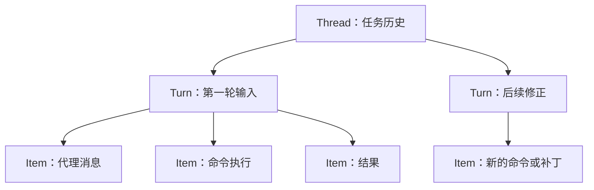

# 第 4 章：会话恢复不会替你恢复文件

<!-- block: codex-ch04.b-opening -->
恢复会话延续的是任务历史，分支会话复制的是对话起点；两者都应与 Git 工作树的实际状态分别核对。

一个任务昨天执行到一半，今天打开同一会话，代理仍记得“测试正在失败”。可是另一位同事已经修好了代码，或你自己切到了另一条分支。此时对话与磁盘各自都合理，却不再描述同一时刻。继续运行前，应先让两份状态重新对齐。

## 4.1 Thread、Turn 与 Item

<!-- block: codex-ch04.b-term-thread -->
客户端协议中，thread 表示一条任务历史；turn 表示一次输入推动的处理回合；item 表示回合中的消息、命令或其他活动记录。三个层级解决不同问题：线程用于保存连续任务，回合用于描述开始与结束，条目用于解释过程中发生的事。



图 4-1：协议里的归属关系。客户端不应把任意一条 item 完成当作整个 thread 完成。

持久化格式与客户端协议也不是一回事。客户端看到的 thread 对象可能只是摘要，完整历史需要另外读取；本地旧日志与新历史存储方式也可能存在兼容路径。不要根据一个返回对象里没有消息数组，就断言会话没有保存。

## 4.2 Resume 与 Fork 各自回答什么

`resume` 表示继续已有会话。你通常希望保留之前的推理背景、已做工作和待解决问题。`fork` 表示从既有历史另起分支，适合比较两个方案，避免把两条探索路线写进同一串对话。

```powershell
codex.cmd resume
codex.cmd fork
codex.cmd exec resume --help
codex.cmd exec fork --help
```

交互与非交互子命令有各自参数，先看固定版本帮助，再决定是用会话 ID 还是选择器。`--last` 之类便利选项适合个人终端，自动化中应保存明确 ID；否则工作目录或会话排序变化时，脚本可能接上另一项任务。

分支历史不会自动生成独立 Git 工作树。两条会话若同时操作同一目录，仍可能覆盖对方文件。要比较实现方案，除了 fork 对话，还应为每个方案分配独立工作树。第 16 章会把这两个“分支”放在同一个实验里。

## 4.3 恢复前的三项核对

先看基线提交与工作树差异，再看会话最后确认到哪一步，最后重新运行能快速判断现状的检查。这样做不需要重放每条旧命令，重点是找出已经过时的假设。

例如，旧会话记录某测试因缺少字段失败。恢复时打开测试文件和相关模型定义，重新运行那项测试；若已经通过，将当前结果补进会话，后续工作便可从这里继续。

同理，之前的安装命令若超时，不能根据聊天里“正在安装”判断依赖完全没写入。检查 lockfile、包目录和安装器日志。命令失败可能留下部分文件；会话的回合失败和磁盘事务回滚不是同一个机制。

## 4.4 历史可以压缩，工作证据应能独立读懂

长会话会受到上下文预算约束，模型下一轮看到的内容未必是所有原文。对话摘要保留的重点也可能与审计需要不同。把关键交付写成文件，比反复要求代理“记住刚才所有细节”更可靠。

一份任务记录可以很短：目标、基线、已改文件、检查命令、已知失败和下一步。敏感数据不要照搬到记录里；只写足够定位的标识。恢复后先读这份记录，再对照 Git 差异，能减少上下文变化造成的偏移。

`exec --ephemeral` 的帮助表明它不持久保存会话文件。它适合某些一次性处理，但不能把它解释为“运行没有副作用”：工具仍可能写项目文件，输出文件也仍可能由你指定保存。会话存储开关与工具写入范围应分别检查。

## 4.5 什么时候应该开始新会话

当目标发生根本变化、代码基线大幅移动、旧上下文充满已失效方案时，新会话往往更清楚。把仍有效的需求与证据带过去即可，不必为了保留连续聊天而背着大量过期信息。

反过来，任务只是被网络中断、终端关闭或短暂切走，并不一定需要新会话。先核实已有状态，再决定恢复。真正需要避免的是无判断地重试：重复执行一次查询通常代价小，重复提交、重复发消息或重复迁移数据库则可能造成外部副作用。

## 4.6 把一次运费修复拆成可辨认的记录

小仓库的第一个输入可以只是“解释 1001 克为什么收费错误，先不要修改”。这一输入推动一个 turn。代理可能读 `parcel.py`，运行测试，最后解释整除问题；读文件、命令、最后消息分别形成活动记录。之后用户再说“按原有规则修复”，才是下一轮输入。两轮可以属于同一个 thread，但不能把它们的命令状态混在一起。

可以把这轮任务保存为一份工作记录：

```json
{
  "task": "parcel-1001g",
  "repository": "parcel-lab",
  "base_commit": "由 git rev-parse HEAD 填入",
  "thread_id": "从本次 CLI 输出读取",
  "starting_status": "工作前 git status --short 的结果",
  "request": "解释 1001 克边界；暂不修改"
}
```

这是项目自己的记录格式，不是 Codex 配置。字段名相似不代表可以传给 app-server。尤其 `base_commit` 是我们补上的代码基线，协议中的 thread 身份并不会天然替代它。若初始仓库还没有提交，就明确写“无提交”，先保存测试和源文件摘要，而不要填一个看似真实的 SHA。

第一轮可能只留下测试输出，第二轮完成代码修改但尚未测试，第三轮再总结。记录各轮的输入目的与结果，便能看出还缺哪一步，也能核对最后总结是否准确。

## 4.7 断开界面后，逐项确认保留了什么

假设修复过程中终端关闭，重新打开项目后先运行 `git status --short` 和测试，再恢复会话查看进度。若历史仍写着“准备修改”，磁盘上却已有补丁，就将这项差异补充给代理，避免重复修改。

现场有四份需要分别核对的状态：工作树内容、Git 提交、会话历史、运行中的进程。恢复会话接续历史，Git checkout 切换文件版本，操作系统管理进程，重新测试则检查当前代码。它们可能处于不同时间点，需要在恢复任务时逐项确认。

本书的运费练习可以手动制造一个安全现场：在副本里把整除公式修好，但先不运行测试；记下差异，再关闭编辑器。重新打开后，确认 `parcel.py` 已变，而 `.git` 中的基线未变。这里甚至不需要 Codex，就能理解为什么“恢复聊天”不能代替检查工作树。

如果测试进程仍在运行，重复启动可能争抢相同端口或输出文件。运费测试没有这类资源，适合最初练习；换成 Web 项目时，要把服务进程身份与监听端口也写入记录。线程 ID 不能用来杀操作系统进程，进程 PID 也不能用来恢复 Codex 历史。

## 4.8 用 schema 看恢复请求覆盖了哪些字段

本机生成的 `ThreadResumeParams.json` 要求 `threadId`，另列 cwd、模型、审批和沙箱等可选覆盖字段。一个经过静态 schema 检查的请求参数如下：

```json
{
  "threadId": "fixture-thread",
  "cwd": "C:/work/parcel",
  "approvalPolicy": "on-request",
  "sandbox": "read-only"
}
```

`fixture-thread` 是教学占位身份，不指向真实历史。这份参数可以说明请求形状，却不能在任意机器上恢复任务；服务端还要找到对应 thread，并对配置、存储和能力进行校验。本册的协议练习只验证形状，没有建立连接。

有些客户端恢复时会显式传入新的 cwd，有些使用保存状态。实现自己的客户端时，应让用户知道本轮究竟在哪个目录执行。历史中的 `parcel.py` 和另一个仓库的同名文件很容易被误认。最少保存仓库基线与当前 cwd，并在恢复后重新确认目录，不要只靠 thread 的标题“修复运费”。

对照请求和响应还有一个实用问题：服务端是否返回完整历史，还是只返回部分 thread 信息。某些选项允许排除 turns，历史分页又有自己的读取方法。客户端列表显示了一个 thread，不代表已经拿到其中所有 item；恢复按钮可用，也不意味着可以用不完整历史重建完整时间线。

## 4.9 分叉适合比较思路，不自动隔离文件

想比较“整数算式”与“引入计费对象”两种实现，可以从相同讨论位置分叉会话。但如果两个会话共用同一个目录，第二个仍会看到第一个已经写入的文件。要比较两份独立结果，还要复制项目或创建不同 worktree。

对这个缺陷，整数算式足够；引入新对象会扩大接口和测试范围。比较时应固定输入、初始源码与测试，分别记录差异。否则一个分支已经得到前一轮修复，另一个仍是原始错误，表面上的用时和成功率就没有共同起点。

记录当前通过测试的 `parcel.py` 所对应的修改、测试命令与 Git 状态，再附上 thread 和 turn 身份。下次恢复时，这些记录就是核对历史与文件的起点。

## 来源

[app-server 的线程、回合与条目协议](https://github.com/openai/codex/blob/086ccc833bc9cf01024ad2dd6af7dbd421b6bf9a/codex-rs/app-server/README.md)、[exec resume/fork 参数](https://github.com/openai/codex/blob/086ccc833bc9cf01024ad2dd6af7dbd421b6bf9a/codex-rs/exec/src/cli.rs)、[rollout 入口](https://github.com/openai/codex/blob/086ccc833bc9cf01024ad2dd6af7dbd421b6bf9a/codex-rs/core/src/rollout.rs)。本章恢复案例是操作方法，没有在真实模型会话中实跑。
