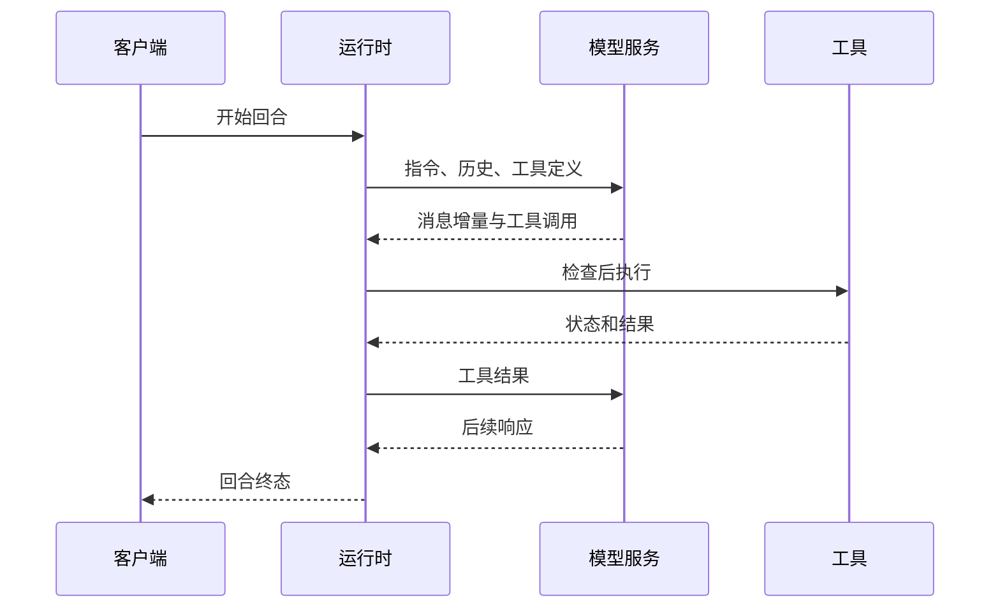

# 第 5 章：模型请求与流式事件

<!-- block: codex-ch05.b-opening -->
模型请求把任务历史、指令和工具描述组合起来；流式事件则逐步报告动作，只有明确终态才表示这一轮结束。

终端里文字开始出现时，任务通常还没有结束。模型可能先说一句解释，随后调用命令；命令输出返回后，它又继续推理。客户端若在第一段文字结束时保存“最终答案”，就可能漏掉真正的修改和检查。

## 5.1 请求不是聊天框内容的直接转发

一次模型请求需要结合用户输入、项目说明、已知任务历史和可用工具。技能说明、运行环境与某些约束也可能进入上下文。用户看见的聊天记录只是其中一部分，不能据此精确还原模型请求。

工具描述尤其重要。模型需要知道工具名、参数形状和用途，才能提出调用；但它不知道工具在本机执行时是否会被策略拒绝。请求阶段可用，不等于执行阶段必然成功。设计客户端时应把“模型选择了动作”和“系统执行了动作”作为两个事件处理。

扩展的描述也会占用上下文，可以先核对哪些能力与当前任务有关。一个用途清楚的只读搜索工具，可能比五个名称相似、说明模糊的工具更容易使用；具体取舍仍要看实际任务结果。

## 5.2 流式响应有内容，也有控制信息



图 5-1：流式返回不只是逐字打字。工具调用与终态决定客户端下一步该做什么。

一个稳健的事件消费者不能只拼接文字。它需要保存 thread、turn、item 的身份，知道哪些条目正在运行、哪些已经完成。命令输出可能多次追加，最终状态可能是成功、失败或中断。若把这些情况都渲染成同一行“已结束”，用户很难判断是否需要重试。

## 5.3 输出预算影响你看见的证据

模型上下文、工具输出和客户端展示都有各自预算。一个命令可能在操作系统层面输出了很多内容，而回到模型或终端的只是摘要或截取。缺少某一行日志不一定代表那一行从未发生，也可能是采集或裁剪造成的。

查询时先取相关文件或失败的测试段落，需要时再扩大范围。必须完整保存的输出由脚本写入临时文件，并将路径、摘要和退出状态记入会话。日志若含凭据等敏感内容，保存与分享时仍需控制访问。

成本统计也要看数据定义。token 用量说明了某些请求消耗，不自动给出真实账单、请求延迟或可用配额。CLI 的 JSONL 输出与服务端计费页面处于不同层，书中不根据一次静态 schema 生成推算模型费用。

## 5.4 替身模型能回答哪些问题

本地协议替身可以返回固定工具调用，用来检查代理是否正确解析参数、等待工具结果和处理失败。它适合协议测试，因为输入和输出可控；它不适合证明模型理解了复杂业务，或者会自发选择正确工具。

构造替身时应主动加入失败：半截响应、异常终态、重复条目或取消。只返回一条完美响应，容易让客户端在真实网络抖动时出问题。每个实验也要说明使用的 provider 协议，不能把一种接口的流式字段套到另一种接口。

本书尚未接入模型替身完成 Codex 会话。已生成的 app-server schema 只证明固定二进制公布了这些协议结构。它提供了下一步客户端实验的起点，模型请求、真实服务连接和任务质量仍分别需要验证。

## 5.5 出错后先保留链路身份

遇到“收到了一部分输出就卡住”，先保存请求对应的 thread、turn 和 item 标识，再检查连接是否结束、服务端是否发出终态、客户端是否丢弃未知事件。若没有这些关联信息，只截取最后几行文字，很容易把前一次任务的错误当成当前任务的问题。

自动化也应区分可重试的传输错误与可能已执行的工具副作用。模型请求可以重试，不代表其中要求的外部操作可以无条件重复。重连后先读已知状态，再决定是否重新发起回合；不要仅因客户端没收到答复就推断服务端什么都没做。

## 5.6 同一个任务有两种可见事件语言

第 14 章使用 `codex exec --json` 的 JSONL，顶层 type 类似 `thread.started`、`item.completed`。第 15 章直接连接 app-server，使用方法和通知名，例如 `thread/start`、`turn/completed`。二者都描述任务进展，但一份是 CLI 面向脚本的输出，另一份是双向服务协议。

固定 exec 实现本身通过进程内 app-server 客户端运行，然后由事件处理器转换输出。因此两个接口相关，却不应混用解析器。特别是 exec 的 `turn.started` 结构很小，不能凭 app-server 文档假定它一定带相同的 turn 对象和所有字段。

```text
模型与工具活动
      ↓
App Server 通知与请求
      ↓ exec 的事件转换
脚本读取的 JSONL
      ↓ 本书检查器
进程、终态、失败活动的摘要
```

经过这层转换，文字、工具结果、回合通知和程序退出仍各有到达时刻。网络中断时可能已经显示正文，却尚未收到结束消息，客户端需要保留这种未完成状态。

## 5.7 对运费任务区分正文与行动

模型可以说“我会运行测试”，这是一段文本；真正的命令 item 才记录执行活动。模型也可以在最后报告写出一段 JSON 字符串，描述 checks；那仍然是消息内容，需要与命令记录核对。客户端若从自然语言中识别“通过”两个字来点亮绿色状态，很容易被计划句或引用文本误导。

相反，命令失败也不等于整个任务没有进展。第一次测试故意暴露边界错误，失败输出是后续修复所需输入。模型收到它后，可能读取函数、提出公式修改，再运行第二次测试。应保留这条顺序，读者才能判断修复是否针对真实失败。

客户端可以分开显示计划文字、工具活动和最终结果。最小版本给命令卡片标出进行中、完成和退出码，就能让用户看见哪些动作已经发生。

## 5.8 不把缺少字段变成默认成功

流式对象常在开始与完成时有不同信息。命令刚开始时 exit_code 为 null，意味着尚无退出结果；不是零，也不是失败。若某行因为截断缺少必需字段，应标记解析问题，不能用默认空对象继续产出“成功”摘要。

本书检查器遇到坏 JSON 或缺少 item.id 时直接报错，遇到未知顶层事件则保存诊断、要求审阅。它针对固定版本的单回合记录设计。升级客户端时，可以据此补充新事件的处理，原始未知内容也应保留，方便排查任务未结束的原因。

## 来源

[exec 的事件消费路径](https://github.com/openai/codex/blob/086ccc833bc9cf01024ad2dd6af7dbd421b6bf9a/codex-rs/exec/src/lib.rs)、[JSONL 输出处理器](https://github.com/openai/codex/blob/086ccc833bc9cf01024ad2dd6af7dbd421b6bf9a/codex-rs/exec/src/event_processor_with_jsonl_output.rs)、[app-server 协议目录](https://github.com/openai/codex/tree/086ccc833bc9cf01024ad2dd6af7dbd421b6bf9a/codex-rs/app-server-protocol)。
