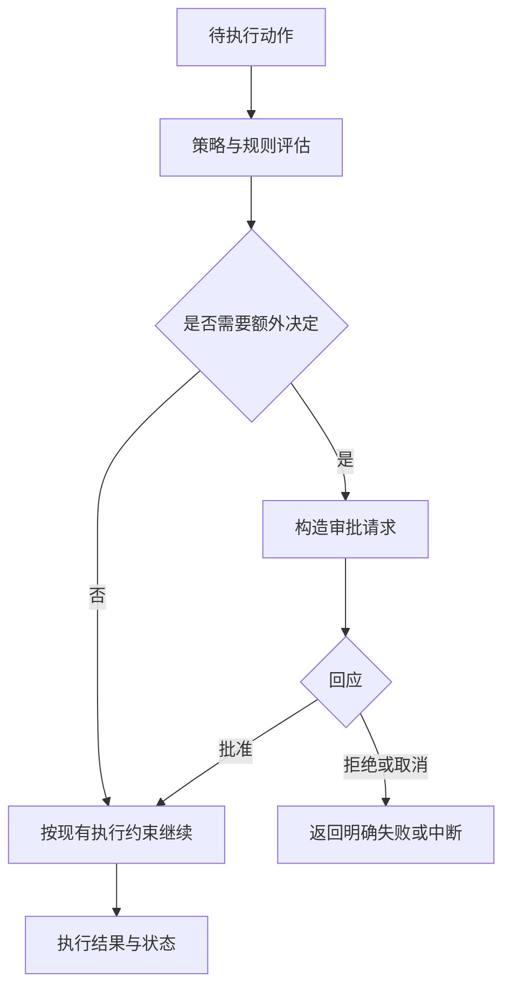
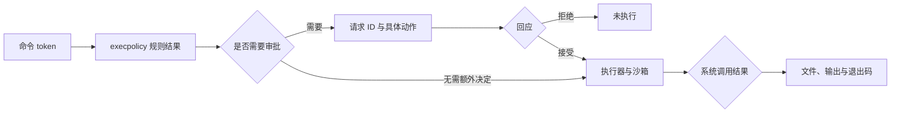

# 第 7 章：审批决定谁来作出下一步判断

<!-- block: codex-ch07.b-opening -->
审批策略决定何时请求决定、由谁回应；它与沙箱执行能力、命令规则和 Hook 信任分别生效。

“允许代理执行”这句话缺少范围。允许的是这一次命令、这一类前缀、当前会话，还是某个目录的写入能力？如果界面把它们都简化成一个确认按钮，使用者很容易以为自己只批准了一次动作，而实际规则已经影响后续运行。

## 7.1 先看固定版本接受哪些值

<!-- block: codex-ch07.b-term-approval -->
本机 0.167.0 顶层帮助的 `--ask-for-approval` 只列出 `on-request` 和 `never`。前者允许模型在需要时请求审批；后者不询问用户，执行失败直接返回给模型。这些文字来自同版本程序，不能用旧教程的枚举替换。

```powershell
codex.cmd --sandbox read-only --ask-for-approval on-request
```

这条命令同时指定执行能力与审批策略。若改用 `never`，程序不再向用户询问，但沙箱、规则和管理约束继续生效；需要额外能力的动作仍可能失败。

本书所用版本的配置实现还明确拒绝旧的 `approval_policy = "untrusted"` 显式设置。遇到这种升级错误，应按当前配置契约迁移，而不是不断尝试同一个旧值。历史文档中的用词可能仍有参考意义，但实际解析结果以固定版本为准。

## 7.2 审批发生在一条具体动作上

有效审批至少应让人看见命令或文件变更、工作目录、请求原因与影响范围。用户批准“运行单元测试”，不能自动推出“发布包到公共仓库”也已经获准。两者都可能出现在同一任务里，但外部副作用与目标不同。



图 7-1：审批改变的是动作能否继续以及继续的范围，执行仍受实际运行环境约束。

## 7.3 非交互 exec 为什么需要单独设计

这一版本的 `exec` 源码明确说明无界面运行默认不向人询问，并使用进程内 app-server 客户端。它还处理自动审查等配置路径，不能只从一个默认值推导全部行为。最稳妥的 CI 设计是事先配置必要能力，将需要人工决策的发布环节放到可审阅的工作流节点。

若脚本遇到审批请求，却没有实现应答通道，任务不应假装成功。本书第 14 章的完成条件会同时检查退出码、回合状态和项目测试。把审批失败写进机器可读结果，比让脚本停在后台无限等待更容易维护。

## 7.4 自动审查不是用户已作决定

本版提供 `--approve-for-me`，其帮助描述为使用 workspace-write 沙箱把审批请求交给自动审查。它是一种审批机制，不能替代用户对任务目标的授权，也不能被教程写成“任何命令都安全”。

上游 app-server 文档还描述了实验性的 managed human command checkpoint：匹配管理规则中 `prompt-user` 的命令需要新的人工决定，即使线程使用自动审查。客户端需要公布相应能力；没有能处理这种请求的连接时，命令会被拒绝。此处是特定管理配置与协议契约，不是 `review.rules` 中普通前缀规则的第四个通用取值。

普通 `execpolicy check` 文档列出的决策仍是 `allow`、`prompt`、`forbidden`。管理要求中的扩展能力有自己的配置入口和客户端要求，配置时应分别核对。

## 7.5 如何评估一次请求是否应批准

先看动作是否属于当前目标，再看它是否使用最小必要范围，然后确认执行结果怎样检查。批准安装测试依赖之前，应知道它会写哪个环境；批准提交之前，应看暂存内容；批准外部发布之前，应看目标和版本。审查内容应具体，避免在一项长任务开始时给出没有边界的总批准。

请求被拒绝后，按原因调整任务，或报告缺少的能力。换壳、换路径或改写命令去执行同一个被拒绝动作，会绕开原决定，不能作为恢复步骤。

本书实跑了规则层的三种决策。完整用户界面、自动审查和管理 checkpoint 按所用版本的源码讲解，涉及真实账号或外部发布的审批尚未实验。

## 7.6 把规则结果、审批答复和进程结果放在一条线上

对运费项目，先判断四个动作：读取文件、运行测试、修改公式、推送提交。它们的任务目的不同，所需能力也不同。`execpolicy check` 返回 `allow` 只说明给定 token 在这组规则中得到允许结果，没有替你启动 Python，也没有证明测试通过。



图 7-2：三次不同的判断。规则匹配、审批接受和测试成功分别发生在不同位置。

假设测试想写 `__pycache__`，只读模式下遇到文件限制。审批策略为 `never` 时，不能期望弹出人工确认；规则允许 `python -m unittest`，也不能据此认为任何文件写入都已获准。我们的测试命令加了 `-B`，就是让这个练习不必为了字节码缓存额外写盘。先消除不必要副作用，通常比扩大整个工作区权限容易解释。

规则禁止 `git push --force` 时，应保留这个决定；包装成另一段脚本不会改变推送的副作用。本轮修复运费计算，是否推送要根据另行提出的交付要求处理。

## 7.7 逐字段阅读一条人工审批请求

本机生成的协议中，命令审批参数要求 `threadId`、`turnId`、`itemId` 和 `startedAtMs`。下面的完整消息经过静态 schema 检查，字符串身份是教学数据：

```json
{
  "id": 91,
  "method": "item/commandExecution/requestApproval",
  "params": {
    "threadId": "fixture-thread",
    "turnId": "fixture-turn",
    "itemId": "fixture-item",
    "startedAtMs": 0,
    "command": "python -B -m unittest -v",
    "cwd": "C:/work/parcel",
    "reason": "Run the boundary tests."
  }
}
```

最外层 `id` 关联一次双向请求，它不能代替 `itemId`。用户点击按钮后，客户端用同一个请求 ID 回答；工具事件之后仍按 item 身份更新。把两个 ID 混用，会出现界面看似批准成功、服务端却还在等待另一条请求的现象。

`command` 和 `cwd` 应一起展示。同样的测试命令，在自己的小仓库和一个刚下载的陌生仓库里，执行内容可能完全不同。`reason` 解释为什么请求，不能取代动作本身；客户端不能只显示“为了完成任务需要权限”而隐藏命令。

拒绝消息的参数很小：

```json
{"id":91,"result":{"decision":"decline"}}
```

这个形状已通过生成的响应 schema。通过 schema 并不意味着请求 91 此刻真的存在，也不保证服务端仍在等待。用户在另一个窗口取消了任务，或请求已经超时，旧界面的决定就需要按真实返回结果处理。不要仅靠按钮变灰推断服务端接受了决定。

## 7.8 为练习写一张决定表

把决定表写在项目笔记里，不必一开始自动化：

| 动作 | 当前任务需要它的原因 | 本轮可检查证据 |
| --- | --- | --- |
| 读 `parcel.py` | 找到计费公式 | 文件内容与行号 |
| 运行测试 | 复现并确认修复 | 用例名、输出、退出码 |
| 改 `parcel.py` | 修复取整边界 | 只有公式一处的差异 |
| 增加依赖 | 当前方案无需依赖 | 没有安装步骤 |
| 推送远端 | 取决于另行提出的交付要求 | 分支、提交、目标仓库 |

表中每项动作都有理由和检查位置。属于任务但执行失败的动作，可以继续查 cwd 或目录能力；找不到任务理由的动作，则应先调整计划。

第 12 章的前置 Hook 示例只识别一个明确命令字符串，完整审批还涉及命令策略、权限配置与宿主。组合这些检查时，分别保存理由与结果，拒绝发生的位置才容易查清。

## 来源

[exec 默认审批与客户端设置](https://github.com/openai/codex/blob/086ccc833bc9cf01024ad2dd6af7dbd421b6bf9a/codex-rs/exec/src/lib.rs)、[配置实现](https://github.com/openai/codex/blob/086ccc833bc9cf01024ad2dd6af7dbd421b6bf9a/codex-rs/core/src/config/mod.rs)、[managed human checkpoint](https://github.com/openai/codex/blob/086ccc833bc9cf01024ad2dd6af7dbd421b6bf9a/codex-rs/app-server/README.md)。

[生成的命令审批参数](https://github.com/openai/codex/blob/086ccc833bc9cf01024ad2dd6af7dbd421b6bf9a/codex-rs/app-server-protocol/schema/json/CommandExecutionRequestApprovalParams.json)。
