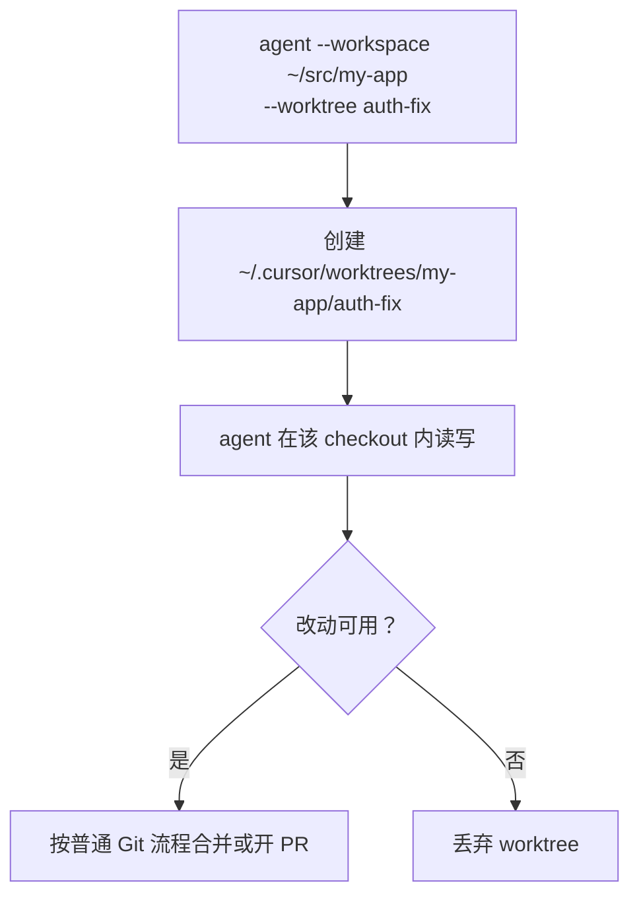

# 第 3 章：会话、目录与 worktree

<!-- block: cursor-ch03.b-opening -->
会话决定上下文，目录决定权限，worktree 决定改动落在哪。

这三件事在文档里分散在三处，实际使用时却总是一起出现：从旧会话继续，在另一个仓库里开工，把改动放进独立 checkout。本章按这三层拆开写。

## 3.1 会话是一条可续的线程

| 目标 | 命令 | 来源页 |
| --- | --- | --- |
| 续指定会话 | `--resume [thread id]` | using |
| 续最近一次 | `agent resume`、`--continue`、`/resume` | using |
| 从列表里挑 | `agent ls` | using |
| 改标题、分叉、压缩 | `/rename`、`/fork`、`/summarize` | slash-commands |

来源：[CLI 用法](https://cursor.com/docs/cli/using)、[斜杠命令参考](https://cursor.com/docs/cli/reference/slash-commands)（访问日期 2026-11-13）。`/rename`、`/fork`、`/summarize`、`/rewind` 在参考页各占一行，本书没有逐条实跑。

会话 id 从哪里来，文档没有单独写。`agent ls` 列出历史会话，`--resume` 接受 thread id，两者字段名是否一致，要在本机对照。

## 3.2 工作区由当前目录决定

默认工作区是当前工作目录。要指向别的仓库，用 `--workspace <path>`：

```bash
agent --workspace ~/src/my-app "解释这个仓库的构建流程"
```

文档的说法是：`--workspace` 给出显式仓库根，不给时用 cwd。工作区同时是权限判定的参照系，第 1 章「工作区内写文件自动放行」里的「工作区」就指它。

目录级的配置也落在这里：项目根的 `.cursor/cli.json` 只放权限，`.cursor/rules/` 放规则（第 4 章），`AGENTS.md` 与 `CLAUDE.md` 按根目录约定读取。换一个目录启动，等于换一整套项目设置。

## 3.3 worktree 把改动挪出去

```bash
agent --worktree "升级测试运行器并修复相关快照"
agent --workspace ~/src/my-app --worktree auth-fix "修复不稳定的鉴权测试"
```

`-w` 或 `--worktree [name]` 让 agent 在新的 Git worktree 里工作，不直接改当前 checkout。存放位置是 `~/.cursor/worktrees/<reponame>/<name>`，与编辑器创建的 worktree 同目录；省略 `name` 时自动生成。清理沿用编辑器 worktree 的保留规则，文档指向「How are old worktrees cleaned up?」一节。

文档强调 `--worktree` 只改变 agent 在项目内编辑文件的位置。它不改变工作区，也不改变你在哪个仓库里启动。`--workspace` 管根，`--worktree` 管落点。



图里的「合并或开 PR」属于 Git 操作，文档只说明创建与清理，没有规定合并流程。

## 3.4 三个落点别混

| 落点 | 由谁决定 | 你用哪条命令观察 |
| --- | --- | --- |
| 当前 checkout | 启动目录，或 `--workspace` | `git -C . rev-parse --show-toplevel` |
| worktree | `--worktree` | `ls ~/.cursor/worktrees/<reponame>/` |
| 云会话 | 消息前加 `&`，转给 Cloud Agent | `cursor.com/agents` |

第三行来自 using 页的 Cloud Agent handoff 一节：消息以 `&` 开头时交给云端继续跑，可在网页或移动端接回。本书没有测试这条路径。

## 3.5 这一章的边界

续会话的四个入口、`--workspace` 的默认值、worktree 的存放路径与清理口径、`&` 的云转交，都来自文档（2026-11-13）。会话 id 与 `agent ls` 字段的对应、worktree 里能否再启 worktree、云会话与本地线程是否共享 id，文档没有写明。`~/.cursor/worktrees/` 下的实际布局，用第二节表格的 `ls` 命令核一次即可确认。
