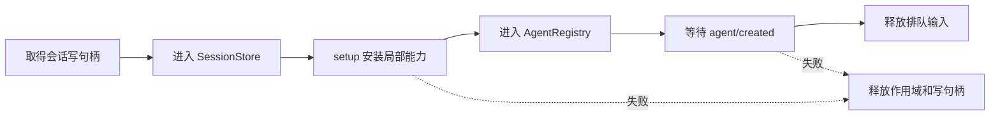

# 第 5 章：Agent 契约与具体循环

<!-- block: deepseek-ch05.b-opening -->
应用按钮写着“新建 Agent”，并不意味着按钮知道循环怎样工作。DeepSeek Harness 把 Agent 的公共行为放在 agent 包，把默认的模型—工具循环放在 agent-loop 包。这个分离决定了替换循环时到底要承担哪些责任。

## 5.1 消费者依赖公共入口

ctx.agents 管理活跃 Agent，并暴露创建与恢复入口。默认 agent-loop 注册工厂，消费者调用 ctx.agents.create 或 resume，拿到 AgentHandle；handle.dispose 是这次创建的清理责任。调用者不应直接实例化默认驱动的内部类，再把它塞进注册表。

```typescript
// 固定版本文档中的 API 形状；需要已经装配的运行时。
const handle = await ctx.agents.create({
  sessionId: 'book-review-session',
  agentOptions: { provider: 'deepseek', model: 'deepseek-chat' },
  setup: (agentCtx, agent) => {
    // 在发布 Agent 之前安装这次实例需要的局部能力。
  },
});
// 所有者结束使用时：await handle.dispose()
```

sessionId 是身份，不是随意的显示名称。复用一个已经被写持有者占用的会话，应由持久化契约阻止，而不是让两个进程同时追加。create、resume 的路由选择也不同：程序化恢复保留历史选择，初始 agentOptions 不能被当成覆盖所有保存状态的开关。

## 5.2 创建成功之前就有事务边界

固定版本的默认循环把初始化做成可回收过程：获得 Session，进入存储，完成 session/created，执行可选 setup，进入 AgentRegistry，等待 serial 的 agent/created，然后释放排队输入。这个顺序让 setup 有机会安装作用域内工具，避免第一轮已经发出请求，插件还没有准备好。

setup 失败时会撤回资源，已持久写出的事实则保留。收到过创建公告的观察者还需要匹配的清理通知。因此，这里的回收包括内存注册，却不等于删除外部观察和磁盘日志。



图 5-1：默认 Agent 发布之前的准备阶段。图中的回收不包含用户代码任意副作用的回滚。

## 5.3 什么时候真的需要替换循环

只想改提示词，优先注册提示词片段；想在工具前审批，使用工具管线；想在模型错误时修复连接，使用 request-error 扩展点。因为这些工作不改变“接输入、请求模型、执行工具、继续”的基本驱动。

当任务本身是固定状态机、需要多模型投票、严格的预算调度，或者模型只在其中一个阶段参与时，替换驱动才有价值。新的驱动需要保持公共 Agent 契约：输入如何接受、取消如何传递、什么时候算结束、哪些事件持久化、每个工具请求是否配上结果、谁关闭资源。只实现一个 while 循环不够。

设计替代驱动时可以先画出它的确定性部分。例如审查流程先读取变更列表，再并发运行静态检查，最后才让模型解释结果。静态检查的运行身份和结果仍应成为可恢复事实；模型故障不能让静态检查默默重复写外部系统。

## 5.4 一个可审阅的替代驱动设计

先规定状态 `idle → collecting → checking → explaining → settled`，取消从每个活动状态进入 stopping，待执行任务收敛后才进入 settled。每一步都列出进入条件、可见输出和副作用。需要恢复时，从持久事件决定哪些阶段已经完成，不从 UI 最后一行文本猜测。

测试应刻意让 checking 的一个子任务失败，验证其他任务是否被取消、错误是否保留、解释步骤是否继续。另一个测试让取消发生在解释请求发出之前，确认没有幽灵请求。再测试重复 dispose：旧 handle 不得删除同 id 的新实例。

这套自定义 Agent 工厂尚未实跑。本册实验只覆盖 Cordis 层的注册与清理；采用替代驱动前，还需在完整组合中测试上述公共行为。

## 5.5 工厂接口怎样保护消费者

一个 Web 路由和一个 ACP 桥接器可能同时使用 Agent 服务。它们关心的是把输入交给一个活跃 Agent、订阅输出、结束自己拥有的实例。若两者都 import 默认循环内部类，驱动升级会同时破坏两个消费者。把创建交给公共工厂后，消费者仍使用同一个接口，而替代驱动承担满足契约的责任。

这里容易漏掉的是所有权。ctx.agents.get(id) 得到可使用的 Agent，并不因此取得创建者手里的 dispose 能力。创建者持有 AgentHandle，工厂提供者也通过自身生命周期承担结构性清理责任。做一个“查看当前任务”的插件时，不能因为查到了对象，就随意关闭别的消费者创建的任务。

setup 准备局部能力，也可以返回同步 commit，在正式发布前再次检查可变条件。输入则要等 create 返回后再交给实例，以免初始化尚未完成就启动模型请求。第 5.8 节会沿发布顺序解释这项检查。

评审替代驱动时，可以分别检查创建和清理、恢复会话、观察注册表这三种消费者，确认它们无需知道内部状态机的私有名称。再让 setup 和 agent/created 监听器分别失败，检查已收到公告的对象是否收到配对的释放通知。

<!-- deepened: 05 -->

## 5.6 工厂槽不是活跃实例表

在 agent/src/index.ts 中搜索 setFactory，会看见一个单独的 factory 槽。它保存负责创建和恢复的提供者；活跃 Agent 的注册是另一回事。应用可以有许多 Agent，却只由当前选定的工厂理解如何构造它们。重复安装工厂会抛错，避免创建入口随注册先后悄悄被覆盖。

setFactory 把槽位写入 ctx.effect，并返回同一个受管 disposer。卸载该注册时清空槽位，后续 create 会在 requireFactory 处失败。这里没有把一个“未设置工厂”的调用默默回退到默认实现。如果改造部署忘记装 agent-loop，错误会靠近创建入口暴露，消费者不必等到第一次输入才发现驱动不存在。

```text
调用者 ctx.agents.create(options)
  → requireFactory() 取得工厂槽
  → getTraceable(ownerCtx, target) 绑定调用者上下文
  → target.createAgent(ownerCtx, options)
  → 工厂创建、准备并发布 AgentHandle
```

上面中间两步决定所有权。源码会把传入的服务代理还原到具体 target，随后按本次 ownerCtx 重新追踪调用，避免层层叠加代理。消费者在哪个上下文创建，资源就应归到那个调用者的生命周期里。否则一个全局工厂很容易把所有创建都挂在自己的全局 ctx 下，用户任务已经结束，实例却还活着。

本书 ReviewTools 只保存并调用函数定义，没有 Session 写句柄、Agent 注册、投影句柄或输入队列。Agent 工厂还需管理这些对象，才能维护长期任务的身份与状态。

## 5.7 create 的参数为什么分成几组

CreateAgentOptions 的 sessionId 同时标识活跃 Agent 与会话日志。meta 保存创建元数据，包括工作目录、父会话、来源和委派深度等；agentOptions 提供模型路由与输出相关初值；setup 负责把局部世界装好。这些字段由不同消费者读取，分组能避免把所有状态塞进一个随意扩展的 options 字典。

seed 是连续、可无损 JSON 表达的初始事件序列，不是一个“把旧聊天全文放进来”的字符串。分支场景还需要明确继承的事件前缀长度。历史里的 turn/step 边界与未闭合尾部必须有语义；复制某个 UI 导出的 Markdown，不足以构成合法 seed。

signal 限定创建阶段的取消，返回 handle 前会解除这段创建关系。创建完成后怎样取消任务，是 Agent 自己的运行控制。把同一个 AbortController 永久作为所有权凭据，会混淆“我不再等待创建”与“我要求已发布 Agent 停止”。写客户端时，创建超时之后仍应知道资源是否成功发布以及由谁释放。

resume 使用 resumeSessionId，先从持久化取得历史再重建局部上下文。setup 在恢复时仍会运行，因为临时注册和连接不在日志里。读者若把 setup 当成“只在第一次创建时写欢迎消息”，恢复后可能重复产生这条业务消息。setup 更适合安装作用域内能力；持久一次性初始化应有自己的事件与幂等条件。

## 5.8 发布前后存在两种可见性

工厂初始化期间，Session 已经可以接收事件，但 Agent 尚未进入公共注册表。setup 因而能准备工具、提示词和限制，而普通消费者还不能通过注册表把输入交给半成品。这个窗口很实用：准备工作可以异步，正式发布点仍然明确。

setup 可返回同步 commit。假设它先异步读取一份审查规则，再准备局部工具；读取期间管理员更新了规则版本。commit 可以在发布前比较版本，拒绝过期准备。为什么要求同步？因为检查后若再 await，又会重新打开“条件已经变化”的间隙。它是一道最终检查，不承担长时间 I/O。

agent/created 使用 serial 等待监听器完成，排队输入在这之后才被释放。因此，一个声明要在 created 阶段补安装工作的插件，其失败会影响创建事务，而不是让第一轮任务带着缺失能力冲出去。另一方面，前面已经收到公告的监听者不能被假装从未收到；回滚会给已开始的公告配对释放通知。

可以用一张所有权表检查设计：Session 的写句柄由创建过程取得；作用域由本次 Agent 拥有；创建者持有 handle；工厂提供者对自己生产的活跃 handle 有结构性责任；只读观察者通过 get 查询对象。让这些角色都调用一个全局 delete(id)，会丢掉谁有权结束哪一次实例的信息。

## 5.9 驱动之外还要记录谁发起了工作

AgentRegistry 使用 AsyncLocalStorage 保存进程内 initiator。withInitiator(agent, operation) 在一段同步或异步调用链中携带发起者，返回值保持 operation 的原样。日志、计量和调用归因可以读取 currentInitiator；必须位于驱动内部的帮助函数才使用 requireInitiator。

initiator 只记录调用归因，不能证明授权或实例仍然活跃。网络请求需先验证显式身份，解析到准确的活跃对象，再建立异步上下文；外部客户端提交的 id 不能直接作为可信发起者。

withoutInitiator 用于创建共享后台工作。例如第一次 Agent 调用懒初始化了一个连接池维护定时器，定时器如果继承该 Agent 的异步上下文，日后替所有任务工作时都可能被归到第一个 Agent 名下。清除继承归因能解决这个问题，但它不负责停止定时器。归因与资源所有权再次是两条不同的线。

本书的 ReviewJournal 刻意在每条工具记录中保留显式 id。它没有使用 initiator，也没有 Session 身份，所以不能拿这份日志直接作为多 Agent 审计。把例子接入正式 Harness 时，可以保留业务 id，同时由宿主的 initiator 或显式执行信息补齐发起关系，而不是把全局 currentAgent 变量塞进样例。

## 5.10 真正替换驱动时保留哪些接缝

设想把默认循环换成“搜集材料、静态检查、模型解释”的审查驱动。先用公共工厂接收创建和恢复，再让自身拥有一个前台任务 Promise。所有停止入口都汇合到同一个收敛过程：停止接纳、通知活动任务、等待结束、撤局部能力、关闭写入、移除准确实例。连续插件的 active/abort/settle 只是其中一小段可运行原型。

不要为了让替代驱动看起来接得上，把每个阶段都伪装成一次普通模型 Step。没有模型请求的静态检查阶段有自己的业务事件；如果要进入公共 Turn/Step 语义，就要满足工具配对、模型历史与结算约定。消费者依赖这些含义恢复任务，错误事件比缺事件更难修。

改造范围有限时，可以保留默认驱动，使用工具或 pre-step 扩展点。若要改变请求模型的时机、并发方式或恢复过程，才需接管工厂与循环的完整契约。

## 固定版本来源

- [packages/core/agent/src/index.ts](https://github.com/deepseek-ai/deepseek-harness/blob/fcc0ad462172522aaf5c93a7b2e01f6b9f0b0159/packages/core/agent/src/index.ts)
- [packages/core/agent-loop/README.md](https://github.com/deepseek-ai/deepseek-harness/blob/fcc0ad462172522aaf5c93a7b2e01f6b9f0b0159/packages/core/agent-loop/README.md)
- [docs/architecture.md](https://github.com/deepseek-ai/deepseek-harness/blob/fcc0ad462172522aaf5c93a7b2e01f6b9f0b0159/docs/architecture.md)
