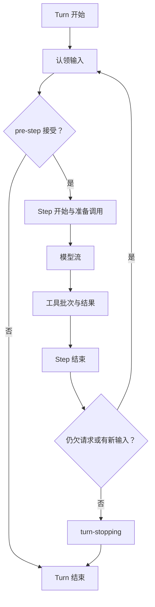
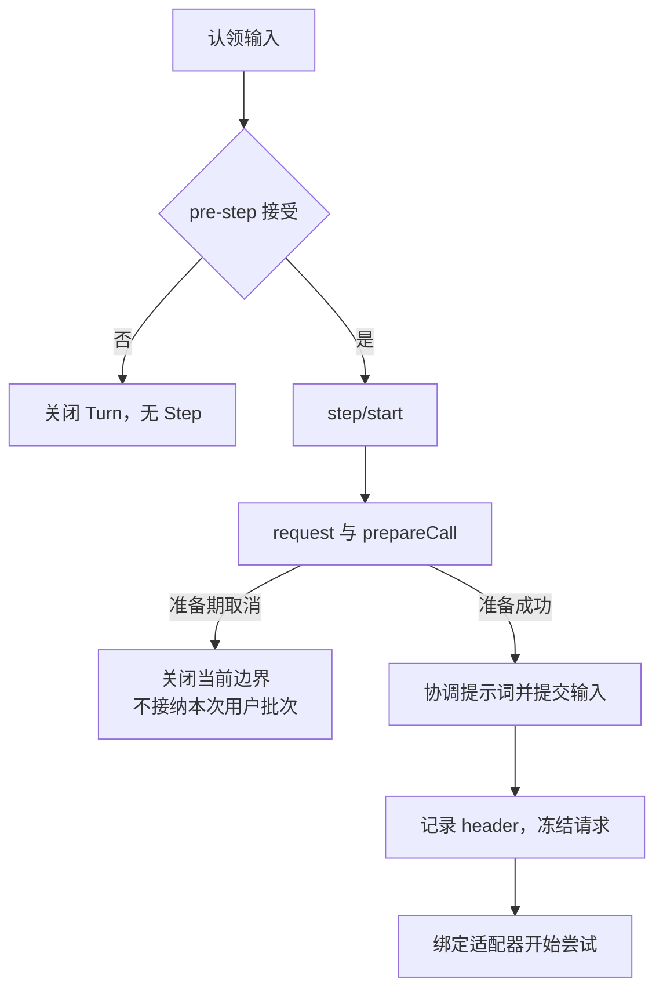

# 第 6 章：Turn、Step 与输入队列

<!-- block: deepseek-ch06.b-opening -->
用户发出一条消息，模型先要求读两个文件，随后又运行测试，最后给出解释。这是一轮用户任务，却不是一次模型请求。用 Turn 和 Step 分开记录，才能回答取消停在哪、追加输入何时生效、失败后还欠哪些工具结果。

## 6.1 两种边界解决不同问题

Step 是一次模型请求及它触发的工具工作。Turn 包含零个或多个 Step：在认领输入前开始，直到没有尚需履行的工作时结束。零个 Step 很有意义，输入可能在 pre-step 被拒绝，或者第一份输入被改写为空；日志仍能表达“尝试开启过一轮，但没有发送请求”。

一次请求可以给出多个工具调用，工具返回后往往还要再请求模型解释结果。因此，回车次数不能直接算作 Step 数，工具数量也不能直接算作 Turn 数；模型流结束时，Turn 可能仍有工作要做。



图 6-1：默认驱动的循环轮廓。真实日志还包含请求头、上下文快照与失败尝试。

## 6.2 输入不是直接塞进正在飞行的请求

默认驱动有一个 inbox。修改队列会留下规范化的 agent/inbox/spliced 事件，投影据此重建待处理输入；领取与取消是不同结果。已经在发送的模型请求被冻结，后来补充的要求应进入后续认领，而不是从旁边改写同一请求对象。

例如任务正在运行测试，你追加“只关注 Windows 的失败”。如果系统把这句立即拼进现有网络请求，那请求与日志就难以一致。通过 inbox 排队，下个被接受的 Step 才获得这条信息；UI 应呈现它仍在等待，避免用户误以为当前调用已经看见新要求。

注入上下文也不必然唤醒代理。固定版本的架构说明区分上下文材料与唤醒消息：有些材料等待下一条真正要工作的输入。用事件记录“已经插入”和“已经认领”，就能解释为什么插件提供了材料，模型暂时没有反应。

## 6.3 pre-step 与 request 各改什么

pre-step 能接受、重写或拒绝被认领消息，决策发生在 Step 准备前。step 的模型选择已经从 Session 取快照，包括 provider、model 和显式 reasoning effort。老的 agent/request 扩展点仍存在，但不能偷偷换掉这份路由选择；当前快照会拒绝这样的改变。

这使路由变化可追踪：用户选择另一个模型，应记录成会话状态，并由下一 Step 获取，而不是某个中间件临时改一个字段。重试也保留该 Step 的模型选择，避免一次失败之后无声换模型却仍被当成同一次请求。

实现观察插件时，把 request 的进入与实际 stream 开始分开计时。配置解析、适配器绑定和上下文准备也会消耗时间。只用“首 token 减用户点击”无法判断是网络慢还是本地准备慢。

## 6.4 停止不等于抹掉已经发生的事

默认 agent.cancel 使用协作式取消信号，并根据 keepInbox 选择是否保留待处理工作。流里已经交给用户的文本可能被保留为中断结果；已经执行的工具也不会倒带。取消的正确目标是停止继续产生不需要的工作，并让状态可解释。

当模型给出多个工具调用时，部分已经启动、部分还没启动。日志需要分别表达“未开始”与“结果未知”；把它们都写成失败会诱发不必要的重试。文件写入若已完成但回执丢失，再执行一次可能覆盖更新的数据。

练习时准备一个只读工具和一个延时工具，任务启动后在不同位置取消。记录取消信号时间、工具进入时间、结束事件与队列剩余项。不要只断言进程退出码；真正要核对的是每个已接受调用都有可解释的结局，以及下一轮恢复不会把尚未确认的副作用直接重做。

本章的完整循环流程来自固定版本源码与文档，未把真实模型请求纳入本册实跑。Cordis 的环绕调用实验只能帮助理解调用顺序，不能替代 inbox、持久化与取消链路的集成验证。

<!-- deepened: 06 -->

## 6.5 先手工推演两步审查

用连续实例的文本统计任务想象一次默认循环：用户要求检查 TODO，第一份模型响应提出 review_text 调用，工具返回 todo=true，第二份模型响应给出解释。整个过程是一轮 Turn，包含两个 Step。第二个 Step 没有工具调用也仍是一个 Step，因为它发出了一次新的模型请求。

若请求失败后允许重试，不能只按网络请求数反推 Step 数。固定循环的重试会复用已接受的组装结果，不再重复 pre-step 和用户输入接纳。一次语义上的推进可能包含多个供应商尝试；每次尝试的记录用于错误和费用诊断，不应该凭空增加一条用户消息。

下面只是方便阅读的事件选录，省略 header、context、系统提示词与完整消息对象，不能作为可导入的 Session JSONL：

```text
turn/start        turn=1
step/start        turn=1 step=1
user/message      审查这段文本
assistant/message 提出 call-1: review_text
tool/call         callId=call-1
tool/result       toolCallId=call-1, todo=true
step/end          turn=1 step=1
step/start        turn=1 step=2
assistant/message 解释发现的 TODO
step/end          turn=1 step=2
turn/end          turn=1
```

这份选录要结合边界和配对来读：缺少 tool/result，下一轮模型历史可能不合法；缺少 turn/end，消费者便无法确认任务是否结束。UI 显示的结束状态不能补齐缺失事件。

## 6.6 inbox 的两种认领位置

agent-loop README 把输入分成当前下一步材料与排队 prompt。Turn 边界会打开持久轮次，再原子地认领待处理 next-step 输入和一个排队 prompt；同一 Turn 的步骤间只认领 next-step 输入。这个差异防止一条新排队任务随意挤进当前任务内部。

例如正在修复一个测试时，用户又提交“然后更新文档”。它究竟是本轮追加约束还是下一轮独立任务，应该由输入入口表达。只把所有字符串放进同一数组、每次循环 splice 全部取走，会让多任务顺序随请求完成时间变化。

结构命令与认领状态也分开。入队、删除、替换等变化有 durable inbox 事件和投影；循环内部还要知道哪些材料已被自己领取，避免两个阶段重复接纳。恢复时先重建可持久事实，再由新驱动建立本次认领，不能恢复一个旧 Promise 的运行位置。

组件样例没有实现 inbox，request.id 只用于关联进程内调用。Harness 还要把输入与轮次持久化，恢复时才能知道哪些材料已入队、哪些已经被认领。

## 6.7 请求准备有一段尚未提交输入的窗口

被 pre-step 接受后，固定循环先写 step/start，再进入 agent/request waterfall 与 prepareCall。此时待用的系统提示词和已接受用户消息还没有作为本次内容提交到历史。若在这两个异步阶段取消，就不应留下看似已经交给模型、实际从未发出的用户接纳记录。

prepareCall 返回真正绑定的适配器能力之后，循环才根据该能力协调系统提示词、刷新运行事实、接纳第一尝试的用户批次、记录请求头和上下文，并派生冻结请求。旧 request/context 快照不能代替本次准备结果；模型路由或插件可能已经改变。

这段顺序使一次配置失败更容易解释：是 Step 已打开但调用准备失败，还是请求已发送后流错误。两者都会结束当前推进，却不应该产生相同的 assistant 历史。调试时把 prepareCall 起止和 stream 起止分开，才能知道外部模型到底有没有收到请求。



图 6-2：准备成功之前和之后的提交位置。箭头描述固定循环的职责次序，省略了重试与提示词更新的分支。

## 6.8 工具批次为什么需要 barrier

假设模型一次提出读取 A、修改 A、再次读取 A。即使三个工具各自都能执行，任意并发会让第二次读取有时看到旧内容、有时看到新内容。管线用工具定义的 isConcurrencySafe 分类，只有准确返回 true 才可进入并行组；未知、未声明、参数无效或分类器抛错都按 exclusive 处理。

exclusive 形成屏障，前面的并行工作需要先收敛，独占调用完成后后面的组才能推进。结果最后仍按模型调用顺序保存，这种稳定输出顺序不代表完成顺序一致。测量性能需要开始/结束记录，解释模型历史则需要原始排列，两者不能用同一个排序规则代替。

本书 review_text 只处理传入文本，业务本身没有共享写入，但它仍会向 ReviewJournal 追加记录。是否允许并发应看所有共享状态是否能正确关联，而不只是看主要计算“像只读”。如果同时两次调用，id 应不同，active 与结果必须按 id 对应；用单个 currentTask 字段会立即丢失其中一次。

## 6.9 三种未完成工具结果

源码把取消前未分发的调用标成 ABORTED_BEFORE_DISPATCH。Step 因其他失败结束时，如果模型提出了调用但没有 tool/call 记录，则使用 TOOL_NOT_STARTED；如果已经记录 tool/call 却没有已提交结果，则使用 TOOL_OUTCOME_UNKNOWN。三个名字分别承载调度事实，不能统一翻译成“工具失败”。

TOOL_OUTCOME_UNKNOWN 表示外部操作的结果尚未确定。循环先等已启动的分发结束，再补齐尚未回答的请求，并保留原始失败原因。后续模型因此能读到配对历史，而不需要自动重做结果不明的操作。

连续实例里的 tool:error 更简单，因为它只有进程内计算和可控取消，没有磁盘结算。我们能确定取消发生后没产生 tool:result，因为测试把计算放在 signal.throwIfAborted 后面。把这份把握推广到任意数据库工具就会出错：数据库可能在取消信号到来前已经提交。

## 6.10 空闲与落盘还有一层距离

当 whenIdle 表示驱动已没有前台工作，调用者往往立刻去磁盘读取日志。固定会话契约明确指出 Turn 边界本身不等待 flush；每次请求的耐久检查点由 checkpoint policy 负责。需要直接读取存储的消费者，必须按存储接口要求自行 flush。

逻辑事件已追加、前台任务已空闲和物理持久化已确认，是三个完成条件。内存中的 turn/end 不保证断电后仍能读到；磁盘暂时缺少最新行，也可能只是尚未 flush。客户端需按自己的用途等待相应条件。

读实际日志时，可先找 Turn 边界，再按 Step 查看请求准备、终止原因和工具结果配对；需要读取磁盘的消费者，还要检查持久化是否完成。

## 固定版本来源

- [packages/core/agent-loop/README.md](https://github.com/deepseek-ai/deepseek-harness/blob/fcc0ad462172522aaf5c93a7b2e01f6b9f0b0159/packages/core/agent-loop/README.md)
- [docs/agent-lifecycle.md](https://github.com/deepseek-ai/deepseek-harness/blob/fcc0ad462172522aaf5c93a7b2e01f6b9f0b0159/docs/agent-lifecycle.md)
- [docs/architecture.md](https://github.com/deepseek-ai/deepseek-harness/blob/fcc0ad462172522aaf5c93a7b2e01f6b9f0b0159/docs/architecture.md)
