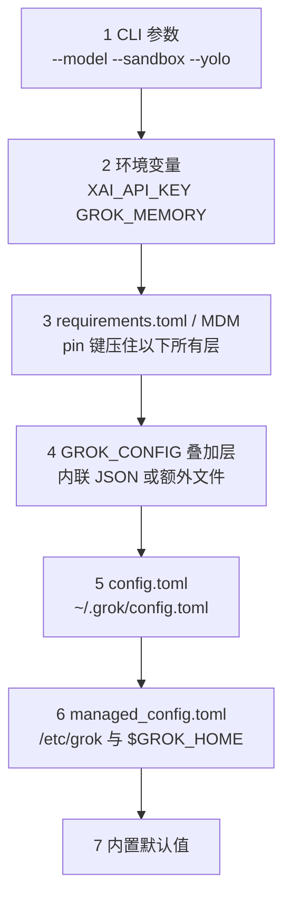

# 第 3 章：配置的七层优先级

<!-- block: grok-ch03.b-opening -->
七层中的任何一层都可能写入同一个键；先知道谁压住谁，再判断你在配置文件里看到的值是否会生效。

改一个 `config.toml` 里的模型名，重启后仍是旧值。常见原因是启动方用环境变量或 CLI 参数覆盖了它，或者组织下发的 `requirements.toml` 把该键钉死。

<!-- block: grok-ch03.b-precedence -->
手册把优先级写成编号列表，并且明确「最高优先级在前」（`05-configuration.md:9`）。读这张表时，序号小的层赢。

## 3.1 七层，从高到低

原文（`05-configuration.md:11-17`）：

1. **CLI flags**（例如 `--yolo`、`--model`、`--sandbox`）
2. **Environment variables**（例如 `XAI_API_KEY`、`GROK_MEMORY`）
3. **`requirements.toml` / MDM**（组织强制，压住其下每一层，包括叠加层）
4. **`GROK_CONFIG` / `GROK_CONFIG_PATH` 叠加层**（在 `config.toml` 与 managed 之上，在 `requirements.toml` / MDM 之下）
5. **config.toml**（`~/.grok/config.toml`）
6. **`managed_config.toml`**（组织下发的默认值，在 `config.toml` 之下）
7. **内置默认值**



图中箭头表示上方一层压住下方一层。第 3 层与第 1 层的关系有一个例外：`requirements.toml` 里标记 `pin` 的键，对该文件之外的一切生效，包括环境变量与命令行（`26-config-reference.md:13`）。

## 3.2 每层被谁压住

| 层 | 例子 | 被谁压住 |
| --- | --- | --- |
| 1 CLI 参数 | `--model`、`--sandbox`、`--yolo` | `requirements.toml` 中标记 `pin` 的键 |
| 2 环境变量 | `XAI_API_KEY`、`GROK_MEMORY` | 第 1 层；`pin` 键 |
| 3 `requirements.toml` / MDM | `/etc/grok/requirements.toml`、macOS MDM `ai.x.grok` | 无更上层 |
| 4 `GROK_CONFIG` 叠加层 | `GROK_CONFIG='{"models":…}'` | 第 1、2、3 层 |
| 5 `config.toml` | `~/.grok/config.toml` | 第 4、3、2、1 层 |
| 6 `managed_config.toml` | `/etc/grok/managed_config.toml`、`$GROK_HOME/managed_config.toml` | 第 5 层及以上 |
| 7 内置默认值 | 未写文件时的默认值 | 以上全部 |

第 6 层由配置文件构成，手册对它的描述是「组织部署的默认值，在 `config.toml` 之下」，即开发者自己的文件可以覆盖组织默认值（`05-configuration.md:16`）。第 3 层不同，其他层无法覆盖它管理的键（`26-config-reference.md:12-13`）。

配置文件这一档内部按从低到高合并：`managed_config.toml` → `config.toml` → `GROK_CONFIG` 叠加层 → `requirements.toml` / MDM（`05-configuration.md:19`）。叠加层与 `config.toml` 是深合并，只覆盖它写到的键。

## 3.3 两种注入方式：内联与文件

`GROK_CONFIG` 是一个内联 JSON 对象；`GROK_CONFIG_PATH` 是一个额外的文件叠加，不是对 `config.toml` 的替换（`05-configuration.md:27-28`）。

- `GROK_CONFIG_PATH` 按扩展名解析：`.json` 走 JSON，其余走 TOML。
- 两者同时设置时 `GROK_CONFIG` 优先。
- `GROK_CONFIG` 为空字符串视为未设置；格式错误时记录警告，并回落到 `GROK_CONFIG_PATH`。
- 叠加层只影响从合并配置读出的设置，只允许一份受限的软设置白名单：`models`、`features`、收窄的 `toolset`，以及只含过滤字段的 `shell_environment_policy`。

以上四条出自 `05-configuration.md:28` 与 `:30`。手册用一句话定性：它**不是**提权路径，系统会拒绝白名单之外的键（`05-configuration.md:30`）。

这个机制面向启动方。手册举例：一个 harness 或 ACP 客户端运行 `grok agent stdio` 时，可以不写 `config.toml`、不迁移 `$GROK_HOME` 就注入设置（`05-configuration.md:25`）。示例命令：

```bash
GROK_CONFIG='{"models": {"default_reasoning_effort": "high"}}' grok agent stdio
```

命令在 `05-configuration.md:33`，本次没有执行。

## 3.4 requirements.toml 与 MDM 压在哪里

三个文件名分管三件事，`26-config-reference.md:9-13` 用一张表区分：

| 文件 | 谁写 | 位置 | 用途 |
| --- | --- | --- | --- |
| `config.toml` | 开发者本人 | `~/.grok/config.toml`，以及项目内 `.grok/config.toml` | 个人默认值 |
| `managed_config.toml` | 组织，经控制台或部署工具 | `/etc/grok/managed_config.toml` 或 `$GROK_HOME/managed_config.toml` | 下发车队起点，开发者可覆盖 |
| `requirements.toml` | 组织，签名 | `/etc/grok/requirements.toml`、macOS 设备管理，或 `$GROK_HOME/requirements.toml` | 设定开发者无法修改的值 |

`requirements.toml` 的读取顺序是 `$GROK_HOME/requirements.toml`（签名缓存），然后 `/etc/grok/requirements.toml`，然后 macOS MDM 域 `ai.x.grok`（`26-config-reference.md:24`、`:705`）。配置文件里的 Requirements 列标注每个键能否在该文件里设置：`pin` 不允许覆盖，`yes` 表示可接受，`—` 表示系统不读取（`26-config-reference.md:34`）。

项目级 `.grok/config.toml` 是另一个受限层，只提供 `[mcp_servers]`、`[plugins]`、`[permission]` 与 `[mcp] max_output_bytes`（`26-config-reference.md:32`）。`26-config-reference.md:19-26` 把它单列为一行，因此那份清单有八行；本章按 `05-configuration.md` 的七层讲，两者不冲突，只是切分粒度不同。

配置读错时的表现，changelog 里有一条记录。1.0.75（2026-11-04）的条目写着：权限规则加载失败时，现在会在会话打开时给出警告，而不是静默跳过（`https://x.ai/changelog/build`，访问日期 2026-11-13）。条目的措辞是 `instead of being skipped silently`，可见之前的版本不留提示。读到「规则没生效」时，先看版本号。

相邻仓库里另有一条仍在打开状态的报告：#209 说非默认审批模式下，特权工具调用会以 `unknown permission option` 全部失败（`xai-org/plugin-marketplace` issue 209，2026-08-09）。它是用户报告，不是官方说明，引用时说清这一点。

## 3.5 GROK_HOME 与这一章的边界

`GROK_HOME` 覆盖配置目录，默认是 `~/.grok`（`05-configuration.md:819`）。会话、记忆、规则的默认路径都挂在这个目录下，后续两章会分别用到。

本章的优先级与配置落点来自手册的 Precedence 节与配置参考表；§3.4 末尾的两条是日期明确的排查线索（`x.ai/changelog/build` 1.0.75 与 `plugin-marketplace#209`，2026-11-13 核对），前者是官方条目，后者是用户报告，不并入上面的配置结论。本次没有在装有 `grok` 的机器上运行 `grok inspect`，也没有构造多层冲突的配置去验证合并顺序。文档把 `grok inspect` 与 `grok inspect --json` 列为查看「哪个文件、哪个值赢了」的入口（`26-config-reference.md:28`），这是验证本章断言最直接的手工实验。
