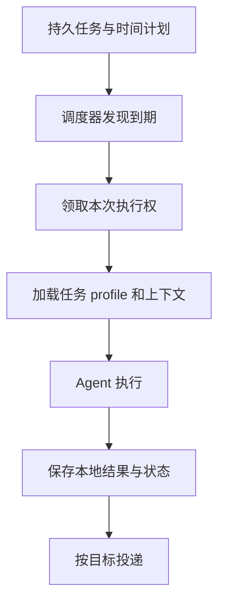
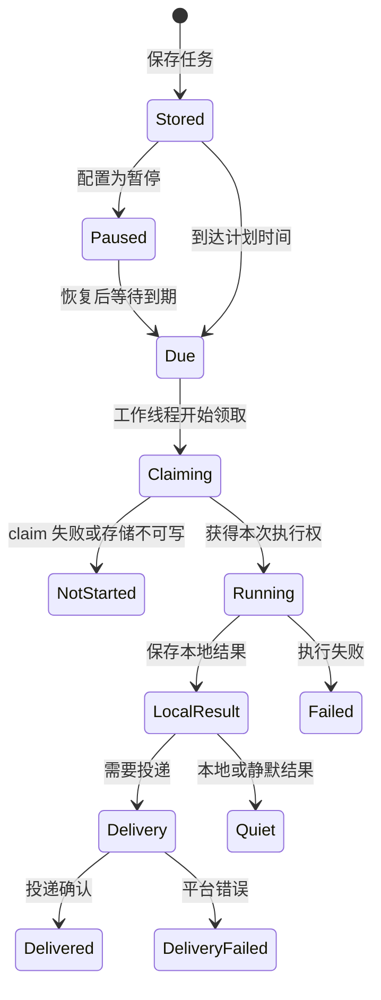

# 第 11 章：Cron 与持续任务

<!-- block: hermes-ch11.b-opening -->
“每天检查资料并给我结果”至少包含四件事：保存任务、计算到期时间、执行 Agent、投递报告。任务可以已经保存但尚未执行，报告也可能已经生成却没有送达。排查时，需要知道它具体走到了哪一步。

## 11.1 调度记录保存在哪里

本书所用版本的 cron/jobs.py 以当前 profile 的 cron 目录保存 jobs.json，并为运行输出使用单独目录。源码特别处理 profile 路由，避免多个配置共用一份任务文件。任务不仅有一句提示词，还需要计划、状态、执行范围和其他控制信息。

直接手改 jobs.json 可能破坏字段一致性，或与正在运行的调度器竞争。日常使用应通过当前版本支持的工具或管理入口创建、更新、暂停任务。研究时可以读取它理解结构，不过内部 JSON 的格式可能随版本变化，不能作为长期稳定的公共 API 使用。

## 11.2 到点、领取和完成不是同一个时刻



调度器必须面对两个进程同时检查到期、任务运行超过下个周期、时区变化和机器停机。该版本包含锁、执行 claim、运行中记录与迟到分类等机制。这些机制减少重复执行和状态混乱，但不等于任何故障下都恰好执行一次。

尤其要区分执行一次与外部副作用一次。报告文件可以覆盖同一路径，聊天通知却可能重复发送。为每次运行保存可识别的结果标记，能帮助用户判断重复报告究竟来自重试、多个调度器还是两个不同任务。

## 11.3 时间表达应当可核对

自然语言“明早”依赖时区和当前时间；cron 表达式还涉及日历边界。创建后应读取系统解释出的下一次执行时间，而不是只看原输入。跨夏令时地区尤其要明确是固定本地钟点，还是固定间隔。

机器离线期间错过的任务如何处理，也需要看具体版本与任务类型。一次性任务和重复任务的恢复策略可能不同。“每天运行”的计划不保证补齐所有漏跑，服务重启也未必从头重放计划。

## 11.4 首次实验先不投递

为教学任务使用单独 profile，只让任务读取虚构资料并写本地报告，不配置真实聊天目标。观察任务创建、到期、执行和本地产出后，再研究投递。这样能避免为了排查调度而不断打扰真实群组。

可以设计三个失败：目录不存在、工具返回错误、执行耗时超过预期。检查本地输出、任务状态和下一次计划如何变化。然后在任务执行前暂停它，确认暂停作用于哪一阶段。已经开始运行的任务与尚未领取的任务不一定受到同样影响。

本书尚未运行真实 cron 调度或投递，这组步骤留作后续实验。记录每次故障前后的状态，可以与下面的源码路径对照。

## 11.5 沉默结果仍然需要本地证据

该版本的 scheduler.py 对静默响应有特殊处理，例如符合约定的 SILENT 标记可以抑制投递，但本地输出仍有用途。静默适合没有新变化的巡检，失败则仍需记录并能被发现。一个任务没有发消息，可能是没有变化、被抑制、尚未执行、失败或投递异常，需要通过状态区分。

长期维护时应关注连续失败与长期无产出，而不只是收到的消息。减少通知噪声有价值，前提是故障仍可发现。把执行结果、投递结果和用户确认拆开保存，会比一个笼统 success 更容易排错。

## 11.6 将已完成的手工任务缩成定时输入
Aurora 可以定时运行的部分，是读取当前规则、检查文件、保存报告。判断哪些旧文档应该删除，仍需要人确认。先把任务写成“只报告问题，保存 input_digest”，就能让定时执行围绕一个可核对的结果展开。

固定源码的 create_job 接受 prompt、schedule、workdir、deliver、paused 等字段。下面是存储 API 层的阅读示例，应在已装齐上游依赖、指向独立实验 profile 的环境中使用；本书没有执行这段创建操作：

```python
from cron.jobs import create_job, use_cron_store

with use_cron_store(experiment_profile):
    job = create_job(
        name="aurora-review",
        prompt="读取当前 rules.json，执行 Aurora 检查器；仅保存和解释结果，不修改资料。",
        schedule="every 30m",
        workdir=str(project_directory),
        deliver="local",
        paused=True,
    )
```

experiment_profile 与 project_directory 是事先准备的 Path 对象，后者应为绝对路径。paused=True 让你先检查存下来的记录。这个函数只创建持久任务记录；调度注册与执行编排还在 scheduler.py 中，平台是否能投递也需另查。读者应通过当前完整应用的管理入口启用任务，再观察下一次执行时间。

创建函数还有 script 与 no_agent 组合，允许纯脚本任务；monitor_script 或 monitor_url 则在调度轮次里先检查是否有变化。它们对应不同运行模式，也有互斥校验。若只是每天产生同一种确定性 JSON，纯脚本可能比每次调用模型更合适；若需要解释新问题，再让 Agent 参与。确定性的处理可以留给脚本，模型负责解释需要判断的新情况。

## 11.7 “30m”和“in 30m”是两份不同计划
parse_schedule 的代码明确区分两种字符串。30m 与 every 30m 是重复间隔，in 30m 是延迟一次执行；ISO 时间戳也是一次性计划。把一个 in 漏掉，可能让原本只想试一次的任务持续存在。创建后核对计划是否重复执行，便能发现这种输入差异。

固定本地钟点与固定时长也不同。每天早上九点通常是日历计划；每隔三十分钟是时长。跨夏令时时，两个相邻本地钟点之间的实际时长可能改变。该版本对没有时区的时间戳采用配置中的时区，并为部分计划提供 timezone、grace_minutes 和 catch_up 控制。读者应同时记录原始表达、解析类型和下一次实际时间，避免只保存一句“每天运行”。

对于 Aurora，可以先用一次性延迟任务观察完整过程，再改成重复任务。验证时把 clock time 与报告 input_digest 分开：相同输入的两次运行应允许产生相同摘要，而运行记录必须能区分这是两次执行。把时间塞进输入摘要会破坏内容比较，把摘要当作运行 ID 又会合并不同执行。

## 11.8 执行权为什么要在动作之前保存
该版本的 claim_dispatch 针对有次数限制的一次性任务，在真正副作用发生前增加并持久化派发计数。这样即使进程在执行中途死亡，也不会因为“没有写完成状态”就无限重跑同一有限任务。代价是一次已经领取但未完成的机会可能不会自动再来，需要诊断记录与操作者决定。

重复任务还有运行 claim、心跳和下一次时间推进，不能把一次性分支的规则直接套到所有任务。scheduler 的 _process_due_job 在工作线程真正开始时领取 fire claim，避免任务在队列里等待时租约先过期；领取失败时，它可以结束这次执行记录而不进入 run_one_job。这解释了为什么“到了执行时间”不等于“工具已经开始”。



这是阅读源码时使用的阶段图，不是 jobs.json 中一一对应的枚举定义。它把最常见的观察点排在一起：未开始、执行失败和投递失败需要不同恢复动作。对最后一种失败，重新投递已有结果通常比重跑 Agent 更接近原意，但仍要核对目标和去重条件。

## 11.9 用输入变化决定是否需要解释
连续两次 Aurora 检查若 input_digest 相同、问题集合相同，就没有必要让模型重新写一段相似报告。可以在业务层比较摘要，只在输入或状态变化时进入解释步骤。这个设计属于本书的任务方案，不是声称 Hermes 默认替你比较 Aurora 报告。

比较时要把失败保留为变化。比如昨天检查正常，今天 rules.json 无法解析，今天没有新报告并不意味着“内容没变”。应记录本次退出码 2 和错误，使调度器能够识别执行退化。旧 reports/latest.json 的存在，只说明曾经有一次成功写过文件。

判断是否静默时，还要查看运行次数、最近成功时间和最近失败原因；这些本地记录仍需保留。它们能区分正常但无变化的巡检与已经停止的任务，用户收到的通知则可集中在需要处理的变化上。

## 11.10 用同一份输入比较三种故障
Aurora 很适合练习持续任务的恢复，因为几种失败可以独立制造。先把项目目录暂时改名，观察工作目录或脚本输入失败；再恢复目录，把规则布尔值改成字符串，观察执行进入程序后被配置校验拒绝；最后让检查正常完成但保持 local 输出，确认没有真实平台投递也能留下本地结果。

| 故障位置 | 本地可见证据 | 合适的下一步 |
| --- | --- | --- |
| 项目目录不可用 | 本次启动或读取错误，没有新输入摘要 | 修复路径后重新执行 |
| 规则类型不正确 | 退出码 2，旧报告仍在 | 修复规则，不能复用旧报告当新结果 |
| 文档断链 | 退出码 1，报告有文件和目标 | 审阅问题后决定修改 |
| 平台发送失败 | 本地报告已存在，投递单独报错 | 核对目标与权限，再处理投递 |

前三种可用本地合成资料验证，最后一种需要实际平台测试环境。每次只改变一个条件，并分别保留 schedule、模型、工作目录和投递目标的原值，任务状态变化的原因就更容易查明。

源码定位：[任务存储、时间与锁](https://github.com/NousResearch/hermes-agent/blob/2bd378ed1b8d6bf2192cb26e0a55ff3091e6bd19/cron/jobs.py)、[调度、执行与投递编排](https://github.com/NousResearch/hermes-agent/blob/2bd378ed1b8d6bf2192cb26e0a55ff3091e6bd19/cron/scheduler.py)。
