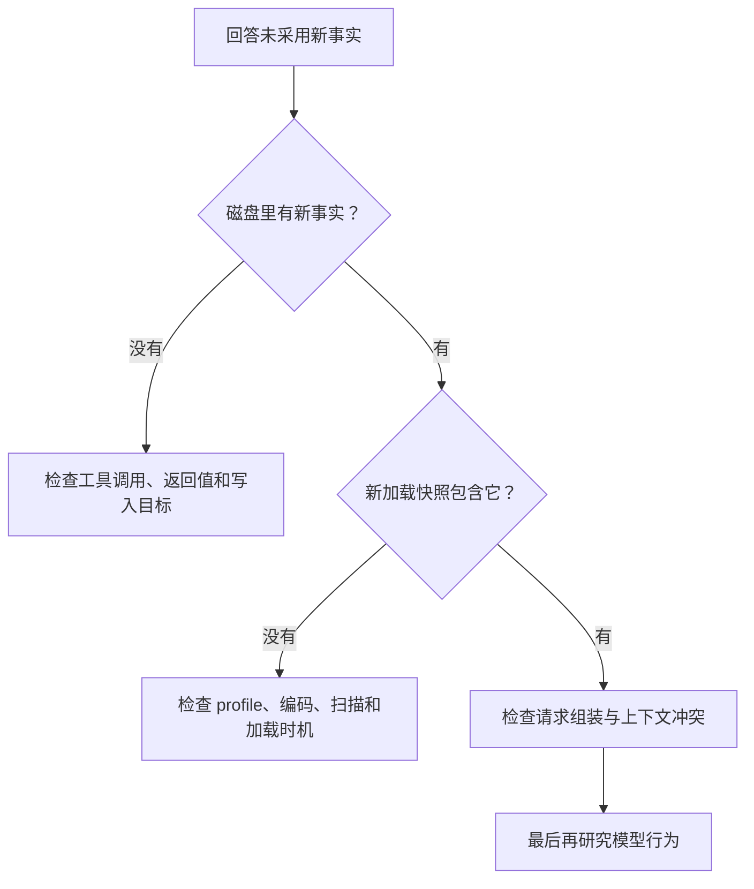

# 第 16 章：观察与调试

<!-- block: hermes-ch16.b-opening -->
“Agent 没记住”可能发生在好几个地方：没有调用 memory，写入失败，写到了另一份 profile，当前快照未刷新，或事实进入请求后被模型忽略。本章从一次错误回答往回查，逐步排除这些原因。

## 16.1 从可见结果往回追

先写下期待和实际：希望新会话采用 unittest，实际回答仍推荐 pytest。接着逐层检查：当前 home 是哪一个，文件中是否有正确条目，新加载时快照是否包含它，最终请求是否带上，以及模型回答为什么偏离。



这个顺序不要求每次都抓取完整请求。很多错误在文件和工具返回阶段就能解释。文件和工具返回都符合预期时，再检查成本更高、也可能包含更多敏感信息的请求内容。

## 16.2 日志需要关联，而不需要复制全部文本

记录 session_id、工具名、阶段、错误类别和时间，常能帮助还原链路。把完整提示词、文件正文和密钥全部写进日志，会扩大泄露面，也让噪声淹没关键事件。围绕当前问题选择字段，会更容易找到关键事件。

对于记忆操作，记录 target、动作、成功状态和用量变化即可描述许多问题。需要检查具体匹配时，在本地查看相关条目，公开报告使用虚构样本。本书的驱动打印每项 PASS，并把源文件摘要和场景结果放入 JSON，不提交用户内容。

## 16.3 常见症状的排查顺序

| 症状 | 先检查 | 不要立即下的结论 |
| --- | --- | --- |
| 保存成功但当前提示没变 | 加载快照与活条目的区别 | 记忆没有持久化 |
| patch 找不到文本 | 当前完整条目、唯一匹配、编码 | 文件权限不足 |
| 技能改了却没生效 | 实际来源、同名项、读取内容 | 模型拒绝遵从 |
| 工具没有出现 | 注册、依赖检查、工具集和本次定义 | 插件代码一定错误 |
| 定时任务没发消息 | 是否执行、本地输出、静默与投递状态 | 调度器完全失效 |

每一行都指出了一条可验证的下一步。每次只改相关的一项配置，便于判断哪次变化解决了问题。

## 16.4 错误注入应当小而明确

本书组件实验故意写入损坏 UTF-8，验证新增操作不会把原文件当成空文件覆盖。这是一个可控的失败输入，发生在临时目录，检查也直接比较字节。这种输入便于重复运行，也不会损坏真实数据。

其他可控输入包括超预算条目、两个相同关键词、批处理中一个不存在的匹配、缺少技能根目录，以及工具输出超过上限。每次只改变一个因素，保存前后状态。实验结束后确认所有文件都仍在临时范围内。

针对外部服务，可以模拟超时和断线，但不能据此宣称真实服务的所有错误都已覆盖。错误类别、重试策略和服务端副作用仍需要单独研究。

## 16.5 避免修复一次、下次又忘

修复应留下触发条件、原因、改动和复现命令。若问题来自错误记忆，修正条目并说明旧结论何时失效；若来自技能，保留失败样本；若来自工具实现，增加能拦住同类错误的检查。把所有问题都写进用户档案，会让知识库越来越混乱。

版本升级后先重跑那些曾经暴露真实问题的实验。来源锁与脚本摘要帮助确认跑的是哪份代码，避免拿旧结果为新版本背书。发生新的失败时保留原记录，追加新的结果，而不是把历史里的 passed 改成 failed 并丢掉时间线。

## 16.6 用一份最小诊断记录还原 Aurora 故障
第 17 章第 6 步会用到这样一个完整样本：输入规则中 scan_examples 为字符串，程序退出码 2，标准输出包含类型错误，latest.json 字节与上次相同。仅凭这几项就能定位到配置解析，无需收集整台机器的所有日志。

一份适合提交给维护者的记录可以这样写：

```text
程序：aurora_lab.py，附脚本 SHA256
命令：check <合成项目目录>
改动：rules.json 的 scan_examples 从 true 改成 "false"
预期：拒绝类型错误，不发布新报告
实际：退出码 2；旧报告字节保持不变
复现材料：四个合成 Markdown 与 rules.json
```

如果实际结果不同，再补解释器版本、系统和必要堆栈。公开记录中应移除 API key，并只摘取所需的会话与目录信息。可重做的合成输入通常比大量未经整理的现场文本更有效，也更容易排除无关因素。

## 16.7 把存储异常和模型选择错误分开
假设用户说“记住新规则”，最终回复却说“已记住”而下一次没用。至少有四条可能路径：模型根本没有调用 memory；调用了但参数目标不对；存储返回失败被忽略；存储成功但下一次加载的是另一个 home。可以沿工具调用、返回和文件逐步判断是哪一种。

先找工具调用与返回。没有调用就检查模型行为和任务上下文；返回失败就看错误类别；返回成功就检查对应文件和目标；文件正确再查新会话实际加载的 profile。提高字符预算只对其中少数情况有用，应等查明错误类别后再决定。

第 4 章写入故障注入还增加了第五种情况：磁盘失败、对象活列表已经变化。若日志只打印对象列表，会产生“明明在内存里”的困惑。诊断记录应把同一时刻的磁盘摘要、活列表和提示快照区分开。你不必把全部记忆内容公开，合成实验中用 A、B 这样的占位事实就能验证关系。

## 16.8 错误注入应当能回答一个具体问题
把 atomic_write_text 临时替换成抛错函数，回答的是“底层写入抛异常后，上层对象和磁盘怎样变化”。它没有模拟真实断电，也没有验证临时文件落盘后、rename 前每个瞬间的耐久性。描述注入点越准确，读者越容易知道结果能用到哪里。

另一个例子是把插件 root 在创建 handler 后移走。它回答的是“运行期间目录消失时，工具是否返回可见错误”。让 FakeContext 返回 None，则回答“插件是否忽略注册拒绝”。这几项检查分别位于持久化、处理器和注册入口，尚未覆盖完整插件生命周期。

选择注入点时先写出想区分的两个解释。如果你怀疑错误来自路径还是权限，可以先用不存在目录和不可读目录分别检查；如果只想确认业务结果处理，就不必启动一个不稳定的真实平台。小实验的优势在于变量少，结果才容易归因。

## 16.9 诊断完成后把证据留在正确位置
修复代码时，把最小失败样本写成测试；修订技能时，把触发条件和操作变化写进方法；改变项目范围时，更新 rules.json 并保留决定理由。memory 中只需留下“遇到这种情况先查哪一处”的稳定入口；完整错误日志与异常栈保存在诊断记录中。

测试也应有足够独立性。若测试只是调用同一个辅助函数生成预期值，再与函数输出比较，错误可能在两边一起出现。Aurora 的断链测试直接断言具体目标 setup.md，修复后再断言状态恢复；MemoryStore 测试核对真实磁盘字节，避免只相信返回的 success。

最后看一个没有改动的重跑。第 17 章第 8 步让相同输入再次生成相同报告，既检查确定性，也能发现你是否在报告里混入了无关时间戳或随机标识。运行标识可以随机生成，input_digest 则由输入决定。两者分别记录，既能区分两次运行，也能确认它们处理的是同一份内容。

源码定位：[组件驱动](examples/check_memory_components.py)、[内置存储错误处理](https://github.com/NousResearch/hermes-agent/blob/2bd378ed1b8d6bf2192cb26e0a55ff3091e6bd19/tools/memory_tool_store.py)、[记忆协调与后台调用](https://github.com/NousResearch/hermes-agent/blob/2bd378ed1b8d6bf2192cb26e0a55ff3091e6bd19/agent/memory_manager.py)。
