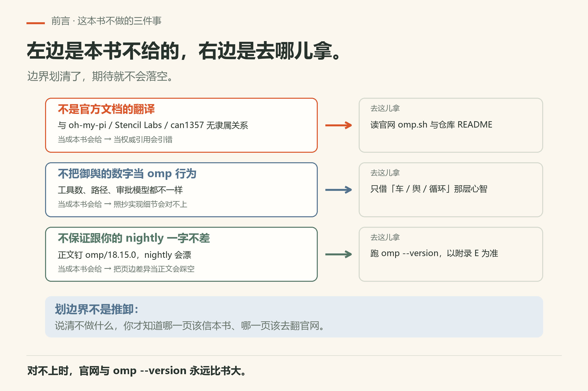
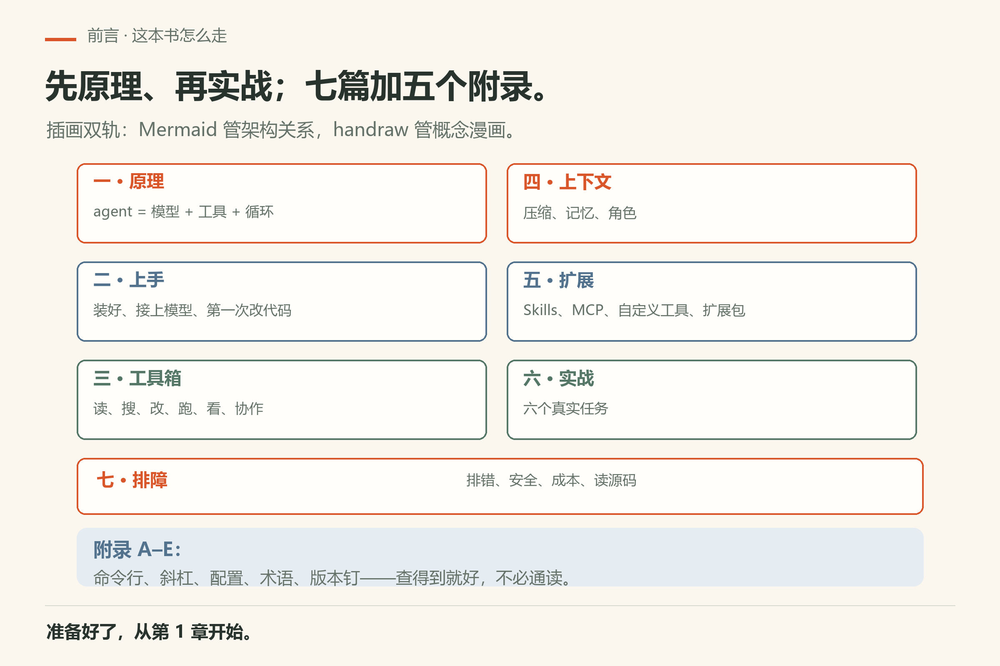
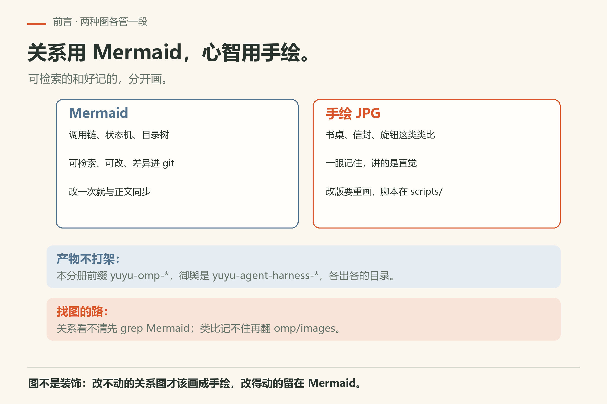
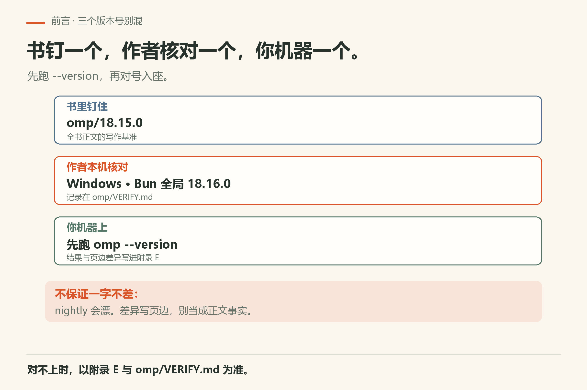
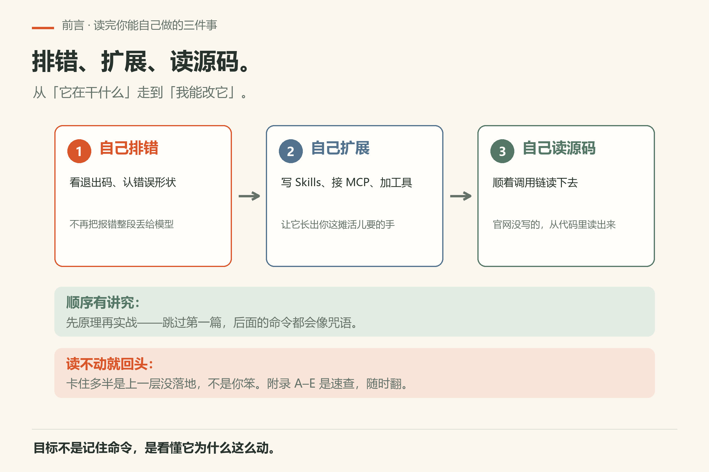

# 前言

<!-- block: omp-front.b-33699144 -->
> **开门一句话：**Omp 是开源终端里的 AI 编程 agent；这本书带你从「它到底在干什么」走到「自己能排错、扩展、读源码」。

本书是同仓丛书《御舆：解码 Agent Harness》的**第二分册**。御舆解剖的是 Claude Code 那套「车」；本分册讲的是开源命令 `omp`（[oh-my-pi](https://github.com/can1357/oh-my-pi)，官网 [omp.sh](https://omp.sh)）——面向**完全新手**，路线是**先原理、再实战**。

## 这本书不做什么

先把边界划清：这三件事本书不做，也不该指望从它这里得到。

- **不是官方文档的翻译。**与 oh-my-pi / Stencil Labs / can1357 **无隶属关系**，也不代表 Anthropic。
- **不把御舆里的 Claude Code 数字原样当成 omp 行为。**工具数、路径、审批模型都不一样；对照只借「车 / 舆 / 循环」这些心智，不借实现细节。
- **不保证跟你机器上的最新 nightly 一字不差。**正文默认钉 **omp/18.15.0**；作者 Windows · Bun 全局曾核对 **18.16.0**。你打开书前先跑 `omp --version`，并以附录 E 与 `omp/VERIFY.md` 为准。

*图0-1：左边本书不给，右边告诉你去哪儿拿。*

## 怎么读

1. **第一篇**先把 agent = 模型 + 工具 + 循环说清楚——没有这一层，后面命令都像咒语。
2. **第二篇**装好、接上模型、完成第一次改代码。
3. **第三到五篇**按工具箱 → 上下文/记忆 → Skills/MCP/扩展往下挖。
4. **第六篇**六个实战；**第七篇**排错、安全、成本与读源码。
5. 附录 A–E 是速查：命令行、斜杠、配置、术语、版本钉。

插画是**双轨**：架构关系尽量用 Mermaid（可检索、可改）；概念漫画保留 handraw 手绘（`omp/images/`）。构建产物前缀是 `yuyu-omp-*`，与御舆的 `yuyu-agent-harness-*` 分开，互不覆盖。

*图0-2：七篇加附录的地图——先原理再实战；查不到的回来翻附录。*

*图0-3：改得动的关系留在 Mermaid，改不动的心智画成手绘。*

*图0-4：书钉 18.15.0、作者核对 18.16.0，你机器先跑 --version。*

*图0-5：排错、扩展、读源码——从「它在干什么」走到「我能改它」。*

准备好了，从第 1 章开始。
