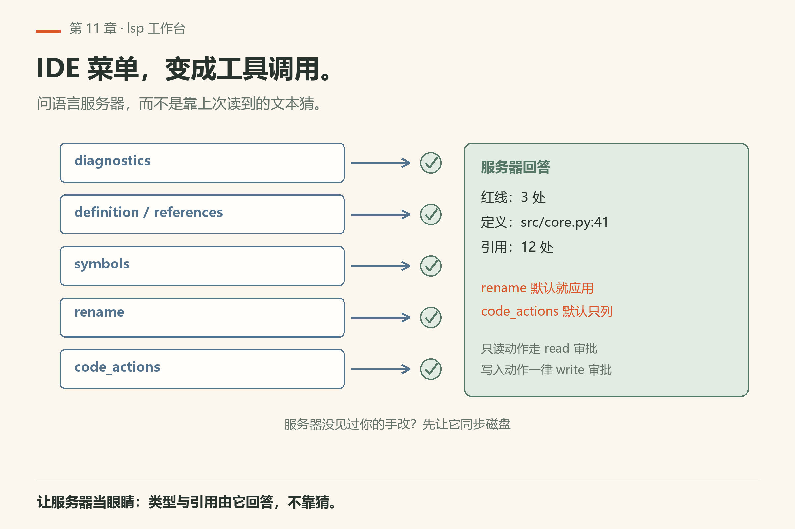
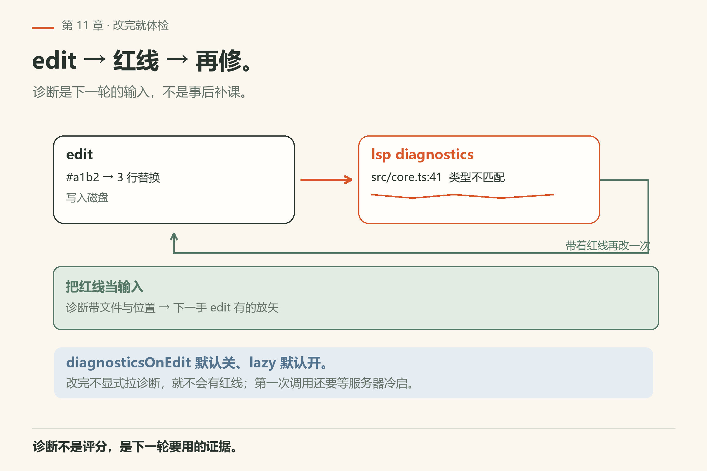
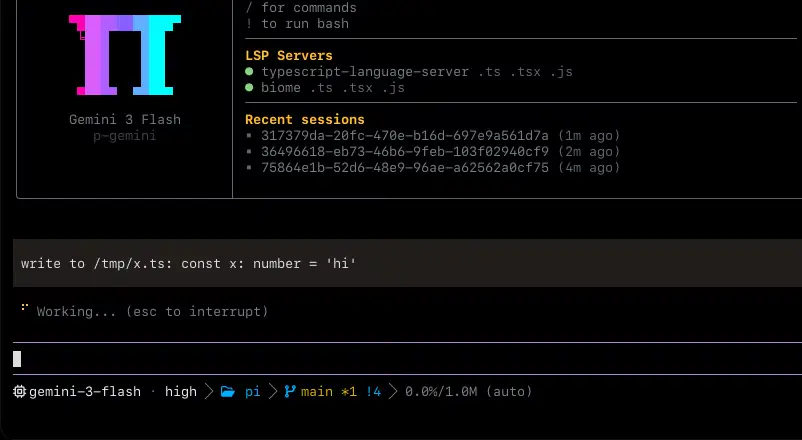
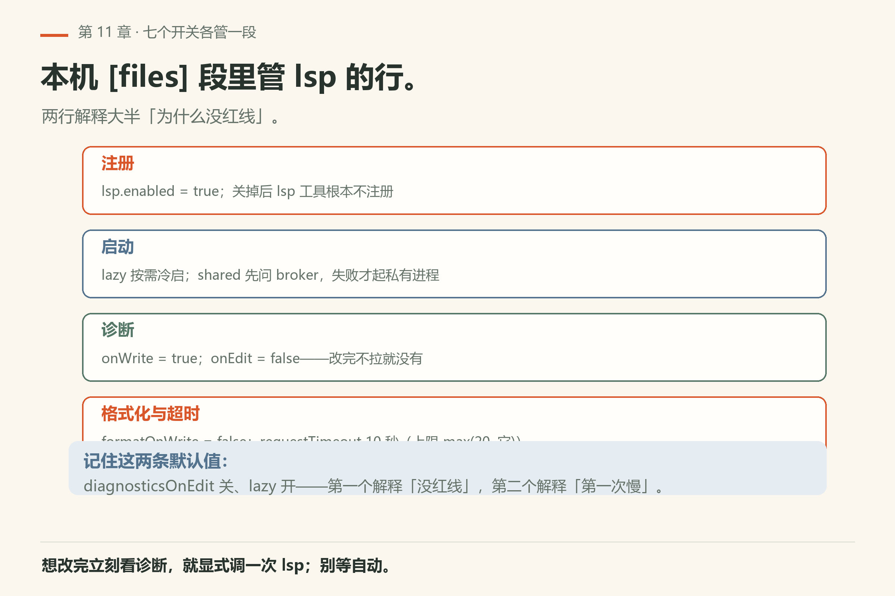
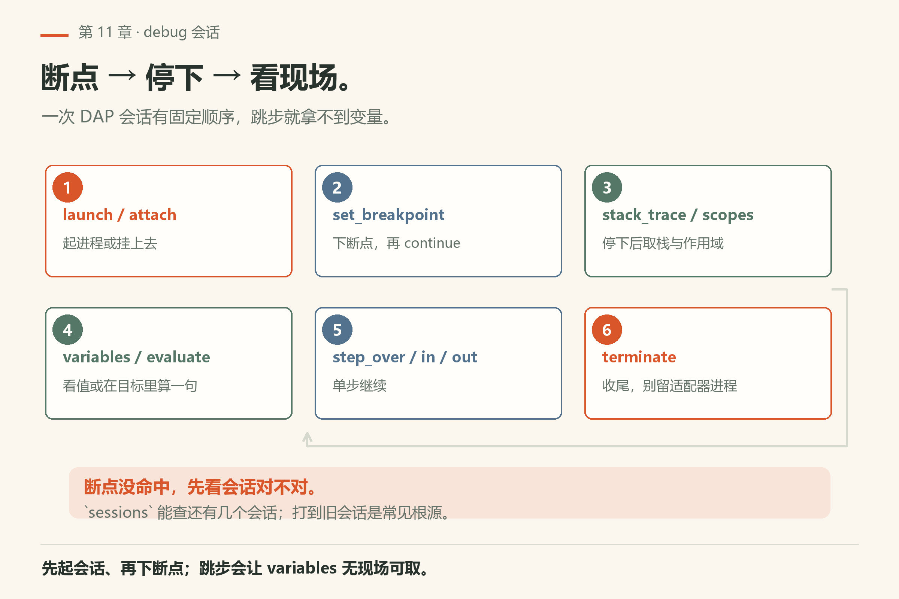

# 第11章 像 IDE 一样懂代码

<!-- block: omp-ch11.b-24b84f70 -->
你让 agent 改完一个函数的返回类型，它说「改好了」。你跑测试，十二个调用点全红。它没骗你——它只是没问语言服务器，凭上一次读到的文本猜的。

> **开门一句话：**语言服务器让 agent 少猜类型：诊断、跳转、重命名都能问。

问题不在模型不努力，在它**没有一双能问问题的眼睛**。omp 内置两只这样的手：**`lsp`** 向语言服务器问诊断、跳转、符号、重命名、code action；**debug** 驱动一次 DAP 调试会话，下断点、单步、看栈与变量。配置背景见 `docs/lsp-config.md`；工具页见 `docs/tools/lsp.md`、`docs/tools/debug.md`。



*图11-1：诊断、跳转、符号、重命名、代码操作——IDE 菜单变成工具调用。*

## 11.1 `lsp`：写入即可诊断

语言服务器协议（LSP）是编辑器跟 `tsserver`、`rust-analyzer`、`pyright` 等说话的标准。`lsp` 工具让 agent 不必「猜类型」，而是**问服务器**。

典型能力族：诊断、定义/引用跳转、工作区/文档符号、重命名、code actions、能力查询与原始请求。展开成 `action` 就是下面这些——**你选哪个 action，就落到哪条分支**：

<!-- block: omp-ch11.b-c23f629d -->
| 你想干什么 | `action` | 还要给什么 |
|---|---|---|
| 看红线 | `diagnostics` | `file`（可以是 glob；整个工作区用 `"*"`） |
| 跳到定义 / 看引用 | `definition` / `references` | `file` + `line` + `symbol`（项目感知服务器必需 `symbol`） |
| 这是什么东西 | `hover` | 同上 |
| 列文件里的符号 | `symbols` | `file` |
| 全工作区搜符号 | `symbols` | `query` + `file: "*"` |
| 重命名符号 | `rename` | `new_name`；`apply` 默认 **true** |
| 改文件名（带引用） | `rename_file` | 源 `file` + 目标 `new_name` |
| 列出可用的 fix | `code_actions` | `apply` 默认 **false**，也就是只列不改 |
| 服务器活着没 / 重载 / 能力清单 | `status` / `reload` / `capabilities` | 什么都不用给 |
| 原始 LSP 请求 | `request` | `query` 写方法名，`payload` 写 JSON |

两个容易记反的默认值：`rename`/`rename_file` **默认就应用**，`code_actions` **默认只列**。想要预览就先显式传 `apply: false`，想直接改就传 `true`。

审批也按 action 分：只读一族（`diagnostics`、跳转、`hover`、`symbols`、`status`、`capabilities`）走 read 审批；`rename`、`rename_file`、`code_actions`、`reload`、`request` **一律**走 write 审批，不管 `apply` 是真是假。

流程上，文件需要在语言服务器视野里——通常意味着已保存/已同步的缓冲。文档强调的工程习惯是：**edit/write 之后立刻拉诊断**，把红线当作下一轮计划的输入，而不是等你人眼扫 diff。

它怎么做到的：单文件语义动作启动前先 `reconcileFileFromDisk()`。没开过的文件补一个 `didOpen`；磁盘上被外部改过的发 `didChange`，并丢掉旧诊断。所以「我明明改了却没红线」多半是你绕过了工具去改文件，或者改的是一份服务器还没见过的副本。



*图11-2：edit → lsp 波浪线 → 再修。诊断不是事后补课。*



*图11-3：上游 README 的 LSP 演示（`assets/lspv.webp`）；诊断与跳转来自服务器，不是模型凭文本猜的。*

### 什么时候 lsp「不工作」

排错章会展开；这里先记清单：

- 没装对应 language server / 项目没生成正确配置；
- cwd 不对，服务器没对着项目根；
- 文件是新写的，还没进服务器视图；
- 该语言根本没配进 `lsp` 配置。

以 `docs/lsp-config.md` 为准做核对，不要假设「装了 omp 就自带所有语言智能」。

“没有诊断”至少有两种解释：服务器检查过这份文件且没有发现问题，或者服务器根本没起来、没纳入文件。用一个你故意写出的类型错误区分它们：状态显示服务可用，诊断又能指向这行，才证明检查链路通了。即使链路正常，语言服务器也不能证明业务计算正确；返回类型没错，金额仍可能算错，后者需要测试或运行证据。

### 七个开关，各管一段

`omp config list` 的 `[files]` 段里就这几行管 lsp，本机 18.16.0 实跑默认值如下（`config-get-lsp-*.txt`）：

| 键 | 本机值 | 它管的那一段 |
|---|---|---|
| `lsp.enabled` | `true` | 关掉后 `lsp` 工具根本不注册 |
| `lsp.lazy` | `true` | 服务器按需冷启；第一次调用慢是正常 |
| `lsp.shared` | `true` | 先问 broker 要共享传输，失败才起私有进程 |
| `lsp.diagnosticsOnWrite` | `true` | `write` 之后自动拉诊断 |
| `lsp.diagnosticsOnEdit` | `false` | `edit` 之后**不**自动拉，得你显式调 |
| `lsp.formatOnWrite` | `false` | 保存不顺手格式化 |
| `lsp.requestTimeout` | `10` | 秒。调用默认上限取 `max(20, 它)`，`timeout` 入参可写 `5..300` |

两行就能解释大半「为什么没红线」：`diagnosticsOnEdit` 默认关、`lazy` 默认开。前者意味着改完不拉就没诊断，后者意味着第一次拉要等服务器起来。



*图11-4：注册、启动、诊断、格式化与超时四段；`diagnosticsOnEdit` 默认关是「没红线」的主因。*

## 11.2 `debug`：DAP 会话



*图11-5：断点、STEP、堆栈与变量——同一套 DAP 子系统。*

`debug` 驱动**一次 DAP 调试会话**。邻近的调试 UI 代码还复用同一子系统做日志、原始 SSE 捕获、报告、profiling、系统诊断等（工具文档 Source 节）。

它也是一个 `action` 开关。分组记比背整串枚举容易：

| 你想干什么 | `action` | 典型症状 / 前提 |
|---|---|---|
| 起一个进程调试 | `launch` | `program` 必填，相对 `cwd` 解析 |
| 挂到已在跑的进程 | `attach` | 得先知道端口/pid |
| 下断点 | `set_breakpoint` / `set_instruction_breakpoint` / `set_data_breakpoint` | 三类断点不是一个入口 |
| 跑到下一个停点 | `continue` | 没停下就是没断点命不中 |
| 单步 | `step_over` / `step_in` / `step_out` | 得先停在一个断点上才有得走 |
| 看现场 | `stack_trace` / `threads` / `scopes` / `variables` | 顺序不能跳，变量靠 scope 取 |
| 在目标进程里算一句 | `evaluate` | 已停住才能算 |
| 收尾 | `terminate` | 不收会留适配器进程 |
| 看还有几个会话 | `sessions` | 排查「为什么断点打到旧会话」 |

你让 agent「复现这个 bug」时，理想剧本是：

1. 写/确认失败测试或最小复现；
2. 下断点；
3. 跑到断点，读变量与堆栈；
4. 单步确认猜想；
5. 再回到 `edit` 修，用测试钉死。

具体输入字段、会话生命周期、限制与错误码以 `docs/tools/debug.md` 为准。适配器是否存在取决于语言生态与本机安装——未验证的组合请标「未验证」。

## 11.3 和 bash/eval 怎么配合

LSP 不是替代 bash，是分工：查定义走 LSP，跑命令走 bash。

- 单元测试快速红绿：`bash` 跑测试命令往往更短；
- 要看程序**为什么**在某行算错：上 `debug`；
- 静态就能看出来的类型错误：先 `lsp`，别开调试器。

## 11.4 本章小实验

**实验一：先看 `--no-lsp` 长什么样**。

```sh
omp --no-lsp --help | head -20
```

本机已验（18.16.0）：`--no-lsp` 在顶层 `--help` 的 FLAGS 段，说明写「Disable LSP tools, formatting, and diagnostics」（`omp/facts/live-18.16.0/help-top.txt`）。**算成功**：旗标说明里同时出现 tools、formatting、diagnostics 三个词——LSP 关的不只是跳转，还有诊断。

**实验二**：故意在 TypeScript/Python/Rust 之一写一个类型错误，`edit` 后立刻 `lsp` 拉诊断，看消息是否指向那一行。**算成功**：诊断带文件名与行号。

先确认你这台机器的默认值：

```sh
omp config get lsp.diagnosticsOnEdit
omp config get lsp.diagnosticsOnWrite
```

本机已验（18.16.0）：分别回 `false` 与 `true`（`config-get-lsp-diagnosticsonedit.txt` / `config-get-lsp-diagnosticsonwrite.txt`）。**算成功**：一假一真——`edit` 不自动拉诊断，`write` 会。**算失败**：两条都不出值或 `lsp.enabled` 回 `false`，那你怎么改都不会有红线，先把开关开回来再说。

**实验三**：对一个已知失败断言，设计「只读调试」：断点打在断言前，打印相关变量，先不改代码。**算成功**：你能说出断言为什么失败。

**实验四**：查本机 `docs/lsp-config.md` 对应的配置入口，记下你的项目用哪一个 server。

## 11.5 重命名与 code action：让服务器动手

人在 IDE 里常点「Rename Symbol」「Quick Fix」。`lsp` 把同类能力暴露给模型：先问服务器可行 action，再应用。比模型手写全局替换安全，因为服务器懂作用域。

练习：对一个明确的内部符号走「lsp 重命名」，再 `grep` 确认旧名只残留在注释或字符串（若有）。

## 11.6 debug 与测试的分工

先测试后调试器：大多数失败不需要挂上 DAP。

- 测试红了但断言清晰：先读失败消息，未必需要 DAP；
- 失败消息只说「不对」却不说哪一状态错：上断点；
- 偶发/竞态：调试日志 + 最小复现，可能比单步更有效——此时 `bash` 跑复现脚本，`debug` 抓关键帧。

未在本机验证的语言适配器，章节实验标「未验证」，不要抄别人环境的启动命令当真理。

## 11.7 翻车对照：LSP 与 debug 的八种撞墙

语言服务器与调试器各有脾气；八种撞墙先看现象再修。

| 翻车做法 | 会看到什么 | 正确做法 |
|---|---|---|
| 让模型「改完自己检查类型」 | 它凭上次读到的文本猜，十二个调用点全红 | 改完立刻 `lsp` 拉诊断；`--no-lsp` 的机器上尤其别指望 |
| 在没装 language server 的机器上用 `lsp` | 要么没反应，要么回一个空/报错结果 | 先 `docs/lsp-config.md` 核对：server 装没装、根标记认不认 |
| cwd 不对就开会话 | 服务器没对着项目根，诊断全空 | 在项目根启动，或用 `--cwd` |
| 新写的文件还没进服务器视图就拉诊断 | 看不到红线 | 先 `edit`/`write` 落盘，再拉诊断 |
| 以为 `edit` 完就有诊断 | `lsp.diagnosticsOnEdit` 默认 `false`，改了也不拉 | 靠 `write` 的自动诊断，或显式调一次 `diagnostics` |
| 想先看 `code_actions` 列了什么，又传了 `apply: true` | 已经改了 | `code_actions` 默认只列；看过再传 `true` |
| 拿 `rename` 当预览用 | 它默认就应用，文件当场就变了 | 要预览得显式传 `apply: false` |
| 偶发 bug 也上单步 | 上下文被堆栈淹没，竞态又抓不住 | 先 `bash` 跑最小复现脚本，稳定复现再下断点 |

## 11.8 与御舆同构点

参见御舆第 3 章《工具系统》与附录 A《架构导航地图》。两边问的是同一件事：**结构化理解优于纯文本匹配**。omp 的 `lsp`/`debug` 是「问服务器」和「看运行态」，御舆那章把同类能力也归在工具系统里——定位靠搜索、确认语义靠读、确认运行态靠调试。命令名、适配器集合、LSP 方言各写各的，不要互抄。

---
**版本核对清单**：`docs/tools/lsp.md`、`docs/lsp-config.md`、`docs/tools/debug.md`。DAP 适配器与语言支持以本机安装及当版文档为准。写作钉 omp v18.15.0；用户本机验证 v18.16.0（见 VERIFY.md）。

- [ ] `omp --help` 的 FLAGS 里 `--no-lsp` 的说明同时含 tools / formatting / diagnostics（本机已验）
- [ ] 你的项目 `lsp` 配置里认的 language server 名字与 `docs/lsp-config.md` 对得上
- [ ] `omp --no-lsp` 跑一次，确认诊断真的消失
- [ ] 未验证的 DAP 适配器，实验前标「未验证」，别把别人环境抄成真理
