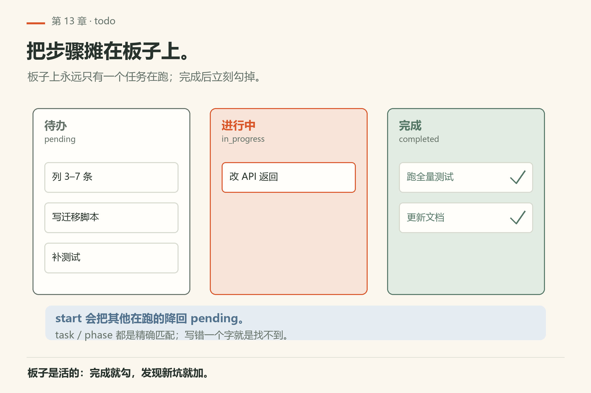
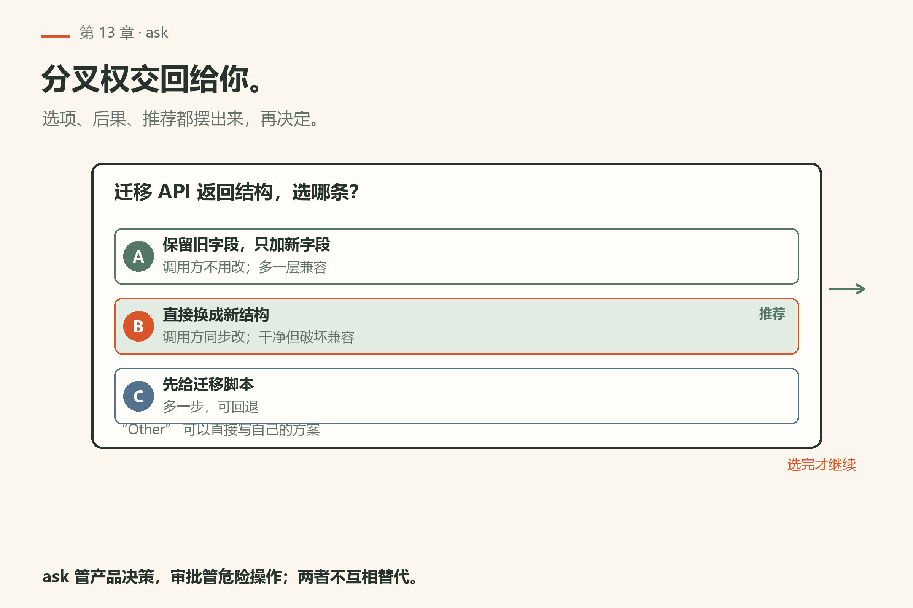
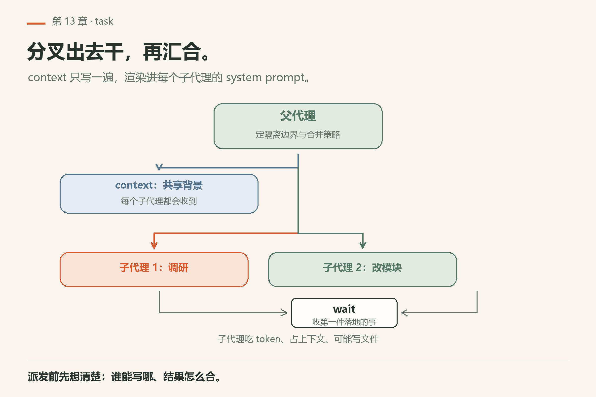
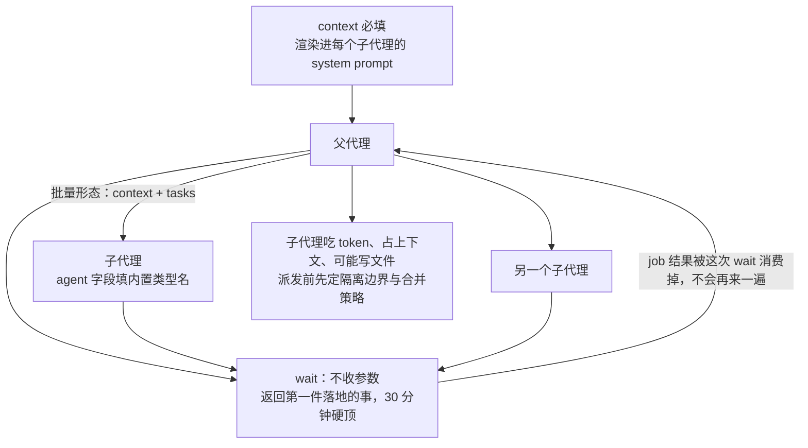
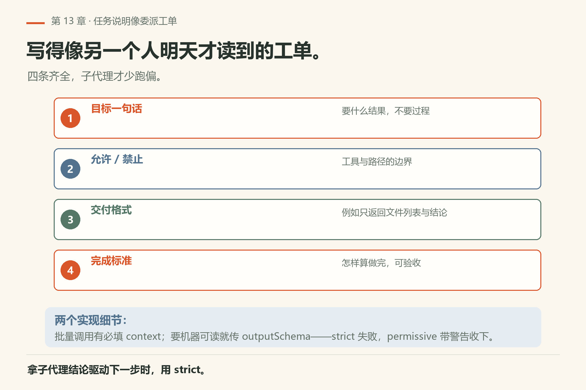
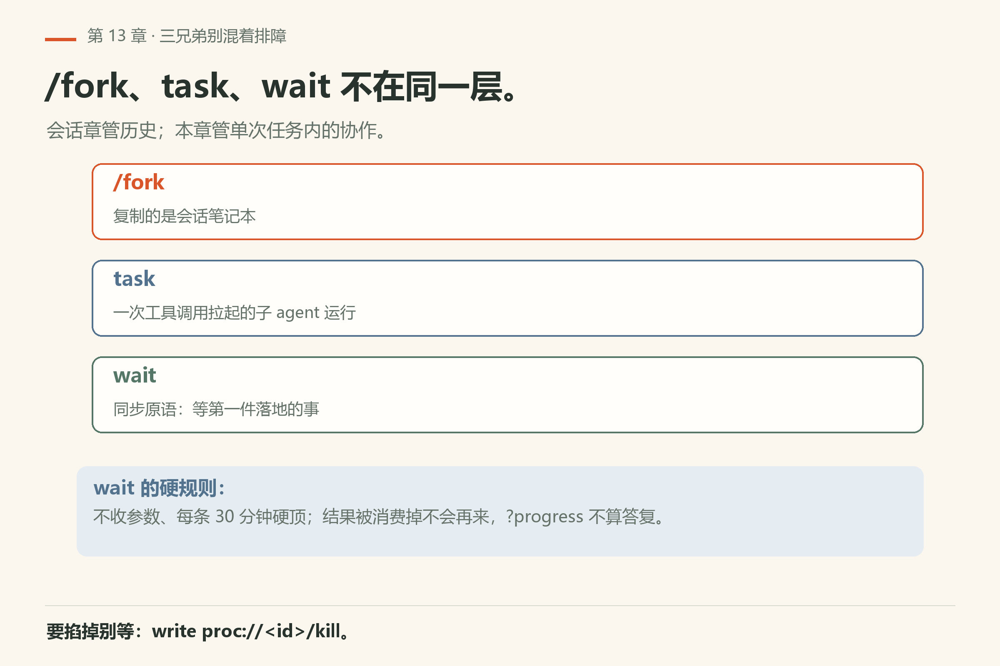

# 第13章 计划与协作

<!-- block: omp-ch13.b-7e7d010a -->
你给了一个「加功能 + 补测试 + 改文档」的任务。它改到一半，你翻卡片发现：功能写完了，测试只跑了一半，文档一个字没动。它没偷懒——它只是走一步忘十步，没有一块板子把步骤摊在外面。

> **开门一句话：**计划先写、活后干；长活丢后台，子智能体只带回结论。

长任务里模型容易「走一步忘十步」。omp 给了四件协作家具：

- **`todo`**：任务板，跟踪多步工作
- **`ask`**：弹出选项/问题，先问你再改
- **`task`**：拉起**子代理**去干一块并行或隔离的活
- **`wait`**：等待后台条件（任务、服务、时间等，以文档为准）

细节：`docs/tools/todo.md`、`ask.md`、`task.md`、`wait.md`，以及 `docs/task-agent-discovery.md`、`docs/collab.md`。



*图13-1：待办 / 进行中 / 完成——把多步工作摊在板上。*

## 13.1 `todo`：把步骤写在外面

当改动跨多个文件、需要测试与文档同步时，让 agent 维护 todo，比只在思维链里默念可靠。工具负责写入/更新条目；你在 TUI 里能看见板子的进展（渲染细节以 TUI 为准）。

一次调用只做**一个** op，op 名和字段都在参数顶层。九个 op 的行为差别不小：

| op | 必须给 | 实际发生了什么 |
|---|---|---|
| `init` | 整张 `list`，或平铺 `items` | **整表替换**。平铺形式会自动合成一个 phase（默认名 `Tasks`），新任务都是 `pending` |
| `start` | `task` | 标 `in_progress`，同时把**其他**已在运行的降回 `pending`——板子上永远只有一个在跑 |
| `done` / `drop` | `task` 或 `phase`，也可以都不给 | 标 `completed` / `abandoned`；不给就管全部 |
| `block` | `task` 或 `phase`，可带 `reason` | 只对还能动的任务生效；已完成的不会被重新拉回 `blocked` |
| `unblock` | `task` 或 `phase` | 退回 `pending`，顺手清掉阻碍备注 |
| `rm` | `task` / `phase` / 都不给 | 真删，不是标掉 |
| `append` | `phase` + `items` | 往后追加；phase 不存在就建一个 |
| `view` | 无 | 只读：不归一化、不写盘 |

`task` 和 `phase` 都是**精确匹配**，写错一个字就是找不到，不是模糊搜索。返回的 `details.storage` 告诉你这份板子存在哪：`session` 是跟着会话落盘的，`memory` 是临时的。折叠预览只列前 8 条，多于这个数得展开看。

习惯：

- 开始复杂任务先列 3–7 条，别列小说；
- 完成就勾，发现新坑就加——板子是活的；
- 不要把 todo 当记忆系统；跨会话记忆看第16章。

## 13.2 `ask`：不确定就问



*图13-2：选项框把分叉权交回给你。*

`ask` 在交互会话里向你提问（可带选项）。适用：

- API 破坏性变更要不要做；
- 两种重构策略选哪条；
- 是否允许安装依赖、改 CI、强推远程……

和非交互的 `omp -p` 合用时，行为受是否有人在场约束——无 TTY/无人值守时不要指望它替你做主。审批模式（approval mode）会在工具执行层再挡一道；`ask` 更偏「产品决策」，审批更偏「危险操作门禁」。

没人可问时它不静默降级，而是**抛错**：`Ask tool requires interactive mode`。所以脚本里别把 `ask` 当可选交互层，它本来就不是。

超时是个容易被忽略的开关：`ask.timeout` 控制等多久（秒，`0` 就是永远等），`ask.notify` 控制要不要弹一句 `Waiting for input`；置上 `recommended: N` 后，超时会自动选中那一项，并在结果里标 `(auto-selected after timeout)`、`details.timedOut: true`。没标 recommended 就选第一项。plan 模式下超时被禁用——规划阶段不会替你拍板。

## 13.3 `task`：子代理分叉



*图13-3：父代理派两个小子代理干活，再用 wait 汇合。*



`task` 启动子代理去执行一块相对独立的工作（调研子树、并行改两个模块、跑隔离实验等）。发现与路由见 `docs/task-agent-discovery.md`。子代理不是无限免费劳动力：它们吃 token、占上下文、可能写文件——派发前想清楚隔离边界与合并策略。

批量形态是 `{ context, tasks: [...] }`。`context` **必填**：它是共享背景，会被渲染进每个子代理的 system prompt，重复写五遍不如写一遍。每条 item 还有两个字段值得知道：`solutionSpace` 描述这活的开放度（修法已给定，还是原因都没定位），它是判思考档位的输入；`taskFile` 让你把长工单放文件里，上限 4 MiB。

本机 `omp agents unpack --json` 回 `total: 6`，六个内置类型是 `reviewer`、`scout`、`seance`、`security-reviewer`、`sonic`、`task`（`agents-unpack-json.txt`）——`agent` 字段填的就是这些名字。

隔离不是白送的：`isolated` 字段只在 `task.isolation.enabled` 为真且 plan 模式关着的时候才存在。本机这个键回 `false`（`config-get-task-isolation-enabled.txt`），所以在默认配置下你写 `isolated: true` 也不会被接受。

实战章（第26章）会把 `ast_edit` + 子代理并行放到重构案例里练。

子代理返回 job id 只证明派发被接受；状态变成 completed 只证明那次运行结束，也不自动证明它改对了。父代理接回的应是实际文件、执行结果和剩余问题，再按总任务的验收标准检查。超时或取消时，先保留已落盘的部分改动与证据，再决定从哪一步续；反复另起一个“完整重做”的子代理，只会重复读取并扩大冲突面。

## 13.4 `wait`：等条件成熟

后台 `bash`、子代理、服务启动……都需要「等到能继续」。`wait` 提供这层同步（输入与可用性见工具文档）。和瞎 sleep 相比，它跟 omp 的任务/后台模型对齐。

它**不收参数**：不能指定等哪个 job、也不能设超时。返回的是「第一件落地的事」——你拥有的 job 结束，或者对端回了你一条消息。每条 wait 都有 30 分钟硬顶。

两个细节解释了大半「为什么它没反应」。job 结果被这次 wait 消费掉，就**不会**再来一遍，所以别指望回头再收。子代理发的 `?progress` 不算答复：它会结束当前 wait，但下次 wait 仍会继续等那个还活着的代理。想直接掐掉就别等：`write proc://<id>/kill`。

## 13.5 第三篇收束：工具怎么配着打

最短决策表：

| 意图 | 工具 |
|---|---|
| 看/搜 | read grep glob ast_grep |
| 改 | edit write ast_edit |
| 跑 | bash eval |
| 懂 | lsp debug |
| 外 | browser computer web_search github |
| 协 | todo ask task wait |

## 13.6 本章小实验

**实验一：先看本机挂了哪些子代理**。

```sh
omp agents --help
```

本机已验（18.16.0）：顶层 `--help` 的 Useful Commands 段写了 `omp agents unpack` 与 `omp agents unpack --project`（`omp/facts/live-18.16.0/help-top.txt`）。**算成功**：看到 `agents` 子命令的存在——它是 `task` 拉起的子代理类型的来源。

再走一步，把名字拿全：`omp agents unpack --json` 本机回 `total: 6`，`skipped` 里列出 `reviewer`、`scout`、`seance`、`security-reviewer`、`sonic`、`task`（`agents-unpack-json.txt`）。**算失败**：`total` 是 `0`，或者 `skipped` 里没有这些名字——说明你的安装包不完整，`task` 会找不到 `agent` 可填。

**实验二**：给一个「加功能 + 测试 + 文档」任务，强制 agent 先写 todo 再动手。**算成功**：你能看到板上 3–7 条，且完成时逐条勾掉。

**实验三**：在两种实现分歧处要求它 `ask`，你选一条，观察后续是否遵守。**算成功**：后续改动沿你选的那条走。

**实验四（可选）**：用 `task` 让子代理只做只读调研（禁止改文件），父代理根据回报再 edit。**算成功**：子代理没写文件，父代理动了。

**开工前先确认两个开关**：

```sh
omp config get task.batch
omp config get task.isolation.enabled
```

本机已验（18.16.0）：`task.batch` 回 `true`（批量形态生效），`task.isolation.enabled` 回 `false`（`isolated` 字段不出现）。**算成功**：两个值都打印出来。**算失败**：`task.isolation.enabled` 回 `true`，但你写的 `isolated` 还是被拒——查一下 plan 模式是不是开着，它只在 plan 关着时才合法。

## 13.7 父代理怎么写任务说明

给 `task` 的说明要像委派工单：

- 目标一句话；
- 允许/禁止的工具或路径；
- 交付格式（例如「只返回文件列表与结论，不改文件」）；
- 完成标准。

写得越像「另一个人明天才能读到的工单」，子代理就越少跑偏。

两条实现细节让工单更好写。批量调用有必填的 `context` 共享字段，别在每条 `task` 里把背景重复五遍。要机器可读的回报就传 `outputSchema`，并选 `schemaMode`：`permissive`（默认）在校验重试耗尽后可能带着警告收下不合约的报文，`strict` 直接失败。要拿子代理的结论去驱动下一步，用 `strict`。



*图13-4：目标、允许/禁止、交付格式、完成标准——写得像明天才读到的工单。*

## 13.8 与会话树的关系

<!-- block: omp-ch13.b-8f1802b6 -->
子代理、后台任务和 `/fork` 不是同一层概念：

- `/fork` 复制的是**会话笔记本**；
- `task` 是一次工具调用拉起的**子 agent 运行**；
- `wait` 是同步原语。

别把三者混着排障。会话章管历史；本章管单次任务内的协作。



*图13-5：`/fork` 复制会话、`task` 拉起子代理、`wait` 是同步原语——别混着排障。*

## 13.9 翻车对照：协作工具的七种误用

委派出问题时，先查这七种：多数是没说清要什么。

| 翻车做法 | 会看到什么 | 正确做法 |
|---|---|---|
| 不列 todo 直接开干 | 走一步忘十步，测试跑一半就停 | 复杂任务先 `todo init` 列 3–7 条 |
| 用 `ask` 问五个都差不多的选项 | 等于没问，模型还是猜 | 选项短而互斥；拿不准就自己定 |
| 无人值守时指望 `ask` 替你选 | 直接抛 `Ask tool requires interactive mode` | 脚本里不要用 `ask`；要默认值就配 `recommended` 并确保有人 |
| `todo` 的 `task` 写成记忆里的措辞 | 精确匹配失败，板子保持原状 | 先 `view` 把原文抄下来，再 `start`/`done` |
| 子代理说明只写一句「调研一下」 | 交回一堆散文，没有文件列表 | 写清目标、允许/禁止的工具、交付格式、完成标准 |
| 共享可变状态时并行派子代理 | 两个子代理改同一迁移文件，冲突 | 先串行；要并行就先开 `task.isolation.enabled` 再用 `isolated` |
| 用 `wait` 等一个不会来的条件 | 等到 30 分钟安全上限 | 先看有没有 owned job；没有就 `read proc://` 查状态 |

## 13.10 与御舆同构点

<!-- block: omp-ch13.b-0849a9d5 -->
参见御舆第 14 章《Plan 模式》、第 10 章《协调器模式》与第 9 章《子智能体与 Fork 模式》。两边问的是同一件事：**先规划后执行、主从分工**。omp 的 `todo` 是任务板，`task` 是子代理，`wait` 是汇合原语；御舆那章把计划模式、协调器、子智能体放在同一组问题下讲。命令名、板子 schema、隔离后端各写各的，不要互抄。

---
**版本核对清单**：`docs/tools/{todo,ask,task,wait}.md`；`docs/task-agent-discovery.md`；协作相关见 `docs/collab.md`。子代理费用与隔离语义以当版文档为准。写作钉 omp v18.15.0；用户本机验证 v18.16.0（见 VERIFY.md）。

- [ ] `omp agents --help` 与顶层 Useful Commands 段你各查过一次
- [ ] `todo` 的九种 op（init/start/done/drop/block/unblock/rm/append/view）你写得出各自什么时候用
- [ ] `wait` 的 30 分钟安全上限你记得住；它没有调用方可选的 timeout
- [ ] 子代理说明的四要素（目标/允许禁止/交付格式/完成标准）你各写得出一条
