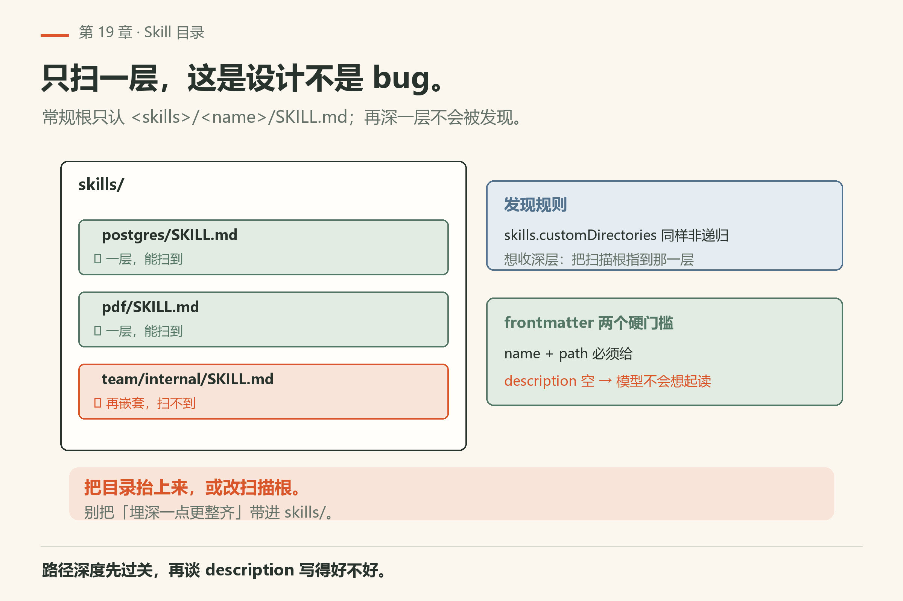
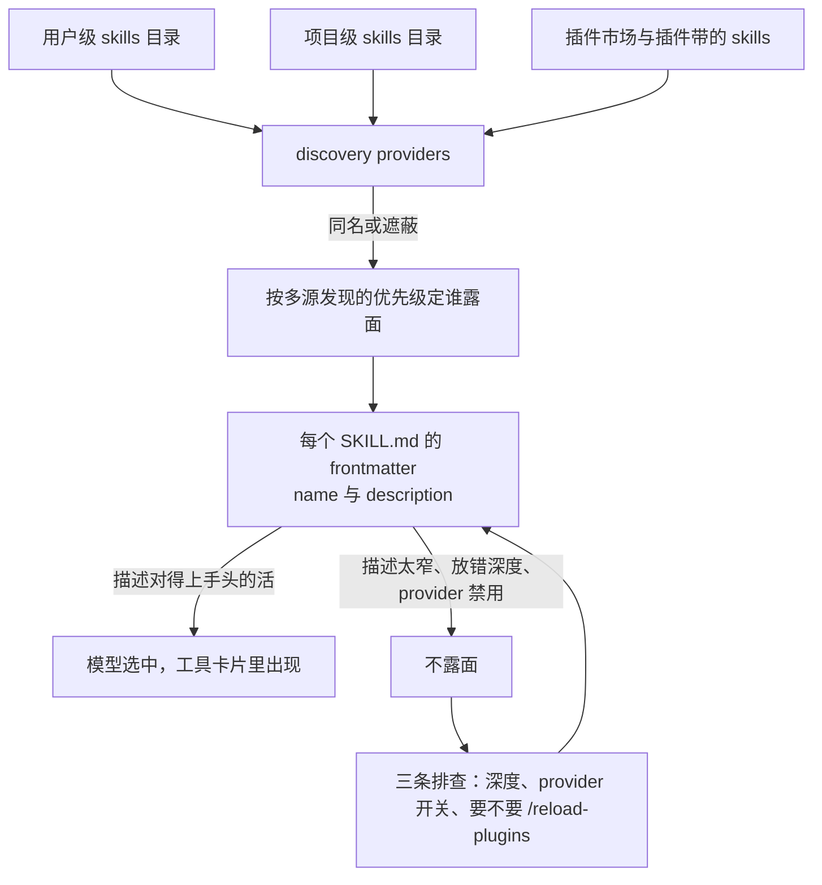
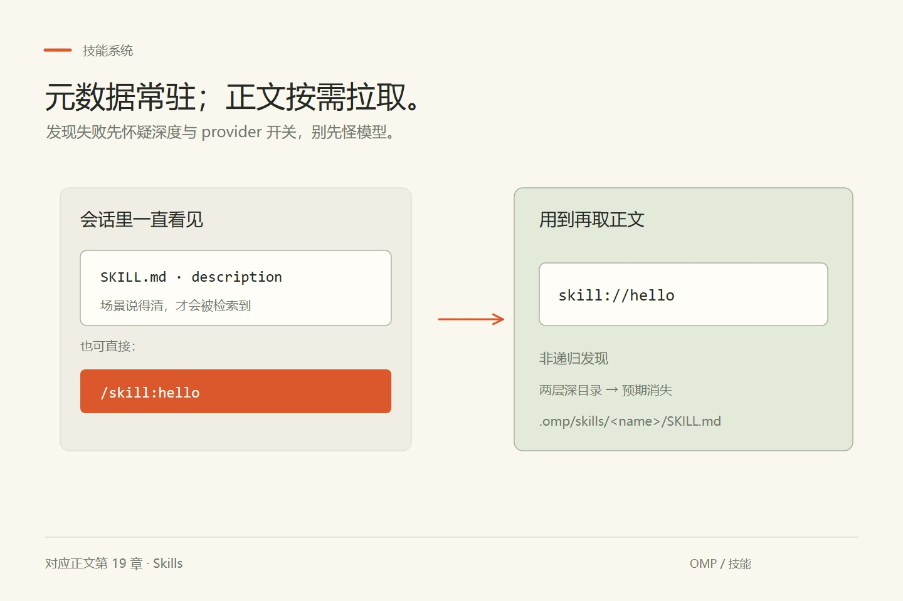
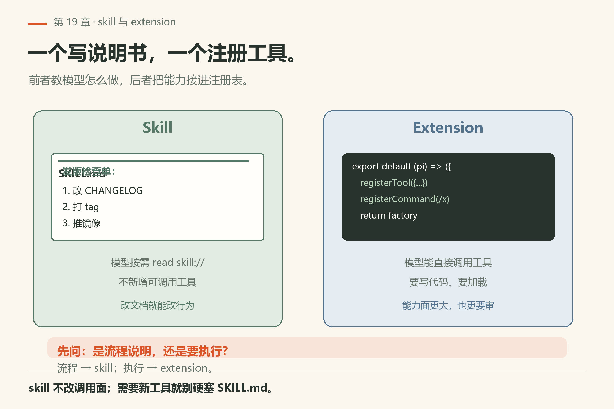
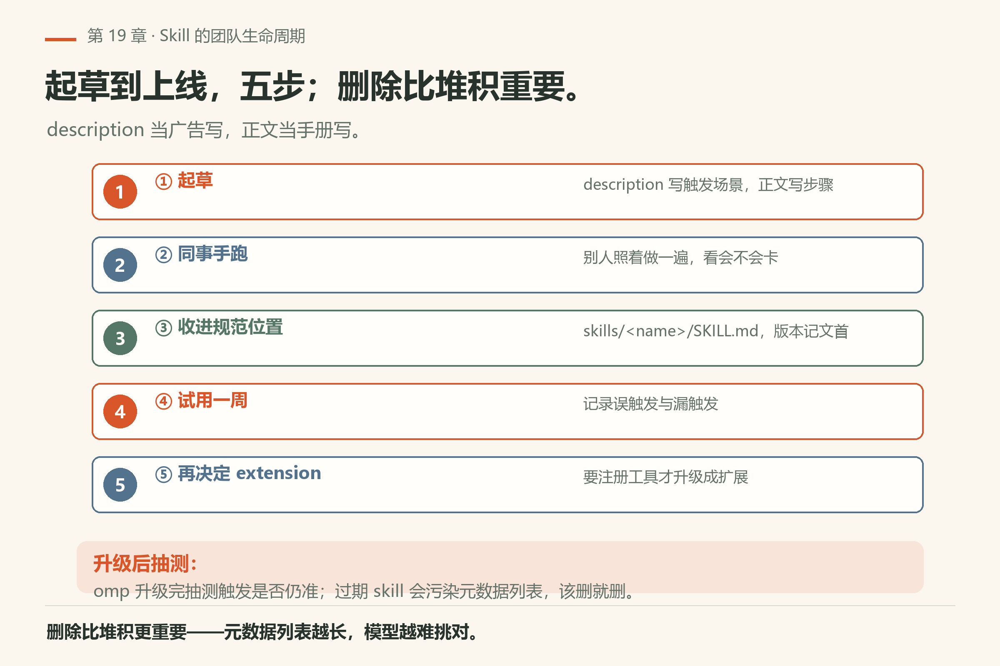

# 第19章 Skills

<!-- block: omp-ch19.b-3faf98a8 -->
你把发版那十步写成 `skills/team/release/deploy/SKILL.md`，提交、合并、重开会话，问它「按我们的技能发版」。模型礼貌地开始瞎猜 tag 名。不是它笨——常规 provider 只扫 `skills/` 下**一层**，`team/release/deploy/` 这种深度根本不进。你的说明书躺在那里，从来没被发现过。

> **开门一句话：**技能是现成说明书；调不出来先查它站的位置对不对。

这一章就把三件事说死：文件放哪才会被扫到、`description` 怎么写模型才会想起去读、读不到的时候用哪几条命令自查。

Skills 是**文件型能力包**：启动时发现，对模型暴露为：

<!-- block: omp-ch19.b-fb2cff3c -->
- 系统提示里的轻量元数据（name + description）；
- 需要时用 `read` 读 `skill://...`；
- 可选的交互命令 `/skill:<name>`。

文档：`docs/skills.md`。



*图19-1：常规发现只认 `skills/<name>/SKILL.md` 这一层——再嵌套一层不会被扫到。*

## 19.1 目录约定

对 native/Claude/Codex/Agents/plugins 等常规根：

```text
<root>/skills/
  postgres/SKILL.md   ✅
  pdf/SKILL.md        ✅
  team/internal/SKILL.md  ❌ 不会被 provider 递归发现
```

`skills.customDirectories` 同样非递归（`*/SKILL.md`）。要把深层技能纳进来，把 `customDirectories` 指到那一层父目录，或把技能抬到规范深度。

Agent Plugins 包只用固定 `skills/<name>/SKILL.md`；Skillshare 注册安装的包则是根上 `SKILL.md`。Claude-plugin 还可接受清单声明的、直接含 `SKILL.md` 的目录。

## 19.2 `SKILL.md` frontmatter

常见字段：`name`、`description`、`globs`、`alwaysApply`、`hide`、`disableModelInvocation`（Agent Skills 里 `hide` 的等价；kebab-case 会规范化）。额外键由扫描器当未知元数据保留。匹配质量取决于 **description 是否说人话**——只写「helper」等于没写。

能力校验至少要 `name` 与 `path`；各 provider 可能加更严的 frontmatter 要求。

## 19.3 怎么用

技能按需拉全文：描述先行，原文按 `skill://` 取。

- 模型侧：根据描述决定要不要 `read skill://...` 拉全文；
- 你侧：`/skill:postgres` 一类命令（若该 skill 暴露了交互面）；
- 团队：把重复的「怎么发版/怎么连登 staging」收成 skill，而不是每次口述。

与 extension 的分工：skill 偏**说明书 + 可选命令**；要注册新工具/钩子/快捷键，走第21–22章。

以发版为例，列表里看到 `release` 只说明说明书被发现了；`read skill://release` 之后，模型才拿到步骤。它还要逐项调用工具、读取退出状态和产物，才能判断发版是否成功。技能名出现、全文读到、命令执行完成是三个不同的检查点。描述写清触发场景可以帮助选中，但不能保证模型每次都选，也不会绕过审批。

## 19.4 发现从哪来

skills 也走 discovery providers（用户级、项目级、插件市场等）。冲突与遮蔽跟上下文文件同一套「多源发现」世界观——改完 skill 后若看不到，先查是否放错深度、provider 是否禁用、是否需要 `/reload-plugins`（扩展章）。



## 19.5 跟做实验：先确认发现链路是通的

`omp read` 吃内部 URI（`omp read PATH`，`facts/live-18.16.0/help-read.txt` 的例子就有 `omp read omp://`），所以技能这一侧有三条 shell 探针，一条模型请求都不发：

```sh
omp skill list                       # 本机已验：exit 0，逐行「名字<TAB>描述」
omp read skill://                    # 本机已验：exit 1，"skill:// URL requires a skill name: skill://<name>"
omp read skill://<第 1 行里的任意名字>   # 本机已验：exit 0，回带 frontmatter 的 SKILL.md 全文
```

本机 `omp/18.16.0` 的第三条我用的是 `omp read skill://sepia-review`，输出第一行是 `[Skill file: <插件缓存里的 SKILL.md 绝对路径>]`，接着是 `---\nname: …\n---` 与正文（`facts/live-18.16.0/read-skill-user-installed.txt`，路径中的用户名已脱敏；三份输出同名文件都在 `facts/live-18.16.0/`）。**怎么算成功**：第一条能列出行、第三条 exit 0 并回正文——说明 skill 协议和「已装技能」这条链路在你机器上是通的。

然后才是**你新写的那个技能**。这里有个坑要先知道：我在临时目录建了 `<cwd>/.omp/skills/hello/SKILL.md`（一层、frontmatter 齐全、`description` 也写了），`omp read skill://hello` **仍然 exit 1**，回 `Unknown skill: hello`，后面 `Available:` 列出的只有用户级的技能（`read-skill-unknown-project-skill.txt`）。`git init` 之后再试，同样。**结论（本机已验的现象，原因未验证）**：shell 里的 `omp read skill://…` 不是「项目级技能有没有被发现」的可靠判据。项目技能的验证得回会话里做：

1. 在项目 `.omp/skills/hello/SKILL.md` 写一段**说得清场景**的 description，重开会话，问它「你现在能看到哪些 skill」；
2. 直接敲 `/skill:hello`——`skills.enableSkillCommands` 在本机是 `true`（`config-get-skills-enableSkillCommands.txt`），所以 `/skill:<name>` 这层交互面默认是注册着的；
3. 故意把它挪到 `skills/team/hello/SKILL.md` 两层深，重开会话，确认它**消失**——「发现失败」是预期，不是 bug（`docs/skills.md`：非递归）。

这三步做完你就有了判断力：以后技能不露面，先怀疑深度和 provider 开关，而不是怀疑模型。



*图19-2：元数据常驻；正文按需 `skill://` 拉取。*



*图19-3：说明书走 skill；注册工具走 extension。*

## 19.6 和上下文文件、插件的边界

Skill 不是 AGENTS.md。AGENTS/RULES 偏「仓库怎么干活」的常驻约定；Skill 偏「某一类任务的说明书」，平时只在系统提示里挂 name + description，正文用 `skill://` 按需读。插件市场装下来的包可能同时带 skill 与 extension：前者教模型怎么做，后者注册真正的工具或斜杠命令。

发现规则记住一句：**常规根下只扫 `skills/<name>/SKILL.md` 一层**。你把说明书塞进 `skills/team/deploy/SKILL.md`，provider 扫不到——这不是 bug，是防爆炸的设计。自定义目录 `skills.customDirectories` 同样非递归；要深层技能，把扫描根指到那一层父目录，或把目录抬上来。

## 19.7 frontmatter 怎么写才「会被选中」

`name` 与路径是硬门槛；真正决定模型会不会读全文的是 **description**。写「helper」「utils」等于没写。写成：「在本仓库用 `make release` 发版：检查 CHANGELOG、打 tag、推镜像。」模型才知道什么时候该 `read skill://...`。

常用字段（以 `docs/skills.md` 为准）：

| 字段 | 作用 |
|------|------|
| `name` | 技能名 |
| `description` | 触发语义 |
| `globs` | 与路径相关时更相关 |
| `alwaysApply` | 是否倾向常驻 |
| `hide` / `disableModelInvocation` | 不对模型暴露调用面 |

`enabled: false` 会在约定扫描里跳过。额外键会被扫描仪当未知元数据保留——别指望随便发明的键自动生效。

## 19.8 调用面：模型、斜杠、read

三条路：

1. **模型自主**：看元数据 → `read` `skill://<name>`（或文档给出的 URL 形态）拉正文；
2. **你手动**：`/skill:<name>`（若该 skill 暴露交互命令）；
3. **编排**：扩展或工作流里显式注入说明。

团队落地建议：把「连 staging」「切 feature flag」「发版检查单」收成 skill，口语里说「按 release skill 来」比每次复述十步稳。要注册新工具或钩子，别硬塞进 SKILL.md——转第21–22章。

## 19.9 翻车对照：技能为什么不露面

查的顺序还是那五步：路径深度 → frontmatter 有没有 `name`、description 是不是空 → provider/插件开关 → 项目级与用户级互相遮蔽 → 改完是否重开会话。下面是对照表，左边每一条都能自己复现。

| 翻车做法 | 会看到什么 | 正确做法 |
|---|---|---|
| 说明书埋进 `skills/team/deploy/SKILL.md` | 静悄悄地没有。常规根只认 `<skills-root>/<skill-name>/SKILL.md` 一层，嵌套**不递归**（`docs/skills.md`） | 抬到一层，或把 `skills.customDirectories` 指到那一层父目录——自定义目录同样非递归 |
| 用 shell 的 `omp read skill://<新技能>` 判断项目技能有没有被发现 | 本机已验：即使一层、frontmatter 齐全也回 `Unknown skill: hello`，exit 1；`Available:` 只有用户级技能（`read-skill-unknown-project-skill.txt`） | 项目技能回会话里验：问「你能看到哪些 skill」或敲 `/skill:<name>`。shell 那条只适合验**已安装**的技能 |
| `description` 写「helper」「utils」 | 照样加载——校验只要 `name` 与 `path`——但模型永远不会想起去读它 | 写成触发场景：「在本仓库用 `make release` 发版：检查 CHANGELOG、打 tag、推镜像。」native `.omp`、`omp-plugins`、`github`、`customDirectories` 这几路是**强制要求** description 的（文档所述），漏写直接不加载 |
| frontmatter 的 `name` 里写了 `/` | 被拒并告警——分隔符留给命名空间和 `skill://<name>/<path>`（文档所述） | 目录名当默认名，别在 `name` 里造斜杠 |
| 以为 `globs` / `alwaysApply` 会自动控制调用 | 文档原话：这两个在 omp 里**是元数据，不是自动的技能调用开关** | 想让模型按路径偏好读某技能，把场景写进 description |
| 想让技能消失，于是加 `--no-extensions` | 关的是扩展发现，技能的开关另有其人：`--no-skills`（`omp --help`）、`skills.enabled`（本机 `omp config get skills.enabled` = `true`，已验）、`skills.ignoredSkills` 排除、`skills.includeSkills` 白名单 | 按粒度选：临时验证用旗标，长期排除用 `ignoredSkills` |
| 同一个技能在用户级和项目级各放一份 | 不是「后面的赢」：capability 去重按名字保留**优先级高的 provider**；名字相同但内容不同时，高优先的保裸名，其余挂上 `<namespace>/<name>` 后缀并**打告警**（文档所述） | 看到告警就去查那两个路径。自定义目录是个例外——它压过同名 provider 技能 |
| 以为 `disabledExtensions` 里写一条 `skill:<name>` 只作用到裸名 | 文档说它和 `skills.ignoredSkills` **同时作用到裸名和最终名**，命名空间别名绕不过去；反过来 `skills.includeSkills` 只在名字全部解析完之后的列表上生效 | 排除用裸名即可；包含规则要按解析后的最终名写，比如 `second/*` |
| 用 `omp skill install` 来「试试看能不能装」 | 它有副作用：写 lock 文件、可能拉脚本（`-y` 那个 flag 的描述就是「install or update skills that ship scripts without asking」，`facts/live-18.16.0/help-skill.txt`） | 诊断用 `omp skill list` / `omp skill search`；真要预演发布用 `--dry-run`（只打包校验，不发） |
| 在 shell 敲 `omp skills list` | 子命令是单数 `skill`；`skills` 不在 `omp --help` 的 COMMANDS 表里，按本机已验的同类行为（`fail/bad-command.txt`：`Working...`，exit 124）它会当提示词吞掉。**这条具体命令我未跑**，因为跑起来就是真发一次请求 | 永远单数：`omp skill …`；拿不准先 `omp skill --help` |


*图19-4：技能不露面按五步查——路径深度、frontmatter、开关、遮蔽、生效时机。*

## 19.10 与御舆同构点

参见御舆第 11 章《技能系统与插件架构》。两边在这一层问的是同一个问题：**能力的封装单位怎么被发现、怎么被加载、怎么被限制**。轻量元数据常驻提示，正文按需拉取，外部能力要过边界才进得来。omp 这边 skill 与 extension 的分工（说明书 vs 注册工具），和御舆那章讲的技能/插件分层是同一类边界。两边的目录约定、键名、装载时机各写各的，不互抄。


<!--deepen-v2-->

## 深挖：Skill 在团队里的生命周期

起草 → 同事手跑 → 收进 `skills/<name>/SKILL.md` → 试用一周 → 再决定要不要 extension。description 当广告写，正文当手册写。版本记在 skill 文首；omp 升级后抽测触发是否仍准。删除比堆积更重要：过期 skill 会污染元数据列表。




*图19-5：起草、同事手跑、收进规范位置、试用一周、再决定要不要扩展。*

<!--deepen-v3-->

## 实操笔记：Skill 评审表

提交 skill 的 PR 必须勾：目录是否一层；description 是否含触发场景与反例；正文是否可手跑；有无密钥；是否写明兼容 omp 版本。评审人只按表打勾，不凭感觉。过期 skill 删文件重于改 enabled。

「有无密钥」这一条不是形式主义：`omp skill publish` 有 `--allow-secrets`，帮助里的原话是「Publish even when credential-shaped strings are found」（`facts/live-18.16.0/help-skill.txt`）。按这个措辞，默认路径是在发现凭据形状字符串时**拦你**；加了 flag 就是明知故犯。我没有实跑 publish，这条按文档措辞读。同理 `-y` 是「带脚本的技能不问你直接装」。两个都不要进你的 alias。发布前用 `omp skill publish ./skills/<name> --dry-run` 打包校验（帮助里的 EXAMPLES 就是这个形态；真跑有副作用，我没跑）。盘点本机现状用 `omp skill list`（19.5 已验）。

---
**版本核对清单**：`docs/skills.md`；布局非递归规则以 Directory layout 节为准。写作钉 omp v18.15.0；用户本机验证 v18.16.0（见 VERIFY.md）。

- [ ] `omp skill list` exit 0，行数与你对本机技能数量的印象一致
- [ ] `omp read skill://<某个已装名字>` 回正文 + `[Skill file: …]` 头
- [ ] `omp config get skills.enabled`、`omp config get skills.enableSkillCommands` 两个值你确认过
- [ ] 你写的每个技能都在 `<root>/skills/<name>/SKILL.md` 这一层，`description` 非空
- [ ] `--no-skills` / `--skills=<glob>` 仍在 `omp --help` 里（升级后先看这两条）
