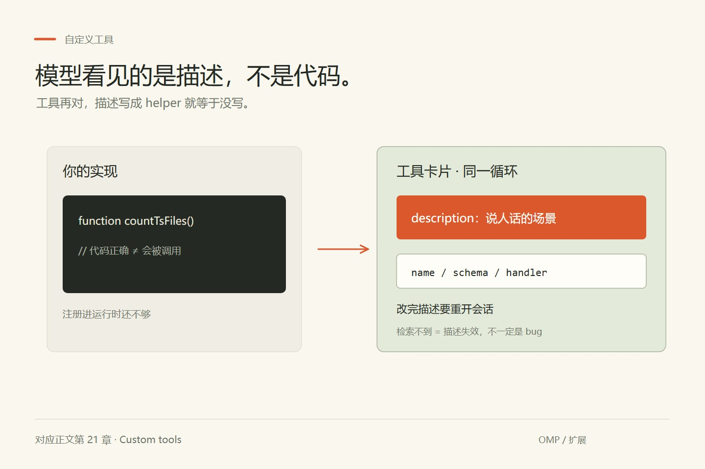
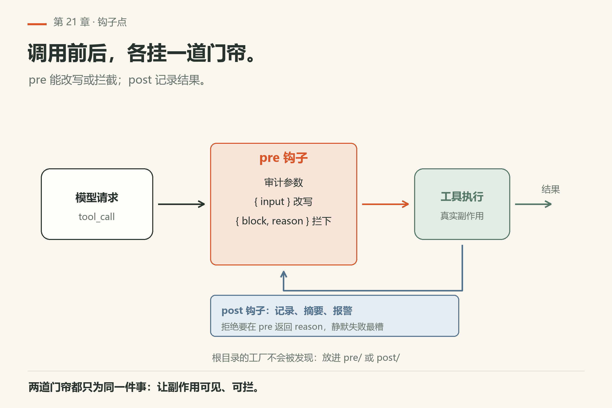
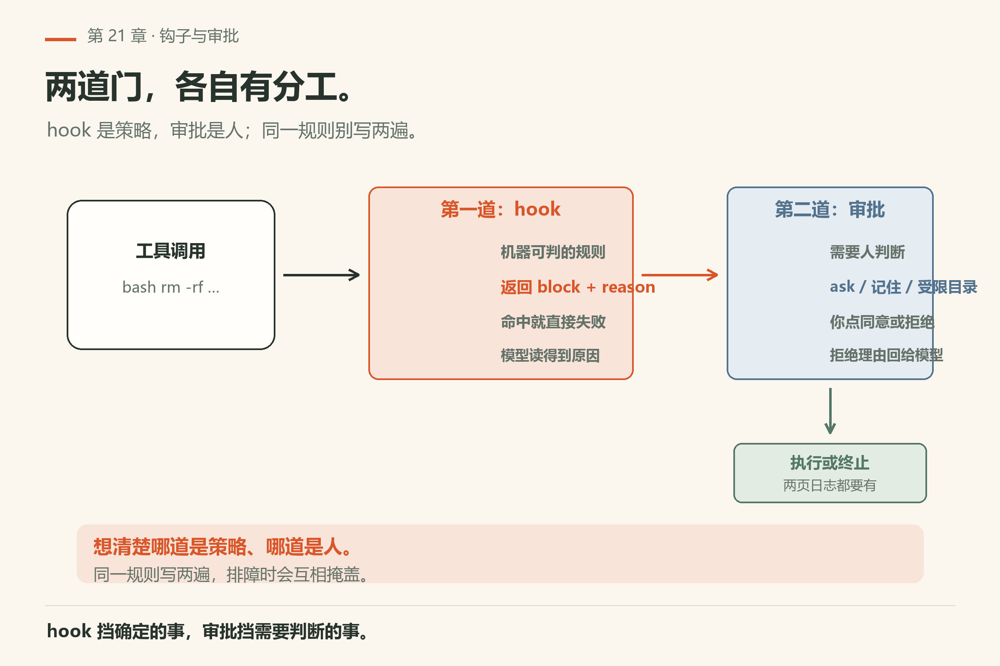
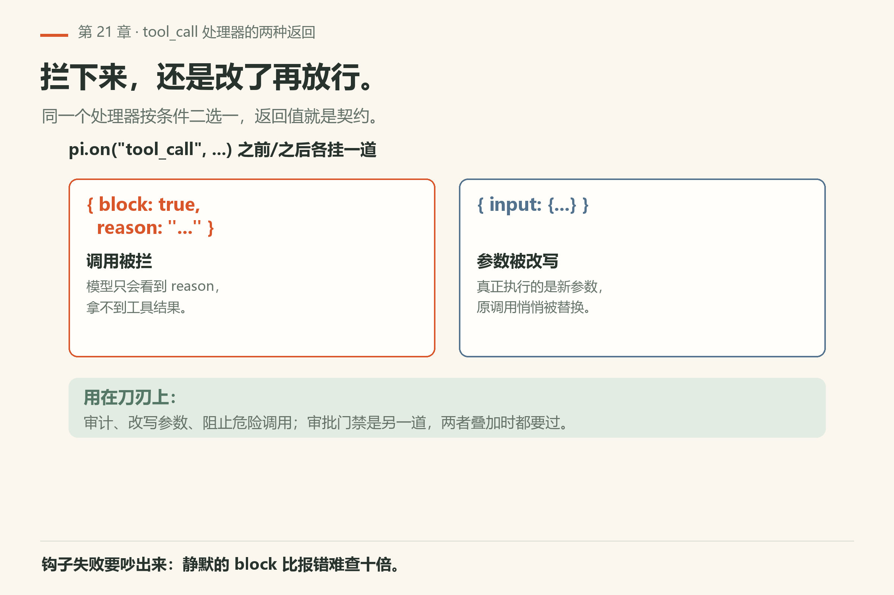
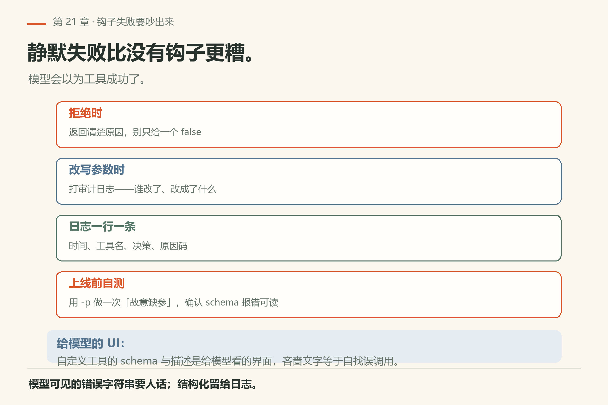

# 第21章 自定义工具与 Hooks

<!-- block: omp-ch21.b-4028e404 -->
你写了个自定义工具，想让模型统计仓库里的 TypeScript 文件数。它跑起来了，模型也真的调用了——然后你改了一行 description，重开会话，模型再也不碰它了。你翻日志，发现工具还在注册表里，只是**描述**不再说人话，模型检索不到。

> **开门一句话：**钩子与自定义工具让你在固定时刻插一手，不必改内核。

这不是 bug，是自定义工具的第一课：模型看见的是**描述**，不是你的代码。工具本身再对，描述写得像「helper」就等于没写。

这一章把两条扩展筋讲清：**Custom tools**（给模型新的可调用工具）与 **Hooks**（在生命周期点插入逻辑）。许多能力最终也通过 **Extensions**（第22章）注册——先读清「当前运行时到底启用了哪条集成路径」。



*图21-1：新工具卡片挂进同一工具循环。*

## 21.1 Custom tools 是什么（不是什么）

custom-tools 文档开篇就划清边界：它不是另起一个 agent，也不是随便丢一个脚本就当稳定 API。四类东西别混：

- **Custom tool**：模型在回合里能直接调用的函数（`execute` + 参数 schema）；
- **Extension**：生命周期/事件框架，能注册工具、拦截事件；
- **Hook**：旧的事件拦截 API，现在也走扩展运行器加载；
- **Skill**：静态说明书，不是可执行工具代码。

要让模型直接调代码，用 custom tool。要注册工具又拦截事件，用 extension。写工具时像内置工具一样想清楚：schema、审批档、并发、错误形状。

## 21.2 集成路径：新代码走扩展工厂

文档的 Integration paths 节列了两种活跃写法：

1. **SDK 提供**：`options.customTools`，转成扩展工具定义再进会话注册表；
2. **文件系统发现**：`discoverCustomToolPaths` / `loadCustomTools`，从 `<agentDir>/tools`、`.omp/tools`、Claude/Codex 的 tools 目录、插件清单里扫出 `.ts`/`.js` 模块，经生成的扩展注册。

新代码统一走扩展工厂：

```ts
export default function (pi) {
  pi.registerTool({ name: "repo_stats", /* ... */ });
}
```

旧式自定义工具目录是历史兼容路径。两套注册互相看不到——你按旧文档写，发现新文档里的扩展注册表根本不认。

## 21.3 模块契约：工厂返回工具，不是工具实例

一个 custom tool 模块 default-export 一个工厂，工厂拿到宿主 API（`CustomToolAPI`）后返回**一个工具或工具数组**。文档给的骨架：

```ts
const factory = pi => ({
  name: "repo_stats",
  label: "Repo Stats",
  description: "Counts tracked TypeScript files",
  parameters: pi.zod.object({
    glob: pi.zod.string().optional(),
  }),
  async execute(toolCallId, params, onUpdate, ctx, signal) {
    const result = await pi.exec("git", ["ls-files", params.glob ?? "**/*.ts"], { signal, cwd: pi.cwd });
    if (result.code !== 0) throw new Error(result.stderr || "git ls-files failed");
    const files = result.stdout.split("\n").filter(Boolean);
    return { content: [{ type: "text", text: `Found ${files.length} files` }] };
  },
});
export default factory;
```

三个要点：

- **参数 schema** 用 `pi.zod` / `pi.arktype` / `pi.typebox`，走共享校验管线；
- **`execute` 抛错**就是工具失败，错误字符串会回给模型——写人话；
- **`onUpdate`** 推流式的部分结果，`details` 存结构化数据，别全塞进 content。

工厂返回类型可以是 `CustomTool`、`CustomTool[]` 或 `Promise<...>`。文件里 import 的 `@oh-my-pi/*` 会解析到 omp 自己跑的那份，包括编译后的二进制。

## 21.4 Hooks 现状：旧 API，新运行器

hooks 文档开头有一节 **Current status in runtime**——以它为准，别拿过期博客当行为保证。要点：

- 默认 CLI 运行时初始化的是**扩展运行器**这条路径；
- `--hook` 被当成 `--extension` 的别名（CLI 路径合并进 `additionalExtensionPaths`）；
- `.omp/hooks/pre/*.ts`、`.omp/hooks/post/*.ts` 里的 JS/TS 工厂被当作扩展模块加载，`pi.on(...)` 处理器绑到运行时事件总线；
- 工具由 `ExtensionToolWrapper` 包装，不再是 `HookToolWrapper`；
- 上下文变换与生命周期发射走 `ExtensionRunner`。

<!-- block: omp-ch21.b-8740cca5 -->
也就是说：**hooks 文档描述的是旧 hook 子系统本身，但当前运行时把发现的 hook 工厂当扩展加载**。共享的 `pi.on(...)` 能工作；旧专有上下文名（如 `ctx.hasQueuedMessages()`）不做兼容垫片，扩展里要改用 `ctx.hasPendingMessages()`。

Hook 典型用途：在 `tool_call` 前后审计、改写参数、阻止调用。`tool_call` 处理器可以返回 `{ block: true, reason: "..." }` 拦下来，或返回 `{ input: {...} }` 改写真正执行的参数。

“调用前”和“调用后”不是对称的安全网。调用前拦下，才可能让那次操作不发生；调用后即使发现内容不对，文件也可能已经写入，外部请求也可能已经送达。要禁止危险写入，应在执行前判断；要在执行后验收，就另写恢复步骤。记录了一条失败日志，本身不会把副作用撤销。



*图21-2：调用前后各挂一道门帘。*



*图21-3：钩子可拦；审批也可拦——两者叠加时都要过。*

## 21.5 最小可跟做实验：确认 hook 目录被发现

这一层不需要你写 TS 就能验「发现链路通不通」。本机 18.16.0 的 `--help` 里 `--hook` 与 `-e, --extension` 都在（`facts/live-18.16.0/help-top.txt`），`--no-extensions` 的原话是「Disable extension discovery (explicit -e paths still work)」。

```sh
omp --help | grep -E "hook|extension|no-extensions"
omp config get skills.enabled
omp skill list
```

**怎么算成功**：第一条能同时看到 `--hook`、`--extension`、`--no-extensions` 三行；第二条 exit 0 回一个布尔值；第三条 exit 0 列出你机器上已有的技能。这三条只读，不发模型请求。

然后才是写 hook：在 `<cwd>/.omp/hooks/pre/` 放一个只记录日志的 `pi.on("tool_call", ...)` 工厂（**不要**放在 `.omp/hooks/` 根上——文档明说根上的工厂不会被 ambient 发现）。起会话，跑一条会触发工具调用的指令，确认日志文件里出现工具名。**这一步我未验证**——本机没实跑过 hook 工厂加载，你要自查：`omp --help` 确认旗标在，再按 `docs/hooks.md` 的 Native discovery location 节核对目录。

## 21.6 翻车对照：自定义工具为什么不露面

工具没露面先查登记：名字、路径、加载时机三处最常见。

| 翻车做法 | 会看到什么 | 正确做法 |
|---|---|---|
| 工具描述写「helper」「utils」 | 照样注册，但模型永远想不起来调它 | 写触发场景：「统计仓库内被 git 跟踪的 TS 文件数，按目录分组」 |
| 把 hook 工厂放在 `.omp/hooks/` 根目录 | 静悄悄没加载。文档明说根上的工厂**不被 ambient native discovery 发现**，必须放进 `pre/` 或 `post/` | 放 `<cwd>/.omp/hooks/pre/*.ts` 或 `post/`，或显式传 `--hook <path>` |
| 用 `omp config set modelRoles.smol ...` 想改角色 | 与工具无关，但同类错误：点路径取不到（见第17章翻车表）。`modelRoles` 是整体对象键 | 查整张表用 `omp config get modelRoles`；角色指派走 `/model` 或手改 `<cwd>/.omp/config.yml` |
| 以为 hook 里能拿到 `ctx.hasQueuedMessages()` | 旧专有上下文名不做兼容垫片，扩展运行器里拿不到（文档所述） | 用 `ctx.hasPendingMessages()`；共享的 `pi.on(...)` 能用 |
| 在 hook 里 `rm -rf` 拦截了，但审批模式也开着 | 两道门都要过：hook 返回 `block` 拦下，审批模式（approvalMode）再拦一次 | 想清楚哪道是策略、哪道是人；别让同一规则写两遍 |
| 工具 schema 用裸 JSON，不接 `pi.zod` | 参数校验走不进共享管线，模型传错参数时错误形状不可控 | 用 `pi.zod.object({...})`，schema 报错可读 |
| 自定义工具与内置工具重名 | 文件系统工具名冲突会被拒（文档所述），已加载的自定义工具也会去重 | 工具名加团队前缀，冲突时先改名再怪框架 |



*图21-4：`tool_call` 处理器的两种返回——`block` 拦下并回 reason，`input` 改写真正执行的参数。*

## 21.7 与御舆同构点

参见御舆第 8 章《钩子系统》与第 3 章《工具系统》。同构的地方在于：**生命周期扩展点是同一层抽象**——在工具调用前后各挂一道门帘，能记录、能改写、能拦。omp 这边把 hook 当扩展运行器加载，御舆那边也是把拦截器绑到事件总线；两边的「拦截点在哪、拦截结果怎么回给模型」问的是同一组问题。不同的只是加载路径和 API 名：跨书只搬这张「调用前 / 调用后」的门帘图，别搬对方的钩子注册命令。

## 21.8 设计建议

工具是重资产：能用技能说明白的，就别写代码。

- 能用 skill 说明白的流程，先别上新工具；
- 工具名/描述写成模型能检索的自然语言；
- 副作用工具默认走严格审批；
- 用扩展的 `/reload-plugins` 迭代，避免每次杀进程。

<!--deepen-v2-->

## 深挖：钩子里的失败要吵出来

静默失败的 hook 比没有 hook 更糟：模型以为工具成功了。拒绝时返回清楚原因；改写参数时打审计日志。自定义工具的 schema 与描述是给模型的 UI，吝啬文字等于自找误调用。




*图21-5：拒绝给原因、改写打审计、日志结构化、上线前故意缺参自测。*

<!--deepen-v3-->

## 实操笔记：钩子的可观测性

每个拒绝/改写决策打一行结构化日志：时间、工具名、决策、原因码。模型可见的错误字符串要人话。自定义工具上线前用 `-p` 做一次「故意缺参」调用，确认 schema 报错可读。

---
**版本核对清单**（写作钉 v18.15.0；用户本机验证 v18.16.0，见 VERIFY.md）：`docs/custom-tools.md`、`docs/hooks.md`；与 `docs/extensions.md` 交叉。`--hook` / `-e` / `--no-extensions` 旗标见本机 `omp --help`（`facts/live-18.16.0/help-top.txt`）。

- [ ] `omp --help` 里 `--hook`、`--extension`、`--no-extensions` 三行你还在
- [ ] `.omp/hooks/pre/*.ts` 与 `post/*.ts` 这两个目录名你分得清
- [ ] 你的自定义工具描述写的是触发场景，不是「helper」
- [ ] 拦截类 hook 返回的 `reason` 是模型能读懂的人话
