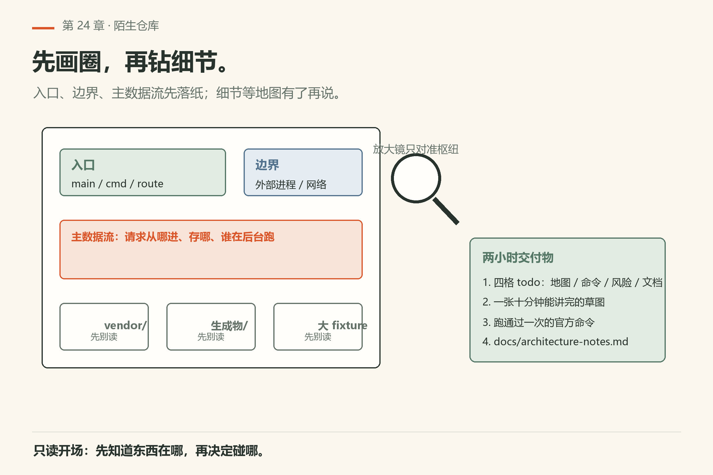
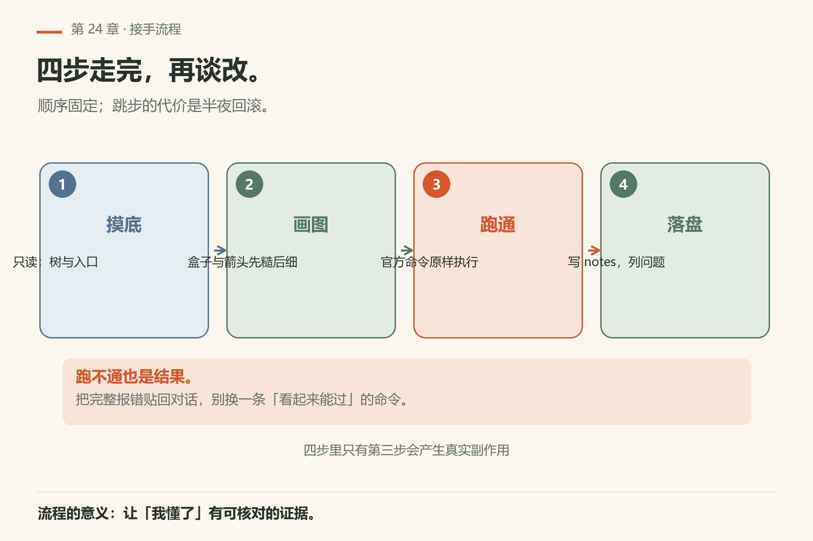
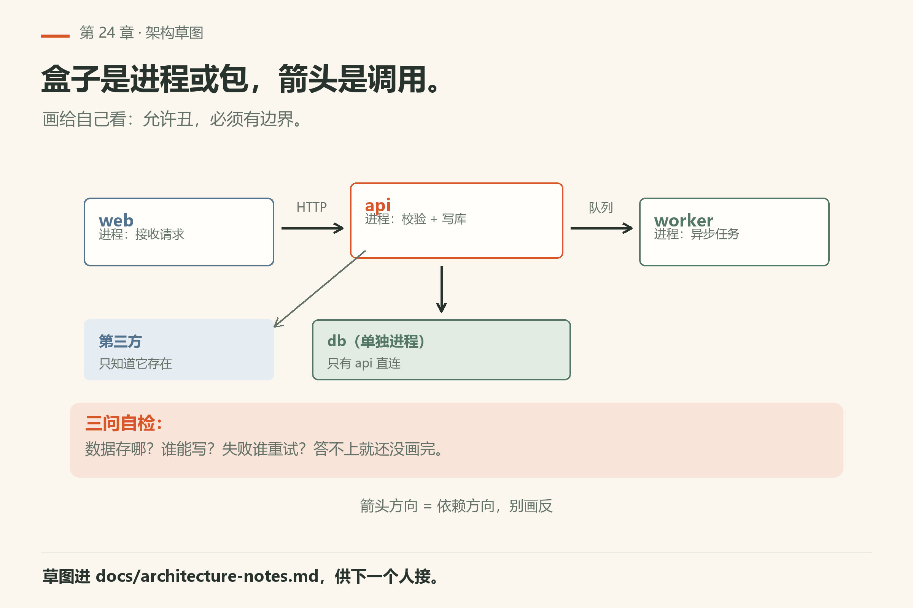
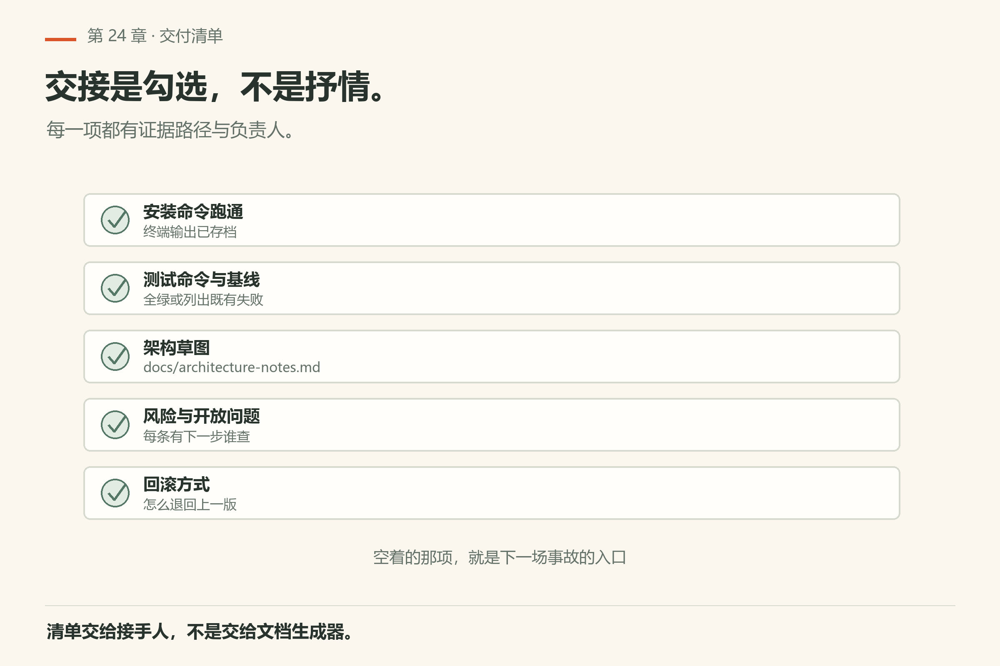
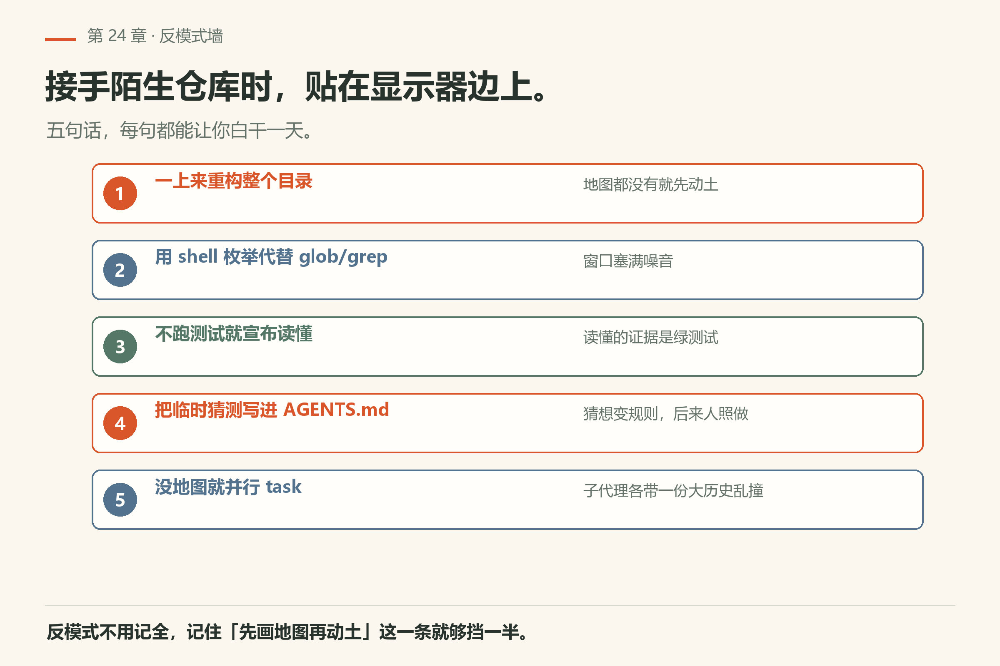
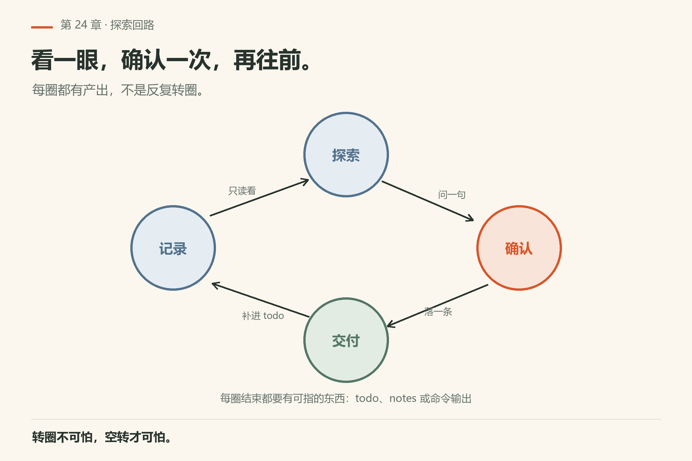
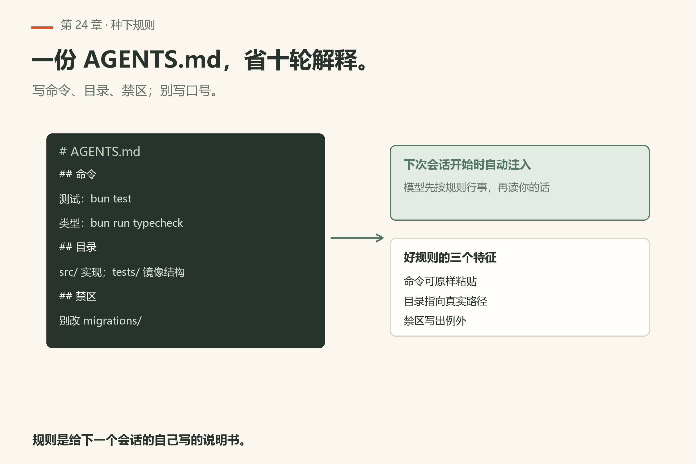

# 第24章 接手陌生代码库

<!-- block: omp-ch24.b-da20a30e -->
场景很具体：周一早上，你被丢进一个从没见过的仓库，老板说「先搞懂它，下午就能改」。你的半天交付不是炫技，而是三样东西：

> **开门一句话：**接手陌生库先画结构，再动手；顺序错了就要返工。

1. **架构草图**（一页能讲完）；
2. **本地可运行命令**（安装 / 测试至少跑通一条）；
3. **风险清单**（哪些目录别乱动、已知坑）。

omp 是加速器，签字的人还是你。这一章按可跟做的时间线写；工具细节回第三篇，上下文发现回第14章与 `docs/context-files.md`。



*图24-1：先画入口与边界，再钻细节。*

## 24.1 开场十分钟：先问「它已经知道什么」

在仓库根目录开新会话：

```sh
cd /path/to/unknown-repo
omp
```

一进来，AGENTS.md、RULES、以及从 `.claude` / `.cursor` / `.codex` 等目录继承的约定，**可能已经进了系统提示**。你不必先让它「去读 AGENTS.md」——按文档，相关上下文文件在会话开始时就会被发现并注入。你要做的是**核对**，不是重复加载。

跟做口令（可直接粘贴）：

> 用几句话复述你此刻已经加载的仓库约定（AGENTS / RULES / 外来约定）。每条后面标「有原文依据」或「我在推测」。不要改任何文件。

你对照磁盘上的原文抓幻觉。接着打开 `todo`，写下本场四格：**地图 / 命令 / 风险 / 文档**。todo 是本任务看板，不是长期记忆（长期记忆见第16章）。

然后让它做顶层盘点（仍不要改文件）：

> 用 glob 列出顶层的 README*、package.json、Cargo.toml、pyproject.toml、go.mod、Makefile、docker-compose*、.omp/**。再用 read 读 README 前 120 行，把「如何安装」和「如何测试」原文摘到 todo 的「命令」格。

安装与测试命令往往就在 README 里。把它们抄进 todo，别只活在聊天气泡——气泡会被压缩（第15章），todo 和仓库文件更扛造。



*图24-2：摸底 → 画图 → 跑通 → 落盘；只有第三步产生副作用。*

## 24.2 画架构：给自己看的，不是给幻灯片看的



*图24-3：盒子是进程或包，箭头是调用——先糙后细。*

推荐剧本（约一小时）：

1. `glob`：`src/**`、`packages/**`、`app/**`、`cmd/**`、`internal/**`——先看树形，不深读；
2. `grep` 入口符号：`main(`、`createApp`、`cmd.Execute`、`FastAPI(`、`CreateHostBuilder`……语言不同，换关键词；
3. `read` **两三个**枢纽文件，而不是二十个边角料；
4. 让 agent 用文字画出「请求从哪进、数据存在哪、后台谁跑」——你负责砍空洞句子：「高内聚低耦合」这种话直接删；
5. 定论落盘：

> 把我们刚确认的架构草图写进 `docs/architecture-notes.md`（若目录不存在就创建）。固定四节：系统上下文、关键命令、风险与雷区、开放问题。开放问题必须写「下一步谁查」。先给我预览，我确认再落盘。

原则：一张能给同事十分钟讲完的草图，好过一百行没有边界的「分析」。

## 24.3 跑通一次「官方路径」

跑通文档命令是一个运行证据，不是整套架构已经理解正确的证明。`--help` 成功只说明程序能启动到帮助入口；测试成功说明本次实际执行的用例通过。要解释请求链路，还得把入口、数据读写和输出对应到代码。交接笔记把这三类证据分开写，下一位同事才知道哪些结论能复现、哪些仍待追踪。

> 按 README 里我们摘进 todo 的测试（或 help）命令，用 bash 原样执行。失败就把完整 stderr/stdout 贴回来，先别改命令碰运气。

常见翻车：

- 把 `bash find` 刷出的几千行路径灌进上下文——改用 `glob`/`grep`；
- 整树 `read` vendor / 生成物 / 大 fixture；
- 测试没绿就宣布「架构懂了」。

失败时把**原文**贴回会话，让它帮读错误，而不是让它猜下一条魔法命令。

## 24.4 文档交付清单



*图24-4：交接是可勾选清单，不是抒情散文。*

最少五项写进 `architecture-notes.md` 或独立 `HANDOFF.md`：

| 项 | 写什么 |
|----|--------|
| 安装与启动 | 可复制命令 |
| 测试 | 可复制命令 + 预期「绿」的样子 |
| 模块边界 | 一页草图 |
| 千万别动 | 生成物、厂商 SDK、脆弱协议目录 |
| 已知坑 | 从 issues / AGENTS 摘，带链接或路径 |

## 24.5 反模式（墙上可贴）

先立规矩再干活：这五条是接手最容易踩的坑，撞上任何一条都浪费半天。

- 一上来「重构整个目录」；
- 用 shell 枚举代替 `glob`/`grep` 灌爆窗口；
- 不跑测试就宣布读懂；
- 把临时猜测写进 AGENTS.md 当真理；
- 让 task 子代理在你还没地图时并行「全面现代化」。



*图24-5：五条墙上反模式——重构整个目录、shell 枚举、未跑测试就宣布读懂、猜测写进规则、没地图就并行。*

## 24.6 半天节奏（可当日程）

把探索切成上下午两段，每段有出口；不是无限期的「熟悉一下」。

- **上午**：上下文复述核对 → README → 顶层 glob → 跑通一条官方命令；
- **下午**：入口 grep → 枢纽 read → 草图落盘 → 风险列表 → 导出或提交笔记。



*图24-6：每圈都要留下可指的东西，空转不算进度。*

全程 todo 盯着四格。禁止一上来重构。

## 24.7 最小可跟做实验：两小时迷你接手

准备一个你三个月没碰的旧项目，或从公开小仓克隆一份到临时目录。严格计时。

**第 0–15 分钟**

```sh
cd /tmp/unknown-lab && omp
```

口令：

> 复述你已加载的约定；每条标「有原文」或「推测」。打开 todo，建四格：地图 / 命令 / 风险 / 文档。用 glob 列顶层 README*、锁文件、docker-compose*、.omp/**。

你对照磁盘核对复述。猜错的划掉，不要让错误约定进笔记。

**第 15–45 分钟**

```sh
omp read <README 路径>:1-120
omp -p "只回复两个字：在线" --no-session   # 引擎通不通，先花一次请求确认
```

本机已验：`omp -p "只回复两个字：在线" --no-session` 在 omp/18.16.0（Windows · Bun）exit 0，
stdout 一行 `在线`，会话没落盘（`facts/live-18.16.0/ch24-ping-no-session.txt`）；`omp read`
的 `:1-120` 行选择器形态同批实跑，见 `facts/live-18.16.0/_manifest.tsv` 里
`omp read omp/ch06.md:1-3`、`omp read omp/ch09.md:raw` 那几行。

口令：

> 用 read 读 README 前 120 行，把安装与测试命令原文写进 todo「命令」格。用 bash 跑测试（或至少 `--help` / `npm test -- --list` 一类只读探测）。失败就把完整输出贴回，先别改命令。

**第 45–90 分钟**

> grep 入口符号（按语言换关键词）。read 两三个枢纽文件。用文字画：请求从哪进、数据在哪、后台谁跑。禁止「高内聚」这类空话。

**第 90–120 分钟**

> 把草图四节写入 docs/architecture-notes.md：系统上下文、关键命令、风险与雷区、开放问题。开放问题必须写「下一步谁查」。先预览，我确认再落盘。

收工标准：另一位同事只看这份笔记，能在十五分钟内说出「从哪进、怎么测、哪别碰」。

## 24.8 上下文发现你该知道的边界

按 `docs/context-files.md`：native `.omp` 有「最近非空目录」一类规则；外来约定（`.claude` / `.cursor` / `.codex` 等）按 provider 列表继承。你在陌生仓里看到「它好像已经知道团队规矩」，多半是发现层干的——所以第 24.1 节强调**核对**而不是重复加载。

若怀疑加载了错误目录的约定：先弄清 cwd、`--cwd`、`--add-dir`，再查 profile（`--profile` 隔离 auth/sessions/settings/caches，见 `docs/cli-reference.md`）。别一上来删文件。



*图24-7：命令、目录、禁区写清楚；口号留给 README。*

## 24.9 输出物模板（可直接复制）

`docs/architecture-notes.md` 骨架：

```markdown
# 架构笔记 — <仓库名>

## 系统上下文
- 谁调用谁（一句话 + 草图链接或 ASCII）

## 关键命令
- 安装：`...`
- 测试：`...`
- 本地启动：`...`

## 风险与雷区
- 路径：…… 原因：……

## 开放问题
- 问题：…… 下一步：<人名或角色> 查 <文件/服务>
```

把模板塞进会话，比「帮我写份文档」更不容易跑题。

## 24.10 翻车对照：陌生仓的前半天

对照着看：同样半天，走对路和走错路看到的分别是哪两张脸。

| 翻车做法 | 会看到什么 | 正确做法 |
|---|---|---|
| 一上来让它「重构整个目录」 | 没有地图就动手，改出大片无关 diff；评审看不懂意图 | 先按 24.6 走完上午流程，再谈改 |
| 用 `bash find` 枚举全树 | 几千行路径灌进上下文，压缩（第15章）之后关键信息先丢 | 用 `glob` 拿树形，用 `grep` 拿符号；别整树 read |
| 整树 `read` vendor / 生成物 / 大 fixture | 上下文被噪音填满，枢纽文件反而没读 | 先 `glob` 看树，再 `read` 两三个枢纽文件 |
| 不跑测试就宣布「架构懂了」 | 笔记写得很漂亮，但安装命令是编的 | 读懂的唯一硬证据：按 README 跑通一条命令 |
| 把临时猜测写进 AGENTS.md 当真理 | 错误约定进库，下一个人（或下一次 agent）继承 | 猜测只写进 todo 或 `architecture-notes.md` 的「开放问题」 |
| 让 task 子代理在没地图时并行「全面现代化」 | 多个子代理各改各的，互相踩；合并冲突 | 先有地图，再按第13章切分片 |
| 它复述的「已加载约定」你不核对就信 | 幻觉混进笔记，把不存在的规矩当成仓库规定 | 对照磁盘原文，逐条标「有原文」或「推测」 |
| 在错目录起会话，继承到别处的约定 | 模型讲的话像「知道」什么，其实读的是别的项目 | 先 `omp config path` 看活动目录；`--cwd` / `--add-dir` 确认工作区 |

## 24.11 与御舆同构点

参见御舆附录 A《架构导航地图》。同构的地方在于：**先建地图再动手**——先问「它已经知道什么」，再画入口与边界，再钻细节；一张能给同事十分钟讲完的草图，好过一百行没有边界的分析。omp 这边把「上下文发现」和「本地可运行命令」当成地图的两条腿；御舆那章讲的是同一类「接手陌生系统时先看什么」。两边的工具名、目录约定、清单格式各写各的，不互抄。

## 24.12 和小实验仓库怎么练

若手头没有「真·陌生仓」，用一个你三个月没碰的旧项目假装陌生：清掉自己的心理预判，严格按本章步骤走一遍，看能在两小时内交出三样交付物。练的是流程，不是装傻。

## 24.13 口头验收问句（给自己或给评审）

1. 安装命令是从 README 原文抄的，还是模型编的？
2. 测试至少跑通过一次了吗？输出还在吗？
3. 「千万别动」有具体路径吗？
4. 开放问题有负责人吗？
5. 笔记在仓库里还是只在聊天气泡里？

五问过关，这章的交付才算数。

## 24.14 和前后章怎么接

接手是下游：上游哪章没学好，这里就会在哪摔跤；按症状回翻。

- 不会用工具：回第三篇；
- 会话爆炸：第15章压缩；
- 要并行探索：第13章 task，但**先有地图**；
- 修 bug：第25章；
- 大重构：第26章。

陌生仓的第一天，禁止跳到第26章。

---
**版本核对清单**（写作钉 omp v18.15.0；用户本机验证 v18.16.0，见 VERIFY.md）：工具行为见第三篇各章；上下文发现与遮蔽见 `docs/context-files.md`（native `.omp` 最近非空目录规则、外来约定 provider 列表）。`omp -p "只回复两个字：在线" --no-session` 本机 18.16.0 回「在线」且退出码 0（`facts/live-18.16.0/print-mode-online.txt`）。本项目章不发明新 CLI。

- [ ] `omp -p "只回复两个字：在线" --no-session` 在你机器上回「在线」且 exit 0
- [ ] 你建过 `docs/architecture-notes.md` 四节骨架，且每节有内容
- [ ] 你跑通过目标仓库的一条官方测试命令，输出存过
- [ ] 你知道目标仓库的 `.omp/`、`.claude/`、`.cursor/` 里各有什么
