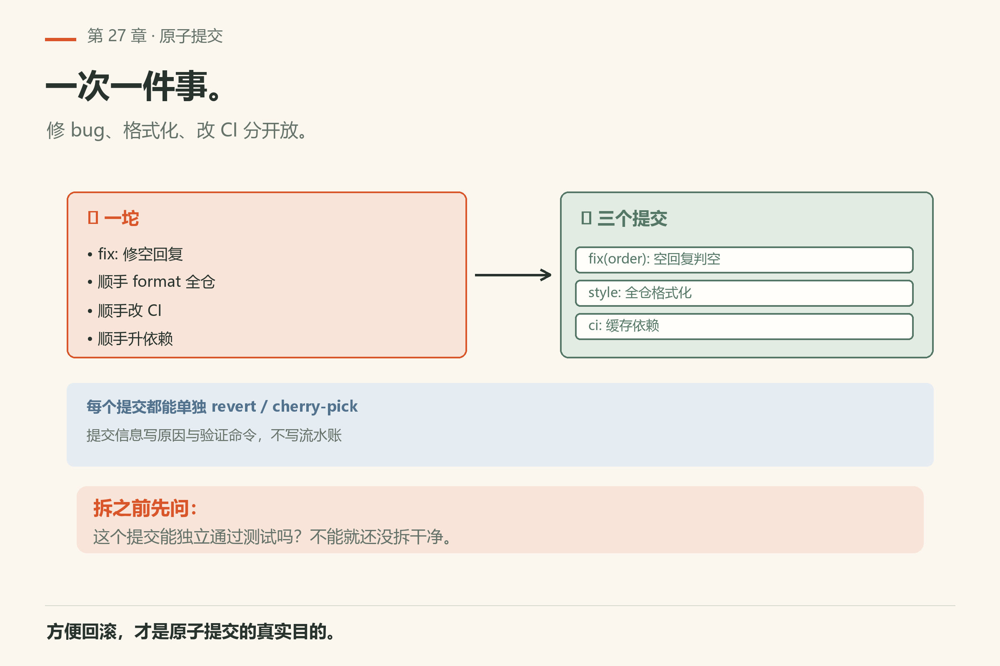
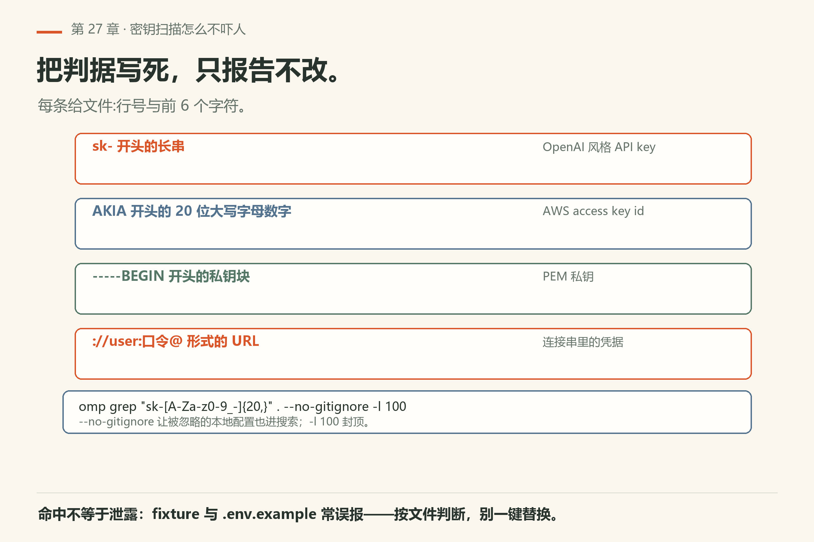

# 第27章 代码评审与原子提交

<!-- block: omp-ch27.b-6fb9b3b4 -->
你提了个 PR，改了一个函数加两行注释。评审人打开 diff，发现 47 个文件——你顺手格式化了整个仓库，把「修 bug」和「改 CI」塞进同一个提交。评审人关掉 PR，说：「拆了再来。」

> **开门一句话：**评审看证据链，提交要原子；密钥进过对话就算泄露。

评审要的是风险与意图，不是文采。提交要的是「一次一件事」，方便回滚与挑拣。这一章把人机分工写成可跟做清单：你定范围，agent 跑检查与起草，你保留合并权。


*图27-1：先勾选再评论。*

## 27.1 人机分工（写在墙上）

评审前先分工：人管方向和验收，agent 管执行和证据。

| 角色 | 负责 | 不负责 |
|------|------|--------|
| 人 | 定范围、定禁区、产品对错、最终合并 | 手工扫完所有 lint 噪音 |
| Agent | 跑测试、扫明显秘密形状、列 diff 文件、起草 Why/What/Test | 替你承担线上责任 |

用 `ask` 在「要不要改公共 API」「要不要动迁移」处分叉——默认选项应偏向保守。

开场口令：

> 这张票的范围是：……。禁止改：……。按下面清单自检，只报告通过/失败与证据，先不要改代码。

## 27.2 评审清单（可粘贴）

至少勾这些：

1. **测试**：约定命令已绿，输出可附；
2. **秘密**：无明显密钥/token 形状进 diff（配合第31章遮罩）；
3. **范围**：文件列表是否超出 ticket；
4. **命名**：是否与仓库既有风格一致；
5. **生成物**：锁文件/构建产物是否误进提交；
6. **兼容**：公共 API / 配置字段是否悄悄变了。

跟做：

> 针对当前工作区 diff（或指定 commit），逐项给出通过/失败。失败项写文件路径。不要改代码。

你只处理失败项；通过项别再让它「优化文风」。

“没检查”单列为未验证，不要塞进通过或失败。比如只跑了单元测试，浏览器操作、迁移脚本和生产凭据都没有被它覆盖；PR 应写清已运行的命令与结果，以及还没触达的边界。测试通过也不是对测试本身的审查：若本次同时改了测试断言、运行器或放行规则，评审还要确认判据没有被悄悄改松。

## 27.3 原子提交



*图27-2：一次一件事，方便 revert 与 cherry-pick。*

把「修 bug」和「顺便格式化全世界」拆开。把「加功能」和「改 CI」拆开。原则：

- 一个提交一个意图；
- 提交信息写**原因**，不写流水账；
- 验证命令写进正文或尾注。

模板：

```text
<范围>: <意图>

为何：...
验证：<命令原文>
```

禁止只写 `update`、`fix`、`wip`。若你的版本提供提交助手，仍然**人审信息**再真正提交——助手不是签字人。

跟做：

> 根据当前 diff 提议如何拆成原子提交（每个提交一句话意图 + 包含文件）。先不要执行 git commit。

你确认拆法后，再让它按片暂存与提交（或你自己提交）。

## 27.4 PR 正文


*图27-3：为何 / 做了什么 / 验证计划——三节就够。*

口令：

> 根据 diff 起草 PR 正文，固定三节：为何、做了什么、验证计划。验证计划必须是可复制命令。删掉所有形容词和「旨在提升」这类空话。先给我预览。

你删剩骨头，再贴到托管平台。附复现步骤时用第25章的四行报告。

## 27.5 评审评论怎么写才可执行

坏评论：「这里感觉不太对。」

好评论：「`User` 可空，但第 88 行直接 `.id`；请加测试 `test_user_none` 或改契约说明不可空。」

让 agent 根据好评论出补丁；你抽查文件:行。评论里给**路径 + 期望行为 + 验收方式**，少谈感觉。

## 27.6 秘密扫描过了再推

推远程前：

> 扫一遍即将推送的 diff，列出疑似密钥/token/私钥块。只报告，不改。

命中则先按第31章处理，再推。客户数据、内网 URL 里的密码同样对待。

## 27.7 评审会议十分钟版

五个人以上的评审别朗读 diff。流程：作者一分钟说为何；agent 事前清单结果投屏；只讨论失败项与公共 API；可执行评论当场录进票；散会后 agent 出补丁，作者抽查。会议不是文学课。

## 27.8 提交信息反例集

反例：`fix`、`update`、`stuff`、`临时`、`asdf`。

正例：`auth: 拒绝空 User 解引用` + 正文「为何：……；验证：pytest tests/test_user_none.py」。

若助手生成了反例风格，你的动作是改信息，不是叹气后仍推上去。


*图27-4：文件数翻倍就停手，按目录聚类再拆提交或拆票。*

## 27.9 范围蔓延报警

当 diff 文件数突然超过票面描述的两倍——停。让 agent 按目录聚类「这些文件分别服务哪个意图」，再拆提交或拆票。范围蔓延是评审质量的第一杀手。

## 27.10 最小可跟做实验：给昨天的提交写「可执行评审」

挑自己昨天的一个提交，假装你是评审人：

```sh
# 先确认引擎通不通（本机已验：回「在线」，exit 0）
omp -p "只回复两个字：在线" --no-session
```

```text
然后走链路：
1. 让 agent 按 27.2 清单自检这个提交，只报告通过/失败与证据；
2. 你写三条好评论（路径 + 期望行为 + 验收方式）；
3. 让 agent 只针对评论出补丁；
4. 看 diff 是否仍然原子。
```

**怎么算成功**：第 1 步清单每项都有「通过/失败 + 文件路径」；第 3 步补丁只动评论点名的位置；第 4 步 `git diff` 文件数没有悄悄翻倍。练的是评论质量，不是挑刺。

### 失败了先看什么

- **清单第 1 项写「通过」但没附输出**：退回去重做。没有命令原文的「通过」不算通过。
- **评论里只有感觉、没有路径**：重写。没路径的评论作者无法执行（27.5）。
- **第 4 步文件数翻倍**：不是评论出了问题，是你在评审过程中顺手改了范围（27.9）。
- **omp 报 `Model "..." not found`**：与评审无关，是模型名（本机同形状 exit 1，`fail/bad-model.txt`）。先修环境。

## 27.11 翻车对照：评审与提交的高频事故

评审阶段的事故大多能预防：对号入座最省时间。

| 翻车做法 | 会看到什么 | 正确做法 |
|---|---|---|
| 一张票改 47 个文件 | 评审看不懂意图；范围蔓延；回滚困难 | 一个提交一个意图；拆提交或拆票（27.3） |
| 提交信息写 `fix` / `update` | 三个月后没人知道这次改了什么、为什么 | 写「范围: 意图」+ 为何 + 验证命令原文 |
| PR 正文写「旨在提升代码质量」 | 空话；评审人只能自己猜 | 三节：为何、做了什么、验证计划（可复制命令） |
| 评论「这里感觉不太对」 | 作者不知道怎么改；来回一轮浪费 | 给路径 + 期望行为 + 验收方式 |
| 把「修 bug」和「顺便格式化」塞进同一提交 | 审查者看不到真正的修复；回滚时连格式化一起退 | 拆开：一个提交一个意图 |
| 推远程前不扫秘密 | 密钥进 git 历史；事后清理成本极高 | 推前扫 diff；命中按第31章处理并轮换 |
| 提交不原子，回滚冲突 | `git revert` 时冲突；一片里混了多个意图 | 回第26章拆提交；小步暂存 |
| 依赖提交助手自动写信息，不人审 | 助手写流水账或「update」；你签字了但信息是假的 | 助手起草，人审信息再提交 |

## 27.12 失败路径：提交落下去之后才发现错了

这比「命令报错」常见，也更贵。四个场景，四组动作。

**场景一：提交信息是 `update`，或者助手写的流水账。** 还没推，就改：`git commit --amend`，只改信息不动文件。已经推了且分支只有你一个人：`git commit --amend` 后 `git push --force-with-lease`——**别用** `--force`，前者会在别人推过之后拒绝覆盖。主干分支禁止这么干，回退为新增一个更正的提交。

**场景二：一个提交里混了两个意图。** 退回去拆：`git reset --soft HEAD~1`（改动全部保留在暂存区），然后 `git restore --staged <path>` 逐组放出来，分两次提交。判据是每次 `git show --stat HEAD` 的文件列表只服务一个意图。

**场景三：密钥进了提交。** 先把明文换成环境变量名（第31章），再决定改写历史还是轮换凭据——**已推到远端的密钥一律按已泄露处理，直接轮换**，改写历史只减少扩散面。定位引入点：`git log -S '<片段>' --oneline`，再看那一版 `git show <sha> -- <文件>`。

**场景四：`omp commit` 自己跑挂了。** 先分清是模型层还是 git 层。模型层的失败形状本机验过（`fail/bad-model.txt`）：exit 1 + `Model "..." not found`，照提示跑 `omp models find`。git 层（合并冲突、无可提交内容、钩子失败）看 `git status` 原文，不要让 agent 猜。`omp commit` 的旗标以 `omp commit --help` 为准：本机 18.16.0 有 `--dry-run`（预览不提交）、`--no-changelog`、`--push`、`-c/--context`、`-m/--model`。**先 `--dry-run`，人看过信息再真提交。** 本机没跑过真提交（会写库），`--dry-run` 的输出形态未验证，你自己跑一次看。

| 症状 | 大概率原因 | 一条命令确认 |
|---|---|---|
| 提交信息是 `update` / `fix` | 没走模板，或被助手默认值带走 | `git log -1 --pretty=%s` |
| 一个提交动了 40 个文件 | 提交前没看 stat，范围蔓延 | `git show --stat HEAD` |
| `git revert` 冲突 | 提交里混了多个意图，不原子 | `git revert --abort`，再 `git reset --soft HEAD~1` 重拆 |
| 推上去才想起密钥 | 推前没扫 diff | `git log -S '<片段>' --oneline`，然后轮换凭据 |
| `omp commit` 报 `Model "..." not found`，exit 1 | 模型名不在注册表，与 git 无关 | `omp models find <片段>` |

## 27.13 密钥扫描怎么写才不吓人

扫描提示词写成「列出疑似密钥」，十次有八次会回来一堆测试 fixture 和文档里的假样例。把判据写死：

> 在即将推送的 diff 里搜下面四类形状：`sk-` 开头的长串、`AKIA` 开头的 20 位大写字母数字、`-----BEGIN` 开头的私钥块、`://user:口令@` 形式的 URL。每条给文件:行号与前 6 个字符，不要输出完整值。只报告，不改。

自己跑也一条命令：

```sh
omp grep "sk-[A-Za-z0-9_-]{20,}" . --no-gitignore -l 100
```

三个参数各有原因。`--no-gitignore` 是因为默认 `Gitignore: true`（本机 `grep-count.txt` 表头），被 ignore 的本地配置文件根本不进搜索范围。`-l 100` 是给结果封顶，防你把上千行灌进上下文。模式串用双引号包住，PowerShell 不会拆你的花括号。

命中不等于泄露：fixture、文档示例、`.env.example` 都是常见误报。你的动作是按文件判断，不是一键替换。真正要处理的只有两类：真密钥（轮换）与看起来像密钥的占位符（改成 `<your-key>`）。

这条正则扫全仓的实际命中和退出码，本机没采（会扫出大量噪音），形态以 `omp grep --help` 为准。



*图27-5：四类形状写死判据；只报告不改，每条给文件:行号与前 6 个字符。*

## 27.14 评审被退回后的三种回法

被退回时不要先解释。先归类，再动手。

**回法一：范围太大。** 拆提交（27.3），或把无关文件`git restore --staged` 拿出去另开票。回复只写一句：已拆成 N 个提交，每个一句话意图。

**回法二：证据不足。** 补三样：测试命令原文与末 20 行输出、复现步骤（第25章四行报告）、改动前后的对比（若改的是行为）。不要把「我本地试过了」当证据。

**回法三：方案本身被质疑。** 回到 `ask`，把两个方案的成本写成两行（改动面、回滚代价），让人选。不要在评论区打三轮字——评审时间比你的打字时间贵。

三种回法的共同点：**每条回复都带一个可执行命令或文件路径**。没有这两样的回复，等于没回。


*图27-6：被退回先归类——范围太大拆提交，证据不足补三样，方案被质疑回 ask。*

## 27.15 与御舆同构点

参见御舆第 8 章《钩子系统》。同构的地方在于：**提交前后的自动化关口**——在代码落库前后各挂一道检查，能记录、能拦、能回退。omp 这边把评审清单、原子提交、秘密扫描当关口三件套；御舆那章讲的是同一类「关口怎么设在提交链上」。两边的钩子注册方式、检查项、提交工具各写各的，不互抄。

## 27.16 和前后章

修复过程见第25章；大重构拆分见第26章；分享会话前遮罩见第31章；成本见第32章——评审若反复全仓测试，记得缓存与角色模型。

## 27.17 可勾选收工

收工有六项，一项都不能少；证据说话。

- [ ] 清单六项有证据
- [ ] 提交按意图拆开
- [ ] PR 三节无空话
- [ ] 评论可执行
- [ ] 秘密扫描无未处理命中
- [ ] 范围未悄悄翻倍

---
**版本核对清单**（写作钉 omp v18.15.0；用户本机验证 v18.16.0，见 VERIFY.md）：会话导出与分享见会话章与 `session-operations-export-share-fork-resume.md`；CLI 提交助手以 `omp --help` / 子命令帮助为准。`omp -p "只回复两个字：在线" --no-session` 本机 18.16.0 回「在线」且 exit 0（`facts/live-18.16.0/print-mode-online.txt`）。

- [ ] 你在本机跑过 `omp -p "只回复两个字：在线" --no-session`，确认引擎通
- [ ] 你的上一个 PR 正文是三节，验证计划是可复制命令
- [ ] 你的提交信息不是 `fix` / `update` / `wip`
- [ ] 你推远程前扫过 diff 里的疑似密钥
- [ ] 你的每个提交可独立 revert
- [ ] 你的提交里没有混进来的格式化改动（`git show --stat HEAD` 对过）
