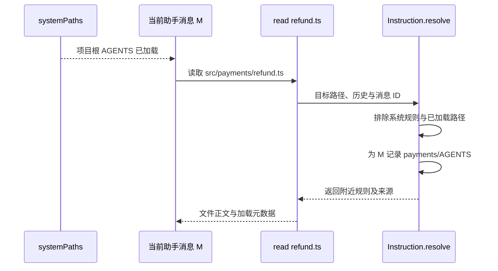

# 第 3 章：配置与项目身份

<!-- block: opencode-ch03.b-opening -->
同一条命令换个目录就出现不同工具，通常应先查配置来源。OpenCode 的配置不是一份孤立 JSON：全局目录、项目文件、.opencode 目录、环境指定的配置和插件修改都可能参与最终结果。

## 3.1 先找来源，再谈优先级

本书所用版本的配置服务保留多个来源并进行合并。配置目录的收集包含全局配置目录、从当前目录向工作树边界寻找的 `.opencode`、用户目录下的 `.opencode`，以及显式指定的配置目录。项目配置文件也会沿目录层级查找。

排查时先列出实际参与的文件，再看冲突字段如何合并。标量、对象、指令列表和插件列表可能采用不同策略；插件还保留声明来源，并单独去重。只记住文件的优先级，容易漏掉这些差别。

```text
记录本次目录
  → 找出项目配置和全局配置
  → 找出 .opencode 中可执行资源
  → 检查环境中的配置覆盖
  → 查看合并后字段与实际请求
```

同样的文件名不等于同样的作用域。复制一个 `opencode.json` 到另一目录后，里面的相对插件路径也会随声明位置改变。第九章的 B 插件就是用这个规则定位的。

## 3.2 JSON 合法不代表配置有效

JSON 解析只检查语法。`"model": "fixture/test"` 还需要 fixture 提供者里确实存在 test 模型；插件路径需要指向可导入模块；工具规则还要对应实际工具或权限名。错误可能分别发生在加载配置、解析模型和执行工具时。

同一个配置值还可能在不同阶段被读取。某些字段参与实例初始化，修改文件后，已有实例未必重新读取。沿字段的读取位置查看代码，再通过实例重建实验确认，比单看配置文件更容易找到原因。

第七章的权限驱动会在场景之间清理实例，让下一场景重新读取配置；需要比较同实例授权时，则刻意保留实例。这个条件若没有写进实验，允许与拒绝的差异就可能被旧状态污染。

## 3.3 项目指令也会随文件读取而变化

指令服务读取全局和项目规则文件，并支持配置中的 instructions。源码中有 `AGENTS.md`、兼容的 `CLAUDE.md` 和已弃用的 `CONTEXT.md` 入口，具体是否启用还受标志控制。不要据此推导三个文件一定全部叠加：实现会按候选顺序寻找匹配。

此外，读取某个子目录文件时，还可能加载附近的指令。服务维护按消息 ID 关联的已加载集合，避免在同一处理过程中重复附加。于是“会话启动时的 system”并不总能代表后来读取深层文件时使用的全部约束。

实际项目可以把跨目录通用规则放在项目根，把语言或模块约束放到相关目录。但规则越分散，越要给出清楚的归属。两个文件互相矛盾时，不能仅靠写上“最高优先级”解决程序到底读了哪个文件的问题。

## 3.4 提示词文件与可执行插件的差别

指令文件提供文本，插件模块运行 JavaScript，MCP 本地配置还能启动另一个进程。它们可能都放在项目目录里，却具有不同的执行后果。

| 项目资源 | 主要作用 | 排查时看什么 |
| --- | --- | --- |
| AGENTS.md | 给模型提供项目约束 | 最终请求中是否加载，是否过期或冲突 |
| plugin 配置与插件目录 | 载入可执行扩展 | 来源、导入、初始化与 Hook 事件 |
| tools 目录 | 提供自定义工具 | 工具 ID、schema 与执行器 |
| MCP 配置 | 连接服务或启动进程 | 命令/URL、认证、状态与工具清单 |

工具权限不是所有这些资源的通用沙箱。特别是插件加载阶段可能已经执行顶层代码。审核一个新项目时，应该检查可执行配置，而不是只搜提示词有没有危险措辞。

## 3.5 建立可复现的配置快照

为一次问题保存配置时，删掉凭据，保留字段结构、相对路径和版本。环境变量可以记录名称和是否设置，不要复制真实值。宿主路径输出可以证明实际读取的位置，但公开报告应把私有目录替换成实验相对路径。

本书驱动保留系统 HOME，为子进程设置 OpenCode 的测试目录入口、独立 XDG 目录和数据库路径。第九章运行了 `debug paths`，确认每个必需路径都落在临时目录。

## 3.6 用两个文件看标量、对象和指令列表
假设全局配置是：

```json
{
  "model": "fixture/base",
  "permission": {"read": "allow", "bash": "ask"},
  "instructions": ["rules/shared.md"]
}
```

项目配置是：

```json
{
  "model": "fixture/test",
  "permission": {"bash": "deny"},
  "instructions": ["rules/project.md", "rules/shared.md"]
}
```

沿 config.ts 的 mergeConfigConcatArrays 读，会看到普通配置先经过 mergeDeep，而 instructions 在两边都存在时单独拼接并用 Set 去重。在只有上述两层、没有后续覆盖的例子里，model 采用项目值，permission 保留 read 同时把 bash 改为 deny；instructions 保留 shared 与 project 两项，重复 shared 不再增加一项。

这只能确定指令列表的合并次序。两份文字若互相冲突，模型会遵守哪一份，还要结合最终请求和模型结果判断。

instructions 的拼接规则只适用于这个字段。插件列表另按来源和身份去重，其他数组则需要查各自的 schema 和读取代码。

## 3.7 沿加载路径确认覆盖发生在哪一步
在 loadInstanceState 中，远程 well-known 配置在前，全局配置随后，OPENCODE_CONFIG 指向的文件在项目配置之前合入。接着读取项目文件和收集到的配置目录，加载命令、agent 与自动发现的插件，再处理 OPENCODE_CONFIG_CONTENT。后面还有账户或托管配置等分支，某些运行标志也会继续影响最终字段。

OPENCODE_CONFIG 指定的文件在项目配置之前加载。用它设置 model 后，项目文件仍可能覆盖这个值；排查时要沿加载链继续往后查，直到找到该字段最后的来源。

同一批目录还可能触发依赖准备与可执行资源发现。配置加载不完全是纯读取 JSON。实验提前准备真实依赖，并关闭不相关下载，是为了把首次安装与插件行为分开观察；不能据此假定任意陌生 .opencode 目录都只是无副作用的静态数据。

相对插件路径在读取其声明文件时就会规范化，保留来源，避免后续合并把 ./plugin.ts 错解为另一个目录。plugin_origins 随去重保留获胜声明的 source 与 scope。第 9 章显式 B 与目录发现 A 的顺序实验，就是追踪这些来源信息进入加载器后的结果。

## 3.8 instructions 与 AGENTS.md 有不同的发现入口
instruction.ts 的 systemPaths 先处理全局候选，再处理项目候选，最后处理 config.instructions。全局 AGENTS.md 与兼容的个人 CLAUDE.md 使用首个存在的候选；项目候选按 AGENTS.md、可选 CLAUDE.md、CONTEXT.md 顺序查找，找到某类匹配后停止继续叠加其他候选名。

这意味着不能在根目录同时放三种文件，就假定它们都按文件名排序进入提示。若项目已经有 AGENTS.md，却把新增约束只写进 CLAUDE.md，应该先核对实际发现结果。正文中写“这条规则优先”改变不了文件是否被读取。

instructions 则显式列出额外材料。相对模式按当前目录与工作树相关范围寻找，绝对路径按所在目录 glob，~/ 按 home 展开。HTTP/HTTPS 项不在 systemPaths 的本地路径集合中，而在 system 阶段单独抓取。该版本抓取时设有五秒超时，失败后可能得到空内容，不能只凭配置中出现 URL 就认为文字已进入请求。

加载后的文本带 Instructions from: 来源标记。诊断时可以在本地请求记录中搜索这个前缀，确认路径和正文，而不是只搜索一个容易在普通文档里重复的句子。远程规则变化也会影响结果，长期复现更适合固定来源或保留当时内容摘要。

## 3.9 读深层文件时，哪些规则会再加入
假设项目根目录有 AGENTS.md，src/payments 下另有 AGENTS.md。会话开始可能已经加载根规则；后来 read 读取 src/payments/refund.ts，Instruction.resolve 从目标文件所在目录向上检查附近规则，排除系统路径里已有的文件、已经加载的路径和本条消息已认领的路径。

已加载集合从完成的 read 工具 part 中提取 metadata.loaded。被标记 compacted 的工具结果不会按普通已加载内容处理。这说明规则去重与会话消息状态有关，不能用一个进程级布尔值概括“这个文件已经读过”。claims 则按 assistant message ID 组织，避免同一处理过程中重复附加。



把跨项目规则放在全局、工程约定放在根目录、模块规则放在相关子目录，能减少无关上下文。但规则分层越细，诊断越要保留实际加载路径。若支付模块的规则没有出现，先检查是否真的读取了那个目录的文件，再检查兼容标志和去重状态，不必先改写所有提示词。

## 3.10 配置修改后怎样避免旧状态干扰
权限实验在场景间显式 dispose 实例，使下一场景重新建立配置和权限状态；验证同实例 always 批准时则刻意保留实例。这个对照说明，观察结果必须附带生命周期条件。只写“改了 permission 后允许”却不说明是否重建实例，读者无法判断新配置是否参与了运行。

你的复现记录可以列四列：来源文件、字段值、实例是否重建、下游可见证据。例如工具名是否进入请求、read 是否执行、审批队列是否出现。程序没有提供某个调试字段时，就用相应消费者的实际行为核对，而不是把自己预想的合并结果当作日志。

来源：[配置合并](https://github.com/anomalyco/opencode/blob/810c0eba1a7348036f8bdf61e6632d0c36c6876c/packages/opencode/src/config/config.ts)、[目录收集](https://github.com/anomalyco/opencode/blob/810c0eba1a7348036f8bdf61e6632d0c36c6876c/packages/opencode/src/config/paths.ts)、[项目指令](https://github.com/anomalyco/opencode/blob/810c0eba1a7348036f8bdf61e6632d0c36c6876c/packages/opencode/src/session/instruction.ts)。
