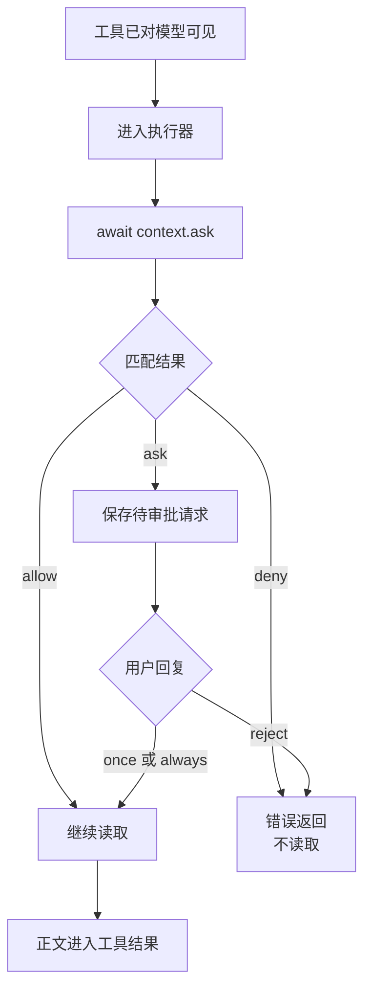
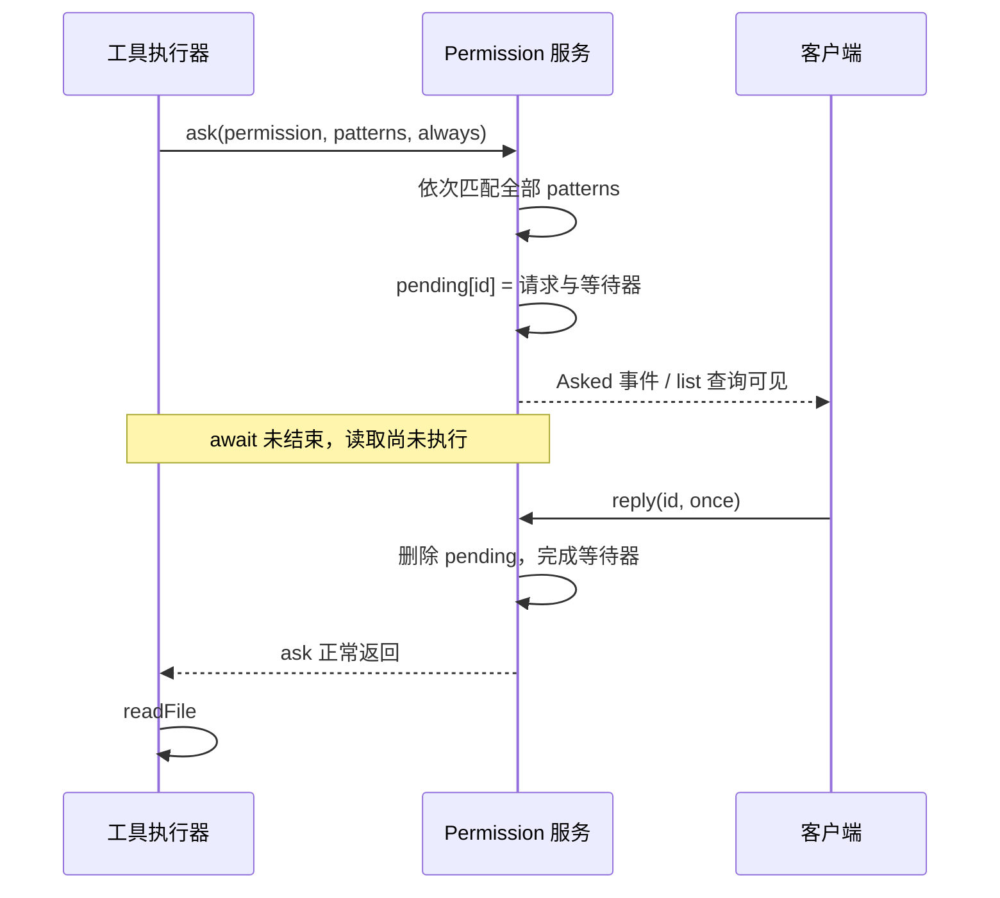

# 第 7 章：权限与审批

<!-- block: opencode-ch07.b-opening -->
权限配置可以让工具从模型列表里消失，也可以让已进入执行器的操作在某一步等待批准。两者发生的位置不同。本章用同一个真实工具分别触发允许、拒绝和询问，观察读取究竟有没有发生。

## 7.1 先分开工具名与操作权限

第六章工具名为 book_probe，内部调用 `context.ask` 申请 book_read。实验配置如下：

```json
{
  "permission": {
    "*": "deny",
    "book_probe": "allow",
    "book_read": "ask"
  }
}
```

book_probe 可以进入模型的可用工具列表；执行器开始后，book_read 再决定是否继续读取。若把 book_probe 本身设为全局 deny，宿主准备请求时可能直接把它隐藏，模型连调用它的机会都没有。

源码的 `Permission.disabled` 正是可见性筛选的一部分。具体操作则走 ask，按权限名和 pattern 匹配规则。后匹配的规则会覆盖前面的匹配，未找到时走询问。复杂规则应逐项检查顺序，不要凭 JSON 看起来的“更具体”自行推断优先级。

## 7.2 拒绝究竟发生在读取前还是后

本例的顺序是 entered → await ask → approved → readFile → read-done。若 ask 拒绝，后续读取不会发生。这个结论依赖样例把检查放在副作用之前；若开发者先 readFile 再 ask，拒绝自然无法让已经读出的信息消失。



图 7-1：操作权限在样例中的位置。操作之前已经执行的代码不属于回滚范围。

内置 read 也在读取内容前调用 ask，但它会先解析路径、检查文件状态和外部目录。权限拒绝不等于“程序连这个路径字符串都没处理过”。在需要严格隔离的场景，仍须使用操作系统或容器提供的限制。

## 7.3 五种情况的真实结果

使用官方 v1.19.5 Windows 宿主、同一份原创工具和本地模型替身，得到下面的结果。请求 ID 与目录是临时值，公开记录只保留事件名称。

| 配置与回复 | 工具进入执行器 | 产生审批请求 | 读取文件 | 下一轮含文件正文 |
| --- | --- | --- | --- | --- |
| book_read=allow | 是 | 否 | 是 | 是 |
| book_read=deny | 是 | 否 | 否 | 否 |
| book_read=ask，回复 once | 是 | 是 | 是 | 是 |
| book_read=ask，回复 reject | 是 | 是 | 否 | 否 |
| book_probe=deny | 否 | 否 | 否 | 否 |

驱动在等待审批时查询真实 `/permission`，确认 pending 请求的权限名和会话 ID；回复前还检查事件文件只有 entered。拒绝后下一轮请求不含已知文件标记，避免仅用“界面显示拒绝”作为证据。

这里的 hidden 场景没有强行向宿主提交一个被隐藏工具的伪造调用。它验证模型收到的能力范围与实际无执行；对于恶意客户端或非法工具调用，应另做协议边界测试，不能从这行结果推出所有绕过方式都被封堵。

## 7.4 once 与 always 保持多久

后五个场景保留同一个宿主进程，在指定位置才清理实例：

| 场景 | 本次是否询问 |
| --- | --- |
| 首次操作，回复 once | 是 |
| 同实例新建会话，再次读取 | 是 |
| 清理实例后首次操作，回复 always | 是 |
| 同实例新建会话，读取同一 pattern | 否 |
| 再清理实例后读取 | 是 |

这说明在本轮 V1 路径中，always 的已批准规则存在项目实例状态内，可以影响同实例的新会话；实例清理后不再沿用。它并不是写回项目配置的“永久允许”。once 则仅放行本次待审批请求。

实验只使用同一 permission 和 `fixture.txt` pattern，尚未覆盖并发审批、不同目录和不同客户端。处理同会话 pending 请求的源码会在 7.10 节展开，扩展实验时可以据此准备对照。

## 7.5 插件代码不在这张权限表的沙箱里

本例的包装器直接使用 `appendFileSync` 写事件文件。它能够这样做，是因为插件作为 JavaScript 运行在宿主进程权限下；工具权限服务并没有拦截每一次 Node 文件系统调用。

因此，要审核一个未知插件，重点是可执行代码和依赖来源。设置 `"*": "deny"` 能约束走相应权限路径的工具，不会把恶意插件变成不能读写磁盘的纯文本。真正限制插件能碰到哪些文件，需要进程用户、容器或其他执行隔离配合。

编写插件时，路径检查、读取前的 ask、错误处理和日志脱敏都需要自己实现。权限服务负责响应 ask，其他 Node 调用仍由插件代码控制。

## 7.6 用这组实验检查自己的工具

从 examples 的说明准备依赖后运行 `check-tool-permissions.py`。把自己的副作用放到同样的检查点后，至少验证允许、拒绝、等待、取消和重复调用。拒绝用例中检查真正的文件或服务状态，不只断言某个函数抛了异常。

本书这轮十个场景均通过；中途取消尚未验证，复现范围见附录 C。

## 7.7 把配置展开成真正匹配的规则

权限配置看起来像一张字典，进入服务后却是一组有顺序的规则。`fromConfig` 对字符串值生成 `pattern: "*"`；遇到对象值，则按其中的 pattern 逐条展开。`merge` 把多组规则摊平成数组，`evaluate` 从末尾寻找 permission 和 pattern 都匹配的那一条。理解这个过程，才能解释为什么改变顺序会改变结果。

下面的片段只配置 `book_read` 这项操作权限。要让本章工具对模型可见，仍需同时保留前面的 `book_probe: "allow"`。

```json
{
  "permission": {
    "book_read": {
      "*": "deny",
      "fixture.txt": "ask"
    }
  }
}
```

它展开后的含义是：先有一条全部拒绝，再有一条例外询问。请求 `fixture.txt` 时，末尾的规则胜出；请求 `secret.txt` 时，只有通配拒绝匹配。若把两个 pattern 的位置反过来，末尾通配规则会盖过前面的询问例外。这里不存在“更具体的路径一定优先”这一额外原则。

再看 `disabled`。它为了决定是否隐藏整个工具，会先找最后一条匹配权限名的规则，只有该规则的 pattern 为 `*` 且 action 为 deny 才把工具隐藏。它没有对每个未来目标逐一调用 `evaluate`，因为请求还没发生，目标也可能尚不存在。因此，“工具出现在 tools 数组”只能说明它没有被整项隐藏，不能说明模型随后传来的任意目标都会获准。

book_probe 控制工具是否可见，book_read 控制具体操作。排错时可以先看请求中的工具列表，再查 ask 的目标和匹配规则。

路径展开也有范围。本书所用版本的 `expand` 处理以 `~/`、`~`、`$HOME/` 等形式开始的 pattern；它并不是任意环境变量模板引擎。自定义工具如果传入的是逻辑资源名而非本地路径，也要统一约定，例如始终使用仓库相对路径，不在一处传绝对路径、另一处写相对 pattern，然后期待匹配器替你猜。

## 7.8 ask 是一个等待中的操作，不是一条通知

权限服务的状态里有两样东西：`pending` 保存尚未处理的请求与 Deferred，`approved` 保存实例内已批准的规则。调用 ask 后，服务先检查请求中的每个 pattern。遇到 deny 直接失败；全部 allow 就直接返回；只要还存在需要询问的 pattern，就构造请求、放入 pending、发出 Asked 事件，然后等待 Deferred 完成。



图 7-2：询问挂起了具体工具的执行。客户端可以通过事件或查询取得请求，审批完成后原来的等待继续；它没有新建一条与工具无关的任务。

因此，驱动在线程池里提交消息请求，主线程查询 pending 并回复审批。如果主线程也阻塞在消息请求上，就会一边等工具完成，一边错过工具正在等待的审批。生产客户端用同一个同步队列处理这两件事时，也会发生互等。

服务用 `Effect.ensuring` 在等待结束时尝试移除对应 pending 项，实例 finalizer 还会拒绝残留请求并清空表。不过，进程被直接杀掉时，finalizer 未必有机会运行，相应事件也可能缺失。

## 7.9 patterns 和 always 为什么是两份列表

`patterns` 描述本次操作需要的目标；`always` 则描述用户选择持续允许时，要写入 approved 的规则。两者在本例里恰好都是 `fixture.txt`，但字段用途并不相同。插件作者完全可以把本次目标列得很窄，却申请一个过宽的持续授权。

例如某工具本次读取 `docs/release.md`，却把 `always` 写成 `*`。选择 once 只放行正在等待的调用；选择 always 则可能给同一 permission 的后续目标都留下允许规则。用户界面应该让人看见持续授权的范围，插件实现也应尽量让这个范围与真实用途一致。不能只在按钮上写“始终允许”，却不交代允许的对象是什么。

这个版本的 reply 在持续允许时遍历 `existing.info.always`，为每个 pattern 追加一条 allow。接下来的 ask 调用以 `evaluate(permission, pattern, ruleset, approved)` 进行判断，approved 放在配置规则之后。这解释了为什么本次允许能够影响同实例的新会话，也说明排查规则时必须同时看静态配置与运行中累计的批准。

“我刚把配置改成 deny，为什么仍能执行”不能只靠肉眼检查配置文件回答。至少要确认新配置是否已被当前实例重新读取，以及原先 approved 状态是否仍在。实验在需要重新建立基线的位置显式 dispose 实例，就是为了避免把上一场景的授权偷偷带进下一场景。

## 7.10 多个待审批请求怎样相互影响

真实应用可能同时有两个工具等待批准。源码的 reply 不是只处理一个 Map 项就结束：reject 会继续拒绝同会话的其他 pending 请求；always 则检查同会话中其余请求的所有 patterns，若这些目标都被已批准规则允许，就一并完成它们。once 在完成当前等待器后直接返回，不创建这样的持续规则。

这里有两个范围：approved 属于实例，后续新会话的 ask 可以使用它；reply 批量处理已经挂起的请求时，则只选取相同 sessionID 的请求。

| 对象 | 保存位置或筛选条件 | 这意味着什么 |
| --- | --- | --- |
| 当前审批等待器 | pending 的 request ID | once 只直接完成该请求 |
| 已批准规则 | 项目实例 approved | 新会话也可能命中相同操作与 pattern |
| 批量 reject | 与被回复请求相同 sessionID | 同会话其他等待也会被拒绝 |
| 批量 always | 同会话且所有 patterns 被允许 | 不能只因一个目标获准就放过整批 |
| 实例清理 | 当前实例的 pending/approved 生命周期 | 不能把内存批准当永久配置 |

这张表来自固定版本源码分析；本书十场景实跑没有创建并发 pending，二者要分别使用。读者要扩展实验，可先让本地替身一次提出两条可区分的工具调用，在收到两个 pending 后只回复其中一个，随后检查另一个请求是否仍存在以及两个执行器的事件序列。测试应固定 sessionID 与 pattern，不然一次改变两个变量，很难判断批量处理到底依赖哪项条件。

## 7.11 从一个错误的“只读审查”设计改起

有一种常见实现：插件往 system 里追加“你只能读文件”，把所有工具保持可见，然后期待模型遵守。这最多是行为提示。另一种实现更隐蔽：把工具权限全部 deny，却在插件初始化时直接读取整个工作目录，再把内容塞进提示词。界面上的权限表很严格，真实读取却绕过了工具路径。

把审查能力拆成三层，设计会清楚得多。第一层是任务需要的数据：本次究竟读哪些文件、最多多少内容、是否允许外部目录。第二层是工具协议：提供足够窄的工具，明确参数与结果，在读取前申请与目标一致的权限。第三层是执行环境：如果仓库或插件不可信，限制宿主进程能够访问的位置。system 提示词只负责解释审查目标与结果格式。

审查结果可以按文件、位置、触发输入、错误原因和验证方法记录；未发现问题时，也应写明检查范围。本章只验证了权限批准与读取的先后顺序。如何检查读到的代码是否正确，第十七章会通过失败测试继续说明。

来源：[规则匹配与审批状态](https://github.com/anomalyco/opencode/blob/810c0eba1a7348036f8bdf61e6632d0c36c6876c/packages/opencode/src/permission/index.ts)、[请求中的工具筛选](https://github.com/anomalyco/opencode/blob/810c0eba1a7348036f8bdf61e6632d0c36c6876c/packages/opencode/src/session/llm/request.ts)、[本书十场景驱动](examples/check-tool-permissions.py)。
