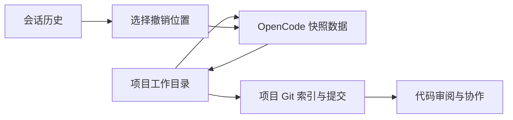
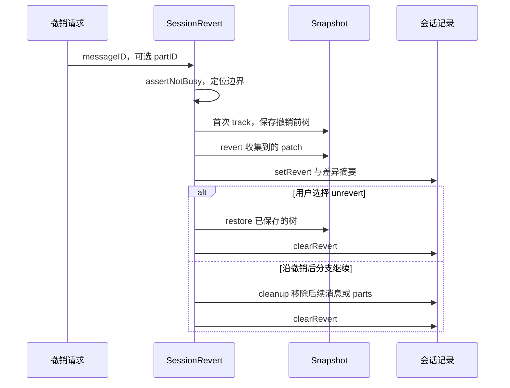

# 第 13 章：工作树、快照和撤销

<!-- block: opencode-ch13.b-opening -->
“回到上一步”可能指回退聊天、恢复文件、切回分支或撤销外部操作。OpenCode 的快照帮助处理部分文件变化，但它与 Git 提交、会话恢复各有边界，不能用一个撤销按钮概括全部副作用。

## 13.1 快照保存在另一处 Git 数据中

本书所用版本的 Snapshot 服务为项目工作树准备独立 gitdir，用当前工作树作为 work-tree。它通过 Git 跟踪文件状态，提供 track、patch、restore、revert 等操作；是否启用还取决于版本控制类型及 snapshot 配置。

独立 gitdir 的存在意味着会话快照不等于你平常看到的项目提交历史。它可以帮助记录 Agent 操作前后的变化，却不替你写有意义的提交信息、审查差异或把修改推送到远端。



图 13-1：快照、会话与 Git 协作分别承担的作用。

## 13.2 哪些文件会进入快照

快照会按版本控制、忽略规则、候选路径和未跟踪文件大小筛选内容。构建缓存、被忽略的凭据、外部目录和远端服务都可能不在恢复范围内。

本书的宿主实验显式关闭快照，因此没有声称验证了文件撤销。读者要研究它，应在独立临时仓库里放入 tracked、untracked、ignored 三类文件，分别修改后观察快照与恢复结果，并保留原始副本。

还需要在执行前保留一处用户改动，检查撤销后它是否仍在。干净仓库中的实验，只能说明新改动怎样恢复，无法回答原有修改会受到什么影响。

## 13.3 会话 revert 具体连接了什么

SessionRevert 首先检查会话不处于忙碌状态，然后根据消息或 part 位置收集相关补丁，调用快照服务，更新会话撤销信息和差异。unrevert 则利用保存的快照恢复撤销前的状态，再清除相应标记。

这里的“消息位置”负责选择边界，真正处理文件的是快照服务。之后继续任务时，cleanup 还会处理被撤销的消息或 parts。聊天记录和文件状态都参与了这段流程，因此直接删数据库中的某条消息不等于执行同样的撤销。

不要在真实工作目录里用手工修改数据库来模拟撤销。除了引用关系和缓存，正在运行的服务可能仍持有旧状态。正常接口能维护的约束，直接改存储不一定会维护。

## 13.4 并行工作最好先隔离文件

如果两个 Agent 同时修改一个目录，快照可能捕获混在一起的变化。哪个文件属于哪个任务、哪个改动在快照前已存在，都需要更多证据。独立 Git 工作树能把任务的文件状态分开，通常比事后猜测更清楚。

```bash
git status --short
git worktree add ../feature-check -b feature-check
```

命令中的目录与分支只是示例，应在你有权限且不存在冲突的位置使用。进入新工作树后，重新确认依赖、配置和项目身份；同一仓库的不同工作树并不保证共享所有运行时缓存，也不保证配置完全一致。

## 13.5 提交前仍要做什么

查看差异，确认只包含任务相关修改；检查新增文件、被忽略文件和生成物；运行实际测试；再提交。快照能帮助恢复失误，但它不会判断一个修改是否符合需求。

外部副作用要单独记录。发出的请求、创建的资源、已经投递的消息，都不能靠恢复本地文件撤回。把这些操作从普通代码编辑里分出来，会让失败后的恢复路径更清楚。

## 13.6 track 返回的是 Git 树，不是提交

Snapshot 的目录由全局数据目录、project.id 和工作树路径的散列组成。两个工作树即使属于同一项目，也能落在不同快照目录。每项关键操作还通过这个 gitdir 对应的锁执行，避免同一份快照索引同时更新。这个锁保护快照存储，不会锁住编辑器或其他进程对工作目录的写入。

`track()` 首先确认项目使用 Git 且 snapshot 没有关闭。首次建立 gitdir 时写入相关 Git 配置，再执行 seed；随后 add 收集候选文件，最后运行 write-tree，返回树对象哈希。它没有创建带作者、时间与父提交的 commit。因此日志中的 hash 能指向一份内容树，却不能拿来替代项目里的一次正式提交。

seed 为快照对象库写 alternates，复用源仓库已有对象，并尽力复制索引，减少大型仓库首次计算对象的开销。因此，快照数据仍可能依赖源仓库，不能作为一份独立的完整备份。

`patch(hash)` 又是另一种结果：更新快照索引后，与传入树比较，返回 `{ hash, files }`。files 是涉及路径，不是一份可脱离对象库单独应用的文本补丁。会话 part 保存这两个字段，后面撤销需要回到那个 hash 取文件内容。

## 13.7 候选文件怎样筛选

add 并不直接无差别执行整个工作树的 git add。它并行取得已跟踪文件的变化和未跟踪文件，合并去重，再用源仓库忽略规则检查确切候选。这里使用 --no-index，使已经进入快照索引、后来又被忽略的文件也能按规则移出；否则旧缓存可能一直留在快照里。

随后检查文件大小，阈值是 2 MiB，但被排除的是其中的大型未跟踪文件。已经跟踪的大文件不因为超过这个值就一概剔除。假设项目含四项内容：已跟踪源文件、普通未跟踪测试、被忽略的凭据文件、刚下载的 8 MiB 数据集。前两项可成为候选，忽略项被过滤，最后一项受未跟踪大小限制。不能把阈值说成“任何大于 2 MiB 的文件都无法恢复”。

目录范围也很具体。文件列表命令从 state.directory 执行并带路径范围，得到的文件最终映射回 worktree。若用户在子目录启动，不能只凭整个仓库的 Git 身份推断每个兄弟目录都会在这次更新中重新采集。查看实际 patch.files，比猜测目录覆盖范围可靠。

## 13.8 一个文件被改两次时恢复哪一份

设某轮开始前价格文件内容为 A，第一步改成 B，第二步改成 C。两段 patch 都可能提到同一路径，但对应不同起点树。`Snapshot.revert(patches)` 按传入顺序构造操作列表，用 seen 集合让同一路径只出现一次，采用首次遇到的那段 hash。因此会话收集补丁的顺序直接决定恢复基线，并不是对每段文本倒序执行一次反向补丁。

单文件恢复先尝试 checkout 指定树中的路径。失败后，用 ls-tree 检查路径是否原本存在：树中有文件，就保留现状并记录 checkout 错误；树中没有，才删除当前路径。这样分别处理旧文件和新增文件。恢复结束后仍要查看差异与错误日志，确认有没有部分失败。

为减少 Git 进程开销，相邻操作可以批处理，但只在 hash 相同、路径互不包含且数量不超过 100 时合并。父目录与子路径可能相互影响，不能为了快就放进同一个批次。批量 ls-tree 或 checkout 失败会回退逐文件处理，保持较细的诊断位置。

`restore(snapshot)` 与这个列表恢复不同：它先 read-tree，再 checkout-index，把树中条目写回。源码没有在这里顺带清除工作目录里所有额外文件。因此“unrevert 恢复原快照”也不应被描述为任意工作目录的精确镜像同步。快照之外的文件和操作仍要单独判断。

## 13.9 会话如何保存撤销前的位置

SessionRevert.revert 的首步是 assertNotBusy。接着遍历消息与 parts，确定 messageID/partID 边界，并收集边界之后的 patch。若目标 part 前没有 text 或 tool，边界还可能提升到最近的用户消息；界面选择的是 part，不代表最终只隐藏那一小块文字。



图 13-2：撤销标记让“暂时退回”和“沿新分支继续”拥有不同处理路径。

第一次撤销保存当前树到 rev.snapshot；已有撤销状态时复用原 snapshot，并先 restore 原起点，再重新应用所选边界的补丁列表。这避免用户不断调整撤销位置时，在已经撤销过的内容上反复叠加恢复。随后计算 diff，更新 session_diff、发布 Diff 事件并写入会话摘要。

unrevert 恢复保存的树并清除标记；cleanup 则删除被放弃的消息或 part，再清除标记。前者试图回到撤销前，后者承认新历史分支。两条路径都不包含远端服务补偿。本书宿主实验关闭了 snapshot，以上机制来自固定源码阅读，尚无本机文件恢复结果可作为额外保证。

检查撤销效果时，可以对照会话的 revert 标记、补丁文件列表和当前工作树差异。标记正确但文件没有恢复，先查文件操作；文件已恢复但聊天仍显示旧分支，再查会话呈现和后续清理。

来源：[快照实现](https://github.com/anomalyco/opencode/blob/810c0eba1a7348036f8bdf61e6632d0c36c6876c/packages/opencode/src/snapshot/index.ts)、[会话撤销](https://github.com/anomalyco/opencode/blob/810c0eba1a7348036f8bdf61e6632d0c36c6876c/packages/opencode/src/session/revert.ts)。
