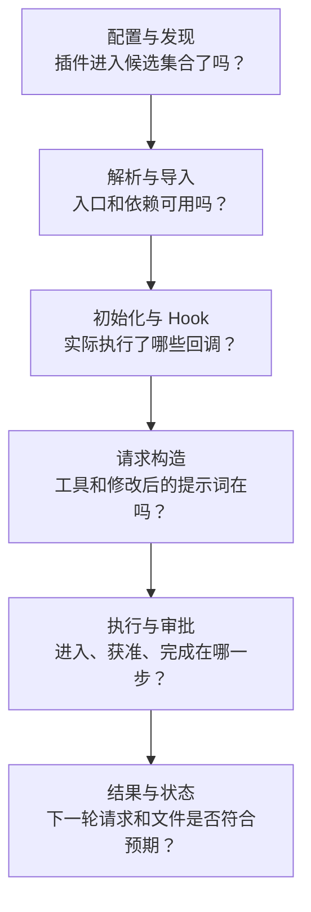

# 第 15 章：调试与可观察性

<!-- block: opencode-ch15.b-opening -->
插件显示“加载成功”，工具却没读到文件，可以从执行过程查起：工具有没有进入请求，执行器有没有开始，是否还在等待审批，读取结果有没有回到下一轮请求。本章用随书实验的事件记录定位这些情况。

## 15.1 先把故障放回它发生的那一层

“没生效”可能指路径未发现、导入失败、工厂初始化失败、Hook 没触发、输出被后续插件改写，或旧模块仍留在进程中。这几种故障的修复位置不同。一开始就升级依赖或清空缓存，会同时改动很多条件，反而丢掉原来的线索。



先找最后一条确定发生的事件，再看相邻的下一层。例如出现 `entered`，就不必继续猜测工具是否注册；出现 `read-done` 却没有模型收到的文件标记，应该转向工具结果包装和请求组装。这个顺序也适合排查第十七章的价格练习：命令工具返回和业务案例通过是两个相邻检查点。

| 现象 | 第一份要看的证据 | 不能直接推出的结论 |
| --- | --- | --- |
| 没有初始化事件 | 配置来源、实际路径、`--pure` | 一定是 TypeScript 语法错 |
| 初始化了但工具不见 | 最终请求的工具列表 | 初始化等于工具必然可见 |
| 工具进入后停住 | pending permission 与回复 | 一定是模型卡住了 |
| 改源码后行为未变 | 同进程计数和重启对照 | 实例清理等于模块重载 |
| 工具称成功但文件未变 | 退出码、正文、diff | 最终回答就是完成证明 |

## 15.2 一条真实 Hook 轨迹能说明多少

`host-plugins-20261110.json` 的 `discovery-and-real-read` 场景包含两份外部插件：B 来自显式配置，A 来自目录发现。去掉重复的 system 事件后，主要轨迹如下；原始 JSON 保留了全部顺序。

```text
B:init → A:init
B:config → A:config
B:system → A:system
B:before → A:before
B:after → A:after
B:dispose → A:dispose
```

这份配置下 B 在 A 前执行；换配置后，顺序仍要按候选列表和合并过程确认。事件轨迹只显示回调顺序，实验另查了发给本地模型端点的请求，确认 system 中确实出现了提示词标记。

这一场景有三次模型请求，system Hook 在完整轨迹里也出现多轮。不要用“一个用户任务”推导“只会触发一次 system”。用 `includes` 防止同一输出重复追加，是观察器自身的幂等处理；统计调用次数则需要保留每次实际事件，二者用途不同。

实验还核对了真实 read 取得的 fixture 标记进入后续模型请求，最后通过 HTTP 调用 `/instance/dispose` 并等到清理事件。于是“发现、初始化、改请求、执行工具、返回正文、清理”这几个节点都有对应观察。模型端点使用本地 SSE 替身，这份轨迹只解释宿主执行链，不评价真实模型的规划能力。

## 15.3 用三种事件区分隐藏、拒绝和等待

自定义工具实验的包装器把执行过程记为 `entered`、`approved`、`read-done`。它们分别位于进入执行器、`context.ask` 返回之后、读取成功之后；这些标记属于测试包装，不是宿主保证提供的内置事件名。

| 场景 | 是否出现审批请求 | 记录的事件 | 文件标记返回 |
| --- | --- | --- | --- |
| allow | 否 | entered、approved、read-done | 是 |
| deny | 否 | entered | 否 |
| ask-once | 是 | entered、approved、read-done | 是 |
| ask-reject | 是 | entered | 否 |
| hidden | 否 | 无 | 否 |

`deny` 与 `hidden` 最容易混淆。前者进入了工具，只是在具体读取前被权限判断拒绝；后者没有走进执行器。因而“文件没有读到”还不足以判定是哪一种。`ask-reject` 与 `deny` 的事件相同，但前者确实排入审批队列并收到拒绝回复，要靠审批记录区分。

等待审批时也可能只有 `entered`，此时不应立即归为失败。先查询是否有未答复请求，关联其请求 ID，再决定等待用户、取消任务还是处理异常。不要把另一个会话的批准误当成当前操作已获准。

同一组实验还观察了授权寿命：once 后的新会话仍询问；always 后，同一实例中新会话的相同 permission/pattern 不再询问；实例 dispose 后又询问。因此排查“为什么这次没问”时，既要看配置，还要看该实例已积累的批准状态。这里的 always 不等于全局永久许可。

## 15.4 关联调用时，时间戳不能代替身份

`review-trace.ts` 用 `JSON.stringify([sessionID, callID])` 作为 Map 的键。只按工具名记录，会把两个并发 read 混在一起；只按调用 ID 记录，又可能混淆不同会话。数组序列化还避免了手工用某个分隔符拼接字符串时的歧义。

before 保存 `performance.now()`，after 取出并删除对应值。找到记录时，`correlated` 为真，`durationMs` 是两次观测的差；找不到时，耗时为 null。缺失不能写成零毫秒：它可能代表 before 没有被观察到、状态已被清理，或条目因容量限制被淘汰。容量上限 128 控制内存增长，代价就是不能把这张表当成无损调用账本。

```json
{
  "sessionID": "example-session",
  "callID": "example-call",
  "tool": "read",
  "correlated": true,
  "durationMs": 4.2
}
```

这是字段形状示意，不是实验测得的性能数据。耗时也会包含两次观测之间的其他 Hook 和等待，不能直接当作文件读取基准。想区分审批等待与真正读取耗时，需要在相应边界另设计时点，而不是根据总耗时猜测。

观察器对 after 的 `output` 额外做了存在性判断。固定源码中的某条 subtask 失败路径可能传入 undefined，类型声明却没有完整表达它。没有输出时仍可记录警告，但不能解引用 `output.metadata`。正常输出则先保留原 metadata，再加入 `reviewTrace`，避免观察功能覆盖工具自身信息。

## 15.5 日志通了，观察器也可能丢记录

`client.app.log` 是真实 SDK 请求，宿主实验在服务日志里观察到了它。临时 JSONL 事件文件则由包装器写入，便于脚本断言顺序。两条渠道互相补充：SDK 证明应用日志入口走通，JSONL 提供细粒度的实验轨迹。

这个插件有意让日志失败不阻断业务。SDK 调用抛错会被捕获；返回错误也按尽力记录处理。于是“服务日志没找到这一行”不等于 Hook 没执行。应先查看本地事件是否存在、请求是否发出和日志返回状态，再判断是哪段链路缺失。需要持久、完整记录的业务操作，应另设相应存储与失败处理，不能直接复用这套教学观察器作为审计系统。

第一轮排查通常只需记录工具种类、相对目标、状态和错误类别。完整提示词、工具正文和绝对路径可能包含项目资料或凭据，需要另作筛选。价格练习中，脚本名与退出结果就足以关联到对应任务。

## 15.6 “已经 dispose，为什么还是旧代码”

宿主实验专门把实例寿命和模块寿命拆开观察。第一次加载模块级计数器是 1；同一进程清理实例并重新初始化后，计数器成为 2，但修改过的源码内容没有进入新请求。重启进程后计数器回到 1，新内容才生效。

这说明在所测路径中，工厂再次执行和模块重新导入并不是同一件事。插件工厂内的 Map 可以在 dispose 时清空，模块顶层的状态仍可能由运行时缓存持有。若你正在调试源码变化，应明确是重新创建了项目实例，还是启动了新进程，别把两种动作都写成“重载”。

另一份 broken 插件在初始化时失败，A/B 仍能完成调用。这个结果只覆盖初始化失败隔离；它没有证明任意 Hook 抛错都不影响其他插件，也没有证明文件副作用会回滚。`--pure` 对照中没有外部插件事件，而内置 read 任务仍完成，可用来缩小外部插件影响范围。

这些实验关闭了文件监视器，没有测试自动热更新。若自己的环境表现不同，先核对监视器、启动方式、平台和版本，再决定结论是否冲突。

## 15.7 用最小实验保留一个可解释的故障

改纯处理器逻辑时先跑八项 Node 检查；改发现、依赖或生命周期时跑真实宿主驱动；改审批时跑十场景权限驱动。具体命令和环境前提保存在 `VERIFY.md`，不要为了复现一条 Hook 修改每次都重装所有依赖。

依赖解析故障可以用一个小目录复现。开发工作区的 TypeScript 能找到辅助包，临时项目的动态 import 却可能找不到，因此需要检查宿主实际加载的路径、包入口和运行时依赖。

记录故障时，写明触发条件、最后成功的位置、首个失败位置和修复方法。例如这里可以记录：“同进程重新初始化后仍使用旧 system 标记，重启进程后新标记进入请求。”升级后重跑这个场景，就能判断是否仍需要重启。

来源：[观察器源码](examples/review-trace.ts)、[宿主实验结果](facts/host-plugins-20261110.json)、[权限实验结果](facts/tool-permissions-20261110.json)、[复现环境](VERIFY.md)、[V1 调度实现](https://github.com/anomalyco/opencode/blob/810c0eba1a7348036f8bdf61e6632d0c36c6876c/packages/opencode/src/plugin/index.ts)。
