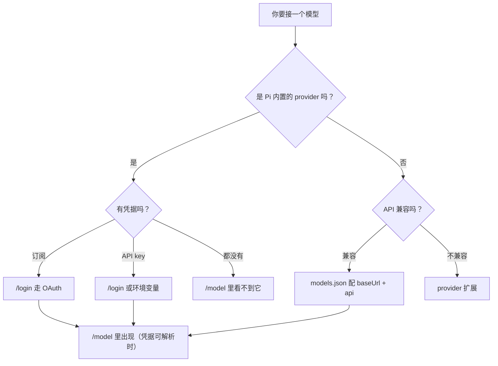

<!-- block: pi-ch03.b-3330b11a -->
# 第3章 模型、provider 与凭据

最常见的"Pi 坏了"其实是三件事的排列组合：**模型在目录里、provider 没有可用凭据、你却在 `/model` 里找它。**

有个读者在 CI 里配好了 `OPENAI_API_KEY`，本地 shell 也 export 了同一个变量，于是本地一切正常。
换到一台新机器，他只把 `auth.json` 拷了过去，却忘了 CI 用的是环境变量；`/model` 里那个模型消失了，
他以为是 Pi 的 bug。其实 Pi 只是按顺序找凭据，找完没有，就把这个模型从可选列表里拿掉。

这一章把"模型 → provider → 凭据 → 选择"这条链拆开，最后给一个自定义端点的最小配置。

## 3.1 三个词，别混用

| 词 | 指什么 | 例子 |
| --- | --- | --- |
| 模型（model） | 真正生成回复的那个东西，有 ID、上下文长度、能力标记 | `claude-sonnet-5`、`gpt-6`、`nvidia/nemotron-...` |
| provider | 提供模型访问的服务或账号，负责鉴权和请求格式 | `anthropic`、`openai`、`nvidia`、`openrouter`、自定义端点 |
| 凭据（credential） | provider 认你的方式：OAuth 令牌、API key、云上的 ambient 凭据 | `auth.json` 里的条目、`ANTHROPIC_API_KEY` |

一个模型 ID 本身不保证可用。Pi 的 `/model` 只列**provider 有可用凭据**的模型；`models.json` 里
写了一个自定义模型，也要等凭据能解析出来才会出现在选择器里（`docs/models.md` 的 Troubleshooting）。
所以"模型找不到"先查凭据，别急着改配置。

## 3.2 你有什么，就走哪条路

`docs/models.md` 给了一张选择表，几乎覆盖所有情况：

| 你手上的东西 | 推荐接法 |
| --- | --- |
| 某个受支持的订阅 | `/login` 走 OAuth |
| provider 的 API key | `/login` 存起来，或设对应的环境变量 |
| 本地 GGUF 模型 | 接 llama.cpp router，用 `/llama` 管理 |
| OpenAI / Anthropic / Google 兼容端点 | 写进 `models.json` |
| 自定义协议或特殊鉴权 | 写一个 provider 扩展 |



顺序建议：**先用内置 provider 跑通，再考虑自定义端点**。自定义端点要自己填 `api` 类型、
模型能力、上下文和价格；填错不会立刻报错，只会在用的时候表现得很怪。

## 3.3 凭据从哪来，谁优先

`docs/models.md` 明确写了运行时顺序（前者优先）：

1. 命令行 `--api-key`
2. `auth.json` 里存的凭据
3. `models.json` 里该 provider / model 的 `apiKey`
4. provider 的环境变量，或云上的 ambient 凭据

provider 扩展也可以定义自己的鉴权行为；那套逻辑由扩展自己负责，不在这张内置优先级表里。

几个实践上的推论：

- **CI 用环境变量**，别把 `auth.json` 塞进镜像或仓库。环境变量只对启动 Pi 的那个进程可见，
  "这个 shell 能用、那个 shell 不能用"通常就是这条。
- **`--api-key` 是一次性的**，不会写盘；适合临时覆盖，不适合当长期配置。
- **`/logout` 只删 `auth.json`**。它不清环境变量、不改 `models.json`、也不去 provider 那边吊销密钥。
  要彻底断掉，得三处一起处理。
- **`auth.json` 里是明文密钥和令牌**。不要提交、不要贴进 issue、不要把整个 agent 目录打包发给别人。

## 3.4 选模型与思考档位

交互模式里：

- `/model` 打开选择器，只列有可用凭据的模型；在某项上按 `Ctrl+S` 可存为新会话的默认值。
- `Ctrl+P` 在可用模型之间循环；`/scoped-models` 控制循环范围并保存。
- `/thinking` 选推理档位；`Shift+Tab` 也可以循环，`Ctrl+S` 保存启动档位。
- 会话会记录 `model_change` 与 `thinking_level_change`；恢复会话时一并恢复，但**不改新会话的默认值**。

命令行里：

```bash
pi --model sonnet:high
pi --model nvidia/some-model --provider nvidia
pi --models "anthropic/*,*sonnet*"
```

`--model` 支持 `provider/id`、模糊匹配，以及 `:<level>` 后缀；`--provider` **必须**和 `--model` 一起用。
`--thinking` 的合法值是 `off`、`minimal`、`low`、`medium`、`high`、`xhigh`、`max`，最终会被夹到
模型支持的范围。写错档位不会中止运行：本机实测 `--thinking bogus` 只打一行 warning，然后按默认档位继续，
退出码仍是 0。

## 3.5 本章小实验：把目录和档位量出来

**第一步：看目录长什么样。**

```bash
pi --offline --list-models | head
```

本机打出六列：`provider`、`model`、`context`、`max-out`、`thinking`、`images`。
`--offline` 读的是本地缓存目录，不联网；它回答"目录里有什么"，不回答"我有没有权限用"。

**第二步：按 provider 过滤。**

```bash
pi --offline --list-models nvidia | head -5
```

本机前三行是 `nvidia` 名下的三个模型，`context` 从 128K 到 256K 不等，`thinking` / `images`
两列是 `yes` / `no`。你要接别的 provider，就把 `nvidia` 换成它的 ID。

**第三步：看一个"错误档位"的真实行为。**

```bash
pi --print --no-tools --no-session --thinking bogus "只回复：OK"
```

本机输出两行：

```text
Warning: Invalid thinking level "bogus". Valid values: off, minimal, low, medium, high, xhigh, max
OK
```

退出码 0（切片：`facts/pi-1.5.0/thinking-invalid.txt`）。这个例子的价值在于：**并不是所有"参数不对"都会失败**。脚本里如果依赖档位生效，
不能只看退出码，要看 stderr 有没有 warning。

**第四步：确认"查不到"也是正常结果。**

```bash
pi --list-models zzzznotfound; echo "exit=$?"
```

本机打出 `No models matching "zzzznotfound"`，退出码 **0**。第 1 章已经记过这条；在这里它多一层含义：
**目录查询是"过滤"，不是"断言"**。

## 3.6 接一个兼容端点：`models.json` 最小例子

在 `~/.pi/agent/models.json`（或项目里对应文件）写：

```json
{
  "$schema": "https://pi.dev/schemas/models.schema.json",
  "providers": {
    "ollama": {
      "baseUrl": "http://localhost:11434/v1",
      "api": "openai-completions",
      "apiKey": "ollama",
      "models": [
        { "id": "qwen2.5-coder:7b" }
      ]
    }
  }
}
```

几个容易忽略的点：

- `apiKey` 可以是字面值、`$NAME` / `${NAME}` 环境插值，或 `!command` 的命令输出；
  `$$` 与 `$!` 分别产生字面的 `$` 与 `!`。命令在**请求时**执行，Pi 不缓存结果。
- 内置 provider 只想走代理时，**只设 `baseUrl`**，模型列表和鉴权保持原样。
- `modelOverrides` 改的是已有模型的元数据：对象字段（如 `cost`）逐字段合并，其他字段整体替换；
  未知 ID 会被忽略。
- 打开 `/model` 会重新读这个文件；改完不必重启。

文档还说明：`models.json` 里的 `models` 条目会新增或替换同 provider 下同 ID 的模型；
`modelOverrides` 适合改内置模型的上下文、价格、图片限制等，不要为了改一个字段复制整个模型。

## 3.7 模型目录里"没有"的两类模型

Pi 还有两类模型**不出现在 `/model`**：

- **分类模型**（classifier）：回答"是/否"、多选或打分，不聊天；
- **图像模型**：根据提示生成图片。

它们通过 `codemode` 工具访问，而 `codemode` 默认是关的（除非某个 MCP server 打开了它，或在
settings 里用 `"defaultTools": ["+codemode"]`）。扩展也可以走 `ctx.modelRegistry` 直接调用。
这一节先知道有这回事即可；第 11 章讲工具边界时会再遇到。

## 3.8 翻车对照：凭据与选择

| 翻车做法 | 会看到什么 | 正确做法 |
| --- | --- | --- |
| `--model not-a-model` | `Error: Model "not-a-model" not found. Use --list-models ...`，退出码 1 | 先 `--list-models` 查 ID；注意 provider 前缀 |
| `--provider nvidia "hi"` | `Error: --provider requires --model`，退出码 1 | 两个参数一起给 |
| `--thinking bogus` | 一行 warning，然后继续，退出码 0 | 脚本里检查 stderr；别把 warning 当成功 |
| 本地 shell 能用、CI 不能用 | CI 进程里没有那个环境变量 | 把变量注入运行 Pi 的那个进程，不是"我的终端" |
| `/logout` 后以为密钥失效了 | 环境变量、`models.json`、provider 端的密钥都还在 | 三处分别处理；必要时去 provider 后台吊销 |
| 远程机器上 `/login` 卡住 | OAuth 回调到不了本机 | 按提示粘贴最终回调 URL 或授权码（`docs/providers.md`） |
| 自定义模型写了却没出现 | provider 的凭据解析不出来 | 检查 `baseUrl` / `apiKey` / 环境插值；打开 `/model` 重读文件 |

## 3.9 与另两册的差别

- **御舆**那册的 Claude Code 用订阅或 API key，模型选择在它自己的配置体系里。
- **Omp** 自带六十多家 provider 的目录，配置在 `~/.omp`。
- **Pi** 用 `~/.pi/agent/models.json` + `auth.json`，并且把分类/图像模型挡在 `/model` 之外。

三边的 provider 数量、默认模型、鉴权顺序都不同。对照时只借"模型 ≠ provider ≠ 凭据"这条分层，
不要抄数字。

<!-- block: pi-ch03.b-d14a7522 -->
第一篇到这里结束：你已经知道 Pi 砍了什么、怎么装、模型怎么接。第二篇开始进入日常使用——
输入、会话树、上下文、压缩、把结果带走。

---

**版本核对清单**（写作钉 `pi/1.5.0`，提交 `f9a2636`；本机 2026-11-08 复验）

- [ ] `docs/models.md` 的凭据优先级是否仍是 `--api-key` → `auth.json` → `models.json` → 环境/ambient。
- [ ] `/model` 是否仍只列有可用凭据的模型；自定义模型"写了但没出现"的排障是否仍指向凭据。
- [ ] `--thinking` 的合法值列表是否仍是 7 档；非法值是否仍只 warning（本机 1.5.0 退出 0）。
- [ ] `--list-models <无匹配>` 是否仍退出 0。
- [ ] `models.json` 的 `$NAME` / `${NAME}` / `!command` 插值规则与 `$$` / `$!` 转义是否未变。
- [ ] 分类模型与图像模型是否仍不出现在 `/model`，且仍经 `codemode` 访问。
