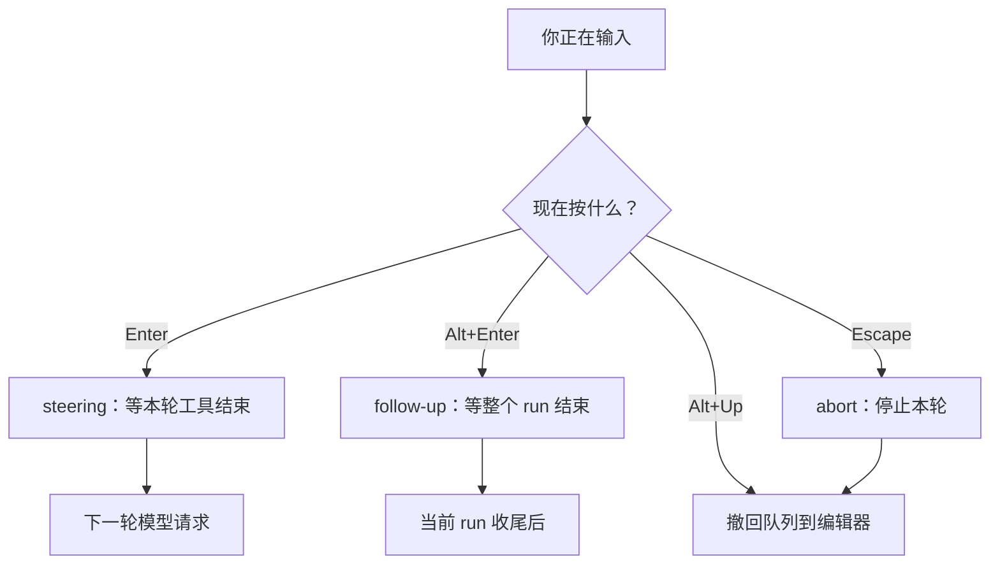

# 第4章 终端里的输入、@文件与排队转向

<!-- block: pi-ch04.b-350c65d9 -->
长任务最常见的浪费，不是模型想错了，而是**你打断得不是时候**。

你写了一段很长的需求，Pi 正在跑第五条命令。你想起漏了一个约束，按 `Enter` 发了出去。你以为它会"补充"，
其实这条消息要等当前回复和它的工具调用全部结束才生效。更糟的是，你连按了几次 `Enter`——
五条消息全进了队列，模型拿到的是五条互相矛盾的补充。

Pi 的输入分两路：**发出去**和**排队**。分清这两路，长任务才不会越跑越乱。

## 4.1 编辑器：先把话写完

交互模式的编辑区支持：

- `Enter` 发送；`Shift+Enter` 换行。
- `Ctrl+G` 在外部编辑器里写长 prompt，存盘后回到 Pi。
- `@` 搜索文件并加入 prompt，`Tab` 补全路径；图片可以粘贴或拖进终端。
- 输入 `/` 打开命令菜单；输入 `!` 直接跑 shell 命令并把输出带进对话，`!!` 跑命令但不把输出给模型。

后两条是两套不同的东西：`/` 是 Pi 的命令系统（可以扩展），`!` 是"借终端跑一条命令"。

```ill
pi-plate-p2
```

`!` 的输出会进上下文，长输出会占 token；不想占就用 `!!`。

## 4.2 工作时插话：三个键，三种命运

Pi 在跑的时候，编辑器仍然可用。`docs/usage.md` 给了这张表：

| 你想做什么 | 操作 | 消息何时生效 |
| --- | --- | --- |
| 调整当前任务 | 输入后 `Enter` | 当前回复与本轮工具调用结束后，作为 steering 进入下一轮 |
| 追加一件后续工作 | 输入后 `Alt+Enter` | 当前**整个 run** 结束后才进入 |
| 把排队消息拿回编辑器 | `Alt+Up` | 立即撤回，不发送 |
| 停掉当前任务 | `Escape` | 中止本轮，排队消息回到编辑器 |



"当前轮"和"整个 run"不是一回事。一个 run 可能包含很多轮：模型调工具、看结果、再调、再看。
你说"顺便也改一下测试"，这是后续工作，应该用 `Alt+Enter`；你说"别用那个函数"，这是对当前思路的修正，
用 `Enter`。选错了不会报错，只会让补充晚到——晚到几十秒，代码可能已经改完了。

Windows Terminal 会截走一部分 `Alt` 快捷键，`docs/terminal-setup.md` 给了替代键；在别的终端里遇到
按了没反应，先查那一页。

## 4.3 看一眼正在发生什么

- `Ctrl+O` 展开/收起工具输出；`Ctrl+T` 显示/隐藏 thinking 块。
- 启动头会列出加载了哪些指令和资源；编辑区边框表示当前 thinking 档位；页脚显示上下文占用与花费。
- `/hotkeys` 查看当前会话可用的快捷键；`/debug` 把渲染行与当前会话消息写到 agent 目录的 `pi-debug.log`。

这些不是装饰。工具输出被折叠时，你看到的是"它跑了"，不是"它跑出了什么"；`Ctrl+O` 是复核改动的入口。
第 20 章讲交付时会反复用到。

## 4.4 本章小实验：验证输入路径，而不是背键位

交互键位没法用非交互命令完整复现，这一节只验证**输入路径**和**旗标存在**。

**第一步：stdin 会被当成提示词。**

```bash
printf '用一句话说明 stdin 会被当作提示词。' | pi --print --no-session --no-tools
```

本机实测：输出的确是一句解释，退出码 0。这条路径是"没有位置参数时读 stdin"，不是 TUI，
但它证明了 Pi 的输入入口不止"命令行参数"一种。

**第二步：确认 TUI 旗标。**

```bash
pi --help | grep -E -- '--tui-mode|--use-theme'
```

本机打出两行：`--tui-mode <mode>`（`fullscreen` 默认 / `regular`）和 `--use-theme <name[/name]>`。
键位与渲染属于交互模式，本章按 `docs/usage.md`、`docs/keybindings.md` 描述，**未在本机逐一验证**；
第一次用时建议先跑 `/hotkeys` 对一遍。

## 4.5 翻车对照：输入阶段的五个坑

| 翻车做法 | 会看到什么 | 正确做法 |
| --- | --- | --- |
| 长 prompt 里按 `Enter` 想换行 | 直接发送，后半句变成第二条消息 | 用 `Shift+Enter`；长文用 `Ctrl+G` |
| 用 `Enter` 发"后续工作" | 消息提前进入下一轮，模型把它当修正 | 后续动作用 `Alt+Enter` |
| 连发五条补充 | 五条都排队，模型收到互相矛盾的 steering | 发一条，其余用 `Alt+Up` 撤回 |
| `!` 跑 `cat` 大文件 | 输出全部进上下文，token 暴涨 | 用 `!!`，或先 `read` 指定行 |
| 在 Windows Terminal 按 `Alt+Enter` 没反应 | 快捷键被终端截走 | 查 `docs/terminal-setup.md` 的平台替代键 |

## 4.6 与另两册的同构点

三册都有"运行中插话"：御舆那册把它放在对话循环的中断与恢复里，Omp 有排队消息与 `Esc` 中止。
机制名字不同，问题一样：**这条消息是修正当前思路，还是一件新工作？** 只要先回答这个，键位可以现查。

下一章离开输入层，进入 Pi 保存工作的地方：会话。你会看到它为什么是一棵树，以及"回退"到底回退的是什么。

---

**版本核对清单**（写作钉 `pi/1.5.0`，提交 `f9a2636`；本机 2026-11-08 复验）

- [ ] `docs/usage.md` 的 `Enter` / `Alt+Enter` / `Alt+Up` / `Escape` 语义是否未变。
- [ ] `--tui-mode` 是否仍是 `fullscreen`（默认）/ `regular`；`--use-theme` 是否仍接受 `light/dark` 形式。
- [ ] `!` 与 `!!` 的输出是否仍分别"进上下文 / 不进上下文"。
- [ ] Windows Terminal 的 Alt 键替代方案是否仍写在 `docs/terminal-setup.md`。
