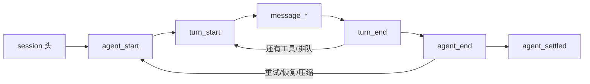

# 第8章 把结果带走：导出、print、JSON、RPC

有人给 CI 写了这样一段：

```bash
RESULT=$(pi --print "检查这次改动")
echo "$RESULT" | python -c 'import json,sys; print(json.load(sys.stdin)["status"])'
```

<!-- block: pi-ch08.b-9715dd0a -->
跑起来就报错：`--print` 输出的是模型的最终文本，不是 JSON。要结构化结果，得换 `--mode json`；
要长期控制，得换 RPC。这一章把四种"带走结果"的方式分开讲。

## 8.1 四个入口，一套内核

`docs/cli-integration.md` 的表：

| 方式 | 接口 | 生命周期 | 什么时候用 |
| --- | --- | --- | --- |
| 交互 | 终端 UI | 直到你退出 | 人坐在终端前 |
| Print | 最终文本到 stdout | 一次调用 | 脚本只要最后一段话 |
| JSON | stdout 上逐行事件 | 一次调用 | 程序要结构化进度 |
| RPC | stdin/stdout 双向 JSONL | 常驻 | 外部程序持续控制 |

SDK 不是 CLI 模式：它把 agent 嵌进 Node.js/Bun 进程（第 19 章）。四种 CLI 模式共享同一套 agent、
会话、资源和工具，模式只决定"输入怎么进、输出怎么出、进程活多久"。

## 8.2 Print：只要最后一段文本

```bash
pi --print "总结这个仓库"
git diff | pi --print "审一下这次改动"
```

- stdout 只有最终助手文本，中间事件不暴露。
- 错误写 stderr。
- 最终响应是 `error` 或 `aborted` 时退出码非零；`length`（被输出上限截断）仍会打印部分文本，
  但 stderr 有 warning，退出码也非零。
- 没有显式选模式、但 stdin 或 stdout 被重定向时，Pi 自动用 print 模式。

所以 `RESULT=$(pi --print ...)` 拿到的是**话**，不是结构化数据。要判断成功，除了退出码，还要看 stderr。

## 8.3 JSON：一行一条事件

```bash
pi --mode json --no-session --no-tools "只回复：在线" | head -3
```

本机前三行：

```json
{"type":"session","version":3,"id":"...","timestamp":"...","cwd":"D:\Temp\User"}
{"type":"agent_start"}
{"type":"turn_start"}
```

之后是 `message_start`、`message_update`、`message_end`、`turn_end`、`agent_end`、`agent_settled`。
几条容易踩的规则：

- **`message_update` 是增量**，不是完整快照。要实时显示，就拼 delta；要最终文本，用 `message_end`。
- **`agent_end` 不代表彻底结束**。自动重试、溢出恢复、压缩重试、排队消息都可能再起一个低层 run。
- **`agent_settled` 才是"不会自己继续了"**。脚本要等的是它，不是 `agent_end`。
- stdout 只放 JSONL；诊断和日志在 stderr。别把 stderr 当协议读。



## 8.4 RPC：常驻进程的双向协议

```bash
pi --mode rpc --no-session
```

stdin 写命令，stdout 读 `response` 和事件；每条记录一行 JSON。要关联请求就带 `id`，
响应用同一个 `id` 回来。`prompt` 的成功只表示"接受/排队/处理了"，**不代表跑完**；
要等 `agent_settled`。

RPC 拒绝 `@file` 参数——文件要在 prompt 里用别的方式给。TypeScript 侧可以直接用导出的 `RpcClient`，
它负责启动子进程、关联请求、分发事件。

## 8.5 本章小实验：数一遍事件

**第一步：piped stdin 进 print 模式。**

```bash
printf '用一句话说明 stdin 会被当作提示词。' | pi --print --no-session --no-tools
```

本机实测：输出一句解释，退出码 0。

**第二步：JSON 事件的种类与数量。**

```bash
cd /tmp/pi-lab
pi --mode json --no-session --no-tools "只回复：在线" > events.jsonl
python - <<'PY'
import json, collections
c = collections.Counter(json.loads(l)["type"] for l in open("events.jsonl", encoding="utf-8"))
print(dict(c))
PY
```

本机一次最短请求的结果是：
`{'session': 1, 'agent_start': 1, 'turn_start': 1, 'message_start': 3, 'message_end': 3,
'message_update': 33, 'turn_end': 1, 'agent_end': 1, 'agent_settled': 1}`。
33 条 `message_update` 对应文本增量——这就是"流式"在协议上的样子。

**第三步：导出一个会话。**

在交互模式里 `/export` 可以把会话存成 HTML 或 JSONL；`/copy` 复制最后一条回复；`/share` 生成查看链接。
这部分需要交互模式，本章按 `docs/usage.md` 记录，**未在本机验证分享流程**。

## 8.6 翻车对照：结果出口的六个坑

| 翻车做法 | 会看到什么 | 正确做法 |
| --- | --- | --- |
| 把 `--print` 输出当 JSON 解析 | `json.loads` 失败 | 用 `--mode json`，按行解析事件 |
| 等 `agent_end` 就收工 | 重试/恢复/排队还会继续 | 等 `agent_settled` |
| 用 `readline` 读 JSONL | 遇到 `U+2028`/`U+2029` 被错误切行 | 按字节/UTF-8 流只按 `\n` 切 |
| 停止读取 stdout | 管道缓冲满，Pi 卡住 | 持续读；不处理的事件也要消费 |
| 把 RPC 的 `prompt` 成功当完成 | 模型还没跑完 | 等事件流里的 `agent_settled` |
| 从 stderr 解析结果 | 诊断信息混进来 | stdout 是协议，stderr 是日志 |

## 8.7 与另两册的同构点

三册都提供"脚本入口"：御舆那册讲流式架构，Omp 有 `-p` 与 JSON/RPC，Pi 的四模式与它们同构。
差别在事件名、结束信号和 RPC 协议细节。对照时只借"文本 / 事件流 / 双向控制"这三层，
不要把 `agent_settled` 当成别家也有的名字。

第二篇到这里结束。第三篇开始往下拆：一次 turn 的生命周期、模型层、工具层、会话格式、TUI。

---

**版本核对清单**（写作钉 `pi/1.5.0`，提交 `f9a2636`；本机 2026-11-08 复验）

- [ ] `--print` 的错误/中止/截断退出码语义是否未变。
- [ ] JSON 模式是否仍先输出 session 头；`message_update` 是否仍是增量。
- [ ] `agent_end` 与 `agent_settled` 的区别是否仍未变。
- [ ] RPC 是否仍拒绝 `@file`；`prompt` 成功是否仍只表示接受/排队。
- [ ] stdout/stderr 的分工是否仍如 8.6 表。
