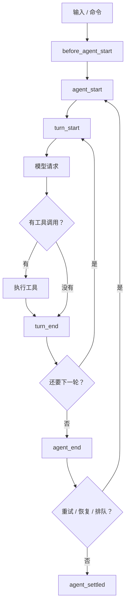
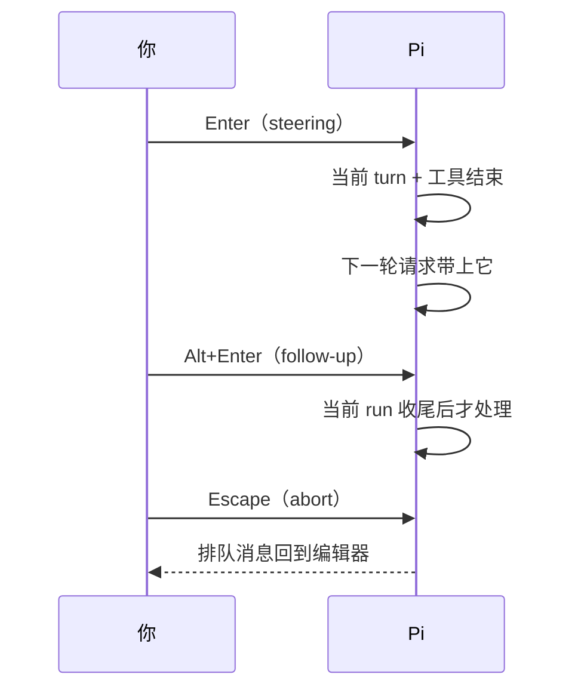

# 第9章 一次 turn 的生命周期

<!-- block: pi-ch09.b-f58eb790 -->
页脚显示"正在思考"，然后蹦出一张工具卡片，又消失，再来一张，最后给出一段总结。

这一段过程在 Pi 里被切成很多可观察的步骤。理解它们，你才知道该在哪一步拦、哪一步等、哪一步算"结束"。

## 9.1 turn 不是一个请求，是一次"回复 + 它的工具"

Pi 的定义很明确：**一个 turn 是一条助手回复，加上这条回复产生的所有工具调用与结果**。

```ill
pi-plate-p3
```




注意两个"结束"：`agent_end` 只是当前这次低层 run 结束；自动重试、溢出恢复、压缩重试、排队消息都可能再起一次。
`agent_settled` 才是"Pi 不会自己继续了"。第 8 章的脚本要等的是后者。

## 9.2 一轮里发生什么

1. **组装请求**：系统提示 sections、活动分支、工具声明、模型与 thinking 设置（第 6 章）。
2. **发请求**：provider 流式返回文本和/或工具调用。
3. **记录助手消息**：文本、thinking、工具调用、usage、stopReason 一起进会话。
4. **执行工具**：每个调用走 `tool_execution_start` → `tool_call`（可拦截/改参数）→ 执行 →
   `tool_result`（可改结果）→ `tool_execution_end`。
5. **决定下一轮**：还有工具结果或排队消息，就再开一个 turn；否则结束本次 run。

`turn_end` 可以追加条目，也可以请求继续。压缩阈值检查发生在"自然需要下一轮"之前，
所以压缩不会平白打断一个已经收尾的 run。

## 9.3 steering、follow-up 与 abort 在生命周期里的位置

- **steering**（`Enter`）：当前助手 turn 和它的工具调用结束后进入，影响下一轮请求。
- **follow-up**（`Alt+Enter`）：当前整个 run 的待办都结束后才进入。
- **abort**（`Escape`）：中止当前 run，把排队消息退回编辑器；此时不走 `agent_before_settle`，
  直接从 `agent_end` 到 `agent_settled`。



## 9.4 本章小实验：打印一次 turn 的事件顺序

```bash
cd /tmp/pi-lab
pi --mode json --no-session --no-tools "只回复：在线" > turn.jsonl
python - <<'PY'
import json
for line in open("turn.jsonl", encoding="utf-8"):
    o = json.loads(line)
    if o["type"] in {"agent_start","turn_start","turn_end","agent_end","agent_settled"}:
        print(o["type"])
PY
```

本机实测顺序：`agent_start` → `turn_start` → `turn_end` → `agent_end` → `agent_settled`。
这条最短的 run 只有一轮、没有工具，所以看不到工具事件。把 `--no-tools` 去掉、让它读一个文件，
再打印 `tool_execution_start` / `tool_execution_end`，就能看到完整的五段工具生命周期。
（这一步本章未跑；你复验时以实际事件为准。）

## 9.5 翻车对照：生命周期层的五个坑

| 翻车做法 | 会看到什么 | 正确做法 |
| --- | --- | --- |
| 在 `agent_end` 就销毁会话 | 重试/恢复/排队还在继续，结果丢失 | 等 `agent_settled`，或显式 abort |
| 把 `turn_end` 当"任务完成" | 后面还有工具轮次 | 看 `agent_settled` 或 `agent_end` 后的 `More` 判断 |
| 在 `tool_call` 里异步改参数后忘记返回 | 调用按原参数执行 | 返回 `{ block }` 或修改后的 input；看扩展文档 |
| abort 后继续读旧事件 | 排队消息已回到编辑器，事件流却还在收尾 | abort 后等 settled，再决定是否重发 |
| 在 `before_agent_start` 里做重活 | 每次 run 都付一次成本 | 只做轻量注入；重活放 `session_start` 或扩展初始化 |

## 9.6 与另两册的同构点

御舆那册把这一圈叫"对话循环"，Omp 叫"agent 循环"，Pi 在 `agent` 包与 `coding-agent` 里把它拆成 run/turn。
三家的共同点是：**turn 是模型请求 + 工具执行的原子单位，run 是 turn 的容器。**
差别在结束信号的名字与重试策略。对照时不要假设"一轮"等于"一次任务"。

下一章拆模型层：请求怎么从 Pi 走到 provider，流式事件又怎么回来。

---

**版本核对清单**（写作钉 `pi/1.5.0`，提交 `f9a2636`；本机 2026-11-08 复验）

- [ ] `docs/how-pi-works.md` 对 turn 与 run 的定义是否未变。
- [ ] `agent_end` / `agent_settled` 的语义是否仍如 9.1。
- [ ] 工具生命周期事件名与顺序是否仍为 start → call → update → result → end。
- [ ] steering / follow-up / abort 的生效位置是否未变。
- [ ] `agent_before_settle` 是否仍在"还有后续工作"时被跳过。
