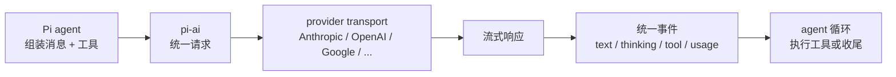

<!-- block: pi-ch10.b-a6ce50b5 -->
# 第10章 模型层：统一接口与流式事件

Pi 能接几十家 provider，但 agent 循环里只看到一种"模型"：能流式返回文本和工具调用，能报 usage，
能声明上下文与能力。

这层统一在 `@earendil-works/pi-ai`。这一章讲它统一了什么、没统一什么，以及流式事件在协议里长什么样。

## 10.1 统一的五件事

| 统一项 | 含义 | 不统一的部分 |
| --- | --- | --- |
| 消息格式 | user / assistant / toolResult / custom 等角色与内容块 | 各家原始字段 |
| 工具调用 | 名称 + 参数 + 调用 ID | 函数调用编码 |
| 流式事件 | 文本/thinking/tool 增量与结束 | 传输层帧格式 |
| usage | input / output / cacheRead / cacheWrite / cost | 计价与缓存规则 |
| 模型元数据 | context、maxTokens、thinking、images、价格 | 目录更新时间 |

`docs/message-types.md` 是消息与内容块的契约；`docs/models.md` 是模型目录与选择的入口。
Pi 启动时用内置目录，可叠加 pi.dev 的更新；缓存离线可用，`pi update --models` 强制刷新。

## 10.2 请求怎么走



扩展可以在几个位置插手（`docs/extensions.md` 的 model events）：`before_provider_headers`、
`before_provider_request`、`after_provider_response`、`provider_stream_event`。这意味你可以改请求头、
改 payload、看原始流事件，但**不应该**在这层假设某家 provider 的私有字段一定存在。

## 10.3 能力不是布尔值

`pi --offline --list-models nvidia | head -5` 本机打出六列：provider、model、context、max-out、
thinking、images。后两列不是"支持/不支持"这么简单：

- `thinking` 为 `yes` 的模型才接受 `--thinking` 的档位；Pi 会把超出的档位夹到模型支持的范围。
- `images` 为 `no` 的模型，图片输入会失败或被拒；目录里的 `input` 字段决定这一点。
- `context` 与 `max-out` 是请求预算，不是"模型绝对能力"；provider 可能另有更小的限制。

`docs/models.md` 还提醒：兼容端点要在 `models.json` 里声明 `api`、`contextWindow`、`maxTokens`、
`cost` 等；写错不会在启动时报错，只会在用的时候表现异常。

## 10.4 本章小实验：看目录、看档位

**第一步：目录的六列。**

```bash
pi --offline --list-models | head -5
```

本机实测：表头就是 `provider model context max-out thinking images`。这六列是后面判断"能不能接"的依据。

**第二步：非法档位只 warning。**

```bash
pi --print --no-tools --no-session --thinking bogus "只回复：OK"
```

本机输出一行 `Warning: Invalid thinking level "bogus". Valid values: off, minimal, low, medium, high, xhigh, max`，
然后正常回复 `OK`，退出码 0。说明档位校验在客户端做，但不阻断请求。

**第三步：模型找不到是硬错误。**

```bash
pi --print --no-tools --model not-a-model "hi"; echo "exit=$?"
```

本机打出 `Error: Model "not-a-model" not found...`，退出码 1。目录查询失败（`--list-models zzz`）退出 0，
模型选择失败退出 1——两条路的错误语义不同。

## 10.5 翻车对照：模型层的五个坑

| 翻车做法 | 会看到什么 | 正确做法 |
| --- | --- | --- |
| 以为 `thinking: yes` 就支持所有七档 | 高档位被静默夹到低档 | 用 `--model provider/id:level` 或 `/thinking` 看实际档位 |
| 自定义端点不写 `contextWindow` | 默认 128000，超了才报错 | 在 `models.json` 里写真实上下文与最大输出 |
| 用 `images: no` 的模型读截图 | 请求失败或图片被拒 | 先查目录的 `images` 列，或换视觉模型 |
| 以为目录里有就能用 | `/model` 里看不到 | 查 provider 凭据（第 3 章） |
| 在扩展里假设某家流事件字段 | 换 provider 就崩 | 只用统一事件；私有字段放 `provider_stream_event` 并做存在性检查 |

## 10.6 与另两册的同构点

御舆那册讲 Claude Code 的流式架构，Omp 也有一层 provider 适配。三家都在做"把 N 家模型压成一套接口"。
差别在事件名、usage 字段和缓存策略。对照时只借"统一消息 + 统一工具调用 + 统一流事件"这三件，
不要把某家的 token 计价方式搬过来。

下一章拆工具层：模型说"我要读文件"之后，Pi 到底做了什么。

---

**版本核对清单**（写作钉 `pi/1.5.0`，提交 `f9a2636`；本机 2026-11-08 复验）

- [ ] `pi --offline --list-models` 的六列是否未变。
- [ ] `--thinking` 的七个合法值是否未变；非法值是否仍只 warning。
- [ ] `--model` 找不到是否仍退出 1，`--list-models` 无匹配是否仍退出 0。
- [ ] `docs/models.md` 的凭据优先级与 `models.json` 字段是否未变。
- [ ] 扩展的 model event 名称是否未变。
