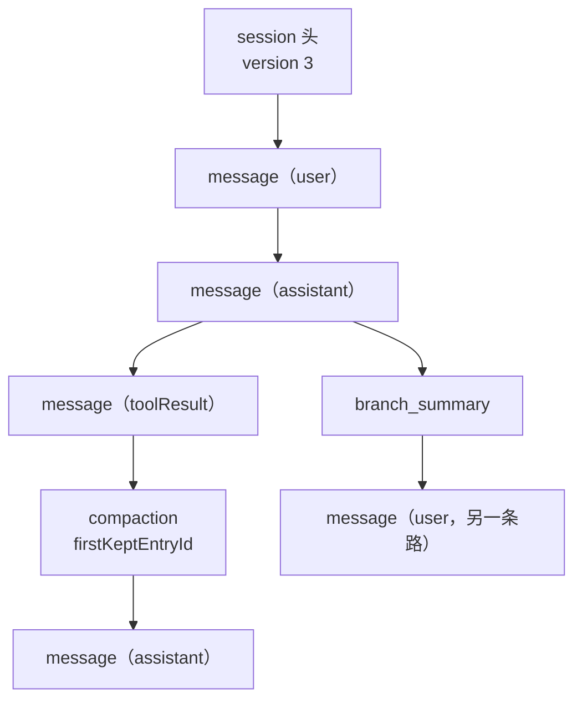

<!-- block: pi-ch12.b-4d959b7a -->
# 第12章 会话格式与恢复

Pi 崩了、机器重启了、你想把会话搬到另一台机器——这些都要回到同一个问题：会话文件里到底存了什么。

答案是 JSONL：一行一个 JSON 对象，第一行是会话头，之后是树上的条目。这一章按"读文件"的顺序拆开它。

## 12.1 文件位置与命名

```text
~/.pi/agent/sessions/--<path>--/<timestamp>_<session-id>.jsonl
```

- `<path>`：工作目录去掉开头分隔符，`/`、`\`、`:` 换成 `-`。
- `<timestamp>`：ISO 时间戳（文件名里把 `:` 换成 `-`）。
- `<session-id>`：默认 UUID；SDK 或 `--session-id` 可自定义。

会话文件可以直接删；交互式删除（`/resume` 里 `Ctrl+D`）在有 `trash` 时走回收站。

## 12.2 三种版本

| 版本 | 结构 | 说明 |
| --- | --- | --- |
| 1 | 线性条目 | 旧格式，加载时自动迁移 |
| 2 | 树（`id`/`parentId`） | 支持原地分支 |
| 3 | 树 + `custom` 角色 | 当前版本；`hookMessage` 统一成 `custom` |

加载旧会话时 Pi 会自动迁移到 v3。写脚本时按 `version` 分支，不要假设所有文件都是 3。

## 12.3 条目类型

会话头之外，所有条目都继承 `{type,id,parentId,timestamp}`。六类条目先排在这张图上，下面逐类说：

```ill
pi-plate-ch12-entries
```


| 类型 | 作用 | 进模型上下文？ |
| --- | --- | --- |
| `message` | 用户/助手/工具结果/系统消息 | 是 |
| `model_change` | 切换模型 | 否（影响后续请求） |
| `thinking_level_change` | 切换思考档位 | 否（同上） |
| `compaction` | 压缩摘要 + `firstKeptEntryId` | 是（替代旧消息） |
| `branch_summary` | 离开分支的摘要 | 是（附到新分支） |
| `context_edit` | 追加式改某条早期条目的上下文 | 是（替换/省略目标） |
| `custom` | 扩展状态 | 否 |
| `custom_message` | 扩展注入的消息 | 是（`display` 控制是否显示） |
| `label` | 书签 | 否 |
| `session_info` | 会话名等元数据 | 否 |
| `usage` | 不计入对话的用量（如缓存预热） | 否 |



## 12.4 上下文是怎么重建的

从当前叶往根走，得到活动路径；如果路径上有 `compaction`，取**最新**那条：

1. 先放压缩条目；
2. 放 `firstKeptEntryId` 到压缩条目之前的非系统条目；
3. 放压缩条目之后的条目。

然后应用 `context_edit`（同一目标以最新编辑为准），再把条目转成消息：`message` 原样、
`compaction` 变成"系统检查点 + 摘要"、`branch_summary` 变成摘要消息、`custom_message` 注入、
`usage`/`custom` 不产生消息。

**原始条目不会被改写**；`context_edit` 只影响未来请求。这是"历史可审计、上下文可裁剪"的关键。

## 12.5 本章小实验：解剖一个会话

**第一步：跑一次落盘请求。**

```bash
cd /tmp && pi --print --no-tools "只回复：会话格式"
```

**第二步：按类型统计。**

```bash
f=$(ls -t ~/.pi/agent/sessions/--D--Temp-User--/*.jsonl | head -1)
python - "$f" <<'PY'
import json,sys,collections
rows=[json.loads(l) for l in open(sys.argv[1],encoding="utf-8")]
print(collections.Counter(r["type"] for r in rows))
print("header:", rows[0])
print("second:", {k:rows[1][k] for k in ("type","id","parentId")})
PY
```

本机实测：类型计数里有 `session`、`message`、`model_change`、`thinking_level_change`（具体数量随一次运行而异）；
第二行是 `model_change`，带 `id`/`parentId`。会话头没有 `id`/`parentId`。

**第三步：验证迁移。**

找一份旧会话（`version` 小于 3）用 Pi 打开，再读文件头。Pi 会把它迁移到 v3；**迁移会改文件**，
所以先备份。本机没有旧会话，这一步未验证。

## 12.6 翻车对照：会话文件层的五个坑

| 翻车做法 | 会看到什么 | 正确做法 |
| --- | --- | --- |
| 手改 `parentId` 想"合并分支" | 活动路径断裂，模型看到的消息顺序不对 | 用 `/tree`/`/fork`；改文件前先备份 |
| 用 `json.load` 读整个文件 | 多行 JSON 报错（JSONL 是逐行对象） | 逐行 `json.loads`，跳过空行 |
| 假设所有文件都是 v3 | 旧文件字段对不上 | 先读 `version`，按版本处理 |
| 把 `custom` 当对话消息 | 它不进模型上下文 | 要注入上下文用 `custom_message` |
| 直接删文件当"清理" | 选择器里消失，无法恢复 | 交互式删除走回收站；或先备份 |

## 12.7 与另两册的同构点

御舆那册把会话当成"对话循环的持久化"，Omp 有自己的会话格式。Pi 的特点是**树 + 追加式编辑**都写在
公开的 JSONL 契约里，条目类型在文档里逐条列出。对照时只借"活动分支决定上下文"这条，
不要假设别家的 `compaction` 字段名一样。

下一章看渲染层：这些事件如何变成你屏幕上的差分画面。

---

**版本核对清单**（写作钉 `pi/1.5.0`，提交 `f9a2636`；本机 2026-11-08 复验）

- [ ] `docs/session-format.md` 的版本号是否仍是 3；迁移规则是否未变。
- [ ] 条目类型清单是否增删（尤其 `context_edit`、`custom_message`）。
- [ ] 上下文重建的三步是否仍以最新 `compaction` 为准。
- [ ] `context_edit` 是否仍只影响未来请求、不改原始条目。
- [ ] 会话文件命名与目录 slug 规则是否未变。
