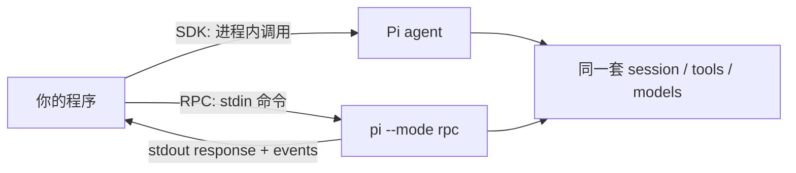

# 第19章 SDK 与 RPC：把 Pi 嵌进程序

有两种"把 Pi 放进程序"的方式，边界完全不同：

<!-- block: pi-ch19.b-836e8334 -->
- **SDK**：把 agent 嵌进 Node.js/Bun 进程，直接调 TypeScript 方法。
- **RPC**：把 Pi 当子进程，通过 JSONL 命令/事件控制。

选错会带来两种痛苦：SDK 拿不到进程隔离，RPC 拿不到进程内对象。这一章先把两条路的边界画开，再逐段说清楚。

```ill
pi-plate-ch19-boundary
```


## 19.1 SDK：进程内，直接调

```typescript
import { createAgentSession } from "@earendil-works/pi-coding-agent";

const { session } = await createAgentSession();

try {
  await session.prompt("What files are in the current directory?");
  console.log(session.getLastAssistantText());
} finally {
  session.dispose();
}
```

`createAgentSession()` 用当前工作目录、发现的资源、设置和凭据。`prompt()` 在 run 结束后 resolve。
要流式输出，先订阅：

```typescript
const unsubscribe = session.subscribe((event) => {
  if (event.type === "message_update" &&
      event.assistantMessageEvent.type === "text_delta") {
    process.stdout.write(event.assistantMessageEvent.delta);
  }
});
await session.prompt("Explain this repository");
unsubscribe();
```

几个关键对象：

| 对象 | 责任 |
| --- | --- |
| `session` | 一条对话：消息、模型、工具、排队、压缩、扩展运行时 |
| `SessionManager` | 持久化/内存条目树，决定活动分支与上下文 |
| `AgentSessionRuntime` | `newSession` / `switchSession` / `fork` / `importFromJsonl` |
| `DefaultResourceLoader` | 扩展、技能、模板、主题、上下文文件的发现 |

`session.dispose()` 会中止活动工作、失效扩展上下文、断开 agent、移除监听。忘了它，进程可能不退出。
`prompt()` 在流式进行中必须说明是 steer 还是 follow-up，否则拒绝——它不替你猜。

## 19.2 RPC：子进程，协议控制

```bash
pi --mode rpc --no-session
```

- stdin 写命令，stdout 读 `response` 与事件，每条一行 JSON。
- 命令可带 `id`；响应重复同一个 `id`，异步处理，别按顺序配对。
- `prompt` 的成功只表示"接受/排队/处理了"，不代表跑完；等 `agent_settled`。
- RPC 拒绝 `@file` 参数；文件通过 prompt 内容或其他命令给。
- 关闭 stdin 请求有序退出；仍要处理信号和异常退出。

TypeScript 侧用 `RpcClient` 可以省掉握手：

```typescript
import { RpcClient } from "@earendil-works/pi-coding-agent";
const client = new RpcClient({ cliPath: "./dist/cli.js" });
await client.start();
const text = await client.promptAndWait("Summarize this repo");
console.log(text);
await client.stop();
```

`promptAndWait()` 会先装监听再发 prompt，避免"很快完成"的竞态。



## 19.3 本章小实验：能验证的与不能验证的

本章的 SDK/RPC 示例**未在本机实跑**（没有为写书搭一个 Node 工程）。可以验证的是协议形状：

```bash
pi --mode json --no-session --no-tools "只回复：OK" | head -3
```

本机前三行是 `session` 头、`agent_start`、`turn_start`；RPC 不发 session 头，用 `get_state` 拿会话信息。
这条差异在 `docs/json.md` 与 `docs/rpc.md` 都写了，属于文档事实，不是实测结论。

**复验建议**：用 `examples/sdk/01-minimal.ts` 跑一次最小 SDK；用 `examples/rpc-client.ts` 跑一次 RPC，
两者都需要先构建或指向可运行的 CLI。跑通后把结果补进 `pi/VERIFY.md`。

## 19.4 翻车对照：集成层的六个坑

| 翻车做法 | 会看到什么 | 正确做法 |
| --- | --- | --- |
| 忘了 `session.dispose()` | 进程挂住不退出 | finally 里 dispose |
| 流式时直接 `prompt()` 不说 steer/follow-up | 调用被拒绝 | 用 `steer()` / `followUp()` 或显式选项 |
| 按响应顺序配对 RPC 命令 | 异步乱序时错配 | 用唯一 `id` 关联 |
| 收到 `prompt` 成功就结束 | 模型还没跑完 | 等 `agent_settled` |
| 用 `readline` 读 JSONL | Unicode 分隔符切错行 | 按字节流只按 `\n` 切 |
| 在 SDK 里改 `agent.state.messages` 想改历史 | 持久化上下文没变 | 用 `SessionManager` |

## 19.5 与另两册的同构点

御舆那册讲 SDK 与流式，Omp 也有 SDK/RPC。Pi 的区别是把 SDK 与 RPC 分成"进程内/进程外"两条清晰边界，
并共用同一套 session 与事件。对照时只借"进程内嵌 vs 子进程控制"这条，不要假设方法名一样。

下一章进入实战：用 Pi 真的改一次代码。

---

**版本核对清单**（写作钉 `pi/1.5.0`，提交 `f9a2636`；本机 2026-11-08 复验）

- [ ] `createAgentSession` / `session.prompt` / `subscribe` / `dispose` 的签名是否未变。
- [ ] 流式中 `prompt()` 是否仍要求 steer/follow-up。
- [ ] RPC 是否仍不发 session 头、用 `get_state` 取会话信息。
- [ ] RPC 命令是否仍按 `id` 关联、`prompt` 成功不代表完成。
- [ ] `RpcClient.promptAndWait` 是否仍先订阅再发 prompt。
