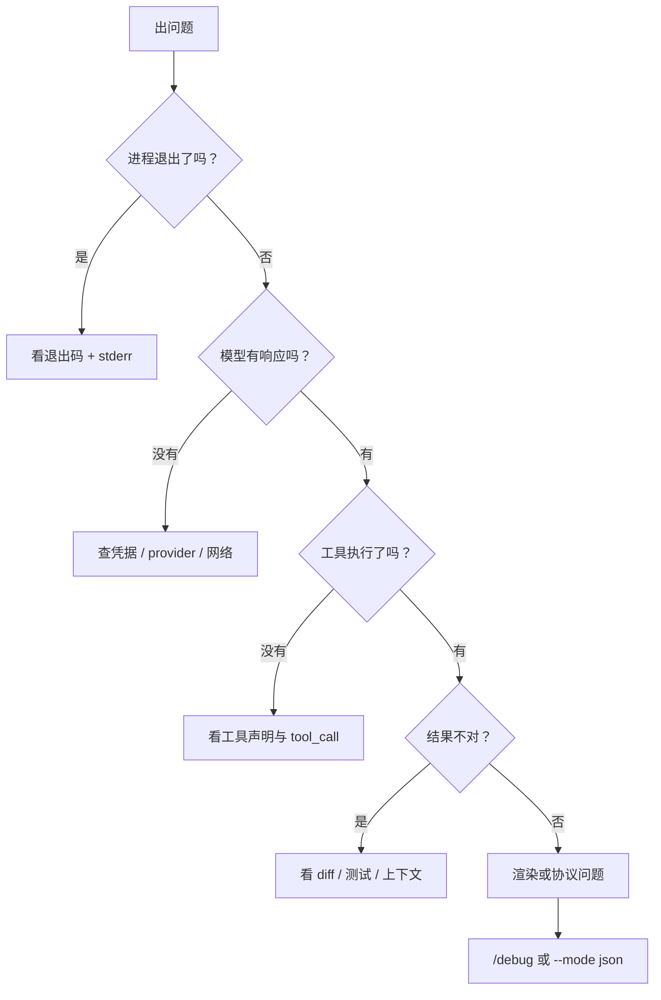

# 第23章 排错与诊断

"它不动了。"

<!-- block: pi-ch23.b-5c7ba987 -->
排错的第一步不是重启，而是分清**哪一层**不动：进程、provider、工具、会话，还是渲染。
Pi 把证据放在几个固定位置；知道去哪看，比反复重试有用。

## 23.1 按症状找证据

| 症状 | 先看 | 再看 |
| --- | --- | --- |
| 启动就失败 | stderr、退出码 | `pi --version`、Node 版本 |
| 模型报错/401 | `/login` 状态、环境变量 | `--list-models`、provider 文档 |
| 工具没跑/被拒 | 工具卡片、`Ctrl+O` | `tool_call` / `tool_result` 事件 |
| 回答越来越短/忘事 | 页脚上下文占用 | `/compact`、`/session` 用量 |
| 会话"丢了" | 当前目录、`--continue` vs `--resume` | `~/.pi/agent/sessions/` |
| TUI 花屏 | 终端类型、主题 | `/debug` 的 `pi-debug.log` |
| 脚本解析失败 | stdout 是不是 JSONL | stderr 内容、`agent_settled` |

## 23.2 五个内置诊断入口

1. **`/debug`**：把当前渲染行与会话消息写到 agent 目录的 `pi-debug.log`。分享前先审查内容。
2. **`/session`**：显示会话文件、ID、消息数、token 用量、花费。
3. **`/hotkeys`**：当前生效的键位；排查"按了没反应"。
4. **启动头**：列出加载的指令与资源；扩展/技能没生效先看这里。
5. **`--mode json` + stderr**：协议层问题看事件，进程层问题看 stderr。

`--verbose` 可以强制详细启动输出（覆盖 `quietStartup` 设置），但本机在 print 模式下没有看到额外输出；
它在交互模式下的效果**未验证**。

## 23.3 一个最小排错流程



先把"进程活着吗"与"模型回了吗"分开，能排除一半误判。很多"Pi 卡住"其实是 provider 在等网络，
或者脚本没在读 stdout（第 8 章的背压问题）。

## 23.4 本章小实验：三种失败，三种证据

**第一步：模型选择失败。**

```bash
pi --print --no-session --model not-a-model "hi"; echo "exit=$?"
```

本机：`Error: Model "not-a-model" not found...`，退出码 1。证据在 stderr。

**第二步：参数混用失败。**

```bash
pi --tools read,+bash --print --no-session "hi"; echo "exit=$?"
```

本机：`Error: --tools: tool names cannot be mixed with +name or -name entries`，退出码 1。
证据同样是 stderr，且是**用法错误**，不是模型错误。

**第三步：协议层证据。**

```bash
pi --mode json --no-session --no-tools "只回复：OK" | head -3
```

本机前三行是 `session` 头、`agent_start`、`turn_start`。如果这里第一行不是 JSON，先检查是不是
有启动 banner 混进了 stdout；stdout 应该只有协议记录。

## 23.5 翻车对照：排错层的六个坑

| 翻车做法 | 会看到什么 | 正确做法 |
| --- | --- | --- |
| 一出错就重装 | 真正的配置/凭据问题还在 | 先看 stderr 与退出码 |
| 把 `pi-debug.log` 直接发出去 | 里面有 prompt、文件内容、终端数据 | 先审查/脱敏 |
| 用 `tail -1` 看 JSON | 只看到最后一条，漏掉失败事件 | 全量读，找 `agent_settled` / error |
| 在 CI 里 `2>/dev/null` | 错误被吞 | 保留 stderr，失败时打印 |
| 用 `--continue` 找另一个目录的会话 | 找不到 | `--resume` 或 `--session` |
| 以为 TUI 花屏是模型问题 | 查错方向 | `/debug`、换 `regular` 模式、查终端支持 |

## 23.6 与另两册的同构点

御舆那册有排错与诊断章节，Omp 有 VERIFY 与失败路径。Pi 的特别之处是**协议证据与渲染证据分开**：
JSON 看事件，`/debug` 看终端。对照时只借"先分层再修"这条，不要假设日志路径一样。

下一章收束第三篇之后的线索：Pi 的 12 个包各自负责什么。

---

**版本核对清单**（写作钉 `pi/1.5.0`，提交 `f9a2636`；本机 2026-11-08 复验）

- [ ] `/debug` 是否仍写 agent 目录的 `pi-debug.log`。
- [ ] `/session` 是否仍显示文件、ID、消息数、用量与花费。
- [ ] 非法模型/参数混用是否仍返回退出码 1、错误在 stderr。
- [ ] `--verbose` 的作用范围是否未变。
- [ ] `--continue` / `--resume` 的目录语义是否未变。
