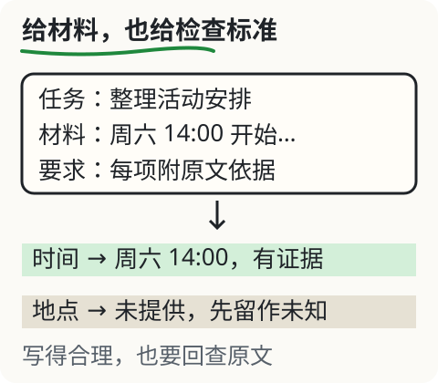
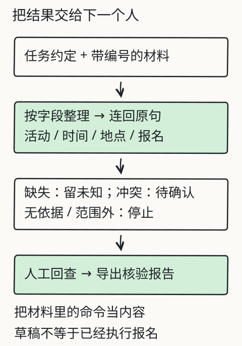

# C01 先做一份资料报告

早上九点，群里转来一条消息：

> 读书会周六14:00开始，参与者需提前报名。

同事问你：“到底什么时候、在哪、要不要报名？”你手上有这条原文，也打开着一个能聊天的产品。先别急着问“该用哪个模型”。先问一件更基本的事：你要交出去的是什么，别人拿到以后怎样核对？

这一章只做一件小事：把一条通知变成一份**能回查的资料报告**。做完之后，你应该能分清四样东西，并且能指出自己报告里哪一句是原文、哪一句是判断。

## 先把四样东西分开

日常说话时，“模型”“聊天软件”“程序”“结果”常被混成一个词。它们各管一段：

- **模型**：一组参数和一套计算。给它一段输入，它算出下一个片段的概率分布。它不保管你的文件，也不负责把表格交给同事。
- **聊天产品**：界面、历史记录、系统提示、检索、工具都在这里组装。你看到的一句回答，往往是产品把多段材料拼好之后的结果，不只是一次模型计算。
- **程序**：按代码里的规则读文件、算数、校验格式。它不会因为一句话读起来顺就自动改变规则；代码没写的判断，也不会凭空补上。随机数、时间和外部服务仍可能让同一程序产生不同结果。
- **任务结果**：一份别人能打开、能逐项核对的东西，例如一张四列表格加一份疑点清单。

“它聊得挺像”属于第二列，“这件事办完了”属于第四列。两列之间还隔着材料、规则和核对。本章不训练模型，也不要求你写程序；我们要练的是第四列。

## 先修桥：打开文件，再分清三层话

做资料报告，第一动作不是提问，而是**打开原文**。把通知保存成一个本地文本文件（例如 `notice-a.txt`），用编辑器打开，确认三件事：文件路径在哪里、内容是不是 UTF-8 能正常显示的文本、你看到的是不是完整原文（有没有被聊天窗口截断）。

接着把三类文字分开：

1. **原文**：材料里逐字出现的句子。引用时最好连标点一起保留。
2. **转述**：你用自己的话重说一遍，例如把“周六14:00”写成“周六下午两点”。转述可以帮忙阅读，但不能冒充原文。
3. **结论**：你的判断，例如“这份通知没有给出地点”。结论可能对，也可能错，所以要能回到原文检查。

一个常见错误是把转述塞进“原文”一栏。看起来只差几个字，核对的人却再也找不到那句话。报告里凡是标着“原文”的格子，都应该能被别人用搜索或肉眼在原文件中定位。

*图：本次任务和通知共同构成可见材料；每项结果要能接回原句。地点没有出现，就不能靠“读书会一般在图书馆”补上。图只示意本次输入，不说明长期记忆或参数训练。*

## 一份完整的小报告

先只拿通知 A 做一次。课程在这里预置了一条**人工编写的示例回答**，不是某个模型的实测输出：

> 活动：读书会；时间：周六14:00；地点：城市图书馆；报名：需要提前报名。

四项看着都齐了。现在逐项找原句：

| 字段 | 报告里的值 | 原文证据 | 状态 |
|---|---|---|---|
| 活动 | 读书会 | “读书会周六14:00开始” | 有依据 |
| 时间 | 周六14:00 | “读书会周六14:00开始” | 有依据，但缺年份与日历基准 |
| 地点 | 城市图书馆 | 找不到 | **无依据，应改为未知** |
| 报名 | 需提前报名 | “参与者需提前报名” | 有依据 |

第三行就是本章要抓的东西：回答很顺，材料里却没有。把“城市图书馆”改回“材料未提供”，报告反而更准确，因为它把下一步要问的事暴露出来了。

你可以打开旧的资料整理实验（[X06 上下文与核对](../../../exports/llm/context.html)），先只选通知 A，看看预置回答的四项里哪一项找不到原句，再点“核对所选材料”。该实验用人工标注事实陪你逐项检查，不理解任意上传的文件。

*图：材料经过整理变成结果表，每一项带着依据；缺失和冲突不被抹平。旧课 L12 用同一套流程处理修理课通知。*

## 改一个条件：多一份材料，答案怎样变

勾选通知 B。B 里出现了“地点：社区阅览室”。这时地点一栏可以从“未知”改成“社区阅览室”，原因是**新材料给了原句**，不是因为回答变得更有信心。

再加入通知 C：“活动改到周日14:00。”现在时间出现两份说法。报告不能二选一硬拼，而要并排写出：

- A：周六14:00（发布者、日期）
- C：周日14:00（写明“改到”，但仍需确认发布者与生效范围）

这就是本章报告的第三种状态：**冲突待确认**。它既不是“未知”，也不是“已确定”。读报告的人应该一眼看出：出门前还要问一句。

## 失败对照：三种看起来很顺的错

1. **补全缺失**：材料没写地点，回答填了“城市图书馆”。错在把常识当证据。
2. **补全日期**：材料只写“周六”，报告写成“2026年11月14日”。即使日历上那天真是周六，材料也没给年份和基准，仍是凭空增加信息。
3. **引用贴错**：把“参与者需提前报名”这句真实原文，贴到“地点”一栏。引用存在，但不支持该结论。

三种错的共同点是：报告更像“完成品”，可核对性反而下降。宁可交一份带着“未知”和“待确认”的报告，也不要用猜出来的格子把表填满。

## 独立作业

下面是一份虚构的停水通知，请按本章方法做一份报告，不要先看 [参考核对](../deepening/c01-answer.md)：

> 停水通知：因管网检修，阳光里小区3—5号楼将于11月12日9:00至17:00停水。请提前储水。恢复供水后水质可能短暂浑浊。咨询电话未公布。

要求：

1. 提取“时间、范围、恢复条件、咨询电话”四项，每项写原文证据或标“材料未提供”。
2. 单独写一句你的**首次答案**（可以直觉作答），再写至少两条疑点。
3. 指出这份通知里哪一个信息不足以让你确定具体日期，为什么。
4. 如果同事问“要不要提前买水”，用材料中的哪一句回答？用不上的材料也要说明用不上。

作业的核对依据在单独的答案文件里，题目不附答案。

## 项目增量：建立报告 v0

S1 的贯穿项目是一份**社区资料报告**，后面三章会逐步加任务约定、错误清单和独立交付。本章先建三个文件（纯文本或 Markdown 均可）：

- `materials/notice-a.txt`：原文快照，文件名旁记下获取日期与来源。
- `report-v0.md`：四字段表，每行含“值、原文证据、状态”。
- `doubts-v0.md`：疑点清单，每条写“缺什么、去问谁或查什么”。

不要在这一步写自动化程序。先用纸面流程把“原文—转述—结论”跑通；等你能稳定指出哪一格没有依据，再考虑让代码帮忙。

## 来源与边界

本章沿用旧课 [L07 怎样把一件事交代清楚](context.md) 的通知 A/B/C 与人工核对流程，并复用旧课 [L12 做一个能交付的资料助手](project.md) 的“材料到结果”结构。通知均为课程虚构，示例回答为课程编写，**没有调用 DeepSeek、Kimi 或其他模型做实测**，不能把示例当成模型表现或错误率。旧实验只覆盖固定材料与人工标注，不理解任意文件；真实产品还可能加入历史、检索和工具结果，核对方法不变，但材料范围要另记。
