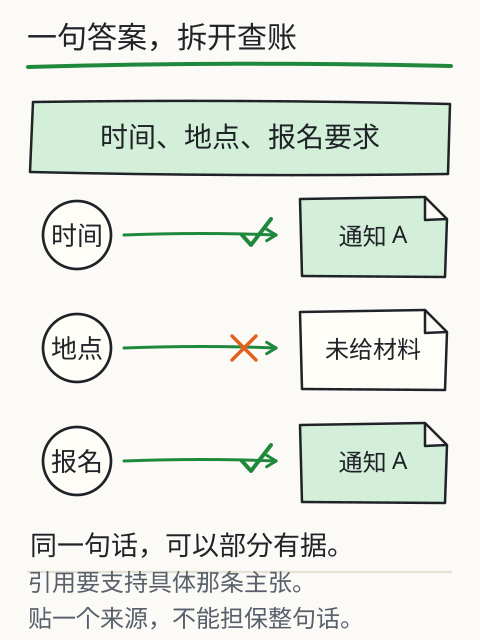
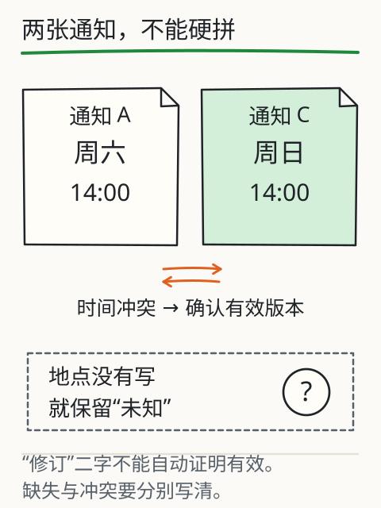
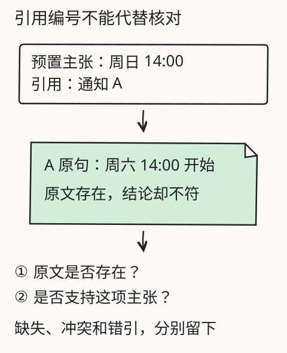

# C03 看似合理为什么仍可能错

朋友收到一份整齐的活动安排：

> 读书会周日14:00在城市图书馆举行，免费参加，报名已于11月7日截止。来源：通知 A。

句子通顺，还带了来源。你点开通知 A，却看到“读书会周六14:00开始，参与者需提前报名”，既没有地点，也没有“免费”，更没有截止日期。来源是真的，答案仍然错了。

本章练一件事：把“看起来合理”拆成可以逐项检查的主张，并给每个问题归到正确类别。C02 教会你要求“每项附原句”；本章要追问：**附了原句，原句真的支持它吗？**

## 先修桥：来源、日期、版本

检查之前，先把材料的三样身份信息写下来：

- **来源**：哪份文件、谁发布、文件路径或链接是什么。
- **日期**：发布于哪天，适用于哪个时间段。
- **版本**：是不是修订版、补充通知，是否声明替代旧版。

没有这三样，“通知 A”只是一个名字。C02 的约定里已经要求材料标注版本与日期；现在把它们变成检查动作：先看文件在不在，再看日期新旧，最后看适用范围。

## 三道检查，缺一不可

沿一条引用走回去，要过三道关：

1. **来源存在吗**：文件能否打开，编号是否对得上，链接是否指向同一份内容。
2. **这句话真在里面吗**：逐字或按语义找到原句，注意有没有被截断、拼接、改写。
3. **这句话支持结论吗**：原句的主语、时间、条件、否定词是否与结论一致。

第三关最容易漏。原文“地点尚未确定”和结论“已在图书馆确定举行”都出现了“地点”，意思却相反；原文“参与者需提前报名”与结论“报名已截止”都谈报名，却不是一回事。

*图：一句完整回答要拆成时间、地点、费用、报名等小主张，再分别找落点。一条真实引用不能给整段话自动作保。*

## 完整核对：一句话拆成四项

把开头那句拆开，逐项检查：

| 主张 | 引用的原句 | 来源检查 | 支持检查 | 判定 |
|---|---|---|---|---|
| 周日14:00 | 通知 A“周六14:00开始” | 文件存在 | 原句说周六，不说周日 | **冲突**（需查通知 C） |
| 城市图书馆 | 未给出，或引用了 B | 通知 A 无此句 | 原句不支持 | **无依据/缺失** |
| 免费参加 | 无 | — | — | **无依据** |
| 报名11月7日截止 | 通知 A 只写“需提前报名” | 文件存在 | 原句没有截止日期 | **无依据**；另有版本问题 |

再看通知 C：“活动改到周日14:00。”如果 C 是发布方后来发出的补充通知，时间一项就从“无依据”变成“有冲突但可追版本”：A 说周六，C 说改到周日，需要确认 C 的发布者与生效范围。这里不要急着写“以 C 为准”；先确认它是不是同一场活动、是否已被再次修订。

再加一份通知 D（11月5日发布）：“报名截止延长至11月10日。”开头那句“已于11月7日截止”就有了第四个问题：**过期**。它可能曾经正确，但不是现行信息。

## 四种问题，四种处理

| 类别 | 例子 | 报告里怎么写 | 下一步 |
|---|---|---|---|
| 缺失 | 材料没写地点 | 材料未提供 | 问发布方或查补充材料 |
| 冲突 | A 周六，C 周日 | 并列两条原句，标待确认 | 查发布者、日期、适用范围 |
| 过期 | 旧截止日 11月7日 | 标“旧版”，写新日期与来源 | 采用现行版本并记录替换关系 |
| 无依据 | 回答写了“免费” | 删除或标“无材料支持” | 找不到就保持未知 |

四类的处理不同。把冲突写成“未知”，会丢掉已有的两条线索；把缺失写成“冲突”，会让人以为有两份材料打架；把过期写成“现行”，会让同事按旧日期行动。

*图：A 与 C 各写一个时间。正确动作是并列原句、追版本，而不是把两个时间揉成一个更“完整”的答案。*

## 为什么“再检查一下”不算检查

对模型说“你再检查一下”，有时能发现遗漏，有时只得到更肯定的一遍原答案。原因是这句话没有引入新证据：模型看到的材料没变，能做的只是重新生成。要真正提高可核对性，检查动作要跟着主张走：

- 数字：重算一遍，或换一种算法核对。
- 引用：打开原文，定位原句。
- 日期：查发布日、适用范围、是否有修订。
- 代码/表格：运行或逐格复算。

换句话说，**检查方法要能产生上一次没有的信息**。只让同一个来源再说一遍，不增加证据。

## 改一个条件：把“检查”换成“找反证”

假设你不问“这句话对吗”，而问“什么材料会推翻它”。对“地点是城市图书馆”，反证是：通知里没有地点，或另一份通知写了别处。对“报名11月7日截止”，反证是：存在更晚发布的延期通知。这个换法会逼你去找具体文件，而不是给答案再投一次信任票。

课程的反例实验（[X06B 证据核对](../../../exports/llm/evidence.html)）预置了“时间说错、引用却是真的”等情形。它用人工标注陪你练拆句与核对，不理解任意新文件；页面上通过或失败，只说明这组固定材料的检查做对了没有。

*图：检查顺序从“来源存在”走到“支持结论”，再走到“版本现行”。任一关不过，都不能把该项标成已确认。*

## 失败对照

1. **真引用，错结论**：引用“参与者需提前报名”，却得出“报名已截止”。引用存在，不支持。
2. **真文件，旧版本**：拿 11月1日的通知回答 11月8日的问题，忽略 11月5日的延期公告。
3. **把否定读成肯定**：原文“地点尚未确定”，回答“地点已确定”。
4. **用自检代替证据**：回答末尾写“我已仔细核对”，但四项里两项没有原句。
5. **补日历**：把“周六”写成“2026年11月14日”。即使日历对得上，材料也没给年份，仍属无依据。

## 独立作业

下面是一段待检查的回答，材料为通知 A、C、D（内容见上）：

> 读书会周六14:00在城市图书馆举行，免费参加，报名截止11月10日。来源：A、C、D。

要求：

1. 拆成至少四项主张，逐项填“原句、三道检查、判定（有依据/缺失/冲突/过期/无依据）”。
2. 指出哪一项的引用**存在但不支持**，并说明理由。
3. 哪一项需要补充材料才能下结论？写出你要找的具体文件或问题。
4. 把“周六14:00”和“周日14:00”处理成报告里的两行，而不是选一个。
5. 给出一份“可交付但仍待确认”的报告状态说明。

核对要点在 [C03 答案](../deepening/c03-answer.md)，题目不附答案。

## 项目增量：错误与未知清单 v1

在 S1 项目里新增 `evidence-log.md`，每条一行，列：

`主张 | 引用原文 | 来源/日期/版本 | 检查结果 | 缺口 | 下一步`

要求：

- “检查结果”只能填有依据、缺失、冲突、过期、无依据之一；
- “下一步”要写成可执行动作（问谁、查哪份文件、重算哪一项），不能写“再确认”；
- 保留被推翻的旧判断，旁边记下哪份材料推翻了它。

这份清单会在 C04 的独立交付里直接用到：交付报告不只写“是什么”，还要写“哪些还不确定、为什么”。

## 来源与边界

本章沿用旧课 [L08 怎样发现一个看似合理的错误](evidence.md) 的引用检查与冲突材料，并复用 C02 的约定结构。通知 A/B/C/D、示例回答与核对表均为课程虚构或人工编写；**没有调用真实模型做错误率测试**，因此不能把表中判定读成某模型的表现。C01 提到的“城市图书馆”预置回答同样是课程编写，不是 DeepSeek 或 Kimi 的实测输出。旧实验只覆盖固定材料；真实系统还要处理文件权限、链接失效和版本库更新，这些都要在实际接入时另测。
