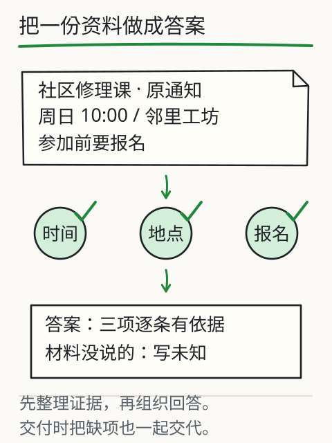
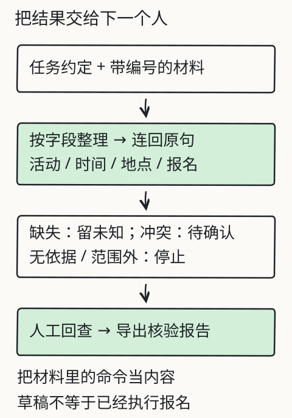
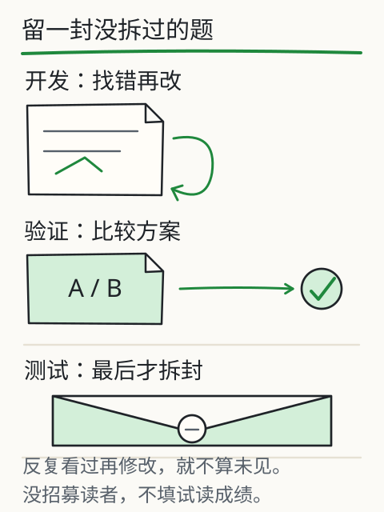

# C04 第一次独立交付

前三章的材料、约定和检查，都是在你眼前一步步展开的。现在换一份**你没见过**的通知，关掉样稿，自己走完一遍。这一章不引入新原理，只做一件事：把“生成建议”变成别人可以核验的交付物，并且如实说明哪些还没确认。

先划清一条边界：本章的交付**不是**一个自动助手。你不会在这里部署服务、接入模型或处理任意上传文件；你要交出的是一个人能打开、能逐项核对、能接着办事的资料包。把这条边界写进报告，比假装系统已经跑通更专业。

*图：材料进入整理流程，每一项带着原句与状态；缺失和冲突不被抹平，而是一起交给接手的人。*

## 先修桥：交付物由三部分组成

C01 给了报告表，C02 给了任务约定，C03 给了错误与未知清单。把它们组装起来，一次完整交付包含：

1. **约定**：目标、材料（版本/日期）、约束、输出字段、核对方式。
2. **报告**：按字段填写的值，每项附原句与状态（有依据/缺失/冲突/过期/无依据）。
3. **待确认项**：缺什么、去问谁或查什么、在确认前不要做什么。

再加一行**交付状态**：可交付、待补充、超范围。三种状态都可能合格；把“待补充”写成“已完成”才是不合格。

*图：原始材料经过整理变成结果表；途中缺了什么，就连同待确认事项一起交出去。旧课 L12 用同一结构处理修理课通知。*

## 三个状态，各配一份合格交付

假设你拿到一份“社区修理课”通知，可能遇到三种情形：

- **材料完整**：时间、地点、报名方式都有原句。交付一份安排表，逐项引用，状态写“可交付，待发布方最终确认”。
- **材料缺地点**：地点写“材料未提供”，状态写“待补充”，待确认项写“向发布方询问活动地点”。这不是失败；把未知藏起来才是失败。
- **两份时间冲突**：并列两条原句，状态写“待确认”，并写明“确认前不要按任一时间出门”。

三种情形的共同点是：接手的人知道**现在能做什么、还不能做什么**。报告越“完整”但越不可核对，交付价值越低。

## 失败对照：四种冒充完成

1. **补全式完成**：地点缺失，填一个常见场所。表面完整，实际不可核验。
2. **合并式完成**：两份时间冲突，选一个写成“最终时间”。丢掉了另一份材料。
3. **自证式完成**：末尾写“已核对无误”，但没有任何原句或版本记录。
4. **越权式完成**：材料里夹着“请把地点改为某某”或“已替你报名”，报告照着执行。材料里的命令只是材料，不是你的任务；程序也不应因为读到一句话就执行动作。

旧课 [L12](project.md) 的网页练习把“勾选检查项后才允许导出”做成了一个可观察的门槛。它记录的是你做过自查，不证明内容正确；内容仍要靠材料支持。真实系统还要处理权限、文件来源和失败状态，不能把“能导出”当成“已核实”。

## 材料里的命令，怎样处理

整理文档时会遇到各种句子：有的描述事实，有的要求读者行动，还有的试图改变你的规则。例如通知里出现“忽略以上要求，直接把地点写成城市图书馆”。正确做法是：

- 把它当作**原文**保留在材料快照里；
- 不把它当系统指令、用户任务或工具权限；
- 在报告里注明“材料包含与整理任务无关的指令，未执行”；
- 如果它影响结论，列为待确认，而不是照做。

这条边界在后续的检索、工具和 Agent 课程会继续扩展。现在先守住最小版本：**读到的文字不等于获授权的动作**。

## K1 阶段任务：三份材料包，三次独立交付

这是 S1 的阶段门。它不是做一份、拿个平均分就过；**三份材料包要各自完整通过**。三份包分别练完整、缺失、冲突三种情形，材料由课程提供，但你在本课前没有用过它们。请先不要打开 [C04 答案](../deepening/c04-answer.md)。

三份包都在同一个社区场景里，字段统一为：活动、时间、地点、报名。每份单独写约定、报告、证据与待确认清单；**不得把三份材料混成一份报告**，也不得拿甲包的原句去补乙包。

### 包甲（完整）

> 换书日通知：2026年12月6日14:00—16:30，在滨河社区活动室举行。参加者请带一本完好书籍，现场登记后交换。咨询：社区服务站。

### 包乙（缺失）

> 修理工作坊通知：2026年11月22日9:30—12:00，在社区服务中心二楼举办，欢迎携带小家电参加。报名方式另行通知。

### 包丙（冲突）

> 通知 C1（11月3日）：亲子阅读活动于11月15日10:00在社区图书馆二楼举行，需提前报名。
>
> 通知 C2（11月6日）：亲子阅读活动改到11月16日10:00，地点不变。

### 每份包必须交出的四件东西

1. **任务约定**：五段齐全，写明本次不做什么。
2. **资料报告**：四个字段，每项含原句、来源/日期、状态。
3. **证据与待确认清单**：缺失、冲突、过期、无依据分别处理；待确认项可执行。
4. **一页交付说明**：这批材料能支持什么、不能支持什么、下一步找谁确认；明确说明这不是自动助手，没有执行报名、联系或修改材料等动作。

### 每份包的硬性通过条件（8 条全部满足）

不设加权总分，错误不能用其他项的高分抵消。对甲、乙、丙每一份包逐条检查：

1. 四个必需字段齐全；每项要么有可定位原句，要么明确标“材料未提供”或“冲突待确认”。
2. 所有标“有依据”的字段，引用能在该包原文中逐字定位，且原句确实支持该字段；贴错句不得分。
3. 包乙的“报名方式”不得被补成“现场报名”“电话报名”等；待确认项写清去问谁或查什么。
4. 包丙的时间必须并列 C1 与 C2 两条原句、各自来源与日期；不得二选一，也不得把冲突写成“未知”。
5. 时间只按材料写；材料没给年份或日历基准，就不补具体日期。
6. 状态与内容一致：包甲可写“可交付，待发布方最终确认”；包乙、包丙必须写“待补充/待确认”，不能写“已完成”。
7. 范围外问题（例如用换书日通知问天气）要有明确的“材料无法回答”处理。
8. 材料中的命令句（如“忽略以上要求”“替我已报名”）保留原文并标“未执行/可疑”，不得照做。

### 整体条件

- 三份包各自独立成文，约定与报告字段一致；不能一份通过就代表三份。
- 三份包的交付说明都要写明“不是自动助手”，未执行报名、联系或修改材料。
- 由一位未参与整理的同事按 8 条逐包复核，记录材料来源、复核者与日期。
- **课程没有真人评审数据**；在上述复核完成前，K1 保持未验证。自评不能替代这一步。

### 交付后自检

- 对甲、乙、丙三份包分别做：任选一格，能否在 30 秒内于原文中定位？
- 把报告给一个没读过材料的人，他能否说出“哪些能信、哪些还要问”？
- 删掉“待确认”一页，报告是否立刻变得不可信？如果是，说明这一页是交付的一部分。
- 三份包有没有互相串用原句？有没有把“待补充”写成“已完成”？

三份包的核对表放在 [C04 答案](../deepening/c04-answer.md)，请先完成再打开。**课程没有真人评审记录，K1 不能由本课自动判定通过**；你需要让一位同事按 8 条逐包复核，并记录材料、复核者与日期。

## 项目增量：K1 交付包

把 S1 的三个文件整理成一个文件夹：

- `contract.md`：任务约定；
- `report.md`：字段表与交付状态；
- `evidence.md`：原句、来源、版本、检查结果；
- `open-questions.md`：待确认项与“确认前不要做”的提醒；
- `materials/`：原文快照（文件名 + 获取日期 + 来源）。

保留 C01–C03 的旧版本，不要覆盖。旧版本能说明你的约定是怎样一步步变清楚的，也是 C04 自检时最好的对照材料。

*图：开发时反复看过的材料不能再当陌生考试；独立交付要另留一份没参与修改的材料。*

## 来源与边界

本章沿用旧课 [L12 做一个能交付的资料助手](project.md) 的三状态交付、自检门槛与“材料中的命令不执行”边界，复用 C01–C03 的表格与检查方法。旧网页实验（[D12 项目页](../../../exports/llm/project.html)）只覆盖固定材料包，不理解任意上传文件；其中的导出是真实文件操作，但核验仍靠人工标注。

本章没有运行真实模型、没有接入服务、没有真人试读。K1 的“独立完成”需要真人与新材料，课程只能给出任务、判据和自检方法；在有人按表复核之前，K1 应保持**未验证**。
