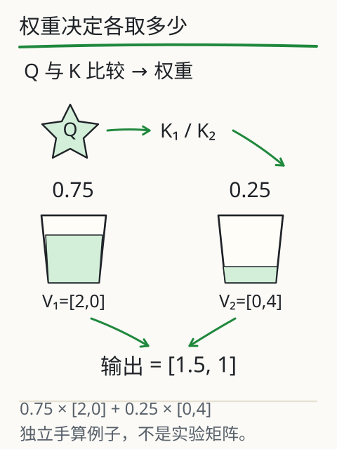
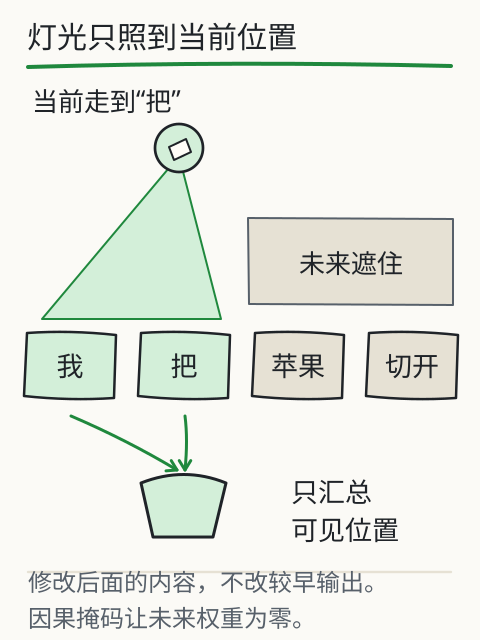

# C07 注意力到底计算了什么

用手遮住“我把苹果切开”的后半句，只露出“我把”。站在“把”这个位置，你能看到“苹果”吗？训练时整句都在材料里，模型会不会提前偷看后面的答案？本章把一次注意力拆成四步：投影出 Q/K/V、算匹配分数、遮住未来、按权重汇总。每一步都能手算。

## 先修桥：矩阵形状与加权平均

先复习两个动作。

**矩阵乘法**：一个 `m×n` 矩阵乘一个 `n×p` 矩阵，得到 `m×p` 矩阵。结果第 i 行第 j 列，是左矩阵第 i 行与右矩阵第 j 列对应相乘再相加。例如：

```
[1 0]   [1 0]   [1 0]
[0 1] × [0 1] = [0 1]
[1 1]           [1 1]
```

这是 3×2 乘 2×2，得到 3×2；单位矩阵不改变输入。

**加权平均**：两个数 10 和 20，权重 0.25 与 0.75，结果是 `0.25×10 + 0.75×20 = 17.5`。权重相加为 1，结果落在两个数之间。注意力最后一步就是这种加权，只是每个“数”换成一行向量。

## Q、K、V 各做什么

同一行输入表示，经过三组不同的学到的参数，得到三种用途：

- **Q（查询）**：当前位置想找什么。
- **K（键）**：每个位置能提供什么“匹配条件”。
- **V（值）**：每个位置实际要汇入的内容。

这不是三个会主动思考的角色，而是三组投影结果。用一个 3 个位置、每位置 2 维的例子：

```
X = [1 0]     WQ = WK = WV = [1 0]
    [0 1]                     [0 1]
    [1 1]
```

取单位矩阵是为了让手算看得见：`Q=K=V=X`。真实模型的三组参数不同，形状也可能不同；本章只练计算关系。

## 站在第二个位置，算一行

位置编号从 0 开始。现在站在位置 1（输入 `[0,1]`），它只能看见位置 0 和 1，位置 2 是未来。

**第一步，算分数**：当前位置的 Q 与各可见位置的 K 求点积，再除以 `√d_k`。这里 `d_k=2`，`√2≈1.4142`。

- 与位置 0：`q·k0 = 0×1 + 1×0 = 0`
- 与位置 1：`q·k1 = 0×0 + 1×1 = 1`
- 除以 `√2`：`[0, 0.7071]`

**第二步，遮住未来**：位置 2 的分数设为负无穷（计算中常写成很大的负数）。`exp(-∞)=0`，它在 softmax 里权重为 0。这样可见位置的权重和为 1，未来位置不贡献。

**第三步，softmax**：对 `[0, 0.7071]`：

- `exp(0)=1`
- `exp(0.7071)≈2.0281`
- 总和 `3.0281`
- 权重 `[0.3302, 0.6698]`

**第四步，加权汇总 V**：可见 V 是 `[1,0]` 与 `[0,1]`：

`输出 = 0.3302×[1,0] + 0.6698×[0,1] = [0.3302, 0.6698]`

第一个分量只来自位置 0 的 V 第一维，第二个分量只来自位置 1 的 V 第二维。权重说明“这次混合各取多少”，不是“模型有多相信某句话”。



*图：权重把不同位置的 V 缩放后相加；权重来自 Q 与 K 的比较，不是人工指定的重要度。*

## 整张矩阵在算什么

把三个位置一起算，形状是这样：

- `X` 是 3×2，`WQ` 是 2×2，`Q` 是 3×2；K、V 同理。
- `QKᵀ` 是 (3×2)·(2×3)=3×3，第 i 行第 j 列是位置 i 的 Q 与位置 j 的 K 的点积。
- 除以 `√d_k`，再对每一行做 softmax；上三角（未来）已被遮住。
- 权重矩阵 3×3 乘 V（3×2），得到输出 3×2。

`Kᵀ` 只是把 K 的行列交换，好让 Q 的每一行与 K 的每一行逐一相乘。mask 在 softmax 之前生效；softmax 是按行做的，所以每一行的权重各自相加为 1。



*图：因果掩码让每个位置只能看见自己和之前的位置；绿色表示可见范围，不是权重大小。*

## 改一个条件：动未来，输出会变吗

站在位置 1，把位置 2 的 V 从 `[1,1]` 改成 `[100,-100]`。先猜输出会不会变，再算：位置 2 的权重是 0，`0×[100,-100]=[0,0]`，所以输出仍是 `[0.3302, 0.6698]`。

再把位置 2 的 K 改得很大，分数仍然被 mask 成负无穷，权重仍是 0，输出不变。这两个测试检查的是**因果边界**：未来内容不能通过这一层影响当前位置。

如果站在位置 2（最后一个位置），未来为空，所有位置都可见；这时改位置 1 的 V 就会改变输出。边界不是“永远只能看两个位置”，而是“不能看自己后面”。

旧实验（[X04 注意力](../../../exports/llm/attention.html)）可以选位置、修改未来 V、对照修改前后的数值，并把一次计算分成“可见—分数—权重—汇总”几步。它使用人工小矩阵，省去投影计算，不是模型内部读数。

## 注意力的边界

一次注意力只是一层、一个头的局部汇总。真实模型还要：

- 用多组 Q/K/V 投影做多头，再拼接（C08）；
- 经过前馈层、残差连接与归一化；
- 加入位置信息，否则同一组词的不同顺序难以区分；
- 堆叠多层，并经过输出头得到词表分数。

注意力权重也不是完整的“思考记录”。权重高只说明这个头这次多取了一些 V，不能直接读成“模型认为这句话重要”或“这句话为真”。

## 失败对照

1. **忘记缩放**：分数随维度变大，softmax 过尖；`√d_k` 是常用的缩放。
2. **先 softmax 再 mask**：未来位置已经分到权重，再置零会破坏“每行和为 1”，必须先遮再归一化。
3. **mask 用 0 分**：0 分不是“看不见”，它仍可能得到非零权重；要用负无穷或等价的加性掩码。
4. **把权重当事实置信度**：权重是混合系数，不是正确概率。
5. **忽略形状**：`QKᵀ` 的行是查询位置、列是被看位置；转置弄反，mask 方向也会反。

## 独立作业（容差 ±0.002）

1. 取 `q=[1,1]`，可见 `k1=[1,0]`、`k2=[0,3]`，`d_k=2`。算两个缩放后分数、softmax 权重。
2. 对应 `V1=[1,2]`、`V2=[3,0]`，算加权汇总输出。
3. 若把未来的 `k3` 设为 `[9,9]`、`V3` 设为 `[5,5]`，输出会不会变？说明理由。
4. `X` 为 4×3，`WQ` 为 3×2：写出 Q、`QKᵀ`、权重矩阵、输出各自的形状。
5. 用自己的话说明：为什么“先 mask 再 softmax”与“先 softmax 再 mask”不等价。

核对过程在 [C07 答案](../deepening/c07-answer.md)。

## 项目增量：注意力轨迹 v1

在 S2 项目里新增 `attention-trace.md`，选一个位置，记录：

`位置 | 可见位置 | 原始分数 | 缩放后分数 | softmax 权重 | 各 V | 输出向量 | 未来改动是否影响`

至少做一次“修改未来 V”的对照，并保留修改前后的数值。数据可以来自旧实验或手算；标明是人工矩阵，不写成模型内部读数。

## 来源与边界

本章沿用旧课 [L04 模型怎样利用前文](attention.md) 的 Q/K/V、因果掩码与加权汇总，复用图 G31/G32/G04/G50 的出处与旧实验 X04 的固定矩阵。单位投影与 `[0,0.7071]` 这组数是课程为手算设计的，**不是 DeepSeek、Kimi 或任何模型的内部 Q/K/V**；真实模型的头数、维度、缩放方式和掩码实现要按架构与代码核对。
