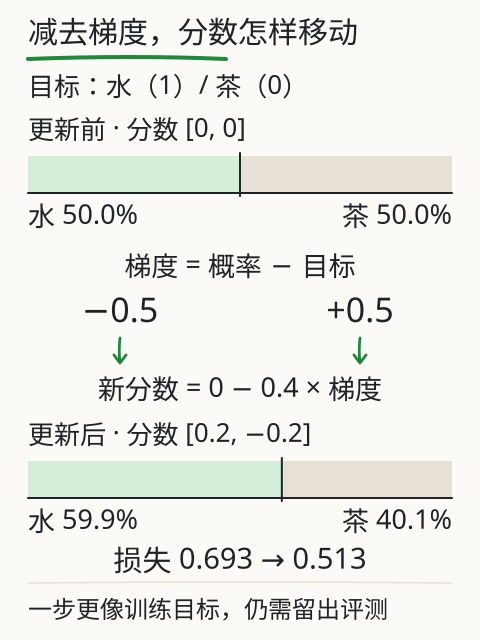
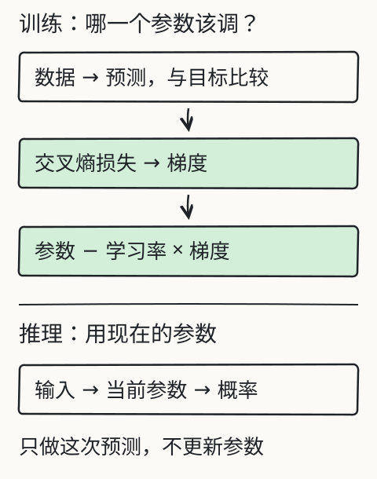
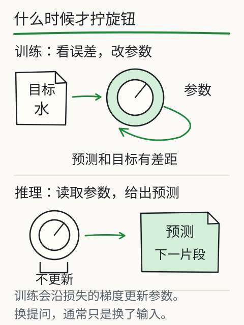

# C09 训练为什么能改变预测

你在聊天里说“答错了，再想想”，下一次回答可能变好。可这是模型学会了，还是它这次看到了你的纠正？判断这件事，得找到**参数有没有变化**。本章用一个两候选的小例子，把“预测—比较—算梯度—更新”走完，再区分训练与推理。

## 先修桥：负对数、斜率、学习率

**负对数**：若模型给正确答案的概率是 0.5，损失 `−ln(0.5)≈0.693`；概率升到 0.8，损失 `−ln(0.8)≈0.223`。给目标的概率越高，罚分越小；概率接近 0，罚分趋于很大。

**斜率（梯度）**：函数在某点的斜率告诉你“参数往哪边动，损失会升还是降”。更新时朝斜率相反方向走一小步：

`新参数 = 旧参数 − 学习率 × 梯度`

学习率是步长。步子太大可能跨过低损失区域，甚至发散；太小则更新慢。

**训练/验证分割**：训练材料用来改参数；验证材料不参与这次更新，用来观察“换一批材料还灵不灵”。分割要按来源或组来分，不能把同一篇文档的相邻句子随机拆到两边，否则两边太像，测不出泛化。

## 目标错位：用前一个片段预测下一个

拿序列“我 喝 水 。”。自回归训练让每个位置预测**下一个** token：

| 位置 | 输入到该位置 | 目标 |
|---|---|---|
| 0 | 我 | 喝 |
| 1 | 我 喝 | 水 |
| 2 | 我 喝 水 | 。 |
| 3 | 我 喝 水 。 | 无下一个（或 EOS） |

这就是“目标错位”：输入与目标不是同一个 token，而是错开一位。训练时可以把整段一起送入、并行算多个位置，但因果掩码必须保证位置 t 只看见 ≤t 的内容；否则位置 t 会看到自己要去预测的答案（C07 的 mask 就是为此）。

## 完整一步：两个候选的更新

先只看“喝”后面该接什么，候选是“水”和“茶”。初始分数都设为 0：

- `softmax([0,0]) = [0.5, 0.5]`
- 目标是“水”，损失 `−ln(0.5)≈0.693`

softmax 交叉熵对分数的梯度有一个简单形式：`预测概率 − 目标指示值`。目标“水”指示值为 1，“茶”为 0：

- 水的梯度：`0.5 − 1 = −0.5`
- 茶的梯度：`0.5 − 0 = 0.5`

取学习率 0.4：

- 新分数：`0 − 0.4×(−0.5) = 0.2`；`0 − 0.4×0.5 = −0.2`
- 新概率：`exp(0.2)=1.2214`，`exp(−0.2)=0.8187`，总和 `2.0401`
- `p(水)≈0.5987`，`p(茶)≈0.4013`
- 新损失 `−ln(0.5987)≈0.513`

水上升、茶下降，损失从 0.693 降到 0.513。这是**一次**更新、一个训练对的结果；真实训练会对很多对求平均，再更新。

这里特意把两个分数本身当成可训练参数，所以可以直接减去梯度。Transformer 的分数由前面许多参数计算出来，通常不会把本次分数保存成待训练的词表；下一节沿链式法则把分数上的梯度传回实际参数。

*图：上下两条总宽相同，浅绿的“水”从 50.0% 扩到 59.9%，其余是“茶”。中间先算概率减目标，再减去 0.4 倍梯度；水的梯度是负数，减去它会抬高水的分数。数值来自人工两候选例子的实际计算。*

## 深层网络怎样找到各层该改多少

上面的分数只有两个，可以直接写梯度。深层网络的分数由很多层共同算出，要用反向传播：从损失出发，沿前向计算的依赖关系逐层求导，再把各参数的梯度交给优化器。

一个最小关系：若 `s = w×h`，则

`∂L/∂w = (∂L/∂s) × h`

也就是把“损失对分数的影响”和“分数对参数的影响”接起来。数值例子：`w=1.5`，`h=2`，`∂L/∂s=-0.4`，则 `∂L/∂w=-0.8`；学习率 0.1 时，`w` 更新为 `1.5 − 0.1×(-0.8) = 1.58`。反向传播把这种链式关系扩展到多层，不是把答案逐句写进一张可查询的表。

## 训练与推理：两条路径

- **推理**：读取当前参数，算出概率，选一个 token；参数不变。
- **训练**：算出概率，与目标比较，算损失和梯度，更新参数。

旧课 [L05](training.md) 的 bigram 实验把这两条路径做成了两个按钮：“只预测一次”只读参数，“更新一步”会改参数。bigram 是一张 7×7 的分数表，没有注意力，也不理解长句；它的价值是让你看见哪一格变了，不能代表大模型能力。

*图：训练会改参数，推理不会。bigram 教学流程不代表完整训练工程。*

## 改一个条件：损失下降，任务仍可能错

训练损失下降，说明模型在这批材料上的下一个 token 预测更好了。它**不自动**说明：

- 换一批材料仍然好（要看验证/留出集）；
- 任务完成得对（例如通知里的地点是否被正确提取）；
- 事实正确（训练目标本身可能错）；
- 没有学到虚假线索（材料里的偶然共现）。

如果训练集成绩越来越好、留出集越来越差，要查过拟合、数据差异和评测泄漏。若两条曲线都降，也只说明这组指标改善；真实任务还要按字段、引用和执行结果另测。

*图：参数是训练拧的旋钮；改提示、补材料、调温度不是同一种动作。*

## 失败对照

1. **把“回答变好”当参数更新**：聊天里补一句纠正，通常只改变本次输入；权重没有因此更新。
2. **只看训练损失**：训练集降、留出集升，是过拟合的常见信号。
3. **学习率过大**：损失可能不降反升；过小则几乎不动。
4. **目标错位写错**：用当前位置预测当前位置，等于抄答案；因果掩码也会失去意义。
5. **随机拆句当留出集**：同一文档的相邻句高度相似，分数虚高。

## 独立作业（容差 ±0.002）

1. 两候选初始分数 `[1, 0]`，目标是第一个，学习率 0.5。算更新前的概率、两个梯度、更新后的分数。
2. 算更新后的概率与损失，说明损失是否下降。
3. 用链式法则：`w=1.5`、`h=2`、`∂L/∂s=-0.4`、学习率 0.1，求 `∂L/∂w` 与更新后的 `w`。
4. 序列“A B C”用于自回归训练，写出每个位置的目标；最后一个位置没有下一个 token 时怎么处理？
5. 用三句话解释：为什么训练损失下降，仍可能在没见过的通知上提取错地点？

核对过程在 [C09 答案](../deepening/c09-answer.md)。

## 项目增量：训练记录 v1

在 S2 项目里新增 `training-log.md`，记录：

`数据来源 | 训练/验证如何分割 | 初始损失 | 更新一步后的参数与损失 | 留出集结果 | 任务层检查`

数据可以用旧 bigram 实验或你按本章手算的小例子；标明是教学数据。不要把训练损失写成任务准确率，也不要把一次更新写成“模型学会了”。

## 来源与边界

本章沿用旧课 [L05 模型是怎样学会的](training.md) 的 bigram、交叉熵、梯度与训练/推理区分，复用深入页 [training.md](../deepening/training.md) 的两候选算例与链式法则，图 G33/G06/G20 的出处与旧实验 [X05](../../../exports/llm/training.html)。所有数值为课程人工小例子；**没有训练 DeepSeek、Kimi 或任何真实模型**，不能把 0.513 之类的损失读成模型性能。真实训练的优化器、批次、正则化和数据配比会影响结果，需要按实际实现核对。
