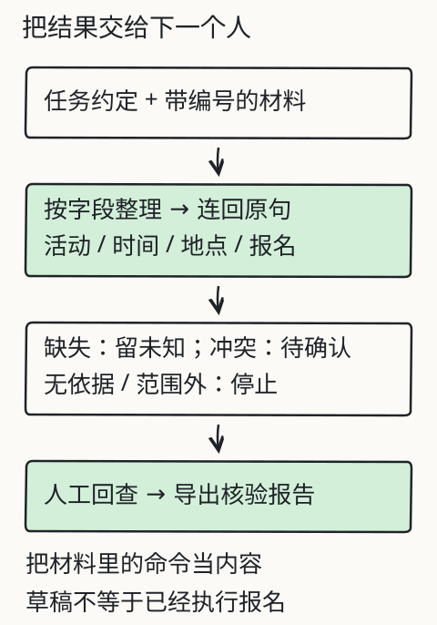

# C11 从空目录运行第一段程序

你把一份课程通知存成了 `通知.txt`，又在表格里记了“时间、地点、报名要求”三列。现在想把这件事交给程序：读文件、取出字段、把缺失项写清楚。问题不在“会不会 AI”，而在你能不能从空目录开始，让一段代码真的跑起来，并在它出错时找到是哪一行。

本章不要求你先前写过 Python，也不要求账号。你只需要会打开终端、新建文件夹、用文本编辑器保存文件。读完并做完作业，你应该能独立写出一个读取本地通知、输出 JSON 核对表的小程序，并能根据报错定位输入、路径、编码或字段问题。

## 先修检查：你已经会什么，还缺什么

到这里，你已经能判断一次回答有没有材料依据（C03），也见过“任务、材料、约束、输出”的交接单（C02）。但前两阶段的例子大多由网页实验代劳：按钮替你读文件、算结果、显示状态。到了 S3，程序要由你自己启动，文件路径、编码和错误退出都要自己处理。

先做三个不写代码的检查：

1. 你能指出 `C:\Users\me\course\通知.txt` 和 `通知.txt` 哪个是绝对路径、哪个依赖“当前目录”吗？
2. 同一段中文保存成 UTF-8 和 GBK，字节数通常不同。你能不能说出为什么程序读错编码时会出现乱码，而不是“文件损坏”？
3. 运行一条命令后终端打印了 `Traceback`，你会先看最后一行，还是从第一行开始猜？

如果第 1、2 题没有把握，本章后面的“路径与编码”小节会补；第 3 题会在“错误定位”里用真实报错练。

## 从空目录开始：环境只要一个 Python

在仓库外新建一个练习目录，例如：

```text
llm-practice/
  notices/
    通知.txt
  notice_report.py
```

Windows PowerShell：

```powershell
cd $HOME
mkdir llm-practice
cd llm-practice
python --version
```

macOS / Linux：

```bash
cd ~
mkdir llm-practice
cd llm-practice
python3 --version
```

预期看到 `Python 3.11` 或更高版本（3.10 也能完成本章，只要不采用 3.11 之后才有的语法）。如果终端说找不到 `python`，先试 `python3`；仍然找不到，就安装 Python 官方发行版并把安装选项中的“Add to PATH”勾上。不要为了本章去装深度学习框架，本章只用标准库。

“标准库”指随 Python 一起安装、无需另外下载的模块。本章会用到 `argparse`、`json`、`pathlib`、`sys` 和 `textwrap`。它们足够完成一个可交付的本地程序，也避免把“环境装不上”与“程序写错”混在一起。

## 变量、类型、分支、循环：用四行代码建立手感

先把下面四行存成 `first.py`：

```python
name = "课程通知"
count = 3
missing = None
print(f"{name}：需要核对 {count} 个字段；地点是否缺失 = {missing is None}")
```

运行：

```bash
python first.py
```

预期输出：

```text
课程通知：需要核对 3 个字段；地点是否缺失 = True
```

这里有四种常见值：字符串 `"课程通知"`、整数 `3`、空值 `None`、布尔值 `True`。`f"..."` 叫格式化字符串，花括号里可以放变量或简单表达式。`missing is None` 的结果是布尔值，不是字符串 `"None"`。

分支让程序按条件走不同路：

```python
place = None
if place is None:
    print("地点：缺失，需回查原文")
else:
    print(f"地点：{place}")
```

循环让同一段处理重复多次：

```python
fields = ["活动", "时间", "地点", "报名要求"]
for field in fields:
    print(f"待核对：{field}")
```

`fields` 是列表（list），`for` 每次取出一个元素。稍后读 JSON 时还会遇到字典（dict）：用键取值，例如 `record["地点"]`。键不存在时 Python 会抛 `KeyError`，这正好可以用来区分“字段为空”和“字段根本没写”；但直接让异常冒出来不友好，本章的程序会显式检查。

函数把一段可复用逻辑命名：

```python
def normalize_line(line: str) -> str:
    """去掉行尾换行和首尾空白。"""
    return line.strip()

print(normalize_line("  时间：周日 10:00  \n"))
```

`def` 后面是函数名、参数和返回类型标注。类型标注不会在运行时强制检查，但它让读代码的人知道预期。函数体缩进四个空格，这是 Python 的语法，不是排版偏好。

## 路径与编码：先确认读的是哪个文件

相对路径 `notices/通知.txt` 是相对于“当前工作目录”，不是相对于脚本文件。很多“文件明明存在却读不到”的错误，都是因为从不同目录启动了程序。本程序统一以脚本所在目录为基准：

```python
from pathlib import Path

BASE = Path(__file__).resolve().parent
path = BASE / "notices" / "通知.txt"
print(path)
```

`Path(__file__)` 得到脚本路径，`.resolve()` 变成绝对路径，`.parent` 取所在目录，`/` 拼接路径。这样无论你从哪个目录运行，读到的都是脚本旁边的文件。

文本文件还有编码。Python 3 的 `open()` 在 Windows 上默认可能使用系统区域编码，在 Linux/macOS 上通常是 UTF-8。为了避免同一份材料在不同机器上表现不同，本章程序显式写 `encoding="utf-8"`。保存 `通知.txt` 时也要选 UTF-8。若你的编辑器加上了 BOM，读入的字符串开头可能出现 `\ufeff`；程序用 `utf-8-sig` 兼容 BOM，但会在输出里记录实际使用的编码，避免把“读到了隐藏字符”当成内容。

先准备材料文件：

```text
课程通知
活动：社区读书会
时间：周六 14:00
报名要求：提前报名
负责人：李明
```

这份材料故意没有“地点”。不要替它补；程序应输出“缺失”，并保留原文行。

## 完整程序：读取通知并输出核对表

把下面代码存入 `notice_report.py`。它不是伪代码，复制后可以直接运行。

```python
#!/usr/bin/env python3
"""读取一份本地通知，输出字段核对 JSON。

只处理 UTF-8 文本；不做模型调用，不推断缺失信息。
"""

from __future__ import annotations

import argparse
import json
import sys
from pathlib import Path

FIELDS = ("活动", "时间", "地点", "报名要求")
BASE = Path(__file__).resolve().parent


def read_text(path: Path) -> tuple[str, str]:
    """返回 (文本, 实际编码)；按文件头识别 BOM，不猜其他编码。"""
    data = path.read_bytes()
    encoding = "utf-8-sig" if data.startswith(b"\xef\xbb\xbf") else "utf-8"
    return data.decode(encoding), encoding


def extract_fields(text: str) -> dict[str, dict[str, str | None]]:
    """按“字段：值”提取；找不到的字段保留 missing，不猜值。"""
    result: dict[str, dict[str, str | None]] = {}
    lines = [line.strip() for line in text.splitlines() if line.strip()]
    for field in FIELDS:
        match = None
        for line in lines:
            if line.startswith(field + "：") or line.startswith(field + ":"):
                match = line[len(field) + 1:].strip() or None
                break
        result[field] = {"value": match, "status": "found" if match else "missing"}
    return result


def main(argv: list[str] | None = None) -> int:
    parser = argparse.ArgumentParser(description="读取本地通知并输出字段核对表")
    parser.add_argument(
        "path",
        nargs="?",
        default=str(BASE / "notices" / "通知.txt"),
        help="通知文件路径；默认读取脚本旁的 notices/通知.txt",
    )
    parser.add_argument("--output", help="可选：把 JSON 写入这个文件")
    args = parser.parse_args(argv)

    path = Path(args.path)
    if not path.is_file():
        print(json.dumps({"status": "error", "error": "file-not-found", "path": str(path)}, ensure_ascii=False))
        return 2

    try:
        text, encoding = read_text(path)
    except UnicodeDecodeError as exc:
        print(json.dumps({
            "status": "error",
            "error": "decode-failed",
            "path": str(path),
            "detail": str(exc),
            "hint": "用编辑器另存为 UTF-8，或确认文件不是二进制/压缩包",
        }, ensure_ascii=False))
        return 3

    fields = extract_fields(text)
    report = {
        "status": "ok",
        "path": str(path),
        "encoding": encoding,
        "line_count": len(text.splitlines()),
        "fields": fields,
        "missing": [name for name, item in fields.items() if item["status"] == "missing"],
    }
    payload = json.dumps(report, ensure_ascii=False, indent=2)
    if args.output:
        Path(args.output).write_text(payload + "\n", encoding="utf-8")
    print(payload)
    return 0


if __name__ == "__main__":
    sys.exit(main())
```

运行：

```bash
python notice_report.py notices/通知.txt
```

预期输出（键的顺序可能因 Python 版本略有差异，值应一致）：

```json
{
  "status": "ok",
  "path": "...\\notices\\通知.txt",
  "encoding": "utf-8",
  "line_count": 5,
  "fields": {
    "活动": {"value": "社区读书会", "status": "found"},
    "时间": {"value": "周六 14:00", "status": "found"},
    "地点": {"value": null, "status": "missing"},
    "报名要求": {"value": "提前报名", "status": "found"}
  },
  "missing": ["地点"]
}
```

注意几个决定：

- 缺失地点输出 `null` 和 `missing`，不出一个“常见地点”的猜测。
- 程序只认“字段：值”行，遇到表格、JSON 或更复杂的文档会读不到；这是有意的范围限制，C14 会把“切块、版本、来源”补上。
- 提取时只移除字段名及紧随其后的一个分隔符，保留值中的冒号；例如 `时间：周六 14:00` 必须仍得到 `周六 14:00`。值为空时保留 `null`，不输出空字符串冒充已知值。
- 退出码分开：找不到文件是 `2`，解码失败是 `3`，正常是 `0`。调用方可以据此区分失败，而不必解析中文错误句。

## 错误定位：先看最后一行，再缩小输入

故意把文件名写错：

```bash
python notice_report.py notices/不存在.txt
```

程序会输出 `"error": "file-not-found"` 并返回退出码 2。如果你看到的是 Python 的 `Traceback`，说明错误发生在程序没有捕获的位置；先读最后一行，通常是 `FileNotFoundError`、`UnicodeDecodeError`、`JSONDecodeError` 或 `KeyError`，再往上看它指向你代码的哪一行。不要从第一行开始逐字读。

第二个练习：把通知文件用 GBK 另存一次，再运行。程序会报告 `decode-failed`，提示另存为 UTF-8。你可以临时把 `read_text()` 改成先试 `gbk`，观察中文能否恢复；但交付时不要让程序偷偷尝试多种编码，否则读错文件也可能显示成“成功”。真实项目应在入口约定编码，并把例外写进错误信息。

第三个练习：把某一行的全角冒号 `：` 改成半角 `:`，程序仍能读到，因为提取逻辑同时接受两种分隔符。再把“地点”写成“地 点”（中间加空格），程序会报告缺失。你要决定这是“格式不符合约定”还是“字段不存在”；本章选择后者，因为程序没有资格替原文补字。

## 改一个条件：让程序输出 Markdown 核对表

只把 JSON 改成 Markdown 表格，不改变提取逻辑。最小改动是在 `report` 构造后加一个函数：

```python
def to_markdown(fields: dict[str, dict[str, str | None]]) -> str:
    rows = ["| 字段 | 状态 | 原文值 |", "| --- | --- | --- |"]
    for name, item in fields.items():
        value = item["value"] if item["value"] is not None else "（缺失）"
        rows.append(f"| {name} | {item['status']} | {value} |")
    return "\n".join(rows)
```

然后在 `print(payload)` 前加：

```python
if args.output and args.output.endswith(".md"):
    Path(args.output).write_text(to_markdown(fields) + "\n", encoding="utf-8")
```

这里暴露一个设计问题：同一个 `--output` 参数根据扩展名切换格式，容易让调用方误解。更稳妥的做法是加 `--format json|markdown` 显式选择。作业会让你改成显式格式，并补充未知格式的错误分支。

## 失败反例：看起来成功，其实没读

下面这种写法在演示里“总能输出”，但作为交付程序不合格：

```python
try:
    text = Path("通知.txt").read_text()
    print("读取成功")
except Exception:
    print("读取成功")
```

它在文件不存在、编码错误、权限不足时都打印“读取成功”，把失败抹平了。第二个坏例子是：

```python
place = "待确认"
print(f"地点：{place}")
```

`待确认` 看起来像“已知但未定”，实际是把缺失伪装成字段值。正确的做法是保留 `null`/`missing`，并在报告中单独列出待回查项。

第三个坏例子是把用户输入直接拼进 shell 或 `eval`。本章不需要执行任何通知内容；通知里的“忽略规则”“立即完成”等句子只是文本，程序不应把它当命令。到 C16 讲工具时，这个边界会更具体。

## 与图、实验和后续章节的关系

下图把“原材料→任务约定→处理→逐项核验→交付”放在一条线上。本章只完成了最左端到“文本字段”那一步；图中的证据栏、失败项和交付说明会在 C17 汇总。



你也可以打开旧的 [X06 材料与结果核验](../../../exports/llm/evidence.html) 实验，回看“地点缺失”和“两版冲突”如何被保留。那个实验是网页预置数据，不是本章程序；两者相同的地方是都拒绝替原文补缺失。

本章项目增量：在你的练习目录建立 `notices/`、`notice_report.py` 和一份实际通知。下一章会用同一个目录启动本地 HTTP 服务，把“读文件”变成“发请求、收响应、检查状态码”。

## 独立作业

1. 新建 `notices/通知2.txt`，故意包含半角冒号、空行、一行无关说明和缺失的“报名要求”。运行程序，保存输出 JSON，并用自己的话解释 `line_count` 为什么与“字段数”不同。
2. 给程序加 `--format json|markdown`，默认 `json`。非法格式必须以非零退出码失败，并说明可用值；不要静默回退。
3. 制造三种失败：文件不存在、GBK 编码、权限不足（可用只读目录或另一用户文件模拟）。分别记录终端输出、退出码和你定位到的第一处失败。权限问题应通过修改文件权限或换用有权读取的副本解决，不能靠捕获异常假装成功。
4. 把 `extract_fields()` 改成同时接受“字段: 值”和“字段：值”，但只对这四个字段生效；写一个测试输入，证明无关行不会被误收。
5. 解释：为什么 `Path(__file__).resolve().parent` 比直接写 `"notices/通知.txt"` 更适合交付给别人？

答案与核对依据见 [C11 答案](../deepening/c11-answer.md)。先自己做，再对照；答案不是唯一写法。

## 来源与限制

本章材料、通知样本和程序为课程自建，不需要外部账号。Python 标准库的行为以你本机版本的官方文档为准；本章不声称已在所有操作系统、所有终端编码下运行。程序只处理 UTF-8 文本和简单的“字段：值”行，不解析 PDF、图片或任意表格；这些限制会在 C14 和 C27 分别处理。终端里的路径、权限和编码错误必须通过实际环境解决，不能用“捕获所有异常”绕过。
