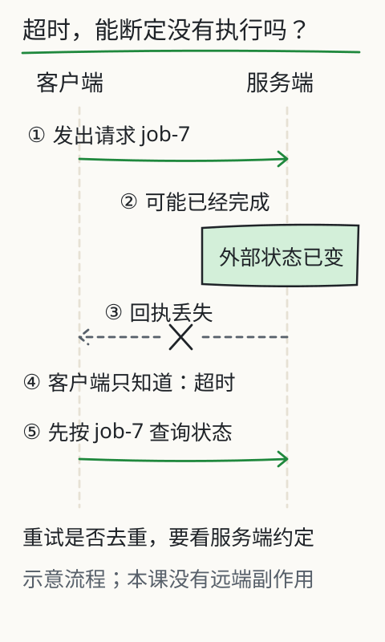

# C12 请求、响应和数据约定

上一章的程序只会读本机文件。现在假设通知由另一个程序提供：你发送一个请求，对方返回一段 JSON。屏幕上可能出现 `200`、`401`、`404`、`500`，也可能什么都没回来。你要能分清“我的输入坏了”“我没有权限”“服务坏了”和“我不知道对方有没有执行”，而不是看到一段文字就当作成功。

本章先在本机启动一个小服务，用 Python 标准库完成请求和响应，不联网、不注册账号。你会看到 JSON 的类型、HTTP 状态码、请求头、超时与未知状态。下一章才把同样的请求结构接到真实模型上。

## 先修检查：文件、函数与错误处理

C11 的程序已经包含路径、函数、分支、循环和退出码。本章默认你会：

- 用 `Path` 读写 UTF-8 文件；
- 用 `try/except` 捕获特定异常，而不是 `except Exception: pass`；
- 看懂 JSON 中的对象 `{}`、数组 `[]`、字符串、数字、布尔值和 `null`；
- 从终端启动一个会持续运行的进程，并用 `Ctrl+C` 停止。

如果“进程持续运行”不熟，先记住：服务程序启动后不会立刻退出，它在等请求；客户端是另一个终端里运行的一次性程序。两者可以不在同一个文件里，但本章为了便于复做，把它们放进同一个脚本，用线程启动服务。

## JSON 不是“带引号的文字”

先看一段合法 JSON：

```json
{
  "id": "notice-001",
  "fields": {"活动": "社区读书会", "地点": null},
  "tags": ["通知", "核对"],
  "verified": false,
  "revision": 3
}
```

`id` 是字符串，`revision` 是数字，`verified` 是布尔值，`fields` 是对象，`tags` 是数组，`地点` 的值是 `null`。这些类型在 Python 中分别对应 `str`、`int`/`float`、`bool`、`dict`、`list`、`None`。`json.loads()` 负责转换，`json.dumps()` 负责反向序列化。

常见错误不是语法，而是类型假设：

```python
data = {"revision": "3"}          # 字符串，不是数字
if data["revision"] > 2:           # TypeError
    ...
```

另一个常见错误是把整个对象当字符串比较。`json.dumps(a) == json.dumps(b)` 可能因为键顺序或空格不同而失败；要比较结构，应比较解析后的字段，或使用明确的规范化规则。

UTF-8 还有一个容易混淆的点：`len("通知")` 是 2（两个 Unicode 码点），`len("通知".encode("utf-8"))` 是 6（六个字节）。HTTP 的 `Content-Length` 计算的是字节数，不是字符数。发送中文时如果长度算错，服务可能只读到半截请求。

## HTTP 的最小结构

一次 HTTP 请求大致包含：

```text
POST /echo HTTP/1.1
Host: 127.0.0.1:8765
Content-Type: application/json; charset=utf-8
Content-Length: 42

{"message": "地点缺失，需要回查"}
```

第一行是方法、路径和协议版本；接着是请求头；空行之后是正文。响应类似：

```text
HTTP/1.1 200 OK
Content-Type: application/json; charset=utf-8
Content-Length: 57

{"status":"ok","echo":{"message":"地点缺失，需要回查"}}
```

状态码按大类读：

- `2xx`：请求被接受并完成（例如 `200`、`201`、`204`）。
- `3xx`：重定向；客户端要决定是否跟随，不能假装已经拿到最终资源。
- `4xx`：请求方问题或权限问题（`400` 坏输入、`401` 未认证、`403` 无权限、`404` 路径不存在、`409` 冲突）。
- `5xx`：服务端失败；这不等同于“请求没有到达”或“操作没有发生”。

`401` 和 `403` 不同：前者通常表示缺少或无效凭证，后者表示身份已识别但不允许。真实系统如何区分由服务方定义，客户端不能自行把 `403` 重试成成功。凭据放在环境变量或本地受控配置中，不写进仓库、不打印到日志、不发给无关服务。

## 完整程序：本地请求实验室

把下面代码保存为 `request_lab.py`。它启动一个只监听 `127.0.0.1` 的教学服务，然后依次发出正常请求、坏 JSON、缺少凭据、无权限路径、慢请求和连接失败。所有结果打印为 JSON，便于核对。

```python
#!/usr/bin/env python3
"""本地 HTTP/JSON 教学实验室。只监听回环地址，不访问外网。"""

from __future__ import annotations

import json
import os
import threading
import time
import urllib.error
import urllib.request
from http.server import BaseHTTPRequestHandler, ThreadingHTTPServer

HOST = "127.0.0.1"
PORT = 8765
TOKEN_ENV = "TEACHING_TOKEN"
DEFAULT_TOKEN = "local-teaching-only"  # 仅用于本机实验，不是真实凭据


class Handler(BaseHTTPRequestHandler):
    server_version = "TeachingLab/1.0"

    def log_message(self, fmt: str, *args: object) -> None:
        # 不打印请求头，避免把凭据写进终端记录。
        print(f"[server] {self.command} {self.path}")

    def _send(self, status: int, payload: dict) -> None:
        body = json.dumps(payload, ensure_ascii=False).encode("utf-8")
        self.send_response(status)
        self.send_header("Content-Type", "application/json; charset=utf-8")
        self.send_header("Content-Length", str(len(body)))
        self.end_headers()
        self.wfile.write(body)

    def do_GET(self) -> None:
        if self.path == "/health":
            self._send(200, {"status": "ok", "service": "teaching-lab"})
        elif self.path == "/admin":
            if not self._authorized():
                self._send(403, {"status": "error", "error": "forbidden"})
            else:
                self._send(200, {"status": "ok", "area": "admin"})
        elif self.path == "/slow":
            time.sleep(2.0)
            self._send(200, {"status": "ok", "note": "slow-response"})
        else:
            self._send(404, {"status": "error", "error": "not-found", "path": self.path})

    def do_POST(self) -> None:
        if self.path != "/echo":
            self._send(404, {"status": "error", "error": "not-found", "path": self.path})
            return
        length = int(self.headers.get("Content-Length", "0"))
        raw = self.rfile.read(length)
        if not self._authorized():
            self._send(401, {"status": "error", "error": "unauthorized"})
            return
        try:
            data = json.loads(raw.decode("utf-8"))
        except (UnicodeDecodeError, json.JSONDecodeError) as exc:
            self._send(400, {"status": "error", "error": "bad-json", "detail": str(exc)})
            return
        if not isinstance(data, dict) or "message" not in data:
            self._send(422, {"status": "error", "error": "missing-message"})
            return
        if not isinstance(data["message"], str):
            self._send(422, {"status": "error", "error": "message-must-be-string"})
            return
        self._send(200, {"status": "ok", "echo": data, "bytes": len(raw)})

    def _authorized(self) -> bool:
        expected = os.environ.get(TOKEN_ENV, DEFAULT_TOKEN)
        return self.headers.get("Authorization") == f"Bearer {expected}"


def start_server() -> ThreadingHTTPServer:
    server = ThreadingHTTPServer((HOST, PORT), Handler)
    threading.Thread(target=server.serve_forever, daemon=True).start()
    return server


def call(method: str, path: str, payload: dict | None = None,
         token: str | None = None, timeout: float = 1.0) -> dict:
    url = f"http://{HOST}:{PORT}{path}"
    body = None if payload is None else json.dumps(payload, ensure_ascii=False).encode("utf-8")
    headers = {"Content-Type": "application/json; charset=utf-8"} if body else {}
    if token is not None:
        headers["Authorization"] = f"Bearer {token}"
    request = urllib.request.Request(url, data=body, headers=headers, method=method)
    try:
        with urllib.request.urlopen(request, timeout=timeout) as response:
            raw = response.read()
            return {
                "ok": True,
                "status": response.status,
                "json": json.loads(raw.decode("utf-8")),
                "bytes": len(raw),
            }
    except urllib.error.HTTPError as exc:
        raw = exc.read()
        try:
            parsed = json.loads(raw.decode("utf-8"))
        except (UnicodeDecodeError, json.JSONDecodeError):
            parsed = {"raw": raw.decode("utf-8", errors="replace")}
        return {"ok": False, "status": exc.code, "json": parsed, "bytes": len(raw)}
    except urllib.error.URLError as exc:
        # 连接失败不一定等于服务端没有收到；这里只记录本机观察到的错误。
        return {"ok": False, "status": None, "error": f"url-error: {exc.reason}"}
    except TimeoutError:
        return {"ok": False, "status": None, "error": "client-timeout"}


def main() -> int:
    token = os.environ.get(TOKEN_ENV) or DEFAULT_TOKEN
    server = start_server()
    try:
        cases = [
            ("健康检查", call("GET", "/health")),
            ("正常回显", call("POST", "/echo", {"message": "地点缺失"}, token)),
            ("坏 JSON", call("POST", "/echo", {"message": "x"}, token)),
            ("缺少凭据", call("POST", "/echo", {"message": "x"})),
            ("无权限区域", call("GET", "/admin", token="wrong-token")),
            ("超时", call("GET", "/slow", timeout=0.2)),
        ]
        print(json.dumps({name: result for name, result in cases}, ensure_ascii=False, indent=2))
    finally:
        server.shutdown()
    return 0


if __name__ == "__main__":
    raise SystemExit(main())
```

运行：

```bash
python request_lab.py
```

你会看到类似结果（端口被占用时先停止占用它的进程，或改 `PORT`）：

```json
{
  "健康检查": {"ok": true, "status": 200, "json": {"status": "ok", "service": "teaching-lab"}, "bytes": 43},
  "正常回显": {"ok": true, "status": 200, "json": {"status": "ok", "echo": {"message": "地点缺失"}, "bytes": 27}, "bytes": 66},
  "缺少凭据": {"ok": false, "status": 401, "json": {"status": "error", "error": "unauthorized"}, "bytes": 44},
  "超时": {"ok": false, "status": null, "error": "client-timeout"}
}
```

上面的“坏 JSON”一项其实发送了合法 JSON：`{"message": "x"}` 是合法对象。要真的测试坏 JSON，必须发送原始字节：

```python
def call_raw(body: bytes, token: str | None = None, timeout: float = 1.0) -> dict:
    request = urllib.request.Request(
        f"http://{HOST}:{PORT}/echo",
        data=body,
        headers={
            "Content-Type": "application/json; charset=utf-8",
            **({"Authorization": f"Bearer {token}"} if token else {}),
        },
        method="POST",
    )
    try:
        with urllib.request.urlopen(request, timeout=timeout) as response:
            return {"ok": True, "status": response.status,
                    "json": json.loads(response.read().decode("utf-8"))}
    except urllib.error.HTTPError as exc:
        return {"ok": False, "status": exc.code,
                "json": json.loads(exc.read().decode("utf-8"))}
```

然后调用 `call_raw(b'{"message": ', token)`，会得到 `400` 和 `bad-json`。这个细节说明：用 `json.dumps()` 构造的请求永远是合法 JSON，测试“坏输入”必须绕过序列化器。

## 状态码与失败分支：把“未知”留在结果里

把 `call()` 的返回分成四类：

1. **成功**：`status` 是 2xx，且响应 JSON 通过字段校验。仅状态码 200 不够；服务可能返回 `{"status":"error"}`。
2. **请求方错误**：4xx。按错误码区分坏输入、未认证、无权限、路径不存在；不要自动重试所有 4xx。
3. **服务端错误**：5xx。可以按策略有限重试，但必须记录首次失败；重试可能造成重复执行，涉及写入时要使用幂等键。
4. **未知**：连接超时、连接中断、只收到部分响应。此时不能断言“没有执行”，也不能断言“执行成功”。真实系统需要服务端提供按请求 ID 查询的能力。

本章的超时是本地 `2.0` 秒睡眠对 `0.2` 秒客户端超时的真实结果。它不是模拟分支，但也不是远程网络故障。

## 改一个条件：端口关掉，看“连接失败”与“500”的区别

把客户端指向一个没有服务监听的端口：

```python
print(call("GET", "/health", timeout=0.5))  # 先把 PORT 改成 8766 或不启动 server
```

你会得到 `URLError`/`ConnectionRefusedError`，`status` 为 `null`。这与服务返回 `500` 不同：前者说明连接层面没有建立，后者说明请求到达了服务并由服务报告失败。把两者都写成“服务错误”会丢失排查信息。

再改一个条件：把 `Authorization` 头改成 `Bearer ` 加空字符串。服务端返回 `401`，而不是 `200` 或 `500`。权限失败必须通过提供正确凭据或由授权方调整权限解决；不能通过关闭检查、伪造头或把错误吞掉来“通过”。

## 图与实验

下图专门画“请求已发出，但回执未收到”的状态。超时只说明客户端在等待窗口内没有拿到结果，不能推出对方没执行。



旧的 [X08 工具调用](../../../exports/llm/tools.html) 实验把“模型建议、程序执行、回执、失败终态”分开显示。本章先把网络层的请求/响应对齐；C16 再把工具参数校验和执行回执接上。

## 项目增量

在你的练习目录新增 `service_contract.md`，写下：

- 服务地址只允许回环地址；
- 请求 JSON 的字段和类型；
- 成功、坏输入、未认证、无权限、服务失败、超时各自的状态码和错误字段；
- 凭据来自环境变量，日志不打印；
- 客户端最多重试几次，哪些请求允许重试。

这份约定是 C13 接真实模型、C16 做工具调用的基础。不要把“示例密钥”写进约定或仓库；`local-teaching-only` 只用于本机实验，见到它不能推断任何真实权限。

## 独立作业

1. 用 `curl` 或 `Invoke-RestMethod` 分别请求 `/health`、`/echo`、`/admin`，记录状态码和响应体。比较 `curl -i` 与只看正文时你漏掉了什么。
2. 给 `/echo` 增加 `request_id` 必填字段（字符串、1–40 字符）。缺失返回 `422`，格式错误返回 `400`，成功时原样回显。写三个请求覆盖这三条路径。
3. 把客户端超时从 `0.2` 改成 `3.0`，观察 `/slow` 从超时变成成功；解释服务端是否因此“没有执行”。
4. 设计一个幂等键：同一个 `request_id` 重复提交两次，服务端只执行一次。说明为什么仅在客户端重试而不带幂等键不安全。
5. 读本章代码，找出至少两处“失败被当成成功”的风险，并改成显式错误。提示：`json.loads` 失败、`HTTPError` 之外的连接错误、字段存在但类型不对。

答案与核对依据见 [C12 答案](../deepening/c12-answer.md)。

## 来源与限制

本章服务与客户端为课程自建，使用 Python 标准库 `http.server` 与 `urllib`；只监听 `127.0.0.1`，不调用外部 API，不需要真实凭据。HTTP 语义以你所用 Python 版本和 RFC 9110 的公开定义为准；本章不展开代理、TLS、压缩、重定向细节。真实模型 API 的路径、状态码、鉴权头和计费字段由服务方文档定义，C13 会要求在调用前核对当前版本，不能把本章的本地约定当成任何供应商的合同。
