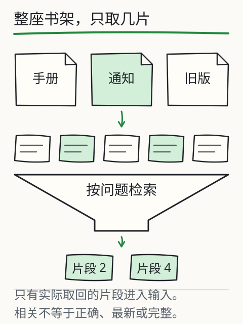

# C14 把自己的文档变成可追溯片段

假设设备手册更新了：旧版写“闭馆前检查门窗”，新版增加“关闭饮水机电源”。如果助手只保存一段截断的文本，它可能永远引用旧版，或者把两版拼成一句。你需要一条能回到**具体文档、具体版本、具体片段**的链路，而不是一个“知识库”黑箱。

本章把本地 Markdown/文本变成带稳定 ID、版本、哈希、权限和字符位置的片段，并实际执行更新、删除和权限检查。检索算法留到 C15；本章先保证“资料本身可追溯”。

## 先修检查：文件、哈希与片段

C11 已经能读写 UTF-8 文件；C13 已经能看到文档清单中的 `id`、`version`、`readers`。本章再加三个概念：

- **哈希**：对文件字节做 SHA-256，得到固定长度摘要。文件改一个字节，摘要就变；它用来判断“当前文件还是不是清单里那一版”。
- **字符位置**：片段记录在原文中的起止位置，便于回查。字符位置不是字节位置；中文一个字符通常占多个 UTF-8 字节。
- **稳定 ID**：文档 ID 不随标题变化；片段 ID 由文档 ID、当前文件 SHA-256 的前 12 位和片段序号构成（示意：`station-log@4f2c9a1b7e03#000`），版本号单独记录在元数据里。文件内容一变，哈希和片段 ID 都会变，旧 ID 不应指向新内容。

如果“哈希”只是听说过，先做一个小实验：

```python
import hashlib
print(hashlib.sha256("设备手册".encode("utf-8")).hexdigest())
```

改一个字再算，摘要完全不同。哈希不能告诉你“哪一句改了”，只能告诉你“字节是否相同”；所以还要保留版本和原文片段。

## 用于版本核验的清单字段

一份固定了文件哈希的文档清单如下（下面是结构示意，省略号须换成实际摘要）：

```json
{
  "schema": "assistant-documents/1",
  "documents": [
    {
      "id": "equipment-guide",
      "path": "docs/equipment-guide.md",
      "version": "2.1",
      "readers": ["student", "staff"],
      "sha256": "…64 位十六进制…"
    },
    {
      "id": "station-log",
      "path": "docs/station-log.md",
      "version": "2026-10-30",
      "readers": ["staff"],
      "sha256": "…"
    }
  ]
}
```

- `id`：稳定、唯一、可读；不要用标题当 ID，标题会改。
- `path`：相对于清单所在目录的路径；必须限制在允许目录内，不能 `../../etc/passwd`。
- `version`：人能读的版本；更新时递增或换日期，不能只改文件内容。
- `readers`：谁可以读；权限检查要在读取正文之前。
- `sha256`：锁定当前文件字节；清单与文件不一致时拒绝使用，而不是“自动更新哈希”把变化吞掉。

本课程示例目录由助手 owner 提供 `station-log`、`equipment-guide`、`visitor-policy`、`closing-notice`，另有教师材料 `review-budget`。不要假设它们的内容；先 `inspect read`。

助手允许省略 `sha256`：未填写时，它计算当前文件摘要并写入报告；填写时，它还核对文件是否与该摘要一致。仓库自带清单没有预填摘要，不能直接拿它练习“与已冻结版本比较”。本章校验程序要求摘要必填，用下面的副本完成练习。

在仓库根目录，把以下代码保存为 `prepare_manifest.py` 并执行 `python prepare_manifest.py`。它以课程资料维护者身份复制这五份教学文件，在新目录 `c14-data` 中固定当前字节的摘要；已有目录会报错，避免重跑时覆盖你改坏的样本。真实项目只能在确认来源和版本后做这一步，不能在校验失败后自动重建摘要。

```python
import hashlib
import json
from pathlib import Path

source = Path("book/llm/examples/assistant")
target = Path("c14-data")
manifest = json.loads((source / "documents.json").read_text(encoding="utf-8"))
target.mkdir(exist_ok=False)
for doc in manifest["documents"]:
    source_path = (source / doc["path"]).resolve()
    source_path.relative_to(source.resolve())
    destination = (target / doc["path"]).resolve()
    destination.relative_to(target.resolve())
    data = source_path.read_bytes()
    destination.parent.mkdir(parents=True, exist_ok=True)
    destination.write_bytes(data)
    doc["sha256"] = hashlib.sha256(data).hexdigest()
(target / "documents.json").write_text(
    json.dumps(manifest, ensure_ascii=False, indent=2) + "\n", encoding="utf-8"
)
print("已准备 c14-data/documents.json；原课程文件未改动。")
```

## 完整程序：校验清单与文件是否一致

下面程序只使用标准库。它读取清单，检查必填字段、路径越界、文件缺失、哈希不一致和重复 ID，并输出 JSON 报告。把它存成仓库根目录的 `verify_manifest.py`。这是资料维护者的文件盘点程序，会读取清单中所有文件的字节；它尚不实现按读者授权访问，不能直接作为面向用户的读取接口。

```python
#!/usr/bin/env python3
"""校验文档清单与本地文件是否一致；不读取模型、不做检索。"""

from __future__ import annotations

import argparse
import hashlib
import json
import re
import sys
from pathlib import Path

REQUIRED = ("id", "path", "version", "readers", "sha256")


def sha256_file(path: Path) -> str:
    digest = hashlib.sha256()
    with path.open("rb") as handle:
        for block in iter(lambda: handle.read(1 << 20), b""):
            digest.update(block)
    return digest.hexdigest()


def load_manifest(path: Path) -> list[dict]:
    data = json.loads(path.read_text(encoding="utf-8"))
    if not isinstance(data, dict) or data.get("schema") != "assistant-documents/1":
        raise ValueError("schema 必须为 assistant-documents/1")
    documents = data.get("documents")
    if not isinstance(documents, list) or not documents:
        raise ValueError("documents 必须是非空数组")
    return documents


def main(argv: list[str] | None = None) -> int:
    parser = argparse.ArgumentParser(description="校验本地文档清单")
    parser.add_argument("manifest", help="documents.json 路径")
    parser.add_argument("--root", default=".", help="允许读取的根目录；默认当前目录")
    args = parser.parse_args(argv)

    manifest_path = Path(args.manifest).resolve()
    root = Path(args.root).resolve()
    try:
        documents = load_manifest(manifest_path)
    except (OSError, ValueError, json.JSONDecodeError) as exc:
        print(json.dumps({"status": "error", "error": "manifest-invalid", "detail": str(exc)}, ensure_ascii=False))
        return 2

    errors: list[dict] = []
    seen: set[str] = set()
    checked: list[dict] = []

    for index, doc in enumerate(documents):
        if not isinstance(doc, dict):
            errors.append({"index": index, "error": "not-an-object"})
            continue
        missing = [key for key in REQUIRED if key not in doc]
        if missing:
            errors.append({"index": index, "error": "missing-fields", "fields": missing})
            continue
        doc_id = doc["id"]
        if not isinstance(doc_id, str) or not doc_id.strip():
            errors.append({"index": index, "error": "invalid-id"})
            continue
        if doc_id in seen:
            errors.append({"id": doc_id, "error": "duplicate-id"})
        seen.add(doc_id)
        if not isinstance(doc["path"], str) or not doc["path"].strip() or Path(doc["path"]).is_absolute():
            errors.append({"id": doc_id, "error": "invalid-relative-path"})
            continue
        if not isinstance(doc["version"], str) or not doc["version"].strip():
            errors.append({"id": doc_id, "error": "invalid-version"})
            continue
        if not isinstance(doc["sha256"], str) or not re.fullmatch(r"[0-9a-fA-F]{64}", doc["sha256"]):
            errors.append({"id": doc_id, "error": "invalid-sha256"})
            continue
        if not isinstance(doc["readers"], list) or not all(isinstance(x, str) for x in doc["readers"]):
            errors.append({"id": doc_id, "error": "invalid-readers"})
            continue

        path = (manifest_path.parent / doc["path"]).resolve()
        try:
            path.relative_to(root)
        except ValueError:
            errors.append({"id": doc_id, "error": "path-outside-root", "path": str(path)})
            continue
        if not path.is_file():
            errors.append({"id": doc_id, "error": "missing-file", "path": str(path)})
            continue
        actual = sha256_file(path)
        if actual.lower() != str(doc["sha256"]).lower():
            errors.append({
                "id": doc_id,
                "error": "sha256-mismatch",
                "expected": doc["sha256"],
                "actual": actual,
                "hint": "确认文件是否更新；更新时同时改 version 和 sha256，不要静默改写清单",
            })
            continue
        checked.append({"id": doc_id, "version": doc["version"], "sha256": actual, "readers": doc["readers"]})

    report = {
        "status": "ok" if not errors else "error",
        "checked": checked,
        "errors": errors,
    }
    print(json.dumps(report, ensure_ascii=False, indent=2))
    return 0 if not errors else 3


if __name__ == "__main__":
    sys.exit(main())
```

运行：

```bash
python verify_manifest.py c14-data/documents.json --root c14-data
```

预期 `status` 为 `ok`、`checked` 有五项、`errors` 为空，退出码为 0。路径统一相对清单目录解析；`--root c14-data` 再限制允许读取的范围。原课程清单没有必填摘要，直接传给这个程序会报 `missing-fields`；这与助手允许省略摘要的接口并不矛盾。

## 切块：边界比“固定 500 字”重要

假设手册有两节：

```markdown
## 闭馆检查
关闭门窗，确认访客离场。关闭饮水机电源。

## 例外
若当晚有维护施工，保留主电源，由值班人员签字确认。
```

如果按固定 40 字硬切，第一块可能包含“关闭饮水机电源”，第二块只剩“若当晚有维护施工，保留主电源”，读者会把两条规则看成互相矛盾。切块应尽量沿标题和段落边界，并在片段元数据中保留：

- `chunk_id`：例如 `equipment-guide@4f2c9a1b7e03#000`（示意；实际是 `doc_id@sha256 前 12 位#三位序号`）；版本 `1.0.0` 单独记录，不写进 ID；
- `doc_id`、`version`、`sha256`；
- `start`、`end`（在原文中的字符位置）；
- `heading`（所在小节）；
- `text`（片段原文）；
- `readers`（继承文档权限，或在文档内进一步收窄）。

固定长度切块不是错，但必须记录切割造成的语义断裂风险。C19 会专门诊断“检索没找对”是否由切块造成。

使用助手查看实际切块：

```bash
python book/llm/examples/assistant/assistant.py inspect chunk \
  --docs book/llm/examples/assistant/documents.json \
  --reader student \
  --chunk-chars 480 \
  --chunk-overlap 80
```

命令按 README 的公开接口输出当前 `--reader` 可见文档的片段：`--chunk-chars 480`、`--chunk-overlap 80`。`review-budget` 这类无权限文档不会出现——权限过滤发生在读取和切块之前，未授权正文不会进入内存，也不会进入片段列表。每个片段给出 `chunk_id`（形如 `station-log@<sha256 前 12 位>#000`，序号补三位）、原文、`start`/`end`、`version` 与 `sha256`。不要用版本号拼 `chunk_id`；重点是看到可回查的原文与位置，而不是只看到一段摘要。

## 更新与删除：不能让旧片段“自然残留”

更新流程应显式：

1. 修改文件内容；
2. 改 `version`（例如 `2.1` → `2.2`）；
3. 重新计算 `sha256`；
4. 重新切块，生成新的 `chunk_id`；
5. 让检索只使用当前版本的索引；旧版本片段可以留作审计，但不能被当作现行规则返回。

删除同理：从当前清单移除文档，再重建当前索引；审计副本另存。助手要求 `readers` 非空，把它清空会使清单校验失败，不能当作删除接口。不要让旧索引继续命中已撤回的材料。C15 的检索如果返回了清单中不存在的 `doc_id`，应视为错误，而不是“历史遗留”。

## 权限：先检查，再读取

`--reader` 必须在读取正文之前检查。一个常见错误是先检索全部文档，再把无权限片段从最终答案里删掉；此时模型已经看到了机密内容，删除输出不能撤销泄露。正确顺序是：

1. 按 `reader` 过滤清单；
2. 只对可见文档读取/切块；
3. 检索只在可见集合内进行；
4. 报告记录 `reader` 和可见文档 ID。

如果你需要让读者看到“有这份材料但无权访问”，可以返回 `unauthorized` 和文档 ID，但不要返回正文。权限失败要通过授权或提供公开替代材料解决，不能修改 `readers` 来绕过。

## 改一个条件：文件改了，清单没改

把 `c14-data/docs` 中某份文档末尾加一个字，不改副本清单中的 `version`/`sha256`，再运行校验程序。预期 `sha256-mismatch`，退出码为 3，且该文档不进入 `checked`。这时不要直接“帮它更新哈希”；先确认改动是否有意、是否需要新版本、哪些引用会受影响。若这是正式交付，旧版本报告必须标记过期。

再改一个条件：把 `path` 改成 `../../outside.txt`。校验程序应报 `path-outside-root`，即使文件真实存在。路径越界是权限/安全问题，不是“路径写错”那么简单。

## 图与实验

下图把整座书架筛成少量片段：检索只应拿到当前读者可见、当前版本、可回查的片段，而不是把整个资料库塞进上下文。



旧的 [X07 检索与生成的分工](../../../exports/llm/retrieval.html) 实验可以改查询、切块大小和取回数量，观察实际进入上下文的片段。它使用预置教学资料，不是你的文档；用它练“切块如何改变命中”，再回到本章的真实清单。

## 项目增量

在你的项目中新增：

```text
docs/                     # 你拥有版权的 Markdown/文本
documents.json            # id,path,version,readers,sha256
verify_manifest.py
out/manifest-check.json
```

至少准备两版同一文档（旧版/新版）和一份无权限文档。保存一次校验输出，记录你如何更新版本、如何让旧片段失效。

## 独立作业

1. 为三份文档写清单，计算正确哈希；运行校验程序并保存输出。故意改一个字节，确认报告 `sha256-mismatch`。
2. 设计切块规则（按标题/段落/固定长度+重叠），从实际输出抄写至少三个 `chunk_id`（`doc@<sha12>#NNN`，不要用版本号编造），并解释一个可能被切断的语义边界。
3. 增加 `--reader` 参数到校验程序，输出该读者可见的文档；无权限文档不得出现在可见列表的正文中。
4. 更新一份文档到新版本，列出需要同步修改的字段和会失效的旧 `chunk_id`；不要只改文件内容。
5. 解释为什么“先检索全部、再删无权限结果”不安全；用一句话说明正确顺序。

答案与核对依据见 [C14 答案](../deepening/c14-answer.md)。

## 来源与限制

清单字段和助手命令来自 `book/llm/examples/assistant/README.md` 与 `--help` 的实际接口；示例文档由课程提供，内容与大小以实际文件为准。SHA-256 只能校验字节一致性，不证明内容真实、合法或最新；版本语义由维护者定义。切块程序与哈希校验程序为课程自建，不依赖外部服务；真实向量索引、并发更新和跨文档权限继承仍需在你的项目中实测。
