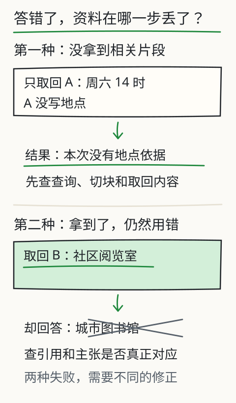

# C15 先找到资料，再组织答案

设备手册里有一段“闭馆检查”，另一段讲“访客登记”。你问“闭馆前要关什么”，词项检索可能因为“闭馆”两个字命中正确段落；换问“晚上结束营业后需要处理哪些设备”，字面没有“闭馆”，词项检索可能一条都找不到。换成 embedding，又可能因为“设备”这个词把无关的“设备采购流程”排到前面。

本章只做两件事：比较**词项检索**与**真实 embedding 检索**的取回结果，并检查取回的片段是否真的支持答案。排名高不等于事实正确，取回数量多也不等于证据充分。

## 先修检查：余弦、集合与“支持”

C06 已经讲过向量、点积和余弦的读法；C14 已经能生成带版本和权限的片段。本章默认你会：

- 用 `cos(a,b)=a·b/(|a||b|)` 比较两个向量，知道零向量要单独处理；
- 区分“取回集合”与“正确答案集合”，能用小集合算召回与精度；
- 把一句话拆成至少两条主张，逐条问“原文哪一句支持它”。

如果余弦不熟，先手算：`a=[1,0]`、`b=[1,1]`，点积为 1，长度为 1 和 `√2`，余弦约 `0.707`。这表示方向相近但不相同；它不表示 `b` 的第二个维度一定叫“语义”。

## 词项基线：先看“有没有命中”

助手提供两种检索器：

```bash
python book/llm/examples/assistant/assistant.py inspect retrieve \
  --docs book/llm/examples/assistant/documents.json \
  --reader student \
  --query "闭馆前要关什么" \
  --retriever keyword
```

```bash
python book/llm/examples/assistant/assistant.py inspect retrieve \
  --docs book/llm/examples/assistant/documents.json \
  --reader student \
  --query "闭馆前要关什么" \
  --retriever embedding \
  --embedding path/to/local-embedding-model
```

`--embedding` 指向一个本地 AutoModel 目录；助手用 mean pooling 生成向量，不依赖 `sentence_transformers`。模型目录必须已存在，助手不会自动联网下载。向量模型与文本模型是两种资源；没有 embedding 模型时，词项检索仍可运行，但不要把它写成“已经用了 embedding”。

先记录三件事：

1. 查询原文；
2. 取回的 `chunk_id`、文档 `version`、分数；
3. 每条片段是否真的包含回答所需的信息。

词项检索的分数容易解释：查询词在片段中出现得越多/越稀有，分数越高。它也会漏掉同义表达；改写成“晚上结束营业后要处理哪些设备”，观察命中变化。这不是“词项检索坏了”，而是它的适用边界。

## 真实 embedding：换一种相似性

embedding 把查询和片段分别编码成向量，再按余弦/点积排序。它可能把“闭馆”和“结束营业”拉近，也可能把“设备采购”误排前面，因为训练语料中的共现模式不等于你的业务规则。你要看的不是“分数更高”，而是：

- 正确片段是否进入前 k；
- 进入前 k 的片段中，有多少真的支持答案；
- 旧版本片段是否因为语义相似而被当成现行规则；
- 无权限片段是否根本没进入候选集。

一个可复做的小集合实验：准备 5 个片段，其中 1 个正确、2 个近似主题、1 个旧版、1 个无关。分别用两种检索器取回前 3，记录：

| 查询 | 检索器 | 正确片段排名 | 前 3 中支持数 | 旧版是否混入 |
| --- | --- | --- | --- | --- |
| 闭馆前要关什么 | keyword | 1 | 1 | 否 |
| 晚上结束后处理哪些设备 | keyword | 未命中 | 0 | 否 |
| 晚上结束后处理哪些设备 | embedding | 2 | 1 | 可能 |

表里的数字只是示例格式，必须用你实际运行的结果替换。不要从教程抄一个“提升 30%”的比率；你的资料、模型和查询不同，结论只对你这一组条件成立。

## 取回之后：引用支持检查

助手 `run` 生成的每条 `claim` 在 `citations` 数组中带 `chunk_id`、`quote` 和报告的 `doc_id`/`version`/`sha256`/`start`/`end`（工具引用则是 `tool_receipt_id`）。检查步骤：

1. 用 `chunk_id` 找到片段原文，确认 `quote` 是原文的连续子串；
2. 读 `quote` 前后的句子，确认没有断章取义；
3. 确认文档 `version` 是当前版本，不是旧版；
4. 确认该 `reader` 有权读取该文档；
5. 如果主张包含数字、日期、否定词，逐项对照原文。

一个常见错误是“引用存在就算支持”。例如原文写“若当晚有维护施工，保留主电源”，答案写“闭馆时必须关闭主电源”，引用片段确实包含“主电源”，但结论与条件相反。引用检查要读完整条件，不是关键词匹配。

还要区分两层：`quote` 必须是所引 chunk 的逐字连续片段，`claim.text` 必须是 `quote` 的逐字连续子串，`answer` 只能列出已核验的 claim 原文。改写、概括或把两个片段拼成一句，运行时会被判 `citation-failed`（paraphrase requires human verification）；这类文本只能交人工复核，不能算自动验证通过。

`copy` 与 `extract` 都不替你判断资料是否适用。后者让模型只选原文，再由程序形成主张；它能减少自由改写的风险，但模型仍可能选到旧规定、漏掉例外或忽略另一份冲突材料。`start/end` 是 chunk 的文档偏移；`source-extract/2` 另给 `quote_start/quote_end`，取该 chunk 内第一个匹配。位置基于去 BOM、统一为 LF 后的文档 Unicode 字符，而哈希绑定原文件字节。

核对抽取报告时，先检查文件哈希，再用相同方式解码和统一换行，以 `[quote_start:quote_end]` 切出引文。比较两边折叠空白后的文本是否相同，然后读这个范围前后的限制条件。匹配忽略连续空白的数量，不忽略大小写、标点或全角/半角；找到了精确位置，仍不能跳过上下文判断。旧 copy 报告没有精确字段时，继续通过 chunk 搜索原文。

## 无命中与低分：不要强行补一个答案

当查询没有任何片段超过阈值时，正确结果是“未找到/证据不足”，不是把分数最低的片段称为证据。助手可能返回 `insufficient-evidence`；此时你应该：

- 检查查询是否使用了资料中的词；
- 检查切块是否切断了关键条件；
- 检查当前读者是否有权看到相关文档；
- 检查文档版本是否已更新；
- 在报告中保留“未命中”与查询原文。

无命中不是模型失败，也不应用常识补写。若业务要求必须回答，应补充材料或明确标注“超出资料范围”。

## 改一个条件：只改检索器

保持文档、切块、查询、读者、模型和提示不变，只把 `--retriever keyword` 换成 `--retriever embedding`（或反向），记录：

- 取回片段集合的差异；
- 正确片段排名变化；
- 答案是否变化，变化是因为证据变了还是模型随机性；
- 延迟和资源消耗（embedding 首次加载模型更慢）。

一次只改一个因素，才能把差异归因到检索器。若同时改查询、切块和模型，你无法判断是哪一项造成结果变化。

## 图与实验

下图把失败拆成两条路：一条是资料根本没被取回，另一条是取回了却被错误使用。先判断失败发生在哪条路，再改对应环节。



旧的 [X07 检索与生成](../../../exports/llm/retrieval.html) 实验可以改查询、片段大小与取回数量，观察实际进入上下文的内容；它的检索器是教学词项实现，不是 embedding。

## 项目增量

在你的项目中保存：

```text
out/c15-keyword.json
out/c15-embedding.json
notes/c15-comparison.md
```

比较表至少包含查询、检索器、前 k 片段、正确片段排名、是否无命中、引用是否支持。不要把“embedding 更好”写成通用结论；只写你这一组材料与查询下的观察。

## 独立作业

1. 用同一查询分别跑词项与 embedding 检索，记录前 3 片段和分数；指出至少一个词项漏检或 embedding 误排的例子。
2. 构造一个“字面不重合但语义相近”的查询，再构造一个“字面重合但语义无关”的查询，比较两种检索器。
3. 取一条 `answered` 报告，把每条 `quote` 放回原文，标出“完全支持 / 部分支持 / 不支持 / 条件被省略”。至少找出一条需要读上下文才能判断的例子。
4. 把取回数量从 3 改到 8，观察答案是否引入无关片段；记录上下文变长后模型是否忽略了前面的关键条件。
5. 解释为什么“分数最高”不能直接当“事实最可信”；用本章的旧版/权限例子说明。

答案与核对依据见 [C15 答案](../deepening/c15-answer.md)。

## 来源与限制

检索器与报告字段来自助手 `inspect retrieve`/`run` 的实际接口；embedding 模型和文本模型均需本地合法目录，本书不预置权重，也不声称某个模型在你的资料上更优。词项检索是教学基线，不等于生产级 BM25；embedding 相似度也不等于事实支持。真实索引更新、并发删除、跨文档权限继承仍需在你的项目中验证。
