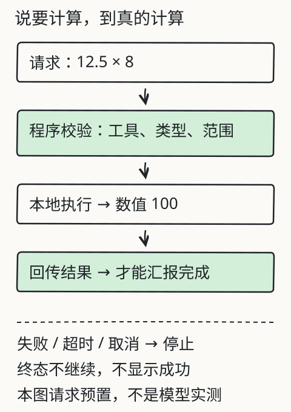

# C16 让工具真的执行，并知道何时停

“3 个区域，每天 2 轮，连续 7 天，一共检查多少次？”模型可以直接写出 42，也可以先提出一次乘法调用，由程序执行后把回执送回来。两种写法看起来都得到 42；只有后者能让你看到：参数是什么、哪个程序执行的、什么时候失败、最多能调用几次。

本章把工具调用拆成“模型提出请求 → 应用校验 → 程序执行 → 回执返回 → 继续或停止”。你会用真实助手运行固定工作流与有限 Agent 两种模式，并检查坏参数、除零、只读权限和超时未知。

## 先修检查：请求、权限、预算

C12 已经讲过请求/响应、状态码和超时未知；C13 已经能让真实模型基于材料回答。本章再加：

- 工具名和参数必须是结构化 JSON，不是一段自然语言；
- 应用必须先校验再执行，不能把模型输出直接 `eval`；
- 每次执行要有回执（成功/失败/超时/未知），失败不能走成功分支；
- 必须有最大步数/最大调用次数，达到上限就停止；
- 涉及现实写入或发送时，需要人工确认；本章只做本地计算和只读查找。

如果“为什么不能 `eval`”不熟，先记住：模型输出是**数据**，不是可信代码。`eval("__import__('os').system(...)")` 会把一段文本变成真实动作；教学工具只接受白名单工具名和有限参数。

## 工具契约：先写清楚，再让模型选

本课程助手支持两个教学工具：

- `calculator`：接受一个**数值算术表达式字符串**，例如 `"3*14"`。程序用 Python AST 解析，只允许数字字面量、一元 `+`/`-`、括号，以及 `+ - * / // % **` 这些运算符；函数调用、变量名、属性访问、字符串/容器字面量和任意语句都不执行。除零、超长表达式、超大指数或结果返回失败。
- `read_document`：按文档 ID 读取当前读者有权访问的片段；只读，不写文件、不发消息。

模型提出的是类似这样的请求：

```json
{
  "tool": "calculator",
  "arguments": {"expression": "3*14"}
}
```

应用收到后检查：工具名是否在 `--allowed-tools` 白名单、`arguments` 是否恰好只有 `expression` 且为字符串、工具是否已实现。校验通过后由 `calculate()` 解析并求值：AST 走白名单，遇到函数调用、名字、字符串字面量或其他运算符就返回失败回执，不执行下一步。任何一项失败都不会进入成功分支。

## 先跑固定工作流

固定工作流的步骤由程序写死，不依赖模型决定。旧实验 [D13 两步价格工作流](../../../exports/llm/tools.html) 就是这种：先查价，再用查到的价格乘数量；查不到就不算总价。

```bash
node book/llm/examples/tool-workflow.mjs
```

它会打印正常结果和 `missing-item` 失败；失败时没有总价，只有 `not-found`。这个基线说明：**固定流程也能真实执行**，但它不会根据问题选择工具或调整步骤。C16 要比较的是“固定”与“模型选动作”，不是把两者混称 Agent。

## 让模型在有限循环里选动作

以设备检查为例，假设任务说明提供“每轮检查 3 个区域，每天 2 轮，连续 7 天”，要求用 `calculator` 计算 `3*14`。这段假设不是文档原文，不能写成材料事实；工具结果由成功回执验证。用 Agent 模式。先把 `MODEL_DIR` 指向你已合法取得并放在本机的模型目录（不是自动下载地址）；运行结果取决于模型、材料与严格校验，失败状态同样要保存：

```bash
# 替换为你本机的模型目录绝对路径
MODEL_DIR="/absolute/path/to/local-model"
python book/llm/examples/assistant/assistant.py run \
  --docs book/llm/examples/assistant/documents.json \
  --reader student \
  --question "每轮 3 个区域，每天 2 轮，连续 7 天，一共检查多少次？请用 calculator 计算 3*14，并把成功回执作为结果依据。" \
  --model "$MODEL_DIR" \
  --mode agent \
  --allowed-tools calculator,read_document \
  --max-steps 4 \
  --max-tool-calls 2 \
  --json out/c16-agent.json \
  --markdown out/c16-agent.md
```

关键参数：

- `--mode fixed`：只按固定流程执行，不根据模型选择下一步；
- `--mode agent`：模型可以在有限步内选择工具，但步数和调用次数有上限；
- `--max-steps 4`：包括模型决策与工具轮次的总步数上限；
- `--max-tool-calls 2`：工具执行次数上限；
- `--allowed-tools`：白名单；未列出的工具即使模型提出也拒绝。

报告中的每条工具执行记录在 `tool_receipts[]` 中，回执号字段是 `receipt_id`；主张引用它时写作 `{"tool_receipt_id":"tool-1"}`。若模型说“计算器算得 42”，但没有回执 ID 或回执参数不是 `3*14`，这条主张不能算已验证。`diagnostics.first_raw_response` 和 `first_failure` 仍要保留。

## 失败路径：每一种都要停在自己的终态

按顺序实验：

1. **坏参数/坏表达式**：`arguments` 里传非字符串（如 `{"expression": 3}`）或多余字段，预期 `invalid-response`，校验阶段就拒绝；表达式 `"3+"` 预期回执失败 `invalid-expression`，最终 `tool-failed`。字符串 `"3+4"` 是合法表达式，会算出 `7`，不能拿它当坏参数。要验证“不执行代码”，可传 `"__import__('os').system('echo hi')"` → `unsupported-expression`，或 `"'a' + 'b'"` → `unsupported-literal`；这些都在 AST 白名单阶段失败。
2. **除零**：`{"expression": "1/0"}`。预期回执 `failed`、错误 `division-by-zero`，不返回 `Infinity` 或一段“已计算”的摘要。
3. **无权限读取**：`read_document` 指向当前 `reader` 不可见的文档。预期回执 `permission-denied`、最终 `permission-denied`，正文不进入上下文。
4. **未知工具**：请求 `send_email` 或 `shell`。未列入 `--allowed-tools` 时预期 `permission-denied`；若显式把它加进白名单，程序仍会以 `tool-failed`/`unknown-tool` 拒绝执行。不要把未知工具加入白名单来“试一下”，除非在隔离环境专门验证错误码。
5. **超时/未知**：真实远程工具可能出现“已发出但没收到回执”。本章本地工具不一定能制造真实网络超时；旧实验有模拟超时分支。若使用模拟，必须标“模拟”，不能冒充远程执行。状态应保留 `timeout`/`unknown`，不能写成成功或“没有执行”。
6. **预算耗尽**：把 `--max-tool-calls` 设为 0 或 1，让任务需要更多调用。预期在达到上限时停止，并说明未完成，而不是继续调用。

每一条都要记录：请求、校验结果、是否执行、回执、最终 `status`。如果失败发生在校验阶段，不应出现“执行成功”的回执；如果超时，不应推断副作用没有发生。

## 人工确认与最小权限

本地计算和只读查找可以由应用自动执行；发送消息、修改文件、下单、删除数据等有现实副作用的动作，必须有明确的人工确认和授权范围。本章助手不提供这些写操作，这是有意的限制，不是“功能没做完”。

如果你在自己的项目中扩展工具，至少做到：

- 工具白名单与参数 schema；
- 每个工具声明只读/写入、所需权限、超时；
- 写入工具要求确认令牌和幂等键；
- 失败与未知状态可查询；
- 不把模型生成的 URL、路径或命令直接当可信输入。

“模型说已经发送”不等于现实动作完成；只有带确认与回执的执行记录才算。

## 图与实验

下图把“模型提出调用、程序校验、执行、回执、继续或停止”画成一个环。失败线不回到成功线；预算耗尽和未知状态也要有自己的出口。



## 改一个条件：固定流程 vs Agent

同一问题分别跑。先设置模型目录与问题，再分别执行完整命令：

```bash
# 替换为你本机的模型目录绝对路径
MODEL_DIR="/absolute/path/to/local-model"
QUESTION="每轮 3 个区域，每天 2 轮，连续 7 天，一共检查多少次？请用 calculator 计算 3*14，并把成功回执作为结果依据。"

# 固定流程：不根据模型选择工具
python book/llm/examples/assistant/assistant.py run \
  --docs book/llm/examples/assistant/documents.json \
  --reader student \
  --question "$QUESTION" \
  --model "$MODEL_DIR" \
  --mode fixed \
  --top-k 3 \
  --max-new-tokens 192 \
  --json out/c16-fixed.json \
  --markdown out/c16-fixed.md

# 有限 Agent：模型可在预算内选择工具
python book/llm/examples/assistant/assistant.py run \
  --docs book/llm/examples/assistant/documents.json \
  --reader student \
  --question "$QUESTION" \
  --model "$MODEL_DIR" \
  --mode agent \
  --allowed-tools calculator,read_document \
  --max-steps 4 \
  --max-tool-calls 2 \
  --json out/c16-agent.json \
  --markdown out/c16-agent.md
```

比较：是否产生工具回执、调用次数、是否超出预算、答案是否仍引用材料、失败时是否停止。若 Agent 没有带来更好的结果，结论可以是“本任务不需要 Agent”，这不是失败。C21 会把这个判断扩展成完整对照。

## 项目增量

保存：

```text
out/c16-fixed.json
out/c16-agent.json
out/c16-failures/*.json
notes/c16-tool-contract.md
```

`c16-tool-contract.md` 写明工具名、参数、返回、权限、超时、最大调用次数和人工确认条件。下一次换问题或换模型时，先按契约检查，而不是从代码里猜。

## 独立作业

1. 用固定流程和 Agent 各跑一次，列出工具回执 ID、参数、结果和最终状态；解释哪一步是模型决策，哪一步是程序执行。
2. 构造坏参数、除零、未知工具、无权限读取四种失败，保存 JSON；确认失败没有产生成功结果。
3. 把 `--max-tool-calls` 从 2 改成 1，运行需要两次调用的任务，记录停止原因；不要把“预算耗尽”写成“任务完成”。
4. 为 `calculator` 写一份参数 schema：只接受 `{"expression": string}`，说明允许的数字、运算符、长度/数值上限和错误码，并解释为什么接受的是受限数值算术表达式字符串，而不是任意代码、函数调用或字符串字面量。
5. 设计一个需要人工确认的写入工具（只写设计，不执行）：说明确认信息、幂等键、回执和回滚条件。

答案与核对依据见 [C16 答案](../deepening/c16-answer.md)。

## 来源与限制

工具循环与报告字段来自助手的 `run`/`--mode`/`--allowed-tools` 实际接口；固定工作流来自旧 D13 示例，已在仓库中可运行。本章不提供发送消息、写文件或联网写入工具，也不声称模拟超时是真实网络故障。工具参数校验、权限和停止条件必须由应用实现；模型的选择意图本身不等于执行。
