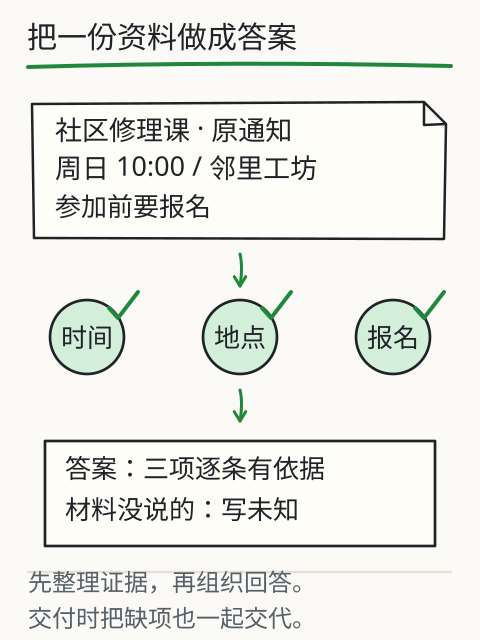

# C17 组装资料助手第一版

到这里，零件已经齐了：C13 能真实推理，C14 能读入带版本和权限的文档，C15 能比较检索结果，C16 能让工具执行并停止。现在把它们装成一条可交付的链路：文档 → 权限检查 → 检索 → 真实模型 → 必要时调用工具 → 带引用的报告与 Markdown 导出。

这一章也是 S3 的阶段门 K3：不是“某一次运行看起来不错”，而是换一份文档、从干净环境重做，正常、缺失、冲突、无命中、越权、服务失败都能给出正确结果。下面的任务要求你留下实际文件，不以截图或口头描述代替。

## 先修检查：每个零件都能单独工作

在组装前，逐项确认：

1. 你已经能用 `inspect read` 列出当前 `reader` 可见的文档；
2. 你已经能用 `inspect chunk` 看到至少一个 `chunk_id`、原文和版本；
3. 你已经能用 `inspect retrieve` 分别跑词项和 embedding，并知道未命中时会发生什么；
4. 你已经能用 `run --model ...` 得到一份带 `claims` 和 `diagnostics` 的 JSON；
5. 你已经能在 C16 中看到工具回执，或明确记录“当前模型未选择工具”。

任何一项没有实际输出，都先补那一项。组装阶段最容易犯的错误，是用上一章的示例输出替代本机的真实运行。

## 一条请求怎样走完全程

```text
question + reader
   │
   ├─ 读取 documents.json：校验 id/version/path/sha256
   ├─ 过滤 readers：无权限文档在读取前排除
   ├─ 切块：chunk_id + 原文位置 + 版本
   ├─ 检索：keyword 或 embedding，取前 k
   ├─ 组装上下文：问题 + 片段 + 工具说明 + 输出格式
   ├─ 真实模型：本地 --model 或显式 --provider api
   ├─ 解析与校验：status/claims/citations/schema
   ├─ 工具（可选）：校验 → 执行 → 回执 → 继续或停止
   └─ 报告 JSON/Markdown：主张、引用、工具回执、诊断、用量
```

图中任何一步失败，都应停在对应状态，而不是继续生成一段“看起来完成了”的答案。

## 从仓库根目录跑通正常路径

先列出可见文档，确认你要用的材料 ID：

```bash
python book/llm/examples/assistant/assistant.py inspect read \
  --docs book/llm/examples/assistant/documents.json \
  --reader student
```

再检索一次，确认问题能命中：

```bash
python book/llm/examples/assistant/assistant.py inspect retrieve \
  --docs book/llm/examples/assistant/documents.json \
  --reader student \
  --query "闭馆前需要检查哪些项目？" \
  --retriever keyword \
  --top-k 3
```

然后运行完整链路。先把 `MODEL_DIR` 指向你已合法取得并放在本机的模型目录；没有本地模型时，使用你已获授权的 API 路径，两者选一，不要求同时具备：

```bash
# 替换为你本机的模型目录绝对路径
MODEL_DIR="/absolute/path/to/local-model"
python book/llm/examples/assistant/assistant.py run \
  --docs book/llm/examples/assistant/documents.json \
  --reader student \
  --question "闭馆前需要检查哪些项目？请逐条给出材料出处；如果材料没有说明，请列为未知。" \
  --model "$MODEL_DIR" \
  --mode agent \
  --allowed-tools calculator,read_document \
  --max-steps 4 \
  --max-tool-calls 2 \
  --top-k 3 \
  --max-new-tokens 192 \
  --repair-attempts 1 \
  --json out/c17-normal.json \
  --markdown out/c17-normal.md
```

`run` 的检索使用助手当前默认的检索器；embedding 对照通过 `inspect retrieve --retriever embedding --embedding DIR` 单独记录，不要把两个命令的配置混成一次运行。如果模型不可用，报告应为 `model-unavailable`，这是有效证据，不是“跑通了”。

打开 JSON，至少确认：

- `status` 与任务相符；
- `claims[].citations[]` 的每条 `quote` 能在对应文档版本中找到，且 `claim.text` 是 `quote` 的逐字连续子串；
- `answer` 只由已核验 claim 原文组成，没有额外结论；
- `diagnostics.first_raw_response` 存在；
- `usage` 不是固定值；
- 若发生工具调用，`tool_receipt_id` 与 `tool_receipts[].receipt_id` 对应；
- Markdown 与 JSON 的主张一致，没有 Markdown 多出无出处内容。

## 边界用例：六种结果都要能出现

K3 要求以下场景各有正确结果。用同一套助手，换材料/读者/问题/模型条件，保存每次 JSON：

### 1. 正常有证据

问题落在可见文档范围内，检索命中，模型回答，每条主张有 `quote`。这是唯一可以标 `answered` 的路径。

### 2. 材料缺失

问一个文档没有覆盖的问题，例如“停车场夜间收费标准”。预期 `insufficient-evidence`，或报告明确“材料未覆盖”，不得用常识补价格。

### 3. 两版冲突

同一规则存在两版（例如闭馆时间旧版 21:00、新版 22:00），且两版都可见。预期 `conflict`，或报告并列两版并说明无法判定；不能悄悄选一个。若清单只允许现行版可见，则旧版不应进入检索。

### 4. 无命中

查询词与材料完全不重合，或阈值内没有片段。预期“未找到/证据不足”，不是把最低分片段当证据。

### 5. 越权

`--reader` 无权读取目标文档。预期 `unauthorized` 或该文档根本不出现在候选集；正文不得进入模型上下文。不能通过修改 `readers` 或关闭检查来“通过”。

### 6. 服务/模型失败

模型目录错误、API 不可达、返回非 JSON、引用对不上。预期分别是 `model-unavailable`、`invalid-response`、`citation-failed` 等，并保留 `diagnostics.first_failure`。不能回退为手工答案或旧缓存答案。

把这六次的 `status`、关键字段、退出码列成表。表中没有“看起来正常”这一项；每个结果都要能指向实际文件。

## 从干净环境复做

把项目复制到一个新目录（不复制 `out/`、不复制已生成的缓存），只保留：

```text
book/llm/examples/assistant/
你的 docs/ 与 documents.json
你的运行说明
```

然后按说明重新安装依赖、启动命令、跑一次正常路径和一次失败路径。记录：

- 依赖安装命令与版本；
- 模型/权重来源与本地路径；
- 环境变量名（不记录密钥值）；
- 第一次运行的实际输出；
- 失败后如何恢复；
- 是否需要联网、是否需要付费账号。

“干净环境”不要求换一台电脑；新建虚拟环境、清空输出目录、不依赖你之前打开的服务，已经能暴露大部分隐含依赖。若只能在同一环境复做，明确标注限制。

## 图与实验

下图把资料、任务约定、处理、逐项核验和交付放在一条线上。K3 不是“答案看起来对”，而是这条线每一段都有可回查的文件。



旧的 [L12 项目交付](../../../exports/llm/project.html) 实验提供四字段报告和缺失/冲突/注入材料；它使用网页预置数据，不等同于本章的真实助手。可以用它检查自己的核验习惯，但 K3 必须提交本章命令产生的真实报告。

## 失败反例：组装后最常见的四种假象

1. **Markdown 很漂亮，JSON 没有引用**：交付时只读 Markdown，等于绕过了结构校验。必须同时保存两者。
2. **把旧运行结果复制到新目录**：`out/` 里的文件时间、哈希、问题都对不上。干净环境复做要重新运行，旧文件只能作为对照。
3. **越权被“过滤”成正常回答**：如果模型已经读到无权限正文，之后再删除引用，泄露已经发生。权限必须在读取前检查。
4. **工具失败仍给总数**：计算器返回失败，报告却写“总计 42”。工具回执必须与主张绑定。

## 项目增量：交付目录

```text
assistant-project/
  documents.json
  docs/
  out/
    c17-normal.json
    c17-normal.md
    c17-missing.json
    c17-conflict.json
    c17-no-hit.json
    c17-unauthorized.json
    c17-model-failure.json
  notes/
    runbook.md
    resource-and-license.md
```

`runbook.md` 写清启动命令、模型路径、读者、依赖、失败恢复；`resource-and-license.md` 记录模型/数据来源与允许用途。密钥只写变量名，不写值。

## K3 阶段门任务

以下任务必须在同一份项目上完成，并保留实际文件。题目不给答案；评分看行为与证据，不看文字多少。

**任务 A（正常链路）**：用你的文档和真实模型回答一个有材料依据的问题。交付 JSON、Markdown、问题原文、读者身份、模型/版本、至少两条主张的原文回查。要求每条主张的 `text` 是其 `quote` 的逐字连续子串、`answer` 只列已核验 claim 原文，每条主张都有来源或工具回执，且 `diagnostics` 保留首次原始响应。

**任务 B（缺失与冲突）**：分别构造“材料没有覆盖”和“两版规则冲突”的问题。要求结果不补猜、不静默选边；报告中能指出缺失字段或冲突的两个版本。

**任务 C（无命中与越权）**：构造一个无检索命中的查询，以及一个当前读者无权读取的文档。要求无命中不拿最低分充当证据；越权在读取前被拒绝，正文没有进入模型上下文。

**任务 D（服务失败与恢复）**：让模型不可用（错误路径/断开 API）一次，记录状态与诊断；恢复后重跑，证明报告来自新调用，而不是旧文件。若使用 API，不得为测试而消耗未授权额度。

**任务 E（干净环境复做）**：在清空输出的目录按 `runbook.md` 重做任务 A 和至少一个失败场景。记录依赖、命令、首次输出和遇到的问题。

**任务 F（口头/书面解释）**：用不超过一页说明：为什么权限要在检索前检查；为什么引用存在不等于支持；为什么超时不能推出“没有执行”；哪一处失败最先发生。

### 通过标准

- 正常、缺失、冲突、无命中、越权、服务失败六类均有实际结果文件，且状态与行为一致；
- 主张可回查到具体文档版本与原文片段；无编造引用；
- 越权内容未进入模型上下文；凭据未出现在文件/日志；
- 模型不可用时没有回退为手工答案；
- 干净环境可复做，命令与依赖写清楚；
- 作者能解释失败边界，而不是只展示成功截图。

任何一项缺失，K3 保持未通过；资源不足（没有合法模型/API）可以记录为阻塞，但不能用示例输出补齐。

## 独立作业

1. 按任务 A–F 建立交付目录，保存全部文件；先自己检查，再对照答案的评分表。
2. 选一条 `answered` 主张，故意把 `quote` 改成一个不存在于原文的句子，运行引用校验，确认会失败；恢复原文。
3. 把 `--reader` 换成另一个身份，记录可见文档集合变化；不要修改清单权限。
4. 写一页 `runbook.md`，让另一位同学只按它操作就能启动正常路径；标出你仍需口头补充的地方。
5. 记录一次真实资源阻碍（缺模型、缺 embedding、API 无权限），说明你如何在不伪造结果的情况下继续完成可达部分。

答案与核对依据见 [C17 答案](../deepening/c17-answer.md)。答案只给评分与排查依据，不提供一份可抄的“标准报告”。

## 来源与限制

助手命令、报告字段与示例文档来自 `book/llm/examples/assistant/README.md`、`documents.json` 与 `--help`；实际模型输出、耗时、费用和可用性由你的环境决定。本章不声称任何模型或 API 已在本机成功运行，也不提供付费账号。PDF/图片输入不在本阶段承诺范围内；C27 才处理 OCR/视觉，并且同样需要合法模型与授权材料。
