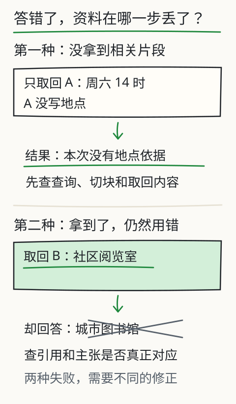

# C19 检索没找对，还是回答没用对

同一个错误答案，可能来自两个完全不同的地方。

问题：“2026 年 10 月 3 日的阵风是多少？”报告回答“风速 4.2 米每秒”。这可能是检索只取回了“风速 4.2”那一段，根本没有把“阵风 6.8”送进上下文；也可能是检索取回了完整段落，模型却选了另一个数字；还可能是模型写对了，但 claim 改写了原文，被引用校验拒绝。三种情况的修复动作完全不同：补检索、改生成、还是改输出契约。若不先找“第一个失败边界”，你会在错误的地方反复调参。

C18 已经冻结了题目、材料、判据和哈希。C19 沿着一条请求的顺序走，判断它**最早**在哪一步偏离预期，并且用一个小集合的精确率/召回率，而不是“感觉检索变好了”。

## 先修检查：你需要的不是更多指标，而是可观察的中间状态

确认你手上有这些字段，缺一项就先用对应命令补齐：

- `authorized_doc_ids`、`filtered_doc_count`：权限过滤发生在读取和检索之前；
- `retrieval.hits[]`：每条命中的 `chunk_id`、`doc_id`、`score`、`used`；
- `diagnostics.prompt.used_chunk_ids`、`diagnostics.warnings`：真正进入提示词的片段，以及因预算被丢弃的片段；
- `usage.calls`：失败发生在模型调用之前还是之后；
- `diagnostics.first_raw_response`：模型第一次原始输出；
- `diagnostics.first_failure.status / stage / detail`：失败的类型和阶段；
- `claims[].citations[]`：主张引用了哪个 chunk、哪段 quote；
- `tool_receipts[]`：工具是否真的执行、成功还是失败。

这些都在 `assistant-report/1` 里。不要只看最终 `answer`；最终文本是最后一个环节的产物，不能告诉你前面哪一步丢了东西。

## 失败阶梯：从权限到最终文字

下面按一条请求的实际顺序排列。判断原则是：**先检查更早的环节；只要更早环节已经偏离，后面的现象都只是后果。**

| 顺序 | 边界 | 典型状态/字段 | 关键问题 |
| --- | --- | --- | --- |
| 1 | 读者/权限 | `missing-reader`、`unauthorized`、`permission-denied`、`filtered_doc_count` | 无权限文档是否在读取前就被排除？ |
| 2 | 清单/文件/版本 | `invalid-manifest`、`missing-source`、`source-decode-failed`、`source-version-mismatch` | 评的是不是正确版本？ |
| 3 | 切块 | `chunk_count`、`chunks[]` 的 `start/end` | 答案所需文字是否落在某个 chunk 内？ |
| 4 | 检索 | `hits=[]`、`usage.calls=0`、低分命中 | 是零命中，还是阈值/查询表达不匹配？ |
| 5 | 提示组装 | `prompt.used_chunk_ids`、`warnings` 的 `prompt budget dropped`、`prompt-budget-exceeded` | 命中了但被预算丢掉？ |
| 6 | 模型调用 | `generation-failed`、`usage.calls>0`、`first_failure.stage=generation` | 模型/端点是否可用？ |
| 7 | 解析 | `invalid-response`、`first_raw_response` | 是围栏、坏 JSON，还是根本没按格式输出？ |
| 8 | schema/语义 | `invalid-response`、`first_failure.stage=validate` | 缺字段、状态非法、冲突条件不足？ |
| 9 | 引用/提取 | `citation-failed`、`citation_errors` | claim 不是 quote 的逐字提取？quote 不在使用的 chunk 里？ |
| 10 | 工具 | `permission-denied`、`tool-failed`、`budget-exhausted`、`tool_receipts[]` | 工具没执行、参数错，还是回执失败？ |
| 11 | 最终回答 | `answered` 且 quote 有效，但答非所问 | 机械校验通过，语义仍不成立 |

“第一个失败边界”不是 `first_failure` 字段的别名。`first_failure` 是程序捕获到的第一个异常；有时更早的环节已经悄悄偏离，只是没有抛错。例如：检索取回了正确 chunk，但提示预算把它丢掉，模型仍然用另一个 chunk 回答；程序不会报错，最终却给出错误数字。这个例子的第一边界是第 5 步，不是第 11 步。

## 第一步：用 `usage.calls` 分开“模型前”和“模型后”

这是最快的分诊：

- `usage.calls = 0`：失败发生在模型调用前。优先查权限、清单/文件、切块、零命中、提示预算。
- `usage.calls > 0`：模型至少被调用过一次。继续查原始输出、解析、schema、引用和工具。
- `usage.calls` 大于你预期的回答轮数：可能发生了 `--repair-attempts 1` 的修复调用，或 Agent 模式的多步调用；两者都应在 `raw_responses` / `tool_receipts` 里留下记录。

先看 `status`：

```text
unauthorized / permission-denied  → 权限边界
missing-source / version mismatch → 来源边界
insufficient-evidence + calls=0   → 检索零命中或没有可用 chunk
prompt-budget-exceeded            → 提示预算边界
generation-failed                 → 模型/端点边界
invalid-response                  → 解析/schema 边界
citation-failed                   → 引用/提取边界
tool-failed / budget-exhausted    → 工具/预算边界
answered                          → 进入人工语义复核
```

状态不是全部。`insufficient-evidence` 既可能来自“检索没有任何命中”，也可能来自“有命中但全部被预算丢弃后没有可用证据”。必须看 `first_failure.stage` 和 `retrieval.hits` 才能区分。

## 三个最小诊断例

下面的 JSON 只展示字段形状，具体值以你的实际报告为准。

### 例 A：检索成功，生成选错

```json
{
  "status": "answered",
  "retrieval": {
    "hits": [
      {"chunk_id": "station-log@...#002", "score": 0.42, "used": true}
    ]
  },
  "diagnostics": {
    "prompt": {"used_chunk_ids": ["station-log@...#002"]},
    "first_failure": null
  },
  "claims": [
    {"text": "风速 4.2 米每秒", "citations": [{"chunk_id": "station-log@...#002", "quote": "风速 4.2 米每秒"}]}
  ]
}
```

如果同一 chunk 里确实同时有“阵风 6.8 米每秒”，而问题问的是阵风，那么第一失败边界在**模型选择/生成**，不是检索。修复方向是改问题表达、提示或模型，而不是继续加 `top_k`。如果该 chunk 根本没有“阵风”，则第一边界在切块：答案文字不在任何已检索片段中。用 `inspect chunk` 看 `start/end` 和原文，确认是哪一种。

### 例 B：命中被提示预算丢掉

```json
{
  "status": "answered",
  "retrieval": {"hits": [{"chunk_id": "equipment-guide@...#003", "used": false}]},
  "diagnostics": {
    "prompt": {"used_chunk_ids": ["station-log@...#000"]},
    "warnings": ["prompt budget dropped equipment-guide@...#003"]
  }
}
```

模型引用了一个不同的 chunk，答案看起来也“有引用”，但真正包含电池续航的片段没有进入提示词。第一边界是**提示组装**。`citation-failed` 的 “unknown chunk_id” 也可能由此产生：claim 引用了未使用的 chunk，校验映射里没有它。此时改检索分数没有用，应先调整 `max_prompt_tokens`、`top_k` 或切块大小，让证据进得去。

### 例 C：检索正常，claim 改写被拒绝

```json
{
  "status": "citation-failed",
  "diagnostics": {
    "first_failure": {
      "status": "citation-failed",
      "stage": "validate",
      "detail": {"errors": ["source claim must be an exact extract of its supporting quote; paraphrase requires human verification"]}
    }
  }
}
```

这里的检索、模型调用都可能正常。第一失败边界是**提取式契约**：claim 必须是对 quote 的逐字提取，不能把“地点尚未确定”改写成“地点已确定为图书馆”。这类失败不应被报告成“检索没找对”。修复是让模型输出原文片段，或由程序生成候选 claim 后人工确认，而不是放宽校验来“通过”。

失败模型证据要原样保留。本课程资源探测中曾出现：本地小模型第一次响应带 Markdown 围栏，`json.loads` 直接失败。正确的记录是保存 `diagnostics.first_raw_response`，状态写 `invalid-response`、阶段 `parse`；不能删掉失败样本、悄悄剥掉围栏后声称“JSON 通过”，也不能把这一次格式失败推广成“该模型所有任务都失败”。它只说明那次调用的输出格式，后续是否可用仍要重新测。

## 精确率、召回率与命中率：小集合也要把账算对

C18 已经给出公式，这里把它用在“诊断检索”上。先为每个查询人工标出相关 chunk。注意：

- 相关单位是 chunk，不是文档；
- 一个文档只有一段相关，其他段落不算；
- 切块参数变化后，chunk ID 和边界都变，必须重新标注；
- 词项检索的分数不是概率，不能拿分数当相关性；
- `used=true` 只表示进入了提示词，不表示它支持最终 claim。

三个查询的对照，逐列从相关片段追到指标：

| 项目 | Q1 阵风 | Q2 续航 | Q3 校准 |
| --- | --- | --- | --- |
| 相关 chunk | A, B, C | D, E | F |
| `top_k=3` 实际取回 | A, D, E | D, E | 无（阈值下无命中） |
| TP | 1 | 2 | 0 |
| FP | 2 | 0 | 0 |
| FN | 2 | 0 | 1 |
| P | 1/3 | 1 | 0/0（记 0 或 n/a） |
| R | 1/3 | 1 | 0/1 |

Q3 暴露一个报告细节：没有取回任何片段时，precision 的分母为 0。不要写“precision=0”而不解释；可以写 `n/a` 并同时报告 recall=0 和 hit=0。若把空结果硬算成 precision 0，平均时会把“没有检索”与“检索了但全错”混在一起。

聚合：

- 微平均：先加总 TP/FP/FN，再算；
- 宏平均：先算每个查询，再平均；
- hit：至少一个相关片段就算命中；它不能替代 recall。

在小集合上，一个查询的差异就能让宏平均大幅跳动。报告要给出每个查询的明细，不能只给一个总数。

## 只改一个因素：切块大小对照

目标：判断“检索没找对”是否由切块边界造成。固定同一文档、同一查询集、同一 `keyword` 检索、同一阈值 `0.08`、同一 `top_k=3`、同一 `chunk_overlap=80`，只改 `chunk_chars`（480→240）。这才是一个单因素对照；不要同时改重叠、检索器或查询。

先看两套切块的实际边界：

```bash
mkdir -p out/c19

python book/llm/examples/assistant/assistant.py inspect chunk \
  --docs book/llm/examples/assistant/documents.json \
  --reader student \
  --doc station-log \
  --chunk-chars 480 --chunk-overlap 80 \
  --json out/c19/chunks-480.json

python book/llm/examples/assistant/assistant.py inspect chunk \
  --docs book/llm/examples/assistant/documents.json \
  --reader student \
  --doc station-log \
  --chunk-chars 240 --chunk-overlap 80 \
  --json out/c19/chunks-240.json
```

再跑同一组查询：

```bash
python book/llm/examples/assistant/assistant.py inspect retrieve \
  --docs book/llm/examples/assistant/documents.json \
  --reader student \
  --query "2026-10-03 阵风" \
  --retriever keyword \
  --top-k 3 --chunk-chars 480 --chunk-overlap 80 \
  --json out/c19/q-gust-480.json

python book/llm/examples/assistant/assistant.py inspect retrieve \
  --docs book/llm/examples/assistant/documents.json \
  --reader student \
  --query "2026-10-03 阵风" \
  --retriever keyword \
  --top-k 3 --chunk-chars 240 --chunk-overlap 80 \
  --json out/c19/q-gust-240.json
```

对每个查询、每个条件，重新标注相关 chunk，再计算 P/R。不要拿 480 条件下的相关 ID 去评价 240 条件；ID 中的 `#000/#001` 已经变了。可以用 `doc_id + start/end + 文本` 对齐，或直接读 `hits[].text` 判断。

合格对照的记录表：

先记原始计数。两列条件分别表示 `chunk_chars/chunk_overlap`，同一行比较同一指标。

| 计数 | 480/80 | 240/80 |
| --- | --- | --- |
| 查询数 | 6 | 6 |
| TP | 填写 | 填写 |
| 取回数 | 填写 | 填写 |
| 相关总数 | 填写 | 填写 |

再由计数计算指标，并记录失败发生在哪里。

| 结果 | 480/80 | 240/80 |
| --- | --- | --- |
| micro P | 填写 | 填写 |
| micro R | 填写 | 填写 |
| hit | 填写 | 填写 |
| 失败阶段 | 填写 | 填写 |

如果 240 的召回提高但精确率下降，要说明代价：更多无关片段进入提示词，可能挤掉真正证据，也可能降低回答准确率。结论可以是“不采用”，不能只挑一个变好的指标。

## 失败反例：四种错误归因

1. **把 `insufficient-evidence` 都说成“模型不会答”**：先看 `usage.calls`；零调用通常是检索/权限/预算问题。
2. **把 `citation-failed` 都说成“检索坏了”**：它可能发生在 `validate`，检索和模型都正常；看 `first_failure.stage` 和 `errors`。
3. **只用 `hit@k` 评价检索**：命中一个相关片段不等于取全；答案可能需要同一文档的另一段。
4. **切块后沿用旧标签**：chunk ID、边界和内容都变了，旧的“相关集合”不再有效，指标是假的。

还有一种隐蔽错误：`answered` 且 `quote` 逐字存在，但 quote 只覆盖半句条件。例如材料写“灯会期间 12 月 1 日至 20 日调整为 18:00”，claim 只写“闭站时间 18:00”，丢掉日期范围。机械校验会通过，语义上却把临时规定当成永久规定。这属于**最终语义复核**，需要人读上下文，不是再跑一次检索就能发现。

## 图与已有实验

下图把“没有取回”和“取回了却仍答错”分开：前者要查查询、切块、排序和阈值，后者要查提示选择、模型、claim 和引用。



旧的 [L09 检索实验](../../../exports/llm/retrieval.html) 用网页预置材料演示“改变查询、切块和条数，看真正进入输入的材料与无结果分支”。它适合练习观察顺序，但不是本章真实助手的运行结果，也不提供你的模型性能数据。

## 独立作业

1. **标 5 个查询**：在当前样例文档上人工标出每个查询的相关 chunk。用 `top_k=3` 跑 `inspect retrieve`，计算逐查询 P/R、微平均、宏平均和 hit。必须写清空结果时 precision 的分母。
2. **制造一次漏检**：用一个材料中有、但查询用了不同说法的问题（例如材料写“阵风”，查询写“最大瞬时风速”），记录 `hits`、`usage.calls` 和最终状态。判断第一边界是查询表达、切块还是阈值。
3. **制造一次“取回但没用对”**：让正确 chunk 进入提示词，观察模型是否选了另一个数字。用 `claims[].citations[].quote` 和 `retrieval.hits[].used` 证明检索成功而生成失败。
4. **做一次单因素切块对照**：按上面的命令跑 480/80 与 240/80（只改 `chunk_chars`），重新标注，填 P/R 表。即使结果变差也要报告；给出采用或不采用的理由。
5. **解释三种失败**：从自己的报告中各找一例 `insufficient-evidence`（零命中）、`citation-failed`（提取失败）、`answered` 但语义不完整。说明它们的第一边界为什么不同。

答案与核对依据见 [C19 答案](../deepening/c19-answer.md)。

## 项目增量：诊断目录

```text
diagnosis/
  labels/
    retrieval-relevance.csv
  out/
    chunks-480.json
    chunks-240.json
    q-gust-480.json
    q-gust-240.json
    failure-a.json
    failure-b.json
    failure-c.json
  notes/
    failure-ladder.md
    one-factor.md
```

`retrieval-relevance.csv` 至少包含 `query_id, chunk_id, relevant(true/false), reason`。`failure-ladder.md` 对每个失败写：状态、`first_failure.stage`、`usage.calls`、关键 chunk、最终 claim、第一边界和下一步只改什么。

## 来源与限制

本章使用 `assistant.py` 的 `retrieval.hits`、`diagnostics.prompt`、`first_failure`、`usage.calls` 和引用校验字段，字段含义以 `book/llm/examples/assistant/README.md` 与源码为准。检索失败图来自课程手绘资产 `retrieval-failures.svg`；旧 L09 实验是网页预置材料，不是本章实测。精确率/召回率的小集合是教师手写算例，不是模型成绩；切块对照的命令可复现，但实际指标必须由你运行后填写。本章不声称任何检索器、模型或参数已经达到某个性能水平。
