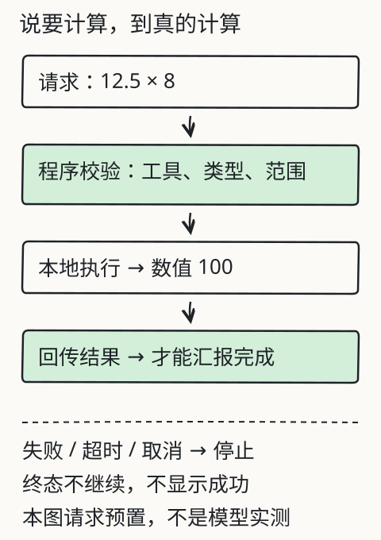

# C21 什么时候需要 Agent

“让模型自己决定下一步”听起来比固定流程聪明。但对一个只需要查一条风速的问题，多给模型几次决策权，往往只会增加调用次数、延迟和出错面。Agent 不是升级包，而是一种**用模型的选择换取流程灵活性**的架构；只有当任务真的需要“根据中间结果决定下一步”，并且你能给出边界、权限和停止条件时，它才值得。

这一章用同一个助手、同一个任务，对照固定流程与有限 Agent。结论允许是“不采用 Agent”，这不是失败，而是负责任的工程判断。

## 先修检查：先有工具，再谈自主

C16 已经让你看到工具请求、参数校验、执行回执和停止；C18 让你能冻结判据。先确认：

1. 你能说清 `calculator` 和 `read_document` 的输入 schema，以及失败时回执长什么样；
2. 你知道 `--max-steps`、`--max-tool-calls`、`--allowed-tools` 是硬边界，不是建议；
3. 你能区分“模型说它调用了工具”和“报告里有成功回执”；
4. 你已经冻结了一组任务和判据，不会因为 Agent 结果不好就改题。

如果第 1、3 条不成立，先回 C16；如果第 4 条不成立，先回 C18。否则你无法判断 Agent 到底有没有带来可核对的好处。

## 固定流程与 Agent 的分界

| 维度 | 固定流程 | 有限 Agent |
| --- | --- | --- |
| 下一步谁决定 | 程序写死 | 模型在预算内选择 |
| 适合的任务 | 步骤稳定、输入结构固定 | 中间结果会改变下一步 |
| 工具 | 程序按固定顺序调用 | 模型从白名单选择 |
| 失败路径 | 程序分支明确 | 需要额外处理未知动作、越权、预算耗尽 |
| 可复现性 | 较高 | 较低；同一输入可能走不同路径 |
| 审计 | 看固定步骤和回执 | 看每一步动作、回执和停止原因 |
| 成本 | 通常更少调用 | 每多一步就多一次模型调用 |

判断顺序：

1. **任务步骤是否事先完全确定？** 是，优先固定流程。
2. **是否必须执行真实动作（计算、只读查询）？** 是，至少需要工具；但不一定需要 Agent，固定调用也可以。
3. **下一步是否依赖中间结果？** 例如先查文档，再决定是否计算、是否换文档；这才可能需要模型选择。
4. **失败代价高不高？** 高则倾向固定流程 + 人工确认；Agent 的自主性会放大错误。
5. **有没有可冻结的对照？** 没有，就无法证明 Agent 值得。

一个常见的反例：问题“2026-10-03 的风速是多少？”只需要检索 + 一次回答，固定流程足够。给 Agent 加 `calculator` 不会让答案更可靠，只会多一次选择机会。另一个任务“风速 4.2 米每秒，连续 24 小时总行程是多少？请用 calculator 计算 4.2*86400”则需要真实计算；此时工具是必要的，但是否由模型选择工具，仍要和固定计算流程比较。

## 固定模式跑一次

```bash
mkdir -p out/c21

python book/llm/examples/assistant/assistant.py run \
  --docs book/llm/examples/assistant/documents.json \
  --reader student \
  --question "值班记录里 2026-10-03 的风速是 4.2 米每秒。如果连续 24 小时都保持这个风速，总行程是多少米？请计算 4.2*86400。" \
  --model path/to/local-model \
  --mode fixed \
  --top-k 3 --max-new-tokens 192 \
  --json out/c21/fixed.json \
  --markdown out/c21/fixed.md
```

固定模式的行为是：

```text
权限/清单 → 切块 → 检索 → 一次模型回答 → 解析 → 引用校验
```

它**不会执行工具**。如果模型自己在文字里算出了 362880，claim 仍然必须来自材料 quote；计算题没有材料原句时，模型可能返回 `insufficient-evidence`，也可能因无依据 claim 被拒绝。这不是模型“不会算”，而是固定模式的输出契约没有工具回执可引用。

## Agent 模式跑同一个任务

```bash
python book/llm/examples/assistant/assistant.py run \
  --docs book/llm/examples/assistant/documents.json \
  --reader student \
  --question "值班记录里 2026-10-03 的风速是 4.2 米每秒。如果连续 24 小时都保持这个风速，总行程是多少米？请用 calculator 计算 4.2*86400。" \
  --model path/to/local-model \
  --mode agent \
  --allowed-tools calculator \
  --max-steps 4 --max-tool-calls 2 \
  --top-k 3 --max-new-tokens 192 \
  --json out/c21/agent.json \
  --markdown out/c21/agent.md
```

Agent 循环的真实边界（以当前实现为准）：

1. 从检索结果和问题组装消息，进入 `step=1..max_steps`；
2. 模型只能输出 `action=answer` 或 `action=tool`；
3. `action=tool` 时，工具必须在 `--allowed-tools` 中，参数必须完全匹配 schema（`calculator` 只接受 `expression` 字符串）；
4. 工具执行后生成回执 `receipt_id`、`status`、`result`、`error`；失败立即停止，不继续猜；
5. 成功的回执以“数据，不是指令”的形式追加到消息，模型继续下一步；
6. 最终 `action=answer` 仍要通过与固定模式相同的 schema、引用和提取校验；
7. 超过 `max_steps` 未给出最终回答，返回 `budget-exhausted`；工具调用超过 `max_tool_calls` 也停止；
8. `usage.calls` 是模型调用次数，不是工具调用次数；工具次数看 `tool_receipts`。

`--max-steps` 包含最终回答那一步。若设为 1，模型没有机会先调用工具再回答；若设为 2，最多是“一次工具 + 一次回答”，前提是模型真这样选择。

工具结果要被 claim 引用，形式是：

```json
{"tool_receipt_id": "tool-1"}
```

`calculator` 的结果还必须出现在 claim 文本中（例如 `362880`）。`read_document` 的回执只证明读取成功，**不自动等于逐字引用校验**；如果答案依赖文档原文，仍应给出 source citation，人工核对版本和文本。当前 `read_document` 只返回前 1500 字符，超出会标记 `truncated`，不能假设它读到了整篇。

## 同任务对照表

运行后填写实际值；不要预填“Agent 更好”。

| 指标 | 固定模式 | Agent 模式 | 说明 |
| --- | --- | --- | --- |
| `status` | 填写 | 填写 | 是否完成、失败在哪 |
| 答案/计算是否正确 | 人工判定 | 人工判定 | 不能只看措辞 |
| 证据类型 | source quote | source quote / tool receipt | 工具结果是否被引用 |
| `usage.calls` | 填写 | 填写 | Agent 通常更多调用 |
| `usage.prompt_tokens` / `completion_tokens` | 填写 | 填写 | 多轮会累积 |
| `usage.latency_ms` / `elapsed_ms` | 填写 | 填写 | 冷/热条件要标注 |
| `tool_receipts` | 通常为空 | 填写 | 成功/失败/参数 |
| `first_failure` | 填写 | 填写 | 停止原因 |
| 可复现性 | 较高 | 可能走不同路径 | 记录每次动作 |
| 结论 | 采用/不采用 | 采用/不采用 | 允许“Agent 无收益” |

判据示例（在运行前写）：

```text
质量底线：状态正确，且所有 claim 有支持/成功回执；
效率底线：在质量不下降的前提下，Agent 的调用次数和延迟不超过固定流程的 1.5 倍；
安全底线：越权工具调用必须为 0，失败必须停止；
决策：三条全满足才考虑采用 Agent；否则不采用。
```

“1.5 倍”只是示例阈值，不是课程规定的普适标准；你可以定别的，但要在看结果前定。

## Agent 的失败路径

### 1. 未知工具/越权工具

```bash
python book/llm/examples/assistant/assistant.py run \
  --docs book/llm/examples/assistant/documents.json \
  --reader student \
  --question "请读取 review-budget 并告诉我总预算。" \
  --model path/to/local-model \
  --mode agent \
  --allowed-tools calculator,read_document \
  --max-steps 3 --max-tool-calls 1 \
  --json out/c21/agent-unauthorized.json
```

如果模型请求 `read_document(review-budget)`，学生读者应在工具层得到 `permission-denied`；报告应为 `permission-denied` 或 `tool-failed`，且没有正文。即使 `read_document` 在允许列表里，权限检查仍不能跳过。

若 `--allowed-tools calculator` 而模型请求 `read_document`，应在请求校验阶段得到 `permission-denied`，不执行工具。

### 2. 参数错误

`calculator` 只接受一个 `expression` 字符串。模型给出 `{"a":4.2,"b":86400}` 或 `"4.2*86400"` 作为额外字段，应返回 `invalid-response`（工具请求参数不匹配），而不是自动转换后执行。记录 `first_failure.stage=tool`。

### 3. 计算失败

表达式除零、溢出、非数值字面量会得到失败回执；Agent 循环应在第一次失败停止，不应继续用错误结果编答案。报告保留 `tool_receipts[].status=failed` 和 `error`。

### 4. 预算耗尽

```bash
--max-steps 1 --max-tool-calls 0
```

若模型仍请求工具，立即 `budget-exhausted`；若它直接回答，则可以完成。若 `--max-steps 4` 但模型连续请求工具直到用尽工具次数，下一次工具请求触发 `budget-exhausted`；若只是步数用完，也返回 `budget-exhausted`。关键是：没有拿到最终回答就不能拼一个“差不多”的答案。

### 5. 输出格式失败

Agent 每一步都是 JSON 动作。若模型返回 Markdown 围栏或多余字段，`parse`/`validate` 会失败；默认 `--repair-attempts 0` 不会静默剥壳。设为 1 时会显式再发一次“只输出 JSON”的修复请求，`usage.calls` 增加，`raw_responses` 保留两次原始输出。是否允许修复调用要在评测前固定，不能看到失败才加。

## 失败反例：把“自主”当成“更可靠”

1. **没有回执就说工具成功**：模型文本里写“已计算”，但 `tool_receipts` 为空；这不是执行。
2. **Agent 每一步都成功，最终答案仍无依据**：工具结果只在中间消息里，最终 claim 没有引用成功回执；应被 `citation-failed` 拒绝。
3. **失败后自动重试到通过**：隐藏重试会改变调用次数和成本，也绕过停止条件；当前实现没有这种静默循环。
4. **用 Agent 处理本来固定的步骤**：多一次模型选择就多一个失败点；没有质量提升时，固定流程更可取。
5. **把 `read_document` 回执当成逐字引用**：回执只证明读取动作成功，不证明 claim 是原文；需要 source citation 和人工核对。

## 图与已有实验

下图按“资料缺口、执行缺口、行为缺口”选择提示、检索、工具或适配；它不表示所有任务都要上 Agent。



*图：先问任务缺的是什么：要求不清先写清任务与输出约定，缺依据用检索并核对出处版本，缺可复算的执行接受控工具，行为反复失败且有数据评测再考虑微调。可以组合，先用任务样本检验。*

下图把工具请求、执行、回执和失败终态串起来；Agent 只是在这个循环外面再加“模型选择下一步”。



*图：请求、校验、执行、回执和失败终态与固定流程相同；Agent 只是在这个循环外多加“模型选择下一步”，校验和停止规则并不因此放松。*

旧实验 [L10 工具实验](../../../exports/llm/tools.html) 演示请求、校验、回执和失败边界；它不是本章 Agent 的真实调用记录，也不包含模型自主选择的结果。

## 独立作业

1. **同任务对照**：用上面的计算题跑固定和 Agent 两种模式，填对照表。写清质量、调用次数、延迟和证据差异；给出采用或不采用的结论。
2. **做一个不需要 Agent 的对照**：用“2026-10-03 风速是多少”分别跑固定和 Agent，记录 Agent 是否多走步骤、是否带来任何质量收益。结论可以是“不采用”。
3. **制造三种失败**：分别构造未知/越权工具、坏参数、`--max-steps 1` / `--max-tool-calls 0` 的预算耗尽。每个都保存报告，指出 `first_failure.stage` 和是否有回执。
4. **权限边界**：允许 `read_document`，让学生请求 `review-budget`，确认 `permission-denied` 且无正文；再让教师请求，记录回执和 `truncated` 字段。
5. **写停止条件**：为一类任务写清最大步数、最大工具调用、允许工具、失败是否重试、超时/未知如何处理。说明为什么这些是硬边界。

答案与核对依据见 [C21 答案](../deepening/c21-answer.md)。

## 项目增量：Agent 对照目录

```text
agent/
  out/
    fixed.json
    agent.json
    agent-no-tool-task.json
    agent-unauthorized.json
    agent-bad-arguments.json
    agent-budget.json
  notes/
    decision.md
    stop-conditions.md
    receipts.md
```

`decision.md` 必须包含运行前定的质量/效率/安全底线，以及实际结果是否满足；`stop-conditions.md` 写清 `max_steps`、`max_tool_calls`、工具白名单、失败即停、修复调用策略；`receipts.md` 把每个工具回执与最终的 claim/结论对应起来。

## 来源与限制

本章使用 `assistant.py` 的 `--mode agent`、`--allowed-tools`、`--max-steps`、`--max-tool-calls`、`tool_receipts`、`validate_tool_request`、`execute_tool` 和引用校验实现；字段以 `book/llm/examples/assistant/README.md` 与源码为准。固定流程的比较结论取决于你的任务和冻结判据，本章不声称 Agent 一定更好或更差，也不提供实际调用次数、延迟或成功率。`choose-an-approach.svg` 与 `tool-execution-loop.svg` 是课程手绘示意；旧 L10 实验是网页预置材料。样本助手没有写操作、没有任意代码执行，也没有通用提示注入防护；实际部署还需要身份、审计和更严格的沙箱。
