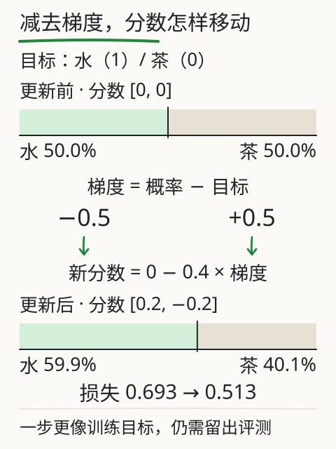
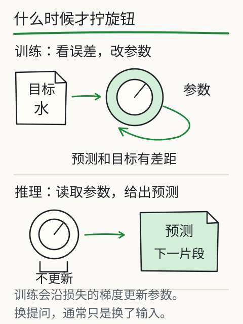

# C23 从数组走到自动微分

先看一个很具体的失败：你已经把一句话拆成 token，又把四条句子放进 Python 列表，信心满满地送进模型，却得到 `mat2 must be a matrix, not a 0-dim tensor`，或者更隐蔽的 `The size of tensor a (4) must match the size of tensor b (3)`。这不是“模型不聪明”，而是你还没把列表、形状、批次和参数说清楚。C23 要把这层地基补上：数组怎样变成张量，参数怎样挂进模块，梯度怎样由自动微分算出来，以及训练完的参数怎样保存和重新载入。

## 先修桥：你已经见过向量和梯度，但还没让它们动起来

C08 让你沿一个位置追踪多头注意力的形状，C09 用负对数、斜率和链式法则解释“目标错了，参数往哪边动”，C11 又让你写过函数、文件和错误定位。那时梯度多是纸面公式，类也还不是你熟悉的工具。现在要换成可运行的对象：

- Python 的 `list` 只是容器，没有形状、广播和设备概念；
- `torch.Tensor` 有 `shape`、`dtype`、`device`，运算按维度对齐；
- `nn.Module` 把一组参数和 `forward` 计算绑在一起；
- `loss.backward()` 沿计算图求梯度，`optimizer.step()` 才真正改参数。

这四个东西分开看都不难，合起来才是“训练”。本章的代码都在 [`examples/tiny_decoder/`](../examples/tiny_decoder/) 里；先把 `model.py` 当教材读，不要一上来背整份实现。

## 从列表到张量：形状是契约，不是注释

一个标量是 0 维张量，一个词向量是 1 维，一句话的 token 序列是 1 维，一个批次是 2 维，加上模型维度就是 3 维。微型 decoder 的输入写作：

```text
idx: [B, T]            B 条序列，每条 T 个 token id
embedding: [B, T, C]   C 是模型宽度，本课默认 64
```

`B`、`T`、`C` 不是随意命名，它们决定后面每个矩阵乘法的左右形状。比如注意力分数是 `[B, H, T, T]`：每个批次、每个头，都要给“当前位置能看哪些位置”打分。若把 `T` 和 `C` 弄反，代码可能仍然跑完，却在算完全错误的东西。

广播（broadcasting）是另一个容易“看起来对”的地方。规则可以先记成一句话：从最右维开始比较，两维相等，或其中一维是 1，就能对齐；否则报错。于是：

```text
A: [3, 1]       B: [1, 4]       A + B: [3, 4]
```

结果第 `i` 行第 `j` 列是 `A[i,0] + B[0,j]`。这不是把 3 条数据复制成 12 条存储，而是计算时按索引取值。模型的 `[T, C]` 位置编码加上 `[B, T, C]` 的 token 表示时，就是靠最左维的 1 自动扩展到整个批次。

```python
import torch

a = torch.tensor([[1.0], [2.0], [3.0]])       # [3, 1]
b = torch.tensor([[10.0, 20.0, 30.0, 40.0]])  # [1, 4]
print((a + b).shape)                          # torch.Size([3, 4])
```

如果两个形状是 `[3, 2]` 和 `[3, 4]`，最右维 2 与 4 不相等，也没有 1，就会报错。这个报错应当让你停下来检查“我到底想对齐哪一维”，而不是随手 `view` 成某个能跑的尺寸。

## 从 Python 类到 `nn.Module`：参数要注册，计算要写在前向里

普通 Python 类也能存 `self.w`，但 PyTorch 不会知道它是可训练参数。`nn.Module` 的约定是：

1. 在 `__init__` 里创建子模块或 `nn.Parameter`；
2. 在 `forward` 里写输入到输出的计算；
3. 调用 `model(x)` 时由框架转去执行 `forward`。

微型 decoder 的 token 嵌入就是一个查表：

```python
self.token_embedding = nn.Embedding(config.vocab_size, config.d_model)
x = self.token_embedding(idx)          # [B, T] -> [B, T, C]
```

`nn.Embedding` 的权重形状是 `[vocab_size, C]`，每一行是一个 token 的初始向量。它和 `nn.Linear` 不同：输入是整数编号，输出是浮点向量。编号本身没有大小含义；训练改变的是这些行向量，不是“把 7 号词改成 8 号词”。

本课的位置不是学习出来的参数，而是固定的正弦编码：

```text
PE(pos, 2i)   = sin(pos / 10000^(2i/C))
PE(pos, 2i+1) = cos(pos / 10000^(2i/C))
```

`pos` 是位置，`i` 是维度编号。它没有可训练参数，所以保存时不需要存一张位置表，载入时按 `max_len` 和 `C` 重算。这样做的代价是位置模式固定；好处是“位置 40”不依赖训练时是否见过那么长的句子。C24 会把它和 token 表示相加，再送进注意力。

一个 decoder block 可以压缩成两行：

```python
x = x + self.attn(self.ln_1(x))
x = x + self.ff(self.ln_2(x))
```

先归一化，再做注意力或前馈，最后把结果加回原输入，这叫残差连接。`x` 的形状始终是 `[B, T, C]`，所以加得回去。若某个子层偷偷把 `T` 或 `C` 改了，残差那一步会立刻报形状错误；这其实是好事。

输出头把 `[B, T, C]` 映射到 `[B, T, V]`，`V` 是词表大小。本课让输出头与 token 嵌入共享同一份权重（weight tying）：`head.weight = token_embedding.weight`。`model.parameters()` 会去重，所以参数计数时这份矩阵只算一次；但 `state_dict()` 里仍可能出现两个键，载入时要注意它们指向同一份存储。

## 手算一个梯度，再让 autograd 复核

先取最小的可微关系：

```text
pred = w * x + b
L = (pred - y)^2
```

设 `w=2`、`x=3`、`b=1`、`y=10`，则 `pred=7`，`L=(7-10)^2=9`。对 `w` 求偏导，链式法则给出：

```text
∂L/∂w = 2 * (pred - y) * x = 2 * (-3) * 3 = -18
∂L/∂b = 2 * (pred - y)     = -6
```

梯度是负的，意味着“把 `w`、`b` 稍微增大，损失会下降”。若学习率是 `0.05`，一次更新：

```text
w_new = 2 - 0.05 * (-18) = 2.9
b_new = 1 - 0.05 * (-6)  = 1.3
pred_new = 2.9 * 3 + 1.3 = 10.0
L_new = 0
```

对这份二次函数和这组数，一步恰好落到目标；换一组数或换更大的学习率，就不一定了。下面让 PyTorch 算同一件事：

```python
import torch

w = torch.tensor(2.0, requires_grad=True)
b = torch.tensor(1.0, requires_grad=True)
x = torch.tensor(3.0)
y = torch.tensor(10.0)

pred = w * x + b
loss = (pred - y) ** 2
loss.backward()

print(w.grad, b.grad)   # tensor(-18.) tensor(-6.)
```

这里的 `w`、`b` 是需要梯度的叶子张量；由它们计算出的 `pred`、`loss` 也会有 `requires_grad=True`，反向传播需要沿这些中间结果回溯。默认只有需要梯度的叶子会累积 `.grad`；若要检查中间结果的 `.grad`，先对它调用 `retain_grad()`。`loss.backward()` 默认把梯度**累加**到 `.grad`，所以训练循环每步都要先 `optimizer.zero_grad(set_to_none=True)`，否则上一步的梯度会混进来。这个细节在 C09 只是文字，现在你可以亲手制造一次“忘记清零”的对比。

把标量换成向量，交叉熵的梯度有一个很好用的形式。若 `p = softmax(logits)`，目标 one-hot 是 `y`，那么：

```text
∂CE/∂logit_i = p_i - y_i
```

模型给目标的机会太少时 `p_target < 1`，梯度为负，更新会把对应分数往上推；给错候选太多时梯度为正，把它往下压。这个式子假设你在比较同一个位置的整个词表；C24 的“目标错位”就是保证每个位置比较的确实是下一个 token。

## 保存不是“把模型对象泡进文件”

一种省事的写法是 `torch.save(model, path)`，但它把 Python 类路径和对象结构一起序列化，换代码、换环境、载入来路不明的文件都更危险。本课只保存可重建的材料：

```python
payload = {
    "format": "tiny-decoder-v1",
    "config": asdict(config),      # 层数、宽度、头数、d_ff、max_len
    "vocab": tokenizer.token_list(),
    "state_dict": model.state_dict(),
    "adaptation": {},              # LoRA 元数据，C25 用
    "meta": {...},                 # 步数、种子等，仅作记录
}
torch.save(payload, path)
```

载入时先按 `config` 重建空白模型和词表，再 `load_state_dict(..., strict=True)`。这样结构对不对得上会被明确检查，不会“看起来加载成功但少了一层”。`torch.load(..., weights_only=True)` 限制反序列化能引用的全局对象；本课的 payload 只含字典、列表、数字、字符串和 tensor，所以可以用它。不要为了打开一个陌生 checkpoint 就改成 `weights_only=False`。

保存后做一次“重载等价”检查：对同一批输入，保存前模型和重载后模型的 logits 应逐位相等（或至少差值在明确阈值内）。`train.py` 把这件事打印成 `checks.reload.bitwise_equal` 和 `max_abs_diff`。如果不等，先查词表顺序、配置、是否漏了 LoRA 包装，再查浮点设备差异；不要用一句“差不多”带过。

## 改一个条件，看看哪里会坏

- **忘记 `zero_grad`**：连续两步的梯度相加，参数走的方向不再对应当前批次。把 `zero_grad` 注释掉跑两步，对比 `.grad`。
- **`requires_grad=False`**：从创建时就冻结的参数不会累积自己的梯度，`.grad` 仍是 `None`；它仍可参与计算，梯度也可能沿这条计算路径传给其他可训练参数。冻结已有参数时还要清掉历史 `.grad`。C25 的 LoRA 冻结检查会用到这个区别。
- **在 `torch.no_grad()` 里训练**：前向能算，反向会报“没有 requires_grad 的输入”；推理时用它省内存是对的，训练时用错就学不动。
- **形状碰巧能广播**：例如把本应 `[T, T]` 的掩码写成 `[T, 1]`，它可能广播成每一列都相同，代码不报错但语义全错。看到注意力权重每一行都一样，先查掩码形状。
- **保存了模块而不是 `state_dict`**，又在载入时换了类名或目录：路径能读到文件，但反序列化失败。统一用 `state_dict` + 配置 + 词表。
- **序列超过 `max_len`**：本课直接报错，不静默截断。静默截断会让“模型没学会长句”和“你根本没把长句喂进去”混在一起。

## 独立练习与项目增量

1. 对 `w=1.5`、`x=-2`、`b=0.5`、`y=1` 手算 `∂L/∂w`、`∂L/∂b`；取学习率 `0.1` 更新一次，算出新的预测和损失。然后用 autograd 复核。再把 `w` 冻结，重做一次前向和反向，说明为什么 `w.grad` 是 `None` 而 `b.grad` 仍有值。
2. 构造 `[3,1]` 与 `[1,4]` 的广播，写出结果形状和任意一个元素的计算；再构造一个不能广播的 `[3,2]` 与 `[3,4]`，记录报错信息。回答：报错发生在哪一维？
3. 运行 `python book/llm/examples/tiny_decoder/train.py inspect`，找到 `parameters.total`、`architecture`、`checks.future_invisibility`。再用 `train` 生成 checkpoint，运行 `inspect --checkpoint ...`，核对 `checks.base_checksum` 与 `sample` 字段。不要只看“跑通了”，要能指出每个字段对应哪段计算。
4. 把 `model.py` 中某个 `nn.Linear` 的 `bias` 去掉，重新 `inspect` 参数量，解释差了多少、为什么。改结构后必须重新训练；旧 checkpoint 不能直接塞进新结构。

项目增量：你已经能把“数组—模块—梯度—保存”四件事说清，并且能用 `inspect` 的字段核对模型结构。下一章会把这些零件真正装成一个 causal decoder，用位移目标训练，再用自回归循环生成。

答案与逐项核算见 [`../deepening/c23-answer.md`](../deepening/c23-answer.md)。下一章：[C24 从零组装最小 decoder](c24.md)。

## 来源与边界

- PyTorch 2.14.1 官方文档：autograd 的 `requires_grad`/反向图说明，`optimizer.zero_grad` 与 `loss.backward` 的训练循环，`state_dict` 与 `weights_only` 的保存/载入建议（本课通过 Context7 核对版本）。
- 本课 `model.py` 的实际实现与手算数值；手算部分不依赖运行结果。
- 边界：本章的标量梯度、广播和保存检查都是教学规模。真实训练还要处理混合精度、设备、分布式、数据加载和更复杂的优化器状态；本课不声称这些都被覆盖。固定正弦位置是本实现的选择，不是“所有 Transformer 都如此”。



*图：减去梯度后，水的分数从 50.0% 升到 59.9%，损失从 0.693 降到 0.513。这只是固定教学数字上的一步，不等于留出评测通过。*



*图：训练时看误差、沿梯度拧动参数旋钮；推理时只读取参数做预测，换提问不换旋钮。*

本地对照实验：[X05 训练与推理](../../../exports/llm/training.html)。它用的是 bigram 分数表，不是本章的 decoder；对照的是“预测—比较—更新”的动作，不是模型能力。
