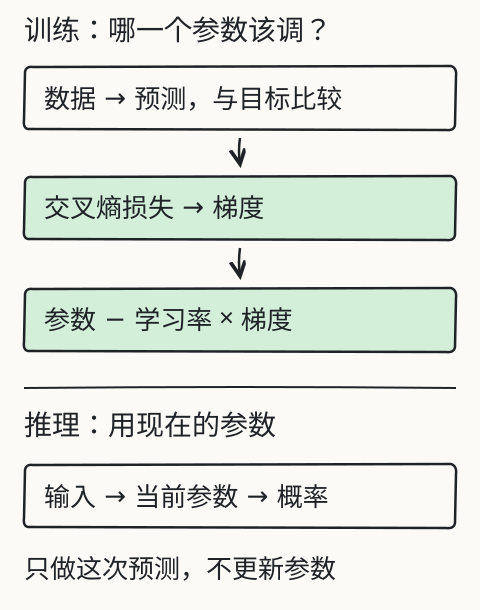
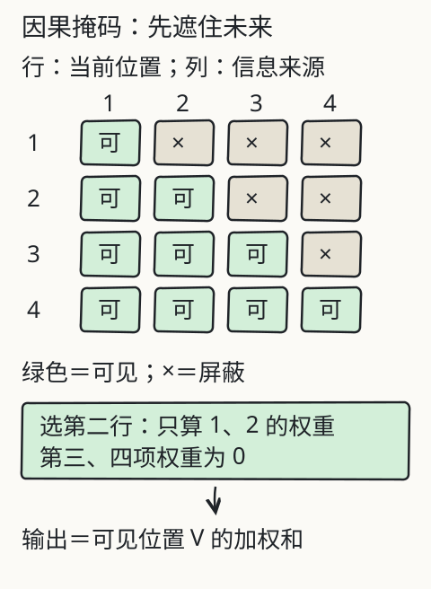

# C24 从零组装最小 decoder

上一章的 bigram 只看前一个 token：它有一张“前一个词→下一个词”的分数表，却没有位置、没有注意力，也没有办法让第三个词影响第一个词的判断。你现在要装的是一个**真正的 causal decoder**：它按顺序读入 token，允许每个位置看自己和左边，不允许看右边；训练时用错开一位的目标，推理时把刚生成的 token 接回输入，一步一步往下写。规模很小，但因果掩码、残差、归一化、FFN、多头和自回归循环都是真的。

## 先修桥：C23 的张量动作要能落到一条句子上

C23 已经让你会看 `[B, T, C]`、会手算 `(wx+b-y)^2` 的梯度、会保存 `state_dict`。C24 不再换一套抽象，而是反复用同几个动作：

- `view` / `transpose`：把 `[B, T, 3C]` 拆成三个 `[B, T, C]`，再拆成 `[B, H, T, dh]`；
- 广播：把 `[T, C]` 的位置编码加到 `[B, T, C]`；
- 掩码：把 `[T, T]` 的布尔矩阵盖到 `[B, H, T, T]` 的分数上；
- 交叉熵：把 `[B, T, V]` 的 logits 与 `[B, T]` 的目标逐位置比较；
- 反向传播：从损失回到 embedding、注意力投影、FFN 和输出头。

如果某一步形状对不上，先回到 C23 的广播规则，不要用 `reshape(-1)` 把问题藏起来。

## 语料与词表：先承认这是玩具

本目录的 `corpus.jsonl` 是作者编写的 192 条短句，按 `group` 分开：

```text
template-g1 ... template-g4   train
command                       train
template-g5                   val
template-g6                   test
```

`template-g6` 的句式在训练组里没出现，但它使用的词都在训练组出现过。词表只从**训练 split** 的文本构建，共 50 个 token：4 个特殊符号 `<pad>`、`<bos>`、`<eos>`、`<unk>`，加上 46 个普通词/标点。验证和留出文本若出现训练没见过的词，会被编码成 `<unk>`；`train.py` 会打印 `corpus.oov_tokens`，不会悄悄把新词加进词表。

一条记录长这样：

```json
{"id": "corpus-g1-00", "group": "template-g1", "split": "train", "text": "the small kite shines ."}
```

分词器把文本切成小写单词和标点：

```text
"the small kite shines ."
-> ["the", "small", "kite", "shines", "."]
-> [<bos>, the, small, kite, shines, ., <eos>]
```

编号本身没有语义；`nn.Embedding` 的可训练行向量才有。训练时不能把验证/留出组的文本拿去建词表，否则“留出”就泄漏了。`train.py` 的 `validate_corpus` 还会拒绝任何横跨多个 split 的 group：同一个 group 不能一半训练、一半验证。

## 目标错位：每个位置到底在预测谁

一条训练序列是：

```text
full:   [BOS, the, small, kite, shines, ., EOS]
inputs: [BOS, the, small, kite, shines, .]        # full[:-1]
target: [the, small, kite, shines, ., EOS]        # full[1:]
```

第 0 个位置看到 `BOS`，要预测 `the`；第 1 个位置看到 `BOS the`，要预测 `small`；最后一个位置看到整句（不含 EOS），要预测 `EOS`。`train.py` 的 `checks.target_shift` 会把 `inputs[1:]` 与 `target[:-1]` 逐项比较；`aligned=true` 才说明错位没有写反。

`make_lm_batch` 把同一批序列右侧补 `<pad>`，但把目标里对应的补位写成 `-100`；`F.cross_entropy(..., ignore_index=-100)` 不把这些位置算进损失。输入里的补位仍会被模型看到，不过它们都在句子右侧，因果掩码保证真实位置不会回头看到它们。若把补位目标也当成正常 token 训练，模型会花容量去学“补位之后还是补位”，损失数字会好看得没有意义。

## 零件一：token 嵌入与固定位置

```python
self.token_embedding = nn.Embedding(V, C)
x = self.token_embedding(idx)                 # [B, T, C]
x = x + self.position_encoding[:T]            # [T, C] 广播到 [B, T, C]
```

位置编码使用正弦/余弦：

```text
PE(pos, 2i)   = sin(pos / 10000^(2i/C))
PE(pos, 2i+1) = cos(pos / 10000^(2i/C))
```

本课把 `C=64` 分成 32 对，`pos` 从 0 到 `max_len-1=47`。它不是训练参数，因此 checkpoint 里没有位置矩阵；载入时按 `max_len` 和 `C` 重算。固定位置的边界是：模型不会因为训练时只见过较短句子，就对较长位置“没有参数”；但位置模式本身也不能从数据里学出新的相对关系。

## 零件二：多头因果注意力

先看单头。输入 `x` 是 `[B, T, C]`。用三个线性层得到 query、key、value：

```text
Q = x W_Q,  K = x W_K,  V = x W_V      每个 [B, T, C]
```

本实现用一个 `qkv` 线性层一次算出 `3C`，再切成三份。分成 `H=4` 个头后，每个头 `dh=C/H=16`：

```text
Q,K,V: [B, T, C] -> [B, H, T, dh]
scores = Q @ K^T / sqrt(dh): [B, H, T, T]
```

`scores[b,h,i,j]` 是第 `i` 个位置对第 `j` 个位置的原始匹配分。除以 `sqrt(dh)` 是为了让点积随维度增长时不要把 softmax 推到过饱和。接着是因果掩码：

```python
mask = torch.triu(torch.ones(T, T, dtype=torch.bool), diagonal=1)
scores = scores.masked_fill(mask, float("-inf"))
weights = torch.softmax(scores, dim=-1)
```

`diagonal=1` 表示只盖住严格上三角；对角线（自己看自己）和左下（看左边）保留。`-inf` 必须在 softmax **之前**加上：`exp(-inf)=0`，未来位置的权重严格为零；如果先 softmax 再乘掩码，归一化分母已经被未来项污染，结果不对。

每个头用权重对 `V` 加权：

```text
head_out = weights @ V                  # [B, H, T, dh]
```

把四个头拼回 `[B, T, C]`，再过输出投影 `W_O`，得到注意力子层输出。多头不是“四个不同的句子”，而是把同一个 `C` 维空间分成四段，让不同头学习不同的匹配模式；最后仍由 `W_O` 混合。

完整的注意力公式可以写成：

```text
Attention(Q, K, V) = softmax(Q K^T / sqrt(dh) + M) V
```

`M` 在允许的位置是 0，在禁止的位置是 `-inf`。C07 的单头实验和 C08 的双头追踪都在讲同一件事，只是这里的 `T`、`H`、`dh` 是代码里真实的形状。

## 零件三：FFN、残差、归一化

注意力负责“从别的位置取信息”，前馈网络负责“对每个位置单独做非线性变换”：

```text
ff1: C -> d_ff=128
GELU
ff2: 128 -> C
```

它的权重在序列维度上共享：同一个 `fc1` 作用于所有 `T` 个位置，但不同位置之间没有直接相加。若把 FFN 写成跨位置的矩阵乘法，那就变成了另一种混合层，不再是本课的结构。

每个 block 采用 pre-norm：

```python
x = x + self.attn(self.ln_1(x))
x = x + self.ff(self.ln_2(x))
```

LayerNorm 在最后一个维度（`C`）上对每个位置单独计算均值和方差，再乘可学习的缩放、加偏置；它不是 BatchNorm，不跨批次统计。残差要求子层输出与 `x` 形状相同；这也是为什么前面每一步都要盯住 `[B, T, C]`。

## 零件四：输出头与参数账本

最后 `ln_f` 后再过一个线性头：

```text
logits = x @ W_head^T        # [B, T, V]
```

本课让 `W_head` 与 token embedding 共享（tied）。对默认配置 `C=64`、`V=50`、2 层、`d_ff=128`，参数量可以手算：

| 部件 | 计算 | 参数 |
| --- | --- | --- |
| token embedding | `50 × 64` | 3,200 |
| 每层 LayerNorm ×2 | `2 × 2 × 64` | 256 |
| 每层 QKV | `64 × 192` | 12,288 |
| 每层输出投影 | `64 × 64` | 4,096 |
| 每层 FFN | `64×128+128` 与 `128×64+64` | 16,576 |
| 每层合计 |  | 33,216 |
| 2 层 | `2 × 33,216` | 66,432 |
| 最终 LayerNorm | `2 × 64` | 128 |
| 输出头 | 与 token embedding 共享 | 0 额外 |
| **总计** |  | **69,760** |

位置编码是固定正弦，不占参数。若把输出头解绑，会多出 `64×50=3,200`；若把层数改成 3，会多出 33,216；头数从 4 改成 8 不改变 QKV 的总参数量，只改变每个头的 `dh` 和分数形状。`inspect` 会把实际 `parameters.total` 打出来，训练后再用同一配置重建；结构改了就必须重训。

## 训练：目标、损失、优化器和留出

`train.py` 的预训练循环做四件事：

```python
optimizer.zero_grad(set_to_none=True)
logits, _ = model(inputs)
loss = F.cross_entropy(logits.reshape(-1, V), targets.reshape(-1), ignore_index=-100)
loss.backward()
torch.nn.utils.clip_grad_norm_(parameters, 1.0)
optimizer.step()
```

默认是 400 步、批大小 24、AdamW 学习率 `3e-3`、权重衰减 0.01、梯度范数裁剪 1.0、种子 7。每一步从训练序列里有放回地抽 24 条，拼成一批；这不是“全批量梯度下降”，而是小批量随机梯度下降。损失是逐目标 token 的交叉熵，perplexity 是 `exp(loss)`（本课在打印时对指数做了上限保护，避免数值爆掉）。

训练结束会在 train/val/test 三个 split 上重新计算损失。留出组 `template-g6` 的句式没有参加训练，所以它的损失**可能**更高；这只说明这组数据的分布差异，不能直接外推成“模型不会泛化”。反过来，如果训练损失下降而留出损失上升，要先查过拟合、数据泄漏和评测材料，而不是宣布模型变强。与 X05 的 bigram 对照时也要诚实：bigram 只有一张 7×7 分数表，没有注意力、位置和 FFN；本课 decoder 的参数更多、结构不同，不能用一个训练损失数字宣布“谁更聪明”。

## 生成：把输出接回输入

训练时一次看整句；推理时没有未来 token，只能自己造。`model.generate` 的循环是：

```text
tokens = [BOS] + prompt
重复直到 EOS 或 max_len：
    logits = model(tokens)[0, -1]      # 只取最后一个位置
    按 temperature / top-k 选一个 token
    tokens.append(token)
```

`temperature <= 0` 时取 argmax（贪心）；`temperature > 0` 时先除以温度再 softmax；`top-k` 只保留分数最高的 `k` 个候选再采样。生成到 `max_len=48` 会停止，不会偷偷把左边截掉再继续；`sample.positions_used` 告诉你实际用了多少位置，`hit_eos` 告诉你是否自然结束。生成结果没有查表拼接，也没有预写答案；但“真的生成了 token”不等于“生成的内容正确或有意义”。



*图：训练把预测和目标比较、算出梯度再改参数；推理只读取当前参数给出概率，不做更新。同一个模型，两种动作。*



*图：因果掩码让位置 1 只看自己，位置 2 看 1–2，依此类推；被遮住的位置权重为 0，输出只由可见位置的 V 加权和组成。*

本地实验：[X04 因果注意力](../../../exports/llm/attention.html) 可以逐位置看 Q/K/V、掩码、权重和“修改未来 V 后较早输出不变”；[X05 训练与推理](../../../exports/llm/training.html) 用 bigram 展示更新，不能代替本章的 decoder。

## 三个检查：未来不可见、目标错位、重载一致

1. **未来不可见**：`future_invisibility_check` 取一条序列，把 `prefix_len=4` 之后的位置换成别的合法 token，再比较两个模型在前 4 个位置的 logits。因为因果掩码让未来权重为零，这两组 logits 应逐位相等；`bitwise_equal=true`、`max_abs_diff=0` 是实现的证据。`suffix_changed` 则确认改动确实影响了最后一个位置，否则这个检查可能只是“两次输入根本没差别”。
2. **目标错位**：`checks.target_shift.aligned` 比较 `inputs[1:]` 与 `targets[:-1]`。如果错位写成 `targets = inputs`，模型会学“复制当前 token”，损失可能降得很快，但生成时只会重复。
3. **重载一致**：保存 `state_dict`、配置、词表后重新载入，对固定输入比较 logits。`checks.reload.bitwise_equal` 应给出明确结果；如果不一致，先查词表顺序、配置、LoRA 包装和保存时机。

## 改一个条件，找到第一个失败边界

- **去掉掩码**：把 `masked_fill` 注释掉，重新训练或直接 `inspect`，`future_invisibility.bitwise_equal` 应变为 `false`。这时不要先调学习率，先修因果性。
- **目标错位**：把 `targets` 改成 `inputs`，观察 `target_shift.aligned` 与生成结果；这是数据管线错误，不是模型容量问题。
- **补位目标没设 `-100`**：训练损失会把补位算进去，留出损失的解释也被污染。先打印 `(targets != -100).sum()` 核对目标 token 数。
- **位置超限**：把 `max_len` 调小到短于某条训练序列，`encode_corpus` 应直接拒绝，而不是截断。
- **词表/检查点不一致**：`load_checkpoint` 会检查词表长度与 `vocab_size`，不匹配就拒绝；不要用“先加载再说”掩盖。
- **训练/推理模式**：本课 `dropout=0`，所以模式差异不明显；若改大 dropout，忘记 `model.eval()` 会让生成带随机性，重载对比也会不稳定。

## 独立练习与项目增量

1. 写出 `T=3` 的因果掩码矩阵（允许为 0，禁止为 `-inf`），标出第 2 行允许的位置。再把 `T=3` 的分数矩阵手算一次 softmax 的行和，说明为什么未来项是 0。
2. 单头手算：`dh=2`，`q=[1,0]`，`k1=[1,0]`，`k2=[0,1]`，`v1=[10,0]`，`v2=[0,20]`。先算缩放后的分数，再算 softmax 权重和输出。这个例子只用于检查公式，不代表训练后的真实头。
3. 参数量：默认配置总计 69,760。把 `n_layers` 改为 3、把输出头解绑、把 `V` 改为 60，各会变成多少？头数改为 8 时参数量为什么基本不变？
4. 运行 `train.py train`，记录 `losses.train/val/test`、`checks.target_shift`、`checks.future_invisibility`、`checks.reload`、`sample.generated_text`。然后 `sample` 同一 checkpoint 两次（相同 seed 与不同 seed），比较 `generated_text`，说明哪些字段受随机采样影响。
5. 故意删掉因果掩码，重新跑 `inspect` 或训练，记录 `future_invisibility` 的变化；恢复掩码后确认检查重新通过。这个对照只改一个因素。

项目增量：你已经有一个能训练、保存、重载、自回归生成的真实微型 decoder，并且能指出每个检查证明了什么、不能证明什么。下一章会在这个底座上比较全量 SFT 与 LoRA，讨论“什么时候该改参数，什么时候该用提示或检索”。

答案与手算见 [`../deepening/c24-answer.md`](../deepening/c24-answer.md)。上一章：[C23 从数组走到自动微分](c23.md)；下一章：[C25 何时适配参数，何时不该训练](c25.md)。

## 来源与边界

- Vaswani 等，*Attention Is All You Need*（2017）：多头注意力、缩放点积、位置编码、前馈层与残差/归一化的原始结构；本课采用 pre-norm 与固定正弦位置，并在正文标明。
- PyTorch 2.14.1 官方文档：`nn.Embedding`、`nn.Linear`、`nn.LayerNorm`、`F.cross_entropy`、`optim.AdamW`、`state_dict` 与 `torch.load(weights_only=True)`。
- 本课 `model.py` / `train.py` 的实际实现；所有形状、参数公式和掩码行为都可以在源码中逐行核对。
- 边界：`corpus.jsonl` 只有几百条短句，词表 50 个 token；这不是预训练语言模型，不能完成真实问答、翻译或推理任务。留出损失与生成样例只描述这组玩具数据，不构成通用能力或规模规律的证据。固定正弦位置和 pre-norm 是本实现的选择，不是对某个商用模型内部结构的断言。
