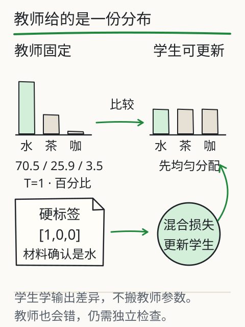
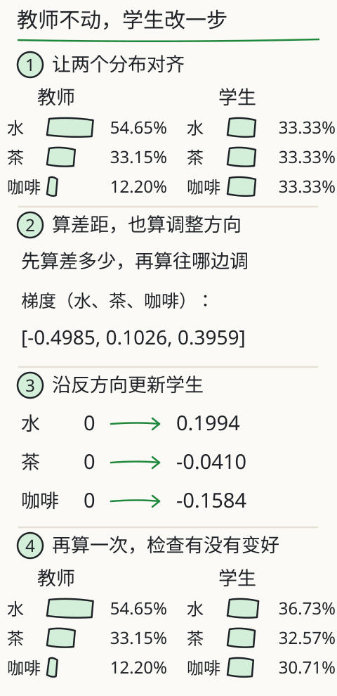
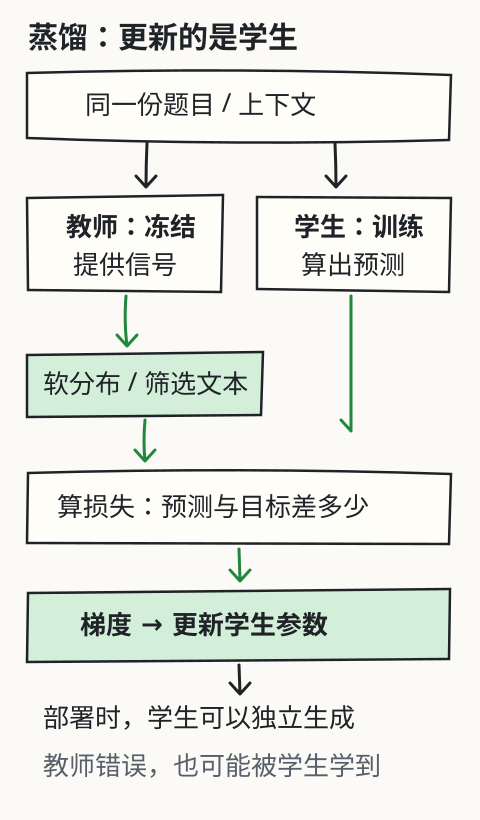

# C26 蒸馏学到的是什么

假设你有一个会做任务的模型，想训练另一个更小的模型来做同样的事。能不能让前者出示范，后者照着练？可以，这就是蒸馏的一条路。但先别急着说“把知识复制过去”：教师给出的是概率、分数或回答文本，学生拿这些信号算损失、改自己的参数；这里没有剪下一块教师权重，也没有把全部能力装进一个小文件。

C26 把三件事分开：**分布蒸馏**（能拿到教师对候选的分数）、**文本/序列蒸馏**（只拿到教师写出的回答）、以及**错误继承**（教师错了，学生也可能学得更像）。同时保留 X09 的固定教学算例：教师分数 `[3,2,0]`、错误教师 `[0,3,2]`、共同温度、KL 方向、T² 和混合梯度。最后给出 K4 阶段门任务；答案不在题面里。

## 先修桥：C09 的交叉熵 + C25 的适配

C09 已经讲过：给定目标分布，交叉熵衡量学生分布与目标差多少；对 logits 的梯度是 `p - y`。C25 又让你看到，示范数据可以拿来更新学生参数，而“更新哪些参数”本身是一个设计选择。蒸馏只是把训练信号的来源换了一部分：

- 硬标签：已核实的目标，例如“杯中是水”，写作 one-hot `[1,0,0]`；
- 软目标：教师给整个候选集的概率或分数，例如 `[3,2,0]` 经 softmax 得到的分布；
- 文本示范：教师只给出最终回答，学生用教师写出的 token 做自回归交叉熵。

三者都能训练学生，但提供的信息量不同。不要把“拿到一段教师回答”说成“拿到教师全部词表概率”，也不要把“学生输出像教师”说成“学生复制了教师内部状态”。

## 硬标签与软目标：先算一遍

为了手算，候选只留三个：水、茶、咖啡。题目已核实杯中是水，所以硬标签是：

```text
y = [1, 0, 0]
```

教师给这三个候选的原始分数是 `[3,2,0]`。温度为 1 时：

```text
p_i(1) = exp(z_i) / Σ_j exp(z_j)
       ≈ [70.54%, 25.95%, 3.51%]
```

最高项是水，但茶仍排在咖啡前面。软目标把这种相对关系也交给学生：学生不只知道“第一名是水”，还要学“茶比咖啡更像”。这不是说杯中有茶的概率是 25.95%；题目已经核实是水，这个分布描述的是**教师的生成倾向**。

温度 T 把分数差距拉开或压平：

```text
p_i(T) = exp(z_i / T) / Σ_j exp(z_j / T)
```

把 T 从 1 调到 2，教师分布约为：

```text
p(2) ≈ [54.65%, 33.15%, 12.20%]
```

最高项收了一点，原来很小的咖啡项被抬起来。比较教师和学生时必须用**同一个 T**；不能一边调热、一边不调，再把差异都算到学生头上。温度也不是越高越好：继续升高会趋近均匀，原本有用的区别会变淡。训练温度和部署时采样温度是两件事。

## KL 在比较什么，方向为什么重要

用 `p` 表示固定教师，`q` 表示学生。常用差异度量是：

```text
KL(p(T) || q(T)) = Σ_i p_i(T) * ln[p_i(T) / q_i(T)]
```

读法：逐个候选比较教师概率与学生概率的比值，取自然对数，再乘教师给它的权重，最后求和。单项可以为负，完整的 KL 总和才非负；不要把某一个候选的单项当成整份损失。

注意方向：`KL(p||q)` 由教师分布加权，学生把概率放到教师认为重要的候选上；交换成 `KL(q||p)` 不是同一个算法。教师固定时，`KL(p||q)` 与软目标交叉熵只差一个不随学生参数变化的教师熵，因此对学生产生相同梯度。教材里说“KL 方向有意义”，指的就是这类差别，不是文字游戏。

## T²、混合损失和一步更新

只学教师分布，可能丢掉已核实的硬标签；只学硬标签，又浪费教师的相对信息。常见做法是混合：

```text
L = α * T² * KL(p(T) || q(T)) + (1 - α) * CE(y, q(1))
```

`α` 调节软、硬信号的份量；硬标签这部分用 `T=1`。本课 X09 的默认设置是 `α=0.7`、`T=2`、学生初始三个分数都是 0，学习率 `0.4`。

为什么要乘 `T²`？未经补偿的软目标梯度大致含一个 `1/T` 因子；在较高温度、固定分数差等近似条件下，概率差本身还会再缩小约 `1/T`，合起来接近 `1/T²`。乘 `T²` 是为了补偿这类尺度变化，让软目标能和硬项一起训练。它不保证不同温度下梯度完全相同，更不是把准确率乘 `T²`。

对学生第 `i` 个候选的原始分数 `s_i`，混合损失的梯度写成：

```text
∂L/∂s_i = α T (q_i(T) - p_i(T)) + (1 - α)(q_i(1) - y_i)
```

按 `新分数 = 旧分数 - 学习率 × 梯度` 更新。X09 的默认算例给出：

```text
混合损失 ≈ 0.7378
梯度     ≈ [-0.4985, 0.1026, 0.3959]
学生新分数 ≈ [0.1994, -0.0410, -0.1584]
```

这些数是固定教学分数上的计算，不是某个商用模型的内部读数。教师的 `[3,2,0]` 在整个更新中保持不变；真正变化的是学生。





本地实验：[X09 蒸馏](../../../exports/llm/training.html#distillation)。它会显示 `q(T)` 与 `q(1)`、教师/学生更新前后、温度与权重的切换，以及错误教师对照；网页与书籍使用同一组公式和数值。

## 错误教师：更像教师，不等于更接近事实

现在做一次故意破坏：保持 `α=0.7`、`T=2`，把教师换成偏向茶的 `[0,3,2]`。题目仍然核实杯中是水。实际更新一步后，学生给水的推理概率会从 `33.33%` 降到约 `32.03%`。

为什么？在这个权重下，软信号把学生往教师分布拉，硬标签只占 0.3；错误教师的软信号压过了硬标签。学生确实“更像教师”了，但对已核实的水却分得更少。这演示的是**模仿与事实的分离**：蒸馏损失下降、输出更像教师，都不等于事实正确。

把 `α` 调到 0，再更新一步，学生只按硬标签学习；这是对照，不是宣布 `α=0` 永远最好。即使 KL 很小，也只说明学生在这批输入上的分布很像教师。教师错得很稳定时，学生也可能学得很像。真实项目里要保留数据来源、错误类型和独立评测，不能只看蒸馏损失。



## 只有教师文本时：序列蒸馏

如果接口只给回答文本，前面的整张概率表就用不上。设教师对题目 `x` 生成示范序列 `ŷ_1,…,ŷ_m`，一个常见的学生目标是：

```text
L_text = -Σ_t ln q_学生(ŷ_t | x, ŷ_<t)
```

`ŷ_<t` 是示范里已经写在前面的部分。训练时把这段前缀给学生，让它预测下一个示范 token；这叫 teacher forcing。每个 token 仍用交叉熵，只是整段监督目标来自教师。经典序列蒸馏用教师解码出的序列近似序列分布，不需要保存所有候选序列的概率。

这条路线没有拿到教师未选中的候选分布。你不能从一段回答倒推“教师给茶的 25.95%”；即使接口附带少数 token 的 logprob，也还不是整个词表。不同词表/分词器还需要对齐：如果教师的第 2 项和学生的第 2 项不是同一片段，按下标相减就没有意义；只用文本时，通常用学生自己的分词器重新编码示范。

真实流程通常是“设计题目→教师生成→核对和筛选→编码→训练学生→独立评测”。别跳过筛选：错误答案、缺失条件、矛盾解释都会被当成要学的目标；还要去重，排除评测题及近似改写，并保留来源和错误类型。最简单的响应蒸馏可以离线做：教师先交出固定示范，学生之后拿它训练。另一些方法会先采样学生自己的回答，再请教师反馈，以减轻“训练时一直沿着教师前缀走，实际生成却沿自己的前缀走”的差异；本课没有实现这些方法。

## 推理蒸馏：学的是可见文本，不是内部思维

只给答案，与连解题步骤一起给，学生可见的材料不同。后者若包含有效中间步骤，能提供更多拆分问题和作答模式的信号；训练仍然是从数据更新学生参数。拿到一篇解释，不等于读取或复制了教师不可见的内部思维。你还要逐步检查：学生可能模仿一长串步骤，也把前后矛盾、答案对但过程错的部分一起学走；数学或代码任务能执行时，加独立验证，开放任务则先写清评价依据。

一个可核查的历史例子是 2025 年 DeepSeek-R1 首版报告第 2.4 节：它描述用整理的教师数据微调 Qwen/Llama 系列学生，报告该组蒸馏模型没有再加 RL 阶段。这是该版本的具体配方，不能推广成“蒸馏从不用 RL”，也不能移给 DeepSeek V4.1 Flash 或 Kimi K3；后两者的实际蒸馏路线需要各自公开依据。

## 和 SFT、RL、量化、剪枝、RAG 的关系

| 方法 | 主要改什么 | 与蒸馏的关系 |
| --- | --- | --- |
| SFT | 用示范数据更新参数 | 教师响应可以成为 SFT 数据；数据来源与训练目标分开看 |
| RL | 根据奖励优化行为策略 | 可与蒸馏前后结合；蒸馏不自动等于 RL |
| 量化 | 权重或计算的数值精度 | 不等于跟教师学习；可对蒸馏后的学生再量化 |
| 剪枝 | 删除或稀疏化连接/结构 | 改结构的机制不同，也可与蒸馏组合 |
| RAG | 取回材料放进本次输入 | 通常不改参数；资料常变时不应靠蒸馏替代更新与引用 |

蒸馏的工程动机通常是“教师使用昂贵，学生更适合部署”。但省多少要看学生结构、硬件、序列长度和任务；出训练材料与训练学生本身也有成本。不能预先承诺固定压缩倍数、必然更快或覆盖教师全部任务；在有限任务上，学生也可能因为数据、目标和评测条件不同而超过教师。

## 把 C24/C25 的小模型放回边界

本目录的 `sft.jsonl` 是作者编写的“指令→回答”示范，不是任何教师模型的输出；`train.py adapt` 做的是 SFT/LoRA，不是模型到模型的蒸馏。C26 的数值来自 X09 的固定教学分布，**不是**本课微型 decoder 的 logits，也不是商用模型的内部读数。要声称做过真实蒸馏，至少需要：

1. 明确教师身份、版本、调用条件和许可；
2. 保存教师输出或分布，区分文本与 logits；
3. 学生分词器对齐，筛选错误与重复；
4. 独立留出集、基线、相同解码设置；
5. 报告质量、错误类型、成本，并说明教师错误是否被继承。

本课只完成其中“公式、梯度、错误教师”的教学证据，不伪造教师输出，也不把玩具分布当成真实模型能力。

## K4 阶段门（题面不含答案）

下面五题用于检查你是否真的能诊断、改进并用小模型验证原理。每题都给出通过标准；答案与参考核算在 [`../deepening/c26-answer.md`](../deepening/c26-answer.md)，但先闭卷做。

1. **闭卷解释**：不看正文，解释目标错位、因果掩码、正弦位置、残差/归一化的作用；写出软目标、KL、T² 和混合梯度公式。通过标准：公式方向正确；能说明 `-inf` 必须在 softmax 前；能说明 T² 是尺度补偿而非准确率；不把蒸馏说成复制权重。
2. **小 decoder 证据**：运行 `inspect` / `train` / `sample`，列出 `parameters`、`losses`、`target_shift`、`future_invisibility`、`reload`、`sample` 字段。通过标准：未来不可见与重载一致有明确布尔结果；留出损失被报告；不把玩具结果外推成通用能力。
3. **SFT/LoRA 对照**：从同一底座跑 `adapt --method both`，做一张表：可训练参数、底座是否冻结、底座/适配器哈希是否变化、重载是否一致、验证/留出损失。通过标准：工程事实与数据测量分开；不宣称 LoRA 或全量 SFT 必然更优；能解释 `base_grads_all_none`。
4. **错误教师**：用 X09 的默认设置和错误教师 `[0,3,2]`，复算一步更新，说明为什么水的概率会下降。通过标准：公式、KL 方向、`α`/`T` 条件正确；明确“更像教师”不等于“更接近事实”；不把教学分布冒充商用模型 logits。
5. **单变量对照**：只改一个因素（去掉因果掩码、改变 rank、或改变温度），记录改动前后的第一个失败边界和证据。通过标准：只改一个原因；有可复现命令/字段；失败不被抹去；能说明该实验不能证明什么。

阶段门不是选择题：你需要能运行、能读数、能指出边界。没有真实运行证据的地方，必须写“未验证”，不能用文字补成已完成。

## 独立练习

1. 教师分数 `[3,2,0]`，分别算 `T=1` 和 `T=2` 的 softmax；解释为什么 T=2 时最高项下降、最低项上升。
2. 写出 `∂L/∂s_i` 的两项，指出哪一项来自软目标、哪一项来自硬标签；当 `α=0` 时剩下什么？
3. 如果教师只给一段回答文本，哪些量你拿不到？学生能用什么损失训练？teacher forcing 的前缀从哪里来？
4. 把错误教师换成 `[0,3,2]`，用默认 `α=.7`、`T=2`、`lr=.4` 算一步；水的概率为什么下降？若把 `α` 调到 0，方向会怎样变？
5. 写一段 5 行以内的“不能声称”的边界说明：本课的蒸馏证据能支持什么、不能支持什么。

项目增量：你已经能把蒸馏拆成分布、文本和错误继承三条线，能用固定数值复算 KL/T²/混合梯度，能把 SFT/LoRA 与蒸馏区分开，并有一套 K4 阶段门的自检标准。C27 会转向图片、扫描件与多模态边界；如果缺少合法 OCR/视觉资源，要如实记录资源阻碍，不能回退成人工伪造模型输出。

上一章：[C25 何时适配参数，何时不该训练](c25.md)。答案与核算：[`../deepening/c26-answer.md`](../deepening/c26-answer.md)。

## 来源与边界

- Hinton、Vinyals、Dean，*Distilling the Knowledge in a Neural Network*（2015）：软目标、温度与师生框架。
- 本课 L05 深入 [`../distillation.md`](../distillation.md) 与 X09 fixture：共同温度、KL 方向、T²、混合梯度、错误教师；所有固定数值来自该教学算例。
- 2025 年 DeepSeek-R1 首版报告第 2.4 节的蒸馏配方，仅作为该版本的历史例子引用；不推广到其他模型版本。
- PyTorch 2.14.1 官方文档：交叉熵、`softmax`、`log`、反向传播与 `state_dict`。
- 边界：本课没有调用真实教师模型，没有采集教师 logits 或文本，也没有实现模型到模型的蒸馏。X09 是三个候选上的受控教学计算；本目录的 `sft.jsonl` 是作者编写的示范，不是教师输出。真实蒸馏的效果、成本、错误继承和许可必须由对应项目另行验证；不得用本课数字冒充商用模型内部读数或真实训练记录。
