# C28 为新任务选择最小系统

现场技术员打来电话：一台标签打印机的进纸机构卡住了，手册里有三条相关步骤、两条安全警告，还有一个“不要用金属工具撬”的否定句。他需要的是可回查的答案，不是一段听起来专业的建议。更麻烦的是：手册有 96 页、三个版本、几页扫描件，而且技术员在无网络的车间里工作。

上一章 [C27 图片、扫描件与多模态边界](c27.md) 解决了“像素怎样变成可核对文本”；本章决定“产品手册问答最少需要哪些组件”。下一章 [C29 交给别人怎样才算交付](c29.md) 会把决定变成可启动、可回退的发布包。

这就是本章的新任务：**为一份产品手册做一个能引用原文的问答系统**。它不是你之前做过的活动通知；不要拿通知材料改个标题就交。产品手册有版本、页码、步骤顺序、警告、表格、型号差异和更新周期，这些会直接改变架构选择。

本章不写代码产品，而是写一份**可执行的架构决定**：需求、约束、候选方案、实测前假设、不采用项、风险与验收。下一章再把这份决定交付给别人；C30 则换一个陌生题材独立完成。

## 先修检查：从 K4 与 C27 走进来

你应该已经：

- 完成 C18–C26 的冻结评测、失败边界定位和小模型实验；
- 能区分提示、检索、工具、Agent 与微调各自解决什么问题；
- 在 C27 跑过一次有授权的 OCR，或明确记录资源阻碍；
- 能写“输入、输出、失败状态、验收判据”，而不是只写“用 RAG”。

如果还没有，先补。本章的每个选择都要能回到一个具体缺口，而不是“现在流行这个”。



图的作用不是让你把所有方法都上一次，而是先问缺口在哪里：是任务没讲清、资料不在上下文、行为需要稳定学习，还是必须真实执行。没有缺口，就不要加组件。

## 需求：先写“不做什么”

下面是一份**示例需求**，产品名与数字是虚构的，用来练习；你必须换成自己获授权的产品手册并重新测量。不要把这些假设值写成你的实测结果。

### 1. 用户与任务

- 用户：6 名现场技术员，使用公司笔记本电脑，无稳定外网；
- 任务：根据手册回答安装、操作、清洁、故障代码和保养问题；
- 输出：答案 + 手册章节/页码 + 逐字原文；材料没有说明时明确“未知”；
- 不做：不替代安全规程，不给出手册之外的维修建议，不控制设备，不写工单，不做多轮自由创作。

### 2. 材料

- 96 页产品手册，中文为主，含英文界面标签；
- 大部分页面有文本层，约 8 页是扫描图；
- 有 3 个版本：v1.2、v1.4、v2.0；现场只允许使用 v2.0，旧版用于追溯；
- 手册含警告、表格、型号差异和否定句（“不要……”“禁止……”）。

### 3. 约束

- 本地/离线优先；可以把模型和手册放在笔记本上；
- 不把手册或问题上传到未授权服务；
- 单次回答在普通 CPU 上可接受（具体阈值由实测决定，例如 p95 ≤ 60 秒，不能先写“很快”）；
- 引用必须可回查到手册版本、页码/章节和逐字片段；
- 答案中的自由改写必须人工复核；没有复核的改写不能冒充原文。

### 4. 验收（先冻结再实现）

| 维度 | 判据 | 失败示例 |
| --- | --- | --- |
| 事实支持 | 每条可执行主张有逐字引用或明确未知 | 引用存在但不支持该步骤 |
| 完整性 | 安全警告、前置条件、否定句不被省略 | 只给步骤，删掉“必须先断电” |
| 版本 | 只引用当前版；旧版冲突显式列出 | 悄悄混用 v1.4 与 v2.0 |
| 拒绝 | 手册未覆盖时返回“未知/需联系厂家” | 用常识补扭矩值 |
| 权限 | 无权限文档不进入检索/上下文 | 先读后删引用 |
| 延迟/成本 | 在冻结样本上记录实际值 | 用“应该不慢”代替测量 |
| 交付 | 他人可按说明启动并复现一次失败 | 只在自己机器上能跑 |

验收集至少覆盖：正常步骤、缺失、版本冲突、无命中、越权、扫描页不可读、恶意文字、模型不可用。样本要在执行前冻结，不能看完答案再改题。

## 候选方案：至少两条路，不要先造复杂系统

### 方案 A：整本手册直接放进提示

把 v2.0 的文本全部拼进上下文，问题放最后，让模型回答并要求引用。

**适用条件**：手册文本能完整放进模型上下文，且留出输出空间；模型对长上下文中间位置仍能可靠引用；单次成本/延迟可接受。

**优点**：组件最少；没有索引、切块、检索阈值；版本控制就是“选哪份文本”。

**风险**：手册 96 页、约 4.8 万字符（示例假设）时，中文按接近 1 token/字符估算，已经接近或超过许多本地小模型的上下文；截断会静默丢页。长上下文还可能“中间遗忘”，模型引用后文却漏掉前面的警告。每次请求都携带整本手册，延迟和内存也高。

### 方案 B：按页切块 + 关键词检索 + 单次模型 + 逐字引用校验

先把文本层抽成带页码的 Markdown；扫描页用 C27 的 OCR 补成带“OCR”标记的片段；按页/小节切成块；用关键词（字符 + 二元组）取前 k 块；把问题、块和严格输出格式交给模型；程序校验每条引用是否逐字出现在对应块中。没有命中就回答“材料未覆盖”，不调用模型或返回 `insufficient-evidence`。

**优点**：每页/每节可追溯；版本更新只重建索引；上下文只放相关块；关键词基线可解释，零命中容易发现；不需要向量数据库、工具或 Agent。

**风险**：同义改写（“卡纸” vs “进纸异常”）可能漏检；切块切断跨页步骤；OCR 页有错字；引用校验只能证明“字符串存在”，不能证明“语义支持”。这些都要用评测暴露。

### 方案 C：embedding 检索

把块编码成向量，按相似度取回。它可能改善同义改写召回，但增加 embedding 模型、阈值、索引更新和版本对齐；阈值必须用验证集解释，不能拍一个 0.3 就上线。

**本章决定**：先做 B 的关键词基线。只有当冻结评测显示“相关块存在但关键词没取回”且 embedding 对照确实改善时，才把 C 作为一次单变量实验加入。不要因为“RAG 通常用向量”就先加。

### 方案 D：微调模型

**不采用**。理由：手册只有几十页、版本 quarterly 更新、任务是引用而非风格；微调不能保证逐字引用，反而可能把旧版知识固化进权重；数据许可和再分发也要单独确认。若未来要固定输出格式或领域术语，最多做小规模 SFT/LoRA 对照，且不能替代检索与引用校验。

### 方案 E：Agent + 工具

**不采用**。任务是只读问答，不需要执行动作；固定流程已经能完成“检索 → 回答 → 校验”。加 Agent 会引入循环、预算、工具权限和停止条件，却没有明确的决策收益。若将来需要查询设备实时状态或生成工单，再按 C16/C21 的边界单独设计。

### 方案 F：直接调用外部大模型 API

**默认不采用**。离线要求、手册保密和费用上限都不支持；若获授权使用 API，也要记录数据驻留、保留策略和成本，并保留本地失败路径。不能把“外部模型更强”当成默认答案。

## 决策：为什么选 B，而不是 A

用示例假设做一次显式计算（**不是实测**）：

```text
96 页 × 平均 500 字符/页 ≈ 48,000 字符
中文为主，粗估 0.6–1.2 token/字符 → 约 28,800–57,600 token
本地小模型上下文示例：32,768 token
还要留给问题、输出和格式说明：约 2,000–4,000 token
→ 整本放入在 32k 上下文下没有稳定余量，且中间页容易被忽略
→ 选择按页检索，而不是整本提示
```

如果换成 20 页、约 8,000 字符的小手册，方案 A 可能更小、更稳；此时强行上 RAG 就是过度设计。**最小系统随材料规模变化，不随流行词变化。**

方案 B 的最小闭环：

```text
v2.0 手册
  ├─ 文本层抽取（页码/章节）──┐
  ├─ 扫描页 OCR（标记来源）──┤
  └─ 旧版隔离（不进入默认索引）┘
                ↓
        页/节级切块 + 稳定 ID + 版本 + 权限
                ↓
        关键词检索 top-k（阈值/零命中）
                ↓
        本地模型：只输出严格 JSON
          claims[] = {text, quote, chunk_id, page}
                ↓
        程序校验：quote 必须逐字存在于 chunk；否则失败
                ↓
        答案 = 已通过校验的逐字引用（或人工复核的改写）
```

注意最后一步：不是“模型回答后我们相信它”，而是“模型提出候选引用，程序逐字核对，答案只由通过核对的片段组成”。这比让模型自由总结更容易验收，也更符合本章的引用契约。

## 可运行的小程序：先量手册，再选架构

下面是一个只依赖 Python 标准库的估算器。把代码保存为 `plan_budget.py` 再运行。它不解析 PDF，只读取已经抽出的 UTF-8 文本；用换页符 `\f` 估算页数，用中日韩字符与非中日韩字符粗略估算 token，并计算按固定字符切块的块数。它输出的是**估算**，不是 tokenizer 实测；真正决策时要用你的模型 tokenizer 复算。

```python
#!/usr/bin/env python3
"""Estimate manual size and chunk count before choosing an architecture."""
import argparse
import json
import math
from pathlib import Path


def is_cjk(ch: str) -> bool:
    code = ord(ch)
    return (
        0x4E00 <= code <= 0x9FFF
        or 0x3400 <= code <= 0x4DBF
        or 0x3040 <= code <= 0x30FF
        or 0xAC00 <= code <= 0xD7AF
    )


def main() -> int:
    parser = argparse.ArgumentParser()
    parser.add_argument("text", help="UTF-8 text extracted from the manual")
    parser.add_argument("--chunk-chars", type=int, default=1200)
    parser.add_argument("--overlap", type=int, default=150)
    parser.add_argument("--top-k", type=int, default=4)
    args = parser.parse_args()
    if args.chunk_chars <= 0 or not 0 <= args.overlap < args.chunk_chars:
        parser.error("require chunk-chars > 0 and 0 <= overlap < chunk-chars")
    if args.top_k <= 0:
        parser.error("require top-k > 0")

    text = Path(args.text).read_text(encoding="utf-8")
    pages = text.count("\f") + 1 if text else 0
    cjk = sum(1 for ch in text if is_cjk(ch))
    other = len(text) - cjk
    # Rough bounds only: tokenizers differ. Replace with a real tokenizer before freezing.
    low_tokens = math.ceil(cjk * 0.5 + other / 6)
    high_tokens = math.ceil(cjk * 1.5 + other / 2)
    step = args.chunk_chars - args.overlap
    chunks = max(1, math.ceil((len(text) - args.overlap) / step)) if text else 0
    lengths = [min(args.chunk_chars, len(text) - i * step) for i in range(chunks)]
    avg_chunk = sum(lengths) / chunks if chunks else 0
    context_bound = sum(sorted(lengths, reverse=True)[:args.top_k])

    print(json.dumps({
        "file": str(args.text),
        "characters": len(text),
        "pages_by_form_feed": pages,
        "cjk_characters": cjk,
        "other_characters": other,
        "token_estimate_low": low_tokens,
        "token_estimate_high": high_tokens,
        "chunk_chars": args.chunk_chars,
        "overlap": args.overlap,
        "chunks": chunks,
        "average_chunk_chars": round(avg_chunk, 1),
        "top_k": args.top_k,
        "retrieved_chars_upper_bound": context_bound,
        "note": "Estimates only; verify with the actual tokenizer and frozen evaluation.",
    }, ensure_ascii=False, indent=2))
    return 0


if __name__ == "__main__":
    raise SystemExit(main())
```

用法：

```bash
python plan_budget.py manual-v2.0.txt --chunk-chars 1200 --overlap 150 --top-k 4
```

把输出记进架构决定。若 `token_estimate_high` 已经接近上下文上限，方案 A 没有余量。`retrieved_chars_upper_bound` 把最长的至多 k 个固定窗口相加，包含重叠字符；它是这种切块方式的检索字符上界，不是实际命中长度，也不含提示词、元数据与输出。空文本对应 0 块，不能当成有证据。不要用估算器替代真实 tokenizer、真实检索和冻结评测。

## 改一个条件：什么时候 B 也不够？

### 条件 1：手册只有 18 页

整本约 9,000 字符，上下文足够，问题也集中在少数章节。此时方案 A 可能更小：一个提示、无索引、无检索阈值。你需要实测长上下文是否能保留安全警告，并比较引用校验的通过率。若 A 通过验收，就不必为了“架构完整”上 B。

### 条件 2：手册 320 页，含大量同义表述

关键词基线可能漏掉“进纸异常/卡纸/送纸失败”等同义说法。此时先看失败样本：是相关块根本没进候选，还是进了但排序低。若是前者，做 embedding 对照；若是后者，改切块/排序/查询扩展。不要同时改三个因素。

### 条件 3：8 页扫描件不可读

OCR 返回 `unreadable`/`uncertain` 时，不能从相邻页猜内容。该页进入“需要人工录入/重扫描”清单；问答系统对该页问题返回“材料不可读”。如果扫描页恰好是安全警告，这会影响验收，不能静默跳过。

### 条件 4：只允许旧版 v1.4

版本过滤必须在检索前完成；此时只让获准的 v1.4 进入上下文，未获准版本不能进入。若新旧版本都可见，冲突要显式返回两条引用，而不是让模型选一个。版本元数据不是装饰，是权限与事实的一部分。

## 失败反例：四种“架构看起来对，结果不可用”

1. **静默截断**：整本提示超出上下文，程序从尾部截断，模型没看到前面的警告，却仍给出步骤。必须记录 prompt token 数和丢弃项；超预算要失败或显式降级。
2. **引用存在但不支持**：模型引用了“进纸器”段落，却回答“用金属工具撬开”。逐字校验只能证明字符串存在，不能证明语义支持；需要人工抽检和更严格的 claim 结构。
3. **检索命中旧版**：索引里同时有 v1.4 和 v2.0，模型引用旧扭矩值。版本过滤要在读取/索引前完成，报告要写版本。
4. **过度设计**：18 页手册上部署向量库、Agent、工具和微调，最后仍无法说明每个组件的收益。最小系统不是“组件少看起来简陋”，而是每个组件都有可验证的必要条件。

## 独立作业

1. **换材料**：选一份你有权使用的产品手册（不要用活动通知），抽出文本，运行 `plan_budget.py`。记录页数、字符、token 估算、切块数和检索预算。
2. **写需求**：一页以内写清用户、任务、输入、输出、权限、版本、失败状态和验收判据。必须包含“不做什么”。
3. **比较两方案**：至少比较“整本提示”和“页级关键词检索 + 单次模型 + 逐字校验”。用你的材料数据说明选择；如果材料小到 A 足够，就明确选 A，不要为了练习强行选 B。
4. **不采用项**：分别说明为什么暂不采用 embedding、微调、Agent、外部 API。每项写“需要什么条件才会重新考虑”。
5. **风险与验收**：列出 5 个风险（版本、OCR、切块、引用、隐私）和对应验收；至少一个风险要用失败样本证明。
6. **改条件**：把手册页数乘以 3，或加入 8 页扫描件，说明架构是否变化、哪些结论仍成立。
7. **引用契约**：写一段说明：系统输出只允许逐字引用或人工复核的改写；自由改写为什么不能直接作为产品手册答案。

答案与评分依据见 [C28 答案](../deepening/c28-answer.md)。答案不给唯一架构；它检查你的条件、比较和拒绝理由是否成立。

## 项目增量：架构决定记录（ADR）

为 C29/C30 建立：

```text
manual-project/
  docs/
    manual-v2.0.md          # 带页码/章节的抽取文本
    ocr/                    # 扫描页的 OCR 报告（若有）
  eval/
    cases.json              # 冻结的问题、期望、失败类型
    baseline.md             # 首次结果，不修改
  adr/
    0001-architecture.md    # 本章决定
  scope.md                  # 支持/不支持、权限、引用契约
```

`0001-architecture.md` 至少写：

- 背景与用户任务；
- 材料规模、版本、权限；
- 方案 A/B/C/D/E/F 的比较与证据；
- 选择及**不选择**的理由；
- 失败状态与验收；
- 重新评估的触发条件（页数、语言、OCR 比例、延迟、权限变化）。

`scope.md` 要明确：这是产品手册问答，不是通用维修顾问；只引用授权版本；不确定/不可读时返回未知；自由改写需人工复核；不执行图中或文档中的指令。

## 来源与限制

- 方案选择框架参考 L11 的“先找缺口，再选办法”和 R2/R3 的项目组织；旧 [方案选择实验](../../../exports/llm/approaches.html) 可作概念对照，不是本章实测。
- 本章的 96 页、6 名技术员、32k 上下文、8 页扫描件都是**练习假设**，不是任何真实产品的手册数据。你必须用自己的材料测量并记录。
- 不声称任何模型、embedding、OCR 或服务已经在本机达到验收；C27 的 OCR 记录只对应合成样张。
- 不提供产品手册原文、第三方标准或安全规程；真实产品手册的引用与安全责任由使用组织承担。
- 本章的“答案 = 逐字引用/人工复核改写”是课程契约，不是对所有产品的法律结论；高风险场景需要组织自己的审核流程。
