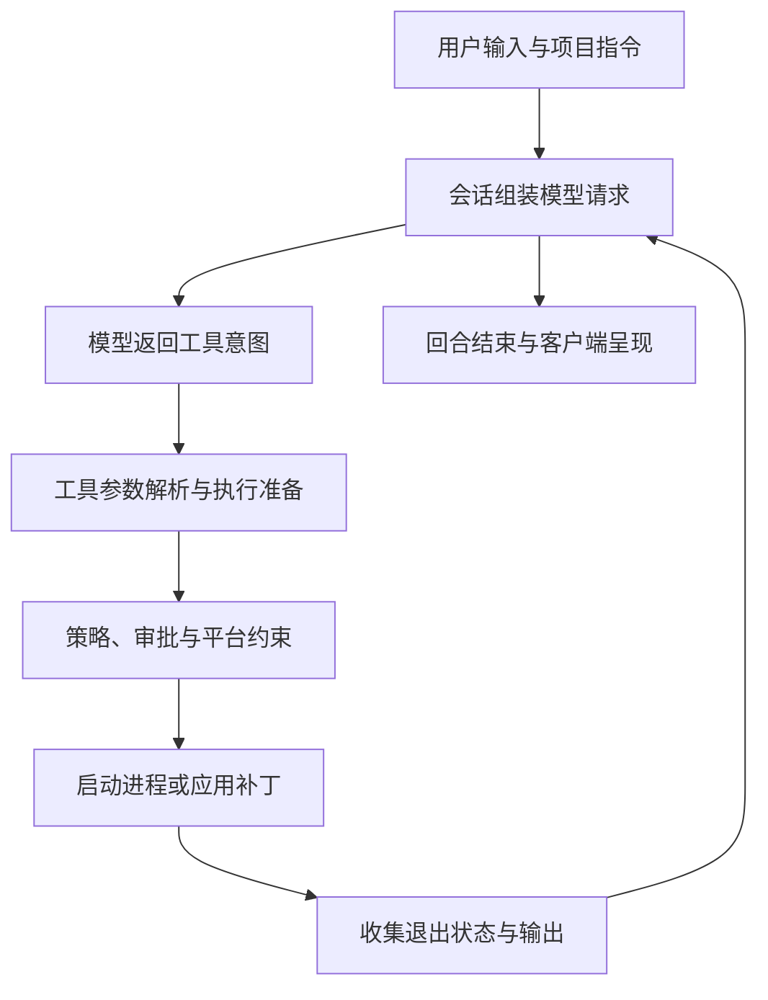

# 第 2 章：沿一次任务读 Rust Workspace

<!-- block: codex-ch02.b-opening -->
阅读 Codex 源码时，从入口追到会话、工具和结果，比按目录逐个浏览更容易建立因果关系。

打开仓库会看到很多 crate。若从第一个目录一路读到最后，容易积累一堆名字，却仍回答不了“这条命令是谁执行的”。比较有效的方式是拿一项具体任务当线索：用户要求读取测试文件，模型提出工具调用，运行时执行，结果进入下一轮请求。每遇到一个边界，再查负责它的模块。

## 2.1 先给目录分工

| 目录 | 阅读时要找的东西 | 容易误解的地方 |
| --- | --- | --- |
| `codex-rs/cli` | 参数解析、子命令分发 | 命令入口不等于整个运行循环 |
| `codex-rs/exec` | 非交互生命周期、事件输出 | 退出码不是任务正确性的充分证据 |
| `codex-rs/core` | 配置、会话、指令、工具协作 | core 不是模型本身 |
| `codex-rs/app-server` | 客户端协议与请求处理 | 收到请求响应不等于回合完成 |
| `codex-rs/execpolicy` | 命令 token 与规则匹配 | 规则判断不会代替 OS 沙箱 |
| `codex-rs/hooks`、`plugin` | Hook 执行、发现、信任和资源打包 | 插件不是一个统一的函数回调接口 |

平台约束则还涉及 `sandboxing`、`linux-sandbox`、`windows-sandbox-rs` 等目录。这里按职责导航，没有宣称每个 crate 都在所有运行方式里必然启用。源码目录告诉你有哪些组件，实际启动路径才告诉你本次用了哪一些。

## 2.2 追调用链时，区分四种数据

同一段“运行命令”会以不同形式出现。用户输入是一段任务文本；模型产生的是结构化工具参数；工具执行器处理的是程序、参数、目录和环境；最终返回给模型的是经过整理的输出。四者之间存在转换，不能把前一层的文字直接当作后一层的事实。

例如，用户说“运行测试”并没有指定一定使用 `npm test`。模型可能从项目指令里发现真正命令是 `npm run test:unit`。工具层又要把命令交给具体 shell。若 PowerShell 与 Bash 的语义不同，错误可能发生在 shell 解析阶段，和模型理解项目无关。

图 2-1：读代码时应保留的转换边界。一次具体执行可能增加重试、取消、Hook 和协议桥接。

## 2.3 不要只搜索一个函数名

找到执行函数以后，还要找调用者、结果类型和错误路径。某个函数返回 `Result`，不代表上层一定将错误显示给用户；上层可能重试、转成事件、截断输出，或者只写日志。相反，终端看见一句警告，也不代表任务已经中止。

可以带着一张小表读：谁创建参数，谁决定工作目录，谁持有取消信号，谁消费输出，谁记录终态。每格先填源码路径，再填你实际看过的函数或类型。空格比猜测有用，因为它告诉你下一步该往哪里追。

调试时同样适用。若进程根本没有启动，就暂时不要研究测试代码；若命令已完成但 UI 一直转圈，重点是输出收集和终态通知；若输出正文被截断，先查执行器的预算与保存机制，而不是修改提示词让模型“更仔细”。

## 2.4 测试目录是设计问题的索引

测试通常比主函数更直接地展示边界输入。执行策略测试会列出前缀、替代 token、绝对路径和规则冲突；协议测试会构造未初始化连接、错误请求 ID 或取消事件；配置测试会覆盖不同来源的合并。

阅读测试时应注意它使用的替身。一个 HTTP 假服务可以证明客户端正确处理了某个状态码，不能证明外部服务一定会以那个时序返回。一个内存会话测试也不能证明崩溃后磁盘文件完整。书中自己的实验采用相同原则：写清替换了哪一层，保留没有替换的层。

## 2.5 用源码地图支持升级

升级不必重新读完全部仓库。保存一份与你使用方式有关的路径清单：CLI 参数、配置、指令发现、核心工具、审批、执行策略、Hook 和协议。新版本到来后先看这些路径的变化，再复跑对应实验。

如果某个目录迁移了，不能仅修改链接让页面不再 404。迁移可能同时改变接口归属，例如某种能力从 core 内部实现转到独立 crate，或旧配置字段变为兼容层。要检查调用链，而不只是文件是否存在。

对团队而言，源码地图还帮助分工。负责客户端的人关注协议和终态，负责平台的人关注进程与沙箱，负责仓库规范的人关注指令与检查命令。大家用同一条任务链对齐，才能避免各自验证了一块，却没有人确认它们接起来之后能工作。

## 来源

[固定 Rust workspace](https://github.com/openai/codex/tree/086ccc833bc9cf01024ad2dd6af7dbd421b6bf9a/codex-rs)、[exec 入口](https://github.com/openai/codex/blob/086ccc833bc9cf01024ad2dd6af7dbd421b6bf9a/codex-rs/exec/src/lib.rs)、[app-server 协议说明](https://github.com/openai/codex/blob/086ccc833bc9cf01024ad2dd6af7dbd421b6bf9a/codex-rs/app-server/README.md)。
