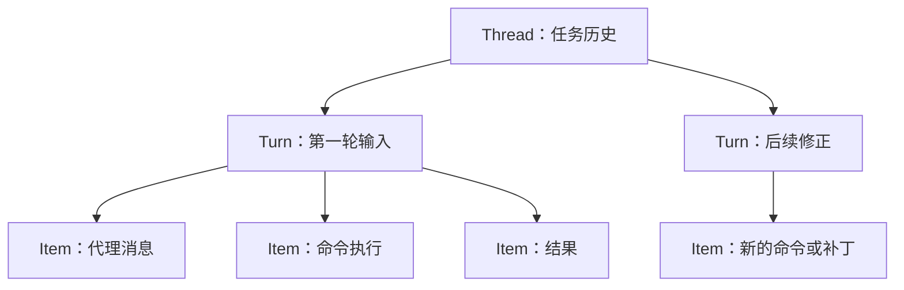

# 第 4 章：会话恢复不会替你恢复文件

<!-- block: codex-ch04.b-opening -->
恢复会话延续的是任务历史，分支会话复制的是对话起点；两者都应与 Git 工作树的实际状态分别核对。

一个任务昨天执行到一半，今天打开同一会话，代理仍记得“测试正在失败”。可是另一位同事已经修好了代码，或你自己切到了另一条分支。此时对话与磁盘各自都合理，却不再描述同一时刻。继续运行前，应先让两份状态重新对齐。

## 4.1 Thread、Turn 与 Item

客户端协议中，thread 表示一条任务历史；turn 表示一次输入推动的处理回合；item 表示回合中的消息、命令或其他活动记录。三个层级解决不同问题：线程用于保存连续任务，回合用于描述开始与结束，条目用于解释过程中发生的事。



图 4-1：协议里的归属关系。客户端不应把任意一条 item 完成当作整个 thread 完成。

持久化格式与客户端协议也不是一回事。客户端看到的 thread 对象可能只是摘要，完整历史需要另外读取；本地旧日志与新历史存储方式也可能存在兼容路径。不要根据一个返回对象里没有消息数组，就断言会话没有保存。

## 4.2 Resume 与 Fork 各自回答什么

`resume` 表示继续已有会话。你通常希望保留之前的推理背景、已做工作和待解决问题。`fork` 表示从既有历史另起分支，适合比较两个方案，避免把两条探索路线写进同一串对话。

```powershell
codex.cmd resume
codex.cmd fork
codex.cmd exec resume --help
codex.cmd exec fork --help
```

交互与非交互子命令有各自参数，先看固定版本帮助，再决定是用会话 ID 还是选择器。`--last` 之类便利选项适合个人终端，自动化中应保存明确 ID；否则工作目录或会话排序变化时，脚本可能接上另一项任务。

分支历史不会自动生成独立 Git 工作树。两条会话若同时操作同一目录，仍可能覆盖对方文件。要比较实现方案，除了 fork 对话，还应为每个方案分配独立工作树。第 16 章会把这两个“分支”放在同一个实验里。

## 4.3 恢复前的三项核对

先看基线提交与工作树差异，再看会话最后确认到哪一步，最后重新运行能快速判断现状的检查。这样做不需要重放每条旧命令，重点是找出已经过时的假设。

例如，旧会话说某测试因缺少字段失败。今天先打开测试文件和相关模型定义，再跑那一项测试。如果已经通过，就不要要求代理“继续昨天的修复”而又制造一个重复字段；应告诉它当前结果，并让后续工作基于现状。

同理，之前的安装命令若超时，不能根据聊天里“正在安装”判断依赖完全没写入。检查 lockfile、包目录和安装器日志。命令失败可能留下部分文件；会话的回合失败和磁盘事务回滚不是同一个机制。

## 4.4 历史可以压缩，工作证据应能独立读懂

长会话会受到上下文预算约束，模型下一轮看到的内容未必是所有原文。对话摘要保留的重点也可能与审计需要不同。把关键交付写成文件，比反复要求代理“记住刚才所有细节”更可靠。

一份任务记录可以很短：目标、基线、已改文件、检查命令、已知失败和下一步。敏感数据不要照搬到记录里；只写足够定位的标识。恢复后先读这份记录，再对照 Git 差异，能减少上下文变化造成的偏移。

`exec --ephemeral` 的帮助表明它不持久保存会话文件。它适合某些一次性处理，但不能把它解释为“运行没有副作用”：工具仍可能写项目文件，输出文件也仍可能由你指定保存。会话存储开关与工具写入范围应分别检查。

## 4.5 什么时候应该开始新会话

当目标发生根本变化、代码基线大幅移动、旧上下文充满已失效方案时，新会话往往更清楚。把仍有效的需求与证据带过去即可，不必为了保留连续聊天而背着大量过期信息。

反过来，任务只是被网络中断、终端关闭或短暂切走，并不一定需要新会话。先核实已有状态，再决定恢复。真正需要避免的是无判断地重试：重复执行一次查询通常代价小，重复提交、重复发消息或重复迁移数据库则可能造成外部副作用。

## 来源

[app-server 的线程、回合与条目协议](https://github.com/openai/codex/blob/086ccc833bc9cf01024ad2dd6af7dbd421b6bf9a/codex-rs/app-server/README.md)、[exec resume/fork 参数](https://github.com/openai/codex/blob/086ccc833bc9cf01024ad2dd6af7dbd421b6bf9a/codex-rs/exec/src/cli.rs)、[rollout 入口](https://github.com/openai/codex/blob/086ccc833bc9cf01024ad2dd6af7dbd421b6bf9a/codex-rs/core/src/rollout.rs)。本章恢复案例是操作方法，没有在真实模型会话中实跑。
