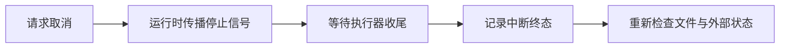
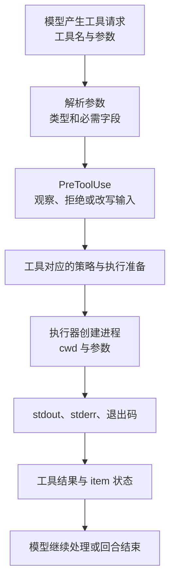

# 第 6 章：工具调用怎样成为本机操作

<!-- block: codex-ch06.b-opening -->
工具执行要经过参数解析、执行准备、策略判断、进程或补丁操作与结果收集；错误发生在哪一层，决定修复方法。

代理说要运行测试时，真正执行命令的是本机程序。模型给出的是意图和参数，运行时负责把它变成可执行动作。这条分界解释了许多现象：模型能选对命令，但 shell 找不到程序；进程成功结束，测试却没有覆盖你关心的行为；取消了回合，磁盘上仍留下已经写入的文件。

## 6.1 先把一条命令拆开

分析执行时，至少记录程序、参数、工作目录、环境和时间预算。`python -m unittest` 在两个不同目录可能发现不同测试；同名 `python` 也可能来自不同虚拟环境。仅保存命令文字并不足以复现。

| 项目 | 典型问题 | 观察证据 |
| --- | --- | --- |
| 程序路径 | PATH 命中了旧版本 | 版本输出或明确可执行文件路径 |
| 参数 | 引号被外层 shell 改写 | 传入参数数组、最小复现 |
| cwd | 运行了另一套测试 | 项目相对目录与基线提交 |
| 环境 | 缺工具、凭据或代理配置 | 脱敏后的必要变量与依赖版本 |
| 时间预算 | 测试慢还是已经卡住 | 开始时间、近期输出与进程状态 |

这个表不要求把完整环境公开。只保存与问题有关的最小数据，能避免日志本身泄露不需要的内容。

## 6.2 Shell 是一门额外语言

```python
# 普通 Python 示例：结构化参数避免多一层 shell 解析。
import subprocess

result = subprocess.run(
    ["python", "-m", "unittest", "discover", "-s", "tests"],
    cwd="sample-project",
    capture_output=True,
    text=True,
    timeout=60,
)
print(result.returncode)
```

这段代码不是 Codex 内部实现，而是说明命令参数与 shell 文本的差别。若确实需要管道、重定向或通配符，就明确选择 shell，并考虑其语法。不能把 Bash 的引号规则照搬到 PowerShell，也不能把 JSON 字符串转义当作 shell 转义。

执行策略同样受到命令形状影响。`git status` 与 `sh -c "git status"` 的第一层程序不同。第 10 章的规则检查对传入 token 作判断，不会自动证明任意嵌套 shell 字符串都得到相同决策。

## 6.3 输出结束与动作完成

进程退出码描述程序怎样退出。测试程序返回非零，通常意味着失败；某些搜索工具返回非零却只是没有匹配。解释退出码时要结合该程序契约，而不能统一当作“环境故障”。

同样，退出码为零不代表用户任务完成。一个构建脚本可能只生成了中间文件，或者根本没有运行指定的测试目标。要核对命令目标、实际产物与检查结果。代理最后的自然语言报告应引用这些证据，而不是只说“运行成功”。

对长输出，既要防止模型上下文被塞满，也要保留可回查的原始信息。适合的做法是缩小查询范围，或让项目工具把完整结果写文件，再提供摘要。不要通过截掉错误行来“整理日志”。

## 6.4 取消不是回滚

取消信号通常表达“停止继续工作”。已经完成的文件写入、提交、外部请求并不会因信号自动撤销。进程是否能及时停止，还取决于它如何响应终止、是否产生子进程、是否在不可中断操作中。



图 6-1：中断后仍要检查状态。箭头没有表示数据库或 Git 自动回滚。

设计可取消任务时，尽量先计算再写入，文件产物先写临时路径，检查通过后再替换目标。外部操作则使用能识别重复请求的业务标识。它们是应用层恢复设计，不能只靠一个通用代理的取消按钮补齐。

## 6.5 工具错误应该怎样进入下一步

一个有用的失败结果应包含动作、阶段和足够短的原因。比如“参数解析失败”与“进程无法启动”需要不同修复；“命令运行后测试失败”应保留测试名称和断言信息。把所有错误都总结成“工具不可用”会让模型盲目重试。

当失败涉及权限时，应先回到第 7、8 章判断。不要为了消掉一次拒绝就把整个环境改为完全访问。也不要反复用不同命令包装同一个被拒绝动作。先确认这个动作是否必要、所需范围是否准确，再使用正式审批和配置路径。

工具层的可观察性最终服务于人工审阅：人应能从记录判断执行器实际做了什么，而不必相信模型给出的解释。把这个要求放在工具设计开始时，比等发生误操作后补日志容易得多。

## 6.6 一条测试命令经过哪些表示

运费项目的测试命令很短：`python -B -m unittest -v`。人在终端输入时，shell 解析字符串并查找 Python；代理执行时，还要经过模型输出、工具参数解析、策略判断与执行器。排错不能把这几种表示都叫作“命令”。

模型输出的工具请求可能包含一个 JSON 参数对象；工具内部把它转换为某个执行器能够接受的数据；执行器创建进程后，stdout、stderr、退出码再变成工具结果。某层传的是字符串，某层传的是参数数组；路径可能是本机路径，也可能带执行环境身份。只有追到实际创建进程的地方，才知道在哪个目录、由哪个解释器执行。



图 6-2：同一条测试命令在不同层的表示。具体工具可以省略或增加分支，图中的数据不能互相代用。

从第 15 章的 app-server 请求看，命令审批带 `threadId`、`turnId`、`itemId`；从第 12 章的 Hook stdin 看，字段是 `session_id`、`turn_id`、`tool_use_id`。这两个接口都能关联一次工具活动，但命名和完整契约不同，不能把一份 JSON 原样送给另一端。

## 6.7 先练习一个完整子进程调用

以下代码可以在运费项目根目录保存为 `run_tests.py`。它不调用 Codex，用来理解工具执行器最终必须解决的最小问题：

```python
import json
import subprocess
import sys
from pathlib import Path

root = Path(__file__).resolve().parent
result = subprocess.run(
    [sys.executable, "-B", "-m", "unittest", "-v"],
    cwd=root,
    capture_output=True,
    text=True,
    encoding="utf-8",
    timeout=20,
)
print(json.dumps({
    "cwd_name": root.name,
    "argv": ["python", "-B", "-m", "unittest", "-v"],
    "exit_code": result.returncode,
    "stdout": result.stdout,
    "stderr": result.stderr,
}, ensure_ascii=False, indent=2))
raise SystemExit(result.returncode)
```

这里使用 `sys.executable`，确保子进程复用运行脚本的 Python。若写死 `python`，PATH 可能找到另一个虚拟环境；若使用 `shell=True`，又多了一层 shell 解释。参数数组保留了每个 token 的边界，提示词或路径中的特殊字符不再由字符串拼接处理。

`unittest -v` 主要把测试报告写到 stderr。看到 stdout 为空不能推断“测试没运行”，看到 stderr 有字也不能直接认定失败，最终状态仍要读退出码和测试内容。修复前应得到非零，修复后得到零。这个小事实足以解释许多把两个流混合后出现的误判。

`timeout=20` 到时会抛出异常，教学脚本会非零退出。生产执行器还要处理部分输出、进程树和取消，但不能把异常捕获后无条件返回零。若你要改写脚本，先决定超时报告的字段，再加入异常分支；不要把错误消息包装进一个名为 `success` 的普通字符串。

## 6.8 看懂命令 item 的开始与结束

固定 `exec_events.rs` 中的 `CommandExecutionItem` 包含 `command`、`aggregated_output`、`exit_code` 和 `status`。开始时退出码可以是 null，状态是 `in_progress`；结束时才有可判读的终态。不要在进程刚启动时把 null 转成零。

```json
{"id":"test-1","type":"command_execution","command":"python -B -m unittest -v","aggregated_output":"","exit_code":null,"status":"in_progress"}
```

```json
{"id":"test-1","type":"command_execution","command":"python -B -m unittest -v","aggregated_output":"FAIL: grams=1001","exit_code":1,"status":"failed"}
```

这是按固定类型编写的教学数据，保存在 `fixtures/` 中，不是模型实跑日志。两个对象的 ID 相同，客户端应更新原来的命令卡片，不能把结束对象误当成第二次执行。`aggregated_output` 表示对象携带的聚合内容，也不应当作每次都要追加的新 delta，否则更新几次就把日志重复几遍。

命令失败后，代理可能继续分析、修复并再次测试。第一条命令失败有时正是任务需要的复现证据。第 14 章的离线检查器会把这类失败列出来交给审阅者，而不会粗暴地把“曾经有一个非零命令”判作所有任务失败。

## 6.9 输出裁剪之后，还能相信什么

大型项目的测试可能打印很多行。界面展示的文本、模型收到的工具结果和磁盘保存的完整日志可能长度不同。若错误只在被裁掉的尾部，模型看到的内容不足以解释原因；若日志里有凭据，完整保存又需要控制访问。执行器要分别解决展示、上下文和存档的问题。

运费项目只有几条测试，可以练习把完整输出保存到独立文件，并在摘要里保留文件位置、退出码和失败用例名。这样摘要短到可读，完整记录又能回查。不要只保存“失败”两个字，否则下一轮仍要重新运行才能知道是 1001 克、类型检查还是导入路径出错。

读源码时沿输入到输出画一条线：哪个函数接收原始参数，哪里确定 cwd，哪里构造审批信息，哪里启动进程，哪里形成 item。遇到缓存、远程执行或日志裁剪，再把分支添上去。把文件从头读到尾通常会被大量辅助类型打断，围绕这一条测试命令追数据更容易建立正确顺序。

## 来源

[核心工具目录](https://github.com/openai/codex/tree/086ccc833bc9cf01024ad2dd6af7dbd421b6bf9a/codex-rs/core/src/tools)、[执行与事件处理](https://github.com/openai/codex/blob/086ccc833bc9cf01024ad2dd6af7dbd421b6bf9a/codex-rs/exec/src/lib.rs)、[固定 CLI 入口](https://github.com/openai/codex/blob/086ccc833bc9cf01024ad2dd6af7dbd421b6bf9a/codex-rs/cli/src/main.rs)。本章的进程设计例子是通用工程方法，未声称完成全部平台取消实验。

[命令 item 字段](https://github.com/openai/codex/blob/086ccc833bc9cf01024ad2dd6af7dbd421b6bf9a/codex-rs/exec/src/exec_events.rs)、[工具前置 Hook 输入](https://github.com/openai/codex/blob/086ccc833bc9cf01024ad2dd6af7dbd421b6bf9a/codex-rs/hooks/src/events/pre_tool_use.rs)。
